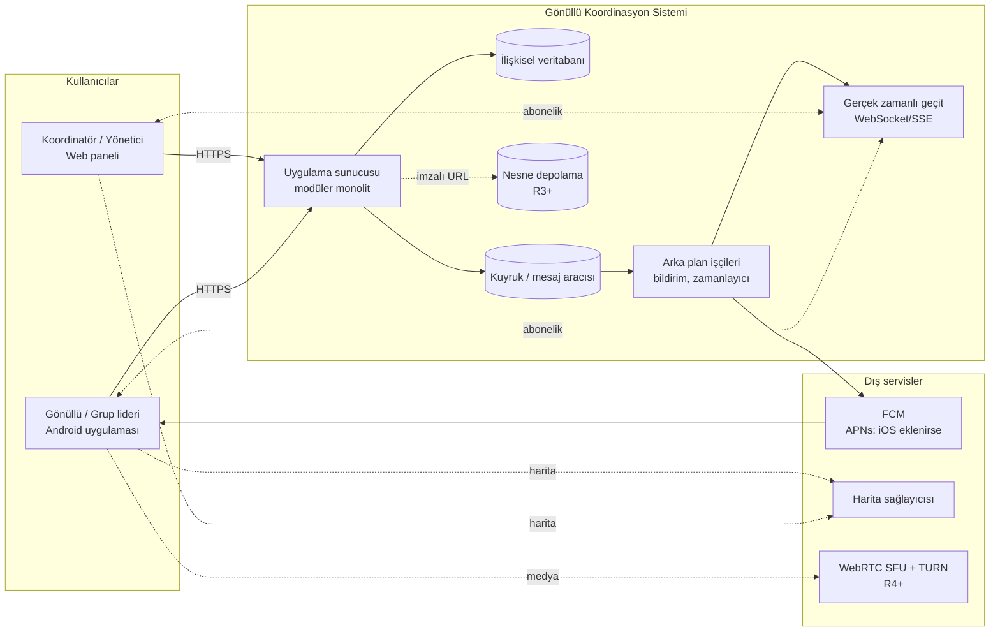
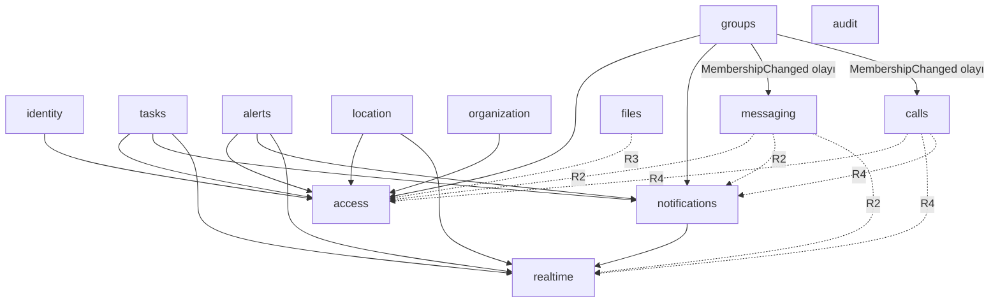

# Mimari Genel Bakış

| Alan | Bilgi |
|---|---|
| Sürüm | 1.0, onaylı mimari (MVP) |
| Tarih | 14.11.2026 |
| Dayanak | `docs/analysis/*` (gereksinim analizi) ve genişleme talebi (§2) |
| Durum | **Kabul edildi.** ADR-001 – ADR-012 onaylandı (`decisions.md`). Gereksinim kararları K-01 – K-33 kesinleşti, açık konular VS-01 – VS-23 ile çözüldü (`docs/analysis/decision-log.md`). Teknoloji yığını ADR-008'dir; ekibin dil bilgisine dair varsayıma (VS-09) dayanır. |

### Kesinleşen kararların mimariye etkisi

| Karar | Mimari sonuç |
|---|---|
| K-01, K-04 | Gerçek kişisel veri yok. Veri yerleşimi, KVKK aktarım kısıtı ve kurumsal barındırma MVP mimarisinin kısıtı değil. Ancak gizlilik tasarım ilkeleri (yetki, konum kapsamı, EXIF temizliği) **korunur**, çünkü kaynak belgenin gereksinimleri. Sentetik veri üretimi test altyapısının bir parçası. |
| K-02 | 500 kullanıcı ve 5 operasyon için **tek API örneği, tek işçi süreci ve aynı süreçte gerçek zamanlı geçit** yeterli. Pub/sub arka kanalı, okuma kopyası ve ayrı mesaj aracısı MVP'de gerekmez (§6). ADR-001'in gerekçesini güçlendirir. |
| K-03 | Push yalnızca **FCM**. APNs, iOS Critical Alerts ve CallKit MVP'de yok. Alarm ve konum riskleri nedeniyle Android yerel Kotlin ile geliştirilir (ADR-008); iOS kararı VS-13'te yeniden değerlendirilir. |
| K-05 | Karmaşıklık bütçesi sınırlı. Gerçek zamanlı taşıma olarak WebSocket yerine SSE (ADR-009); ayrı mesaj aracısı yok (ADR-004); tek komutla kurulan Docker Compose ortamı (ADR-008). Yoklama yedeği korunur (`mvp-scope.md` §6). |
| K-07, K-09, K-15 | Operasyonel işlemler yalnızca operasyon kapsamındaki KOR rolüyle yapılır; alarm, konum ve kurum geneli duyuru grup rolünden türemez (`authorization.md` §4). |
| K-12, K-13, K-14, K-16, K-17 | Görev kapasitesi, sınırlı hatırlatma (2 dk × 5), kullanıcının başlattığı ön plan servisiyle konum (ADR-011), yalnızca son konum ve yalnızca aktif operasyonda alarm (`domain-model.md`, `communication.md`). |

## Doküman dizini

| Dosya | Konu |
|---|---|
| `README.md` | Hedefler, sürüm haritası, modüller, dağıtım, MVP'de yapılan ve yapılmayan hazırlıklar |
| `domain-model.md` | Kullanıcı-grup ilişkileri, üyelik yaşam döngüsü, grup türleri, varlıklar (MVP ve gelecek alanları) |
| `authorization.md` | Yetkilendirme modeli: kurum rolleri, grup üyelik rolleri, grup politikaları, izin kataloğu |
| `communication.md` | Bildirim sistemi, gerçek zamanlı iletişim, mesajlaşma, dosya paylaşımı, sesli ve görüntülü görüşme |
| `decisions.md` | Mimari karar kayıtları (ADR) |
| `design/` | **Sistem tasarımı** (kabul edildi): `system-architecture.md` (bileşenler, modüller, TD-01 – TD-22), `emergency-alert-design.md`, `technical-risks-validation.md`, `design-review.md`, `api-and-data-design-basis.md` (sonraki aşama girdileri) |
| `diagrams/` | UML diyagramları (Mermaid): use case, activity, sequence, component, deployment, ERD. Dizin: `diagrams/README.md` |
| `ui-flows/` | Ekranlar ve kullanıcı akışları: `android-flows.md` (AND-01 – AND-12), `web-flows.md` (WEB-01 – WEB-12) |
| `../analysis/decision-log.md` | Gereksinim kararları (K-01 – K-33), varsayımlar (VS-01 – VS-23), parametre değerleri |

---

## 1. Mimari hedefler ve ilkeler

### 1.1 Hedefler (öncelik sırasıyla)
1. **MVP'yi büyütmeden genişleyebilirlik.** Gelecek özellikler için *genişleme noktası* tanımlanır; özelliğin kendisi inşa edilmez.
2. **Acil iletişimin güvenilirliği.** Sohbet, dosya ve görüşme trafiği hiçbir koşulda acil alarmı geciktirmemeli.
3. **Yetkinin tek yerden denetlenmesi.** Yeni özellik eklendiğinde yetki kontrolü dağınık `if rol == ...` kontrolleriyle değil, merkezi politika ile genişler.
4. **Gizlilik varsayılanı.** Yeni iletişim kanalları (sohbet, dosya, görüşme) konum ve kişisel veri erişimini dolaylı yoldan genişletmemeli.
5. **Ekip ölçeğine uygunluk.** Öğrenci ekibinin işletebileceği karmaşıklıkta kalmalı (RP-05).

### 1.2 İlkeler
- **P1 – Erken soyutla, geç inşa et.** Gelecekteki her özellik için (a) veri modelinde nereye bağlanacağı, (b) yetki kataloğunda hangi izinle yönetileceği ve (c) hangi olaydan besleneceği MVP'de belirlenir. Tablolar, servisler ve ekranlar ise o sürümde yapılır.
- **P2 – Kritik ve genel trafik ayrımı.** Alarm (KRİTİK) ve sohbet (DÜŞÜK) aynı bildirim hattını kullanır ama ayrı kuyruk ve önceliklerle işlenir (ADR-004).
- **P3 – Kritik yetkiler grup üyeliğinden türemez.** Acil alarm gönderme, konum görme ve kurum geneline duyuru yalnızca kurum rolü ve operasyon kapsamından gelir. Kullanıcıların kurduğu bir grupta "yönetici" olmak bu yetkileri vermez (bkz. `authorization.md` §4).
- **P4 – Grup ve konuşma ayrıdır.** Grup bir *üyelik* kavramıdır. Konuşma (mesajlaşma) bir *iletişim kanalıdır*. Bir grubun konuşması olabilir; her konuşmanın grubu olmak zorunda değildir (ileride bire bir sohbet için) (ADR-003).
- **P5 – Olay odaklı genişleme.** Modüller birbirini doğrudan çağırmak yerine alan olaylarına (ör. `MembershipChanged`) abone olur. Gelecekteki mesajlaşma modülü mevcut kodu değiştirmeden üyelik olaylarını dinler.
- **P6 – Medyayı kendimiz işlemeyiz.** Ses ve görüntü için hazır WebRTC/SFU altyapısı kullanılır. Dosyalar uygulama sunucusundan değil, nesne depolamadan servis edilir (ADR-006, ADR-007).

---

## 2. Sürüm haritası

İlk sürüm (MVP) kapsamı `docs/analysis/mvp-scope.md` ile aynıdır ve **genişlemeyle büyütülmedi.** Talep edilen yeni özelliklerin bir kısmı zaten MVP'de vardı. Bunlar aşağıda "MVP'de mevcut" olarak işaretlendi.

| Özellik | MVP (R1) | R2 | R3 | R4 | R5 |
|---|---|---|---|---|---|
| **Grup oluşturma** | Koordinatör, operasyon grubu oluşturur (FR-04) | – | **Kullanıcıların grup oluşturması** (topluluk grubu) | – | – |
| **Gruba katılma** | Yalnızca yetkili kişinin eklemesi/ataması | **Katılma talebi + onay**, davet bağlantısı | Açık katılım (topluluk grupları) | – | – |
| **Üye yönetimi** | Koordinatör ekler/çıkarır, lider atar (FR-04) | Grup içi roller (yönetici/moderatör/üye), toplu işlemler | Grup sahibi devri | – | – |
| **Grup içi yazılı mesajlaşma** | Yok | **Metin sohbeti** (FR-05), okundu bilgisi, sessize alma | Yanıtlama, düzenleme/silme, bire bir sohbet (Q-20) | – | – |
| **Fotoğraf, belge, dosya** | Yok | – | **Ek paylaşımı** (fotoğraf, PDF, ofis belgeleri) | Görev ve operasyon ekleri | – |
| **Grup sesli görüşme** | Yok | – | – | **Sesli görüşme** | – |
| **Görüntülü görüşme** | Yok | – | – | – | **Görüntülü görüşme** |
| **Grup bazlı duyuru** | **MVP'de mevcut** (FR-06, Z) | Bildirim tercihleri, zamanlanmış duyuru | Grup yöneticisinin kendi grubuna duyurusu (politikayla) | – | – |
| **Gruplara özel acil bildirim** | **MVP'de mevcut** (FR-13, Z): gruba hedefli alarm | Grup bazlı alarm şablonu, yanıt seçenekleri ve otomatik eskalasyon (FR-17) | Yetkinlik veya bölge bazlı hedefleme; SMS/arama yedek kanalı (ayrı karar, kurum onayı) | – | – |

> **Not:** "Grup bazlı duyuru" ve "gruplara özel acil bildirim" orijinal belgede ilk sürüm için zorunlu (Z). Bunları MVP'den çıkarmadım. Gelecek sürümlere yalnızca genişletilmiş biçimleri kaldı.
>
> **Sürüm sıralaması bir öneridir.** Gerekçe: her sürüm bir öncekinin altyapısını kullanır. Sohbet, gerçek zamanlı kanalı ve üyelik olaylarını kullanır. Dosyalar sohbeti, görüşmeler hem gerçek zamanlı kanalı hem grup politikalarını kullanır. Bu yüzden sohbet önce gelir.

---

## 3. Sistem bağlamı

Kesik çizgiler MVP'de kısmen bulunan veya gelecekte eklenecek bağlantılardır: nesne depolama R3'te, SFU R4'te gelir.

---

## 4. Mimari stil: modüler monolit

**Karar (ADR-001):** Tek dağıtılabilir uygulama sunucusu. İçinde sınırları net modüller bulunur. Arka plan işçileri aynı kod tabanından ayrı süreçler olarak çalışır.

Mikroservis seçilmedi, çünkü ekip ölçeği, MVP süresi ve işletim yükü buna uygun değil. Modül sınırları, gerektiğinde (ör. gerçek zamanlı geçidin veya medya bileşeninin) ayrılabilecek şekilde çizilir.

### 4.1 Modüller

| Modül | Sorumluluk | MVP | Gelecek |
|---|---|---|---|
| **identity** | Hesap, davet, oturum, MFA, cihaz/push token | ✅ | SSO (R3+) |
| **access** (yetkilendirme) | Rol atamaları, izin kataloğu, `can()` politika motoru | ✅ | Grup üyelik rollerinden ve grup politikalarından izin türetme (R2+) |
| **organization** | Kurum, operasyon ve yaşam döngüsü | ✅ | – |
| **groups** | Grup, üyelik, toplanma noktası | ✅ (operasyon grupları) | Katılma talebi (R2), topluluk grupları (R3) |
| **tasks** | Görev, atama, durum makinesi | ✅ | Ekler (R4) |
| **location** | Konum alımı, güncellik, operasyon kapsamı | ✅ | – |
| **alerts** | Acil alarm, alıcı durumu, hatırlatma, iptal | ✅ | Şablonlar, otomatik eskalasyon (R2) |
| **notifications** | Hedef kitle çözümleme, teslim kaydı, kanal adaptörleri, öncelik kuyrukları | ✅ | Tercihler, sessize alma, toplu özet (R2) |
| **realtime** | Konu tabanlı abonelik, yetkili yayın | ✅ (asgari) | Sohbet trafiği, varlık (presence), yazıyor göstergesi (R2) |
| **audit** | Denetim kaydı | ✅ | – |
| **messaging** | Konuşma, mesaj, okundu imleci | ❌ | R2 |
| **files** | Ek meta verisi, yükleme, tarama, imzalı erişim | ❌ | R3 |
| **calls** | Görüşme oturumu, SFU erişim belirteci | ❌ | R4 (ses), R5 (görüntü) |

### 4.2 Modül bağımlılık kuralları
1. Modüller birbirinin veritabanı tablosuna doğrudan erişmez. Erişim modülün açık arayüzü veya alan olayları üzerinden olur.
2. Her modül yetki kontrolünü `access.can(subject, action, resource)` üzerinden yapar (ADR-002).
3. Bildirim gönderen her modül (alerts, tasks, groups, gelecekte messaging ve calls) `notifications` modülüne bir **bildirim isteği** bırakır. Push servisini doğrudan çağırmaz (ADR-004).
4. Anlık güncelleme gerektiren her modül `realtime` modülüne bir **konu olayı** yayınlar. Bağlantı yönetimini kendisi yapmaz (ADR-005).
5. Alan olayları aynı veritabanı işlemi içinde **outbox** tablosuna yazılır ve işçi tarafından dağıtılır. Böylece "kayıt oluştu ama bildirim gitmedi" durumu oluşmaz (NFR-06).

---

## 5. MVP'de yapılan ve yapılmayan genişleme hazırlıkları

MVP'nin büyümemesi için **yalnızca MVP'nin zaten ihtiyaç duyduğu** veya maliyeti çok düşük olan hazırlıklar yapılır.

### 5.1 MVP'de yapılanlar

| # | Hazırlık | Neden MVP'de | Ek maliyet | Gelecekteki karşılığı |
|---|---|---|---|---|
| HZ-1 | Üyelik ayrı bir varlık: `GroupMembership(role, status)` | FR-04 ve lider ataması bunu zaten gerektiriyor | Çok düşük | Katılma talebi, grup içi roller |
| HZ-2 | Grupta `type` ve `join_policy` alanları (MVP'de tek değer: `OPERATIONAL`, `MANAGED`) | Tek sütun | Çok düşük | Topluluk grupları, açık/talepli katılım |
| HZ-3 | Merkezi `can()` ve izin adlarıyla yetki kontrolü | NFR-02 ve US-28 bunu zaten gerektiriyor | Yok (yalnızca yaklaşım farkı) | Grup politikaları, yeni izinler |
| HZ-4 | Bildirim hattı: hedef kitle anlık görüntüsü, alıcı bazlı teslim kaydı, öncelik sınıfı | Alarm ve FR-18 bunu zaten gerektiriyor | Yok | Sohbet bildirimleri, tercihler, yeni kanallar |
| HZ-5 | Hedef kitle ifadesi (`user`, `group`, `operation`) | FR-06 ve FR-13 zaten gerektiriyor | Yok | Rol, yetkinlik veya bölge hedefleme |
| HZ-6 | Outbox ile alan olayları | NFR-06 (güvenilir bildirim) | Düşük | Mesajlaşma ve görüşme modüllerinin üyelik olaylarını dinlemesi |
| HZ-7 | Gerçek zamanlı geçit: konu tabanlı, abonelikte yetki denetimi | AC-14.2 ve AC-22.2 (koordinatör panelinin anlık güncellenmesi) | Düşük | Sohbet, presence, görüşme sinyalleşmesi |
| HZ-8 | API sürümleme (`/v1`) ve sıralanabilir ID'ler (ör. ULID/UUIDv7) | Genel iyi pratik | Yok | Mesaj sıralama, imleçli sayfalama |
| HZ-9 | Bildirim sınıfları için mobil kanallar baştan ayrı (alarm / görev / genel) | FR-14 zaten gerektiriyor | Yok | "Sohbet" kanalı eklenir. Kullanıcı sohbeti sessize alır ama alarmı almaya devam eder |

### 5.2 MVP'de bilinçli olarak yapılmayanlar
- Konuşma, mesaj ve ek tabloları, nesne depolama, SFU/TURN altyapısı.
- Grup içi rol yönetimi ekranı, katılma talebi akışı, topluluk grupları.
- Kullanıcı bildirim tercihleri ekranı.
- Mesaj aracısı olarak ayrı bir altyapı (ör. Kafka). MVP'de veritabanı tabanlı kuyruk veya hafif bir kuyruk yeterli (§8).
- "İleride lazım olur" diye boş tablo, kullanılmayan uç nokta veya özellik bayrağı.

---

## 6. Dağıtım görünümü

| Bileşen | MVP | Gelecek |
|---|---|---|
| Uygulama sunucusu (API) | 1 örnek, durumsuz (Spring Boot, Docker Compose) | Yatay ölçek |
| Arka plan işçisi | Aynı uygulamada ayrı iş parçacığı havuzları; `CRITICAL` havuzu ayrılmış | Ayrı süreç; kuyruk başına işçi havuzu |
| Gerçek zamanlı geçit | API ile aynı süreçte, SSE (ADR-009) | WebSocket (R2), ayrı süreç ve pub/sub arka kanalı |
| Veritabanı | PostgreSQL 16, tek birincil, günlük yedek (RPO 24 sa / RTO 4 sa) | Okuma kopyası. Mesaj tabloları için bölümleme |
| Kuyruk | PostgreSQL tablosu + `SKIP LOCKED`; outbox: Spring Modulith olay kaydı | Gerekirse ayrı mesaj aracısı |
| Nesne depolama | – | R3: S3 uyumlu (demoda MinIO). Prototipte veri sentetik (K-04) |
| Medya | – | R4: SFU + TURN (barındırılan veya kendi kurulumumuz, ADR-006) |
| Gözlemlenebilirlik | Yapısal log, Spring Boot Actuator sağlık ve metrik uçları, `CRITICAL` kuyruk bekleme uyarısı (> 30 sn) | İzleme panoları, SLO uyarıları |
| Ters vekil ve TLS | Caddy (demo), TLS ≥ 1.2 | – |
| Yardımcı servisler | Mailpit (davet e-postalarını yakalar), Firebase projesi (FCM) | – |

**Boyutlandırma (K-02, VS-02, VS-03):** MVP sütunu 500 kayıtlı kullanıcı, 150 eşzamanlı oturum, 5 eşzamanlı aktif operasyon ve 500 alıcılı alarm için yeterli kabul edilir; Hafta 12'de k6 yük testiyle doğrulanır. Demo ortamı: Docker Compose ile tek makine veya tek sanal sunucu (VS-11). "Gelecek" sütunu yalnızca bu hacim aşılırsa devreye girer.

**Kritik izolasyon kuralı (MVP'den itibaren):** Alarm bildirimleri ayrı bir öncelik kuyruğunda işlenir. Sohbet geldiğinde (R2) onun hacmi bu kuyruğu tüketemez (P2, RT-16).

---

## 7. Kalite nitelikleri ve mimari yanıtları

| Nitelik | Mimari yanıt | Doküman |
|---|---|---|
| Güvenilir bildirim (NFR-06) | Outbox, idempotent bildirim isteği, alıcı bazlı teslim kaydı, yeniden deneme | `communication.md` §1 |
| Yetkilendirme (NFR-02) | Merkezi `can()`, varsayılan red, abonelikte ve dosya erişiminde de denetim | `authorization.md` |
| Gizlilik (NFR-15) | Kritik yetkiler grup üyeliğinden türemez; fotoğraflardan konum meta verisi silinir | `authorization.md` §4, `communication.md` §4 |
| Ölçek (NFR-12) | Durumsuz API, ayrılabilir gerçek zamanlı geçit, mesajlarda imleçli sayfalama | `communication.md` §2–3 |
| Genişleyebilirlik | Modül sınırları, olaylar, izin kataloğu, grup türleri | Bu dosya §4–5 |

---

## 8. Teknoloji yığını (ADR-008, kabul edildi)

Ayrıntı, gerekçe ve reddedilen seçenekler `decisions.md` ADR-008 – ADR-012'de. Özet:

| Katman | Seçim |
|---|---|
| Backend | Java 21, Spring Boot 4.1.x, Spring Modulith 2.1.x, Spring Security, Spring Data JPA, Flyway |
| Veritabanı ve kuyruk | PostgreSQL 16; outbox için Spring Modulith olay kaydı; teslim kuyruğu `SKIP LOCKED` |
| API | REST + OpenAPI 3 (springdoc), tek sözleşme kaynağı (ADR-010) |
| Gerçek zamanlı | SSE (ADR-009); R2'de WebSocket |
| Push | Firebase Cloud Messaging |
| Kimlik | JWT erişim + iptal edilebilir yenileme belirteci, TOTP (ADR-012) |
| Android | Kotlin, Jetpack Compose (Material 3), Retrofit/OkHttp, WorkManager, Fused Location Provider, ön plan servisi (ADR-011), MapLibre + OSM |
| Web | TypeScript, React, Vite, MUI, TanStack Query, Leaflet + OSM |
| Test | JUnit 5, Testcontainers, Spring Modulith testleri, Vitest, Playwright, Compose UI test, k6 |
| Sentetik veri | Datafaker (Türkçe), sabit tohumlu üretici |
| Ortam | Docker Compose, Caddy, Mailpit, GitHub Actions *(depo konumu varsayım)* |

### 8.1 Modüllerin teknolojiye eşlenmesi

§4.1'deki her modül bir Spring Modulith uygulama modülüdür (ayrı Java paketi). Modüller arası çağrılar yalnızca açık arayüzler ve uygulama olaylarıyla yapılır. Modül sınırları CI'da doğrulanır. Android ve web istemcileri backend'e yalnızca OpenAPI sözleşmesindeki REST uçları, SSE akışı (web) ve FCM (Android) üzerinden bağlanır.

### 8.2 Ertelenen teknik seçimler

| Karar | Sürüm | Not |
|---|---|---|
| WebSocket protokol ayrıntısı (ör. STOMP) | R2 | Sohbetle birlikte |
| SFU ürünü | R4 | ADR-006 |
| Nesne depolama sağlayıcısı | R3 | ADR-007 |
| iOS teknolojisi | VS-13 | Yerel Swift veya çapraz platform |
