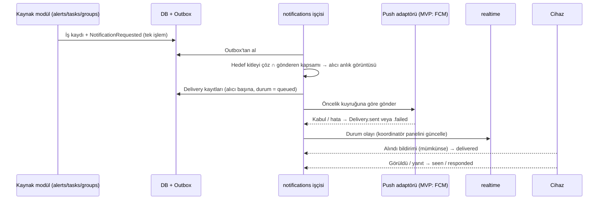
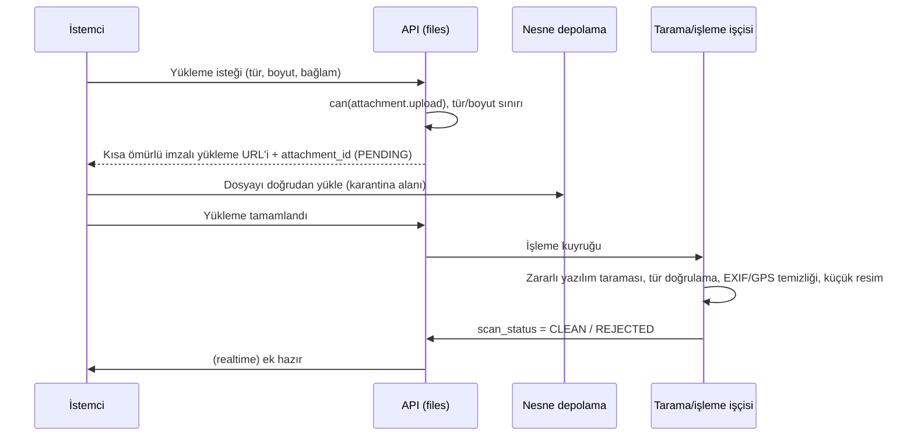
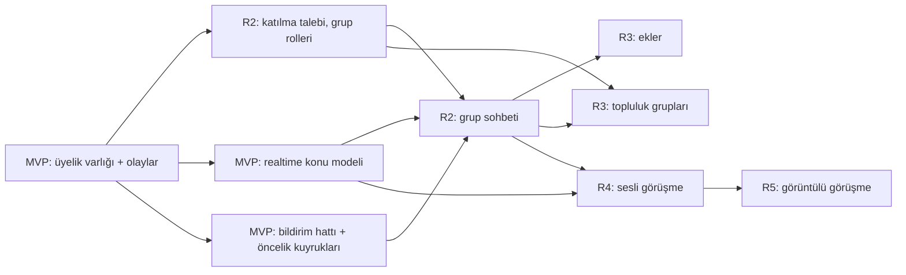

# İletişim Altyapısı: Bildirim, Gerçek Zamanlı İletişim, Mesajlaşma, Dosya ve Görüşme

> **Durum: Kabul edildi** (ADR-004, ADR-005, ADR-009; TD-08, TD-10, TD-13, TD-18, TD-21; DR-01). Her bölüm **MVP'de ne var** ve **gelecekte ne eklenecek** diye ayrıldı. MVP'de olmayan bileşenler inşa edilmez; yalnızca bağlanma noktaları ve kısıtları tanımlandı. Parametre değerleri: `docs/analysis/decision-log.md` §5.

| Bölüm | MVP | Sürüm |
|---|---|---|
| §1 Bildirim sistemi | **Var:** alarm, görev, duyuru, toplanma noktası | Tercihler R2, yeni kanallar R3+ |
| §2 Gerçek zamanlı iletişim | **Asgari:** web paneli için anlık durum | Sohbet ve presence R2, görüşme sinyalleşmesi R4 |
| §3 Mesajlaşma | Yok | R2 |
| §4 Dosya paylaşımı | Yok | R3 |
| §5 Sesli ve görüntülü görüşme | Yok | Ses R4, görüntü R5 |

---

## 1. Bildirim sistemi (MVP'nin çekirdeği)

### 1.1 Akış

**Kanallar (K-03):** MVP'de push yalnızca FCM (Android) üzerinden, uygulama içi bildirim ise web ve Android için gider. APNs adaptörü iOS eklenirse aynı kanal adaptörü arayüzüyle eklenir (§1.4). Hacim 500 kullanıcıyla sınırlı (K-02), bu yüzden tek işçi süreci ve ayrılmış `CRITICAL` kuyruğu yeterli.

**Uygulama (ADR-008):** Outbox, Spring Modulith olay yayın kaydı ile; teslim kuyruğu PostgreSQL tablosu ve `SKIP LOCKED` ile; `CRITICAL` ayrı işçi havuzunda. FCM gönderimi Firebase Admin SDK ile. Android uygulaması alarm, görev ve genel bildirimler için ayrı bildirim kanalları tanımlar (HZ-9).

### 1.2 Öncelik sınıfları ve izolasyon

| Öncelik | Kategoriler | Kuyruk | Mobil kanal | Kullanıcı tercihiyle kapatılabilir mi? | S |
|---|---|---|---|---|---|
| `CRITICAL` | Acil alarm, alarm iptali | **Ayrılmış kuyruk ve işçi** | Alarm kanalı (yüksek önem, özel ses) | **Hayır** | MVP |
| `HIGH` | Görev ataması, toplanma noktası değişikliği | Normal kuyruk, öncelikli | Görev kanalı | Hayır (MVP), R2'de kurum kararına bağlı | MVP |
| `NORMAL` | Duyuru, katılma talebi sonucu | Normal kuyruk | Genel kanal | R2: evet | MVP |
| `LOW` | Sohbet mesajı | Toplu kuyruk (birleştirme ve sınırlama) | Sohbet kanalı | Evet (grup sessize alma) | R2 |
| `CALL` | Gelen görüşme | Ayrı ve kısa ömürlü | Arama kanalı / platform arama arayüzü | Evet | R4 |

**Kural:** Sohbet veya görüşme trafiği ne kadar artarsa artsın `CRITICAL` kuyruğu ayrı işlenir ve hız sınırına takılmaz. Bu kural MVP'den itibaren yerleşir, çünkü sonradan eklemek bildirim hattının yeniden yazılmasını gerektirir.

### 1.3 Güvenilirlik (NFR-06)
- **Outbox:** Bildirim isteği iş kaydıyla aynı veritabanı işleminde yazılır.
- **Idempotency:** `idempotency_key`, aynı isteğin tekrarında ikinci bildirim oluşmasını önler (AC-20.5). Push gönderiminde de alıcı ve bildirim başına tek gönderim garanti edilir; yeniden denemeler aynı kaydı günceller.
- **Yeniden deneme:** Geçici hatalarda üstel bekleme ile 3 deneme yapılır (VS-14). Kalıcı hatada (ör. geçersiz token) cihaz kaydı pasifleşir ve alıcı "Gönderilemedi" olarak işaretlenir.
- **Hatırlatmalar (K-13):** Yanıtsız alarm hatırlatmaları zamanlayıcı tarafından 2 dk aralıkla, en fazla 5 kez tetiklenir ve aynı hat üzerinden gönderilir. Yanıt gelince durur; sonra alıcı "Yanıtsız" olur. Otomatik eskalasyon R2. Alarm yalnızca aktif operasyonda oluşturulabilir (K-17).
- **Sağlık kontrolü:** `CRITICAL` kuyruğunda bekleme süresi 30 sn'yi aşarsa teknik yöneticiye uyarı gider ve sağlık ucu "bozulmuş" döner (GAP-11, VS-14).

### 1.4 Genişleme noktaları
| Genişleme | Nasıl eklenir | S |
|---|---|---|
| Yeni kategori (sohbet, katılma talebi, görüşme) | Kategori ve varsayılan öncelik eklenir; kaynak modül `NotificationRequested` üretir | R2+ |
| Kullanıcı tercihleri | Hedef kitle çözümünden sonra, `CRITICAL` hariç, tercih filtresi uygulanır | R2 |
| Toplu özet (digest) | `LOW` kuyruğunda aynı konuşmanın bildirimleri birleştirilir | R2 |
| Grup bazlı alarm şablonları | `Alert` oluşturulurken şablondan mesaj, yanıt seçenekleri ve hatırlatma politikası doldurulur | R2 |
| Otomatik eskalasyon (FR-17) | Zamanlayıcı, süre dolunca yanıtsızlar için yeni bir `HIGH`/`CRITICAL` bildirim isteği üretir | R2 |
| Yeni kanal (SMS, e-posta, sesli arama) | Kanal adaptörü arayüzü: `send(delivery) → result`. Hedef kitle, kayıt ve durum mantığı değişmez | R3+ (ayrı karar, §2.2 kurum onayı) |
| Yeni hedefleme (yetkinlik, bölge) | `audience_expr` tipine eklenir (`domain-model.md` §5) | R3+ |

### 1.5 FCM mesaj sözleşmesi ve Android gösterim kuralları (TD-08, TD-10, TD-18, TD-21, DR-01)

Tüm mesajlar **data** mesajıdır; bildirimi uygulama kendisi çizer. Mesajda yalnızca kimlikler ve kısa metin bulunur; ayrıntılar REST ile alınır.

| `type` | Öncelik (FCM) | `collapse_key` | TTL | Android kanalı | Cihazdaki davranış |
|---|---|---|---|---|---|
| `ALERT` | yüksek | `alert:{id}` | 60 dk | `alarm` | Durumu sunucudan doğrula (TD-10) → alındı bilgisi → ön plandaysa tam ekran, değilse yüksek önemli ve kaydırılamayan bildirim + yanıt eylem düğmeleri (TD-21) |
| `ALERT_REMINDER` | yüksek | `alert:{id}` | 60 dk | `alarm` | Aynı bildirimi günceller ve sesi tekrar çalar; yanıtlanmışsa yok sayılır |
| `ALERT_CANCELLED` | yüksek | `alert:{id}` | 60 dk | `alarm` | Aynı bildirimi "ALARM İPTAL EDİLDİ" ile değiştirir; açık alarm ekranını iptal durumuna geçirir |
| `ALERT_CLOSED` | yüksek | `alert:{id}` | 60 dk | `alarm` (**sessiz güncelleme**, LD-09) | Aynı bildirimi sessizce "Alarm kapatıldı" olarak günceller ve yanıt düğmelerini kaldırır. `genel` kanal kapalı olsa bile eski alarm bildirimi ekranda kalmaz |
| `TASK` | yüksek | `task:{id}` | 24 sa | `gorev` | Görev bildirimi; dokununca AND-05 |
| `MEETING_POINT` | yüksek | `group:{id}:mp` | 24 sa | `gorev` | Toplanma noktası güncellendi; dokununca AND-06 |
| `ANNOUNCEMENT` | normal | – | 24 sa | `genel` | Duyuru; gelen kutusuna (AND-09) |
| `OPERATION_INVITE` | normal | `invite:{id}` | 72 sa | `genel` | Operasyon daveti (TD-01); dokununca AND-03'teki davet kartı |
| `LOCATION_STOP` | yüksek | `loc:{operation}` | 10 dk | – (görünür bildirim yok; servis bildirimi güncellenir) | Konum ön plan servisini durdurur (TD-18) |
| `SESSION_REVOKED` | yüksek | `session` | 10 dk | – | *İsteğe bağlı hızlandırma:* yerel belirteçleri siler, AND-01'e döner. Oturum iptali buna bağlı değildir; sunucu tarafı iptal (FR-22) zaten yeterlidir |

**Android gösterim sınırları (DR-01, kesin):**
- Uygulama **ön plandayken** alarm tam ekran açılır (AND-08).
- Uygulama **arka plandayken veya ekran kilitliyken** `alarm` kanalında yüksek öncelikli bildirim gösterilir; kullanıcı dokununca alarm ekranı açılır.
- Uygulama kilit ekranında **kendiliğinden tam ekran açmaz** (full-screen intent kullanılmaz; US-42, R3).
- Rahatsız Etmeyin, sessiz mod veya kullanıcının kapattığı bildirim izni **aşılmaya çalışılmaz.** Kanalın DND istisnası ve sesi kullanıcının ayarındadır (G-01, G-02).
- Yüksek öncelikli FCM mesajı her zaman görünür bir bildirimle sonuçlanır. Böylece Android'in yüksek öncelik kotasını düşürme riski azalır (`LOCATION_STOP` ve `SESSION_REVOKED` istisnadır; seyrek gönderilirler).
- **Kanal sesi bildirim ses akışını kullanır** (`AudioAttributes.USAGE_NOTIFICATION` sınıfı). `USAGE_ALARM` kullanılmaz, çünkü birçok cihazda sessiz modu aşar ve DR-01'e aykırıdır (LD-08).
- **Kilit ekranı görünürlüğü:** alarm bildirimi kilit ekranında başlık ve kısa metinle görünür (herkese açık görünürlük). Metin kısa tutulur ve kişisel veri içermez (LD-12).
- **Sıra garantisi yok (LD-32):** FCM mesajların geliş sırasını garanti etmez. Cihaz her mesajı bağımsız işler; kesin durum REST'ten okunur (TD-10). İptal edilmiş veya kapanmış bir alarm, sonradan gelen bir hatırlatmayla yeniden açılmaz.
- **`collapse_key` biçimi** bu tablodaki `tür:{kimlik}` biçimidir (ör. `alert:{id}`); diğer dokümanlardaki `alert_id` ifadeleri bunu kasteder (LD-14).

**Teslim denemeleri:** Hatırlatmalar yeni bildirim kaydı değil, aynı `ALERT` bildiriminin `DELIVERY.attempt = 1..5` denemeleridir; elle yeniden gönderim aynı bildirimde yeni bir tur (`DELIVERY.round`) açar ve hatırlatmalar o turda sürer (LD-43). İptal ve kapanış ayrı bildirim kayıtlarıdır (`domain-model.md` §2).

### 1.6 Uygulama içi gelen kutusu (TD-13)

Her bildirim için bir `IN_APP` teslim kaydı oluşur. Android'deki Bildirimler ekranı (AND-09) bu kayıtları listeler; okununca `read_at` dolar. Bildirim tercihleri ve sessize alma R2'dedir (FX-08).

---

## 2. Gerçek zamanlı iletişim

### 2.1 MVP ihtiyacı
- Koordinatör panelinde görev yanıtlarının 10 sn, alarm yanıtlarının 5 sn içinde görünmesi (AC-14.2, AC-22.2).
- Konum görünümünün güncellenmesi.
- **Mobilde alarm iletimi için gerçek zamanlı bağlantıya güvenilmez.** Uygulama arka plandayken veya kapalıyken bağlantı yoktur. Alarmın birincil yolu her zaman push'tur. Uygulama açıkken gerçek zamanlı kanal yalnızca ek hız sağlar.

### 2.2 Tasarım: konu tabanlı yayın

| Konu | Örnek olaylar | Abonelik yetkisi | S |
|---|---|---|---|
| `user:{id}` | Kişiye özel bildirim, oturum iptali | Yalnızca kendisi | MVP |
| `operation:{id}` | Görev durumu, alarm alıcı durumu, konum güncellemesi | `operation` kapsamında KOR/ADM | MVP |
| `alert:{id}` | Alıcı durum değişiklikleri | `alert.view` | MVP |
| `group:{id}` | Üyelik değişikliği, toplanma noktası | Aktif üyelik veya K1 kapsamı | MVP (asgari) |
| `conversation:{id}` | Yeni mesaj, düzenleme, yazıyor göstergesi, okundu | `conversation.read` | R2 |
| `presence:group:{id}` | Çevrimiçi üyeler | Aktif üyelik | R2 (isteğe bağlı, gizlilik kararı gerektirir) |
| `call:{id}` | Görüşme başladı/bitti, katılımcılar | `call.join` | R4 |

**Kurallar**
- **RT-K1:** Abonelik başında `can()` çalışır. `MembershipChanged` veya rol değişikliğinde ilgili abonelikler sunucu tarafından kapatılır.
- **RT-K2:** Gerçek zamanlı kanal **doğruluk kaynağı değildir.** İstemci yeniden bağlandığında kaçırdığı veriyi REST üzerinden imleçle (`seq`, `updated_since`) çeker. Kaçırılan bir olay veri kaybına yol açmaz.
- **RT-K3:** Olay yükü asgari tutulur (ID ve durum). Hassas içerik (konum koordinatı, mesaj içeriği) ancak abonelik yetkisi olan konuda gönderilir.
- **RT-K4 (ADR-009):** MVP'de taşıma **SSE**'dir (yalnızca web paneli). Android gerçek zamanlı bağlantı tutmaz; FCM + uygulama açılışında REST ile güncellenir. R2'de sohbet için WebSocket eklenir. Çok örnekli dağıtımda örnekler arası yayın için pub/sub arka kanalı (ör. Redis) eklenir; MVP'de tek örnek yeterli (K-02).
- **RT-K5 (yedek):** Kapı KP2'de SSE sorun çıkarırsa web paneli 5 sn'lik yoklama (polling) ile çalışır. Konu modeli ve REST imleçleri aynı kalır (`mvp-scope.md` §6).

### 2.3 Çevrimdışı davranış (K-24, MVP)
- Android, bağlantı kesildiğinde 10 sn içinde çevrimdışı göstergesi ve son senkronizasyon zamanını gösterir.
- **Yalnızca alarm yanıtı** yerel olarak saklanır ve bağlantı gelince WorkManager ile otomatik yeniden gönderilir. Yanıt istemci tarafından üretilen idempotency anahtarı taşır; sunucu tekrarları tek yanıt olarak kaydeder. Yanıt zamanı olarak cihazın yanıt zamanı ve sunucunun alış zamanı birlikte saklanır.
- Diğer işlemler "gönderilemedi" olarak işaretlenir ve kullanıcı tarafından elle tekrarlanır. Genel çevrimdışı kuyruk R2.

---

## 3. Mesajlaşma *(R2)*

### 3.1 Kapsam
- **R2:** Grup konuşması (her grup için en fazla bir tane), metin mesajı, sistem mesajı, okundu imleci, konuşmayı sessize alma, kendi mesajını silme.
- **R3:** Yanıtlama, düzenleme, moderatör silmesi, bire bir sohbet (K-22), ek (§4).
- **Kapsam dışı (K-29):** Uçtan uca şifreleme ilk sürümde yok. Denetim, saklama ve moderasyon yükümlülükleriyle çelişir ve karmaşıklığı yüksektir. Aktarım şifrelemesi (TLS ≥ 1.2) her zaman vardır.

### 3.2 Gönderim akışı
1. İstemci `client_message_id` üretir ve mesajı REST (veya WebSocket) ile gönderir.
2. Sunucu `can(message.send)` kontrolü yapar ve `seq` ataması ile mesajı kaydeder. Mesaj kaydı ve outbox olayı aynı işlemdedir.
3. `realtime` konuya yayın yapar. Çevrimiçi üyeler mesajı anında alır.
4. `notifications`, çevrimdışı ve sessize almamış üyelere `LOW` öncelikli push gönderir (birleştirerek).
5. İstemci, okuduğu son `seq` değerini bildirir (`last_read_seq`).

### 3.3 Senkronizasyon ve çevrimdışı
- İstemci her konuşma için son bildiği `seq` değerini saklar. Yeniden bağlanınca `GET /conversations/{id}/messages?after_seq=` ile eksikleri alır.
- Çevrimdışıyken yazılan mesajlar istemci kuyruğunda bekler. Gönderildiğinde `client_message_id` sayesinde çift kayıt oluşmaz (FR-24 ve US-35 ile ortak altyapı).

### 3.4 Saklama ve moderasyon
- Konuşma türüne göre saklama süresi (K-22: R2 analizinde belirlenecek, Ertelendi). Zamanlanmış bir iş, süresi dolan mesajları siler veya anonimleştirir.
- Üyelik biten kullanıcı geçmiş mesajları **göremez** (K-30, D-01).
- Şikâyet etme ve moderasyon R3'te gelir. Topluluk grupları gelmeden önce zorunludur.

---

## 4. Fotoğraf, belge ve dosya paylaşımı *(R3)*

### 4.1 Akış

### 4.2 Kurallar
- **F-01:** Dosyalar uygulama sunucusundan geçmez, nesne depolamaya doğrudan yüklenir. Böylece API sunucuları büyük dosya trafiğiyle meşgul olmaz.
- **F-02:** İndirme yalnızca `can(attachment.download)` sonrası üretilen **kısa ömürlü** imzalı URL ile yapılır. Genel veya kalıcı bağlantı yoktur.
- **F-03:** `CLEAN` olmayan dosya indirilemez ve önizlenemez.
- **F-04:** **Fotoğraflardan EXIF ve GPS meta verisi silinir.** Aksi hâlde sohbette paylaşılan bir fotoğraf, konum yetkisi olmayan kişilere kişinin konumunu sızdırır (RC-06, NFR-15).
- **F-05:** İzin verilen türler beyaz listeyle belirlenir (başlangıç listesi: JPEG, PNG, HEIC, PDF, yaygın ofis belgeleri). Azami boyut ve son liste R3 analizinde belirlenir (Ertelendi). Çalıştırılabilir dosya kabul edilmez.
- **F-06:** Depolama kotası kurum ve grup başına tanımlanır (RT-18).
- **F-07:** Saklama süresi mesajın saklama süresine bağlıdır. Mesaj silinince ek de silinir.
- **F-08:** Veri yerleşimi: prototipte veriler sentetik olduğundan kısıt yok (K-04, K-18). Gerçek veriye geçilirse yeniden değerlendirilir (VS-10, RC-04).

---

## 5. Grup sesli görüşme *(R4)* ve görüntülü görüşme *(R5)*

### 5.1 Yaklaşım
- **Kendi medya sunucumuzu yazmıyoruz.** WebRTC tabanlı bir **SFU** kullanılır (ADR-006). Grup görüşmesinde her katılımcı sesini bir kez yükler ve SFU dağıtır. Eşler arası örgü (mesh) 4–5 kişiden sonra ölçeklenmez.
- **TURN sunucusu zorunludur.** Mobil ağlar ve kurumsal güvenlik duvarları arkasındaki kullanıcıların bağlanabilmesi için gerekir.
- Bizim backend'in sorumluluğu **medya değil kontrol düzlemidir:** görüşme oturumu, yetki, erişim belirteci, katılımcı kaydı ve bildirim.

### 5.2 Akış
1. `can(call.start)` → `CallSession` oluşturulur → SFU'da oda açılır.
2. `CALL` öncelikli bildirim ve `conversation:{id}` / `call:{id}` konularına olay gönderilir.
3. Katılmak isteyen kullanıcı `can(call.join)` sonrası **kısa ömürlü, odaya özel** SFU belirteci alır ve doğrudan SFU'ya bağlanır.
4. Üyelik biterse (D-01) kullanıcı SFU odasından sunucu komutuyla çıkarılır.
5. Görüşme bitince konuşmaya `CALL_EVENT` sistem mesajı yazılır (süre ve katılımcı sayısı; içerik yok).

### 5.3 Mobil platform gereksinimleri (erken bilinmesi gerekenler)
- Gelen arama deneyimi için Android'de ConnectionService ve tam ekran bildirim gerekir. iOS eklenirse (K-03, VS-13) CallKit ve PushKit (VoIP push) de gerekir. Bu izinler ve mağaza politikaları ayrıca doğrulanmalıdır (RT-03 ile benzer).
- **Mobil teknoloji seçimi (README §8) WebRTC SDK desteğini de dikkate almalıdır.** R4 uzak olsa bile seçilen çatının bu yolu kapatmaması gerekir.

### 5.4 Kısıtlar ve kararlar
- **Kayıt yapılmaz (K-33).** Görüşme kaydı yeni bir kişisel veri kategorisi yaratır (ses/görüntü) ve KVKK değerlendirmesi gerektirirdi (RC-07).
- Görüşme içinde acil alarm gelirse alarm her zaman öne çıkar. Alarm ekranı görüşme arayüzünün üstünde gösterilir.
- Görüntülü görüşme (R5) bant genişliği, pil ve TURN maliyetini katlar. Afet sahasında zayıf ağ koşulları beklendiğinden önce ses (R4) gelir. Görüntü için düşük bant genişliği profili tanımlanır.
- Maliyet: barındırılan SFU dakika başı ücretlendirir, kendi kurulumumuz ise işletim yükü getirir (RT-19).

---

## 6. Gelecek özelliklerin bağımlılık zinciri

**Neden topluluk grupları sohbetten sonra geliyor:** Kullanıcıların grup kurabilmesi, moderasyon, şikâyet ve grup politikaları altyapısının hazır olmasını gerektirir. Bunlar sohbetle birlikte olgunlaşır. Ayrıca operasyon dışı topluluk gruplarının kurumun KVKK sorumluluğunu nasıl etkileyeceği ayrıca değerlendirilmelidir (Q-27).
