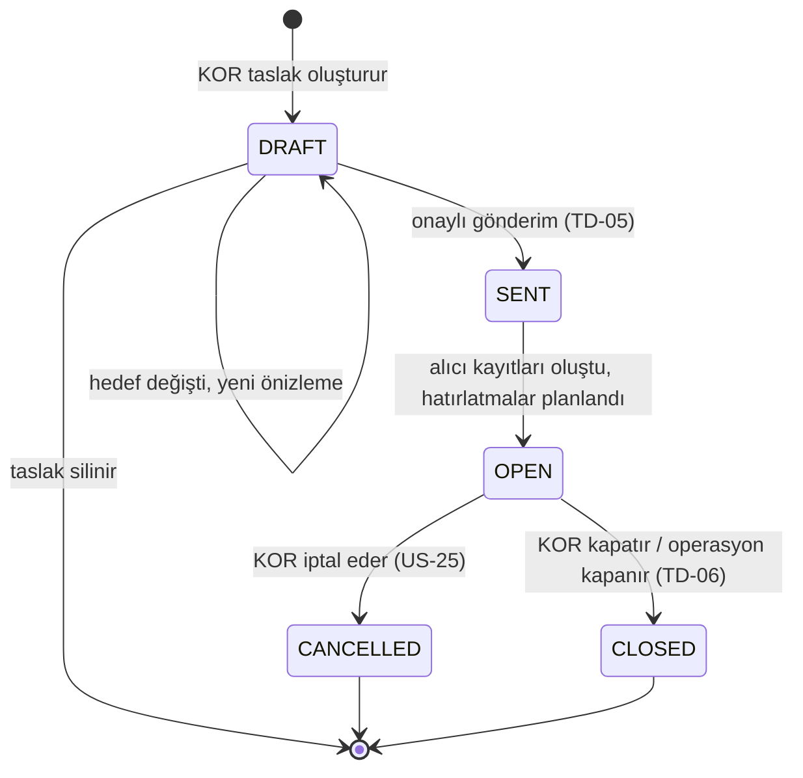
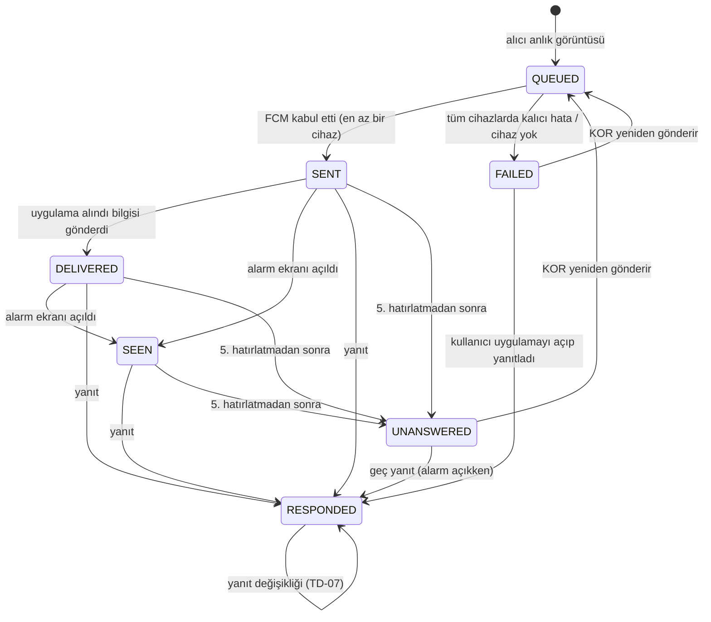

# Acil Alarm Sistemi: Ayrıntılı Tasarım

| Alan | Bilgi |
|---|---|
| Durum | **Kabul edildi** (14.11.2026; TD-03, TD-05 – TD-10, TD-21; DR-01). Gereksinim kararları kesindir: K-09, K-13, K-17, K-24, K-31; ADR-004, ADR-009 |
| Kapsam | Çekirdek MVP: US-20 – US-25, US-21 (AC-21.4), US-32. Otomatik eskalasyon (US-26) **R2**, burada yalnızca bağlanma noktası olarak anılır |
| İlgili diyagramlar | `../diagrams/activity-alert.md`, `../diagrams/sequence-alert.md` |

> **Garanti sınırı (kaynak belge §6.1, RT-01, RT-04):** Sistem, alarmın FCM'e iletildiğini ve uygulamanın bildirdiği teslim, görülme ve yanıt sinyallerini **ölçer ve gösterir**. Alarmın her cihazda ses çıkaracağını, sessiz modu veya Rahatsız Etmeyin'i aşacağını, kilit ekranında tam ekran açılacağını ya da zorla durdurulmuş bir uygulamaya ulaşacağını **garanti etmez.** Arayüz ve test raporu bu sınırı açıkça belirtir.

## 1. Durum modelleri

### 1.1 Alarm (ALERT)

CON-09'daki "Taslak → Gönderildi → Açık → Kapatıldı / İptal" modelinin uygulamasıdır. `SENT` kısa süreli bir ara durumdur: aynı işlemde alıcı kayıtları yazılır ve alarm `OPEN` olur.

### 1.2 Alıcı (ALERT_RECIPIENT, TD-03)

- **DELIVERED** isteğe bağlı bir sinyaldir. Uygulama süreci çalışıp ağa erişebildiğinde gönderilir. Sinyal gelmezse panelde "bilinmiyor" görünür (AC-24.2).
- **Panel gösterimi:** Her alıcı satırında durum zaman damgalarıyla ayrı sütunlarda gösterilir: Gönderildi / Teslim edildi / Görüldü / Yanıt (BR-06). Ana durum sütunu yukarıdaki makinedeki son durumdur.
- Alarm `CANCELLED` veya `CLOSED` olunca alıcı durumları donar; yeni yanıt kabul edilmez (TD-06).

## 2. Uçtan uca akış

Senaryo: aktif "Sel-2026" operasyonunun KOR'u, "Lojistik-A" ve "Arama-B" gruplarına alarm gönderiyor.

### Adım 1 — Yetkili kullanıcı alarm oluşturur
- **Ekran:** WEB-09 Acil alarm yönetimi → "Yeni alarm".
- **Form:** mesaj (zorunlu), talep edilen eylem, öncelik, hedef (operasyon kapsamındaki kişiler ve gruplar; zorunlu). Yanıt seçenekleri sabittir: "Aldım", "Yardım gerekiyor", "Göreve gidiyorum" (K-13).
- **Sunucu denetimleri:**
  1. Oturum MFA'dan geçmiş mi (K-19)?
  2. `can(user, alert.send, operation)`: yalnızca bu operasyonun KOR'u (K-07, K-09). ADM ancak kendini KOR olarak atadıysa.
  3. Operasyon `ACTIVE` mi (K-17, AC-20.6)?
  4. Hedefler operasyon kapsamında mı (K-31, AC-20.7)?
- **Sonuç:** `ALERT(state=DRAFT)` oluşur ve sunucu hedef kitleyi çözer: gruplardaki aktif üyeler ∪ seçili kişiler; gönderen hariç; tekilleştirilmiş; en fazla 500 kişi (VS-02). Yanıtta alıcı sayısı, alıcı listesi ve taslağın sürüm numarası döner.

### Adım 2 — Onay adımı (BR-04, AC-20.2)
- Panel, onay penceresinde "BU BİR ACİL ALARMDIR", alıcı sayısını, alıcı listesini, mesajı ve operasyon adını gösterir. Onay düğmesi ayrı bir tıklama gerektirir ve varsayılan odak "İptal" düğmesindedir.
- Onay isteği `Idempotency-Key` (istemcide üretilen UUID) ve taslak sürümünü taşır (TD-05).
- Sunucu, hedef kitleyi yeniden çözer. Önizlemeden sonra değiştiyse (ör. bir üye gruptan çıkarıldı) `409` döner ve yeni önizleme gösterilir.
- **Tek veritabanı işlemi:** alarm `SENT → OPEN` olur; alıcı anlık görüntüsü `ALERT_RECIPIENT(QUEUED)` satırları olarak yazılır; `NOTIFICATION(category=ALERT, priority=CRITICAL)` oluşur; `AlertSent` olayı outbox'a yazılır; denetim kaydı oluşur.

### Adım 3 — Alarmın gönderilmesi
- `notifications` modülü olayı `CRITICAL` kuyruğuna alır. Bu kuyruğun ayrı bir işçi havuzu vardır ve diğer trafikten etkilenmez (ADR-004).
- Her alıcının **aktif cihazları** için bir `DELIVERY(channel=PUSH)` satırı, ayrıca uygulama içi gelen kutusu için bir `DELIVERY(channel=IN_APP)` satırı oluşur.
- FCM'e yüksek öncelikli *data* mesajı gider: `alert_id`, `recipient_id`, `type=ALERT`, kısa başlık; `collapse_key = alert:{id}`, TTL 60 dk (TD-08). Mesaj içeriği kilit ekranı için kısa tutulur.
- FCM yanıtına göre (§3): başarı → `DELIVERY.sent`, alıcı `SENT`. Kalıcı hata → cihaz pasifleşir. Alıcının hiç başarılı cihazı kalmazsa `FAILED`.
- Hedef: alarm kaydından FCM'e iletime kadar p95 ≤ 5 sn (NFR-08). Ölçülür, cihaza ulaşma süresi garanti edilmez.
- `RecipientStateChanged` olayları SSE ile panele akar (≤ 5 sn).

### Adım 4 — Android'de alarm akışı
1. `FirebaseMessagingService` mesajı alır.
2. Ağ varsa `GET alert` ile alarm durumunu doğrular. İptal edilmiş veya kapanmışsa alarm gösterilmez, yerine bilgi bildirimi çıkar (TD-10). Ağ yoksa mesajdaki bilgiyle devam edilir.
3. Ağ varsa "alındı" bilgisi gönderilir → `DELIVERED`.
4. **Gösterim:**
   - **Uygulama ön plandaysa:** tam ekran alarm ekranı (AND-08) hemen açılır (K-13).
   - **Uygulama arka plandaysa veya ekran kilitliyse:** `alarm` kanalında yüksek önemli bildirim çıkar. Bildirimde yanıt eylem düğmeleri bulunur (TD-21); dokunulursa tam ekran alarm ekranı açılır. **Kilit ekranında kendiliğinden tam ekran açılması (full-screen intent) MVP'de kullanılmaz** (RT-03, US-42 R3).
5. Bildirim, kullanıcı yanıtlayana kadar kaydırılarak kapatılamayan (ongoing) bildirim olarak kalır. Alarm iptal edilir, kapanır veya yanıtlanırsa güncellenir.
6. Alarm ekranı açılınca "görüldü" bilgisi gönderilir → `SEEN`.

Ekran özellikleri (AC-21.2, AC-21.3): mesaj, talep edilen eylem ve üç yanıt düğmesi kaydırmadan görünür; alarm metni ≥ 20 sp; düğmeler ≥ 48×48 dp; TalkBack etiketleri.

### Adım 5 — Kullanıcı alarmı yanıtlar
- Yanıt; `recipient_id`, `option`, cihaz yanıt zamanı ve istemcide üretilen `Idempotency-Key` ile gönderilir.
- Sunucu: alarm `OPEN` mı? Alıcı bu kullanıcı mı? Aynı anahtar daha önce işlendiyse aynı sonucu döner (çift kayıt olmaz).
- Alıcı `RESPONDED` olur; `responded_at_server` ve `responded_at_device` saklanır; hatırlatmalar iptal edilir; `AlertResponded` olayı yayınlanır; denetim kaydı oluşur; panel ≤ 5 sn içinde güncellenir (AC-22.2). "Yardım gerekiyor" yanıtı panelde öne çıkarılır (AC-22.3).
- **Yanıt değişikliği (TD-07):** alarm açıkken farklı bir seçenek gönderilebilir; son yanıt geçerli olur ve her değişiklik denetim kaydına yazılır.
- **Ağ yoksa:** yanıt WorkManager benzersiz işine yazılır (aynı alarm için tek iş). Kullanıcıya "Yanıt iletilemedi, tekrar deneniyor" gösterilir; bağlantı gelince otomatik gönderilir ve sonuç gösterilir (AC-22.4, K-24).

### Adım 6 — Yanıt vermeyenlere hatırlatma (K-13)
- Alıcı oluşturulurken `next_reminder_at = gönderim + 2 dk`, `reminder_count = 0` olur.
- Zamanlayıcı işçi her 30 sn'de bir zamanı gelen alıcıları `SKIP LOCKED` ile alır. Koşul: alarm `OPEN`, alıcı `RESPONDED` değil, `reminder_count < 5`.
- Her hatırlatmada aynı `collapse_key` ile yeni FCM mesajı gider (cihazdaki bildirim güncellenir, ses tekrar çalar), `reminder_count` artar, `next_reminder_at` 2 dk ileri alınır.
- 5. hatırlatmadan 2 dk sonra hâlâ yanıt yoksa alıcı `UNANSWERED` olur. Böylece yanıtsız listesi gönderimden en geç yaklaşık 12 dk sonra kesinleşir (mvp-scope §1 hipotezi).
- `FAILED` alıcılara hatırlatma gönderilmez; KOR'un "yeniden gönder" işlemini bekler.
- **Manuel yeniden gönderim (AC-23.4):** KOR, `UNANSWERED` ve `FAILED` alıcıları tek işlemle seçip yeniden gönderir. Bu alıcılar `QUEUED` olur, sayaç sıfırlanır ve aynı bildirimde yeni bir teslim turu açılır (`round`; sonraki hatırlatmalar bu turda, LD-43); işlem denetime yazılır.
- **Otomatik eskalasyon yok** (R2, US-26). R2'de aynı zamanlayıcıya "süre dolunca eskalasyon bildirimi üret" kuralı eklenecek (bağlanma noktası).

### Adım 7 — Alarm iptali (US-25)
- KOR "İptal et" der; onay penceresi açılır. Alarm `CANCELLED` olur; zamanlanmış hatırlatmalar iptal edilir.
- **Tüm alıcılara**, yanıtlamış olanlar da dahil, `CRITICAL` öncelikli "ALARM İPTAL EDİLDİ" mesajı gider. Aynı `collapse_key` ve bildirim kimliği kullanılır; cihazdaki alarm bildirimi ve ekranı iptal durumuna geçer (AC-25.1).
- Alarm silinmez. İptal eden kişi ve zaman saklanır (AC-25.2).
- **Düzeltme (TD-09):** "İptal et ve düzeltilmiş alarm gönder" seçeneği, formu önceki içerikle doldurur. Yeni alarm `corrects_alert_id` ile eskisine bağlanır ve yine onay adımından geçer.

### Adım 8 — Alıcı bazında durum görüntüleme
- **Ekran:** WEB-10 Alarm detayı. SSE konusu `alert:{id}`.
- **Üst özet:** Yanıtladı / Bekliyor / Yanıtsız / Gönderilemedi sayıları (AC-23.1) ve "Yardım gerekiyor" sayısı.
- **Alıcı tablosu:** ad, grup, son yanıt, Gönderildi / Teslim edildi / Görüldü / Yanıt zaman damgaları, hatırlatma sayısı, hata türü. Bilinmeyen sinyaller "bilinmiyor" olarak gösterilir (AC-24.2).
- **Erişim:** düzenleme yalnızca operasyonun KOR'u; ADM salt-okur izler (user-roles §4.4). Konum bu ekranda gösterilmez; harita WEB-08'dedir ve yalnızca KOR görür (K-15).

### Adım 9 — Denetim kayıtları
`audit` modülü olayları dinleyerek aşağıdaki kayıtları yazar. Kayıtlarda mesaj içeriği ve sır bulunmaz (AC-27.2).

| İşlem | `action` | Kaydedilen ayrıntı |
|---|---|---|
| Taslak oluşturma | `ALERT_DRAFTED` | operasyon, hedef sayısı |
| Onaylı gönderim | `ALERT_SENT` | alıcı sayısı, idempotency anahtarı |
| Yanıt / yanıt değişikliği | `ALERT_RESPONDED` | alıcı, seçenek, önceki seçenek |
| Manuel yeniden gönderim | `ALERT_RESENT` | alıcı sayısı |
| İptal | `ALERT_CANCELLED` | iptal eden kişi |
| Düzeltme | `ALERT_CORRECTED` | eski ve yeni alarm kimlikleri |
| Kapatma | `ALERT_CLOSED` | elle / operasyon kapanışı |
| Kalıcı gönderim hatası | `ALERT_DELIVERY_FAILED` | alıcı, hata türü |

## 3. Hata ve kenar durumları

| Durum | Davranış | Kullanıcıya görünen |
|---|---|---|
| **Web'de ağ kesintisi** (onay sırasında) | İstek tekrar gönderilir; aynı `Idempotency-Key` sayesinde tek alarm oluşur (AC-20.5) | "Gönderiliyor…" ardından sonuç. Belirsizse panel alarm listesini yeniler |
| **Çift tıklama / yinelenen istek** | Aynı anahtar → aynı alarm döner. Farklı anahtar ama aynı taslak sürümü → taslak zaten gönderildiği için `409` | Tek alarm |
| **FCM geçici hata** (zaman aşımı, 5xx, kota) | Üstel bekleme ile 3 deneme (VS-14). Hâlâ başarısızsa o cihazın teslimi `FAILED` | Alıcı satırında hata türü |
| **FCM kalıcı hata** (geçersiz veya kayıtsız token) | Cihaz kaydı pasifleşir; diğer cihazlar denenir; hiçbiri yoksa alıcı `FAILED` | "Gönderilemedi: cihaz kaydı geçersiz" |
| **Alıcının kayıtlı cihazı yok** | Anında `FAILED`; uygulama içi kutuya yine yazılır | "Gönderilemedi: cihaz yok" |
| **FCM servisi tamamen erişilemez** | `CRITICAL` kuyrukta bekleme 30 sn'yi aşınca TEK'e uyarı ve sağlık ucu "bozulmuş" olur (GAP-11). Deneme bitince alıcılar `FAILED` | Panelde toplu "Gönderilemedi" ve yeniden gönder seçeneği |
| **Cihaz çevrimdışı** | FCM mesajı TTL (60 dk) boyunca saklar. Hatırlatmalar aynı `collapse_key` ile birleşir. Cihaz bağlanınca durumu sunucudan doğrular (TD-10) | Panelde `SENT`, teslim "bilinmiyor"; 12 dk sonra `UNANSWERED` |
| **Cihaz TTL'den sonra bağlanır** | Mesaj gelmez. Uygulama açılışında açık alarmlar sunucudan çekilir ve yanıt verilebilir (alarm hâlâ `OPEN` ise) | Uygulama açılınca alarm ekranı |
| **Yanıt gönderilirken ağ yok** | WorkManager yeniden dener; idempotent | "Yanıt iletilemedi, tekrar deneniyor" |
| **Yanıt, alarm kapandıktan/iptal edildikten sonra ulaşır** | Reddedilir (TD-06); cihaz bilgi ekranı gösterir | "Bu alarm kapatıldı / iptal edildi" |
| **İptal mesajı cihaza ulaşamaz** | Cihaz bağlandığında veya uygulama açıldığında durum doğrulaması iptali gösterir (TD-10). Garanti edilmez | Bayat alarm bildirimi bir süre görünebilir: **bilinen sınır** |
| **Kullanıcı bildirim iznini kapatmış** (Android 13+) | FCM teslim edilir ama bildirim gösterilmez. Uygulama açılınca ana ekranda kalıcı uyarı (AC-31.2) | Uyarı bandı |
| **Uygulama zorla durdurulmuş** (veya bazı üreticilerde son uygulamalardan kaydırılmış) | Android FCM mesajını uygulama yeniden açılana kadar iletmez | Panelde `SENT`, teslim "bilinmiyor": **garanti edilemez** |
| **Sessiz mod / Rahatsız Etmeyin** | Bildirim gösterilir, ses çalmayabilir. Kanal sesi ve DND istisnası kullanıcı ayarına bağlı | Garanti edilemez (`technical-risks-validation.md`) |
| **Operasyon alarm açıkken kapanır** | Açık alarmlar `CLOSED` olur (TD-06), hatırlatmalar durur, cihazlara bilgi mesajı gider | "Operasyon kapandı, alarm kapatıldı" |
| **Gönderen KOR'un rolü alarm açıkken kaldırılır** | Alarm açık kalır. Yönetimi operasyonun diğer KOR'ları yapar; yoksa ADM kendini KOR olarak atar | – |
| **Sunucu alarm sırasında yeniden başlar** | Outbox ve kuyruk kalıcıdır; işçiler kaldığı yerden devam eder. Hatırlatma zamanları veritabanında olduğu için kaybolmaz | Kısa gecikme |

## 4. Zamanlama özeti

| Olay | Hedef / değer | Kaynak |
|---|---|---|
| Kayıt → FCM iletimi | p95 ≤ 5 sn | NFR-08 |
| Yanıt → panel | ≤ 5 sn | AC-22.2 |
| Hatırlatma | 2 dk aralık, en fazla 5 | K-13 |
| `UNANSWERED` kesinleşmesi | Gönderimden ~12 dk | mvp-scope §1 |
| FCM TTL | 60 dk *(varsayım, TD-08)* | – |
| Push yeniden deneme | 3, üstel bekleme | VS-14 |
| `CRITICAL` kuyruk uyarısı | > 30 sn | VS-14 |
| Zamanlayıcı tarama aralığı | 30 sn *(tasarım varsayımı)* | – |

## 5. Test noktaları (kabul kriterleriyle eşleşme)

| Test | Kabul kriteri |
|---|---|
| Onay penceresi olmadan gönderim yok; aktif olmayan operasyonda red | AC-20.2, AC-20.6 |
| Kapsam dışı hedef 403 | AC-20.3, AC-20.7 |
| Aynı anahtarla iki istek → tek alarm | AC-20.5 |
| Alıcı durum sütunları ayrı, bilinmeyen = "bilinmiyor" | AC-24.1, AC-24.2, AC-24.3 |
| 2 dk × 5 hatırlatma, yanıtla durma | AC-23.2, AC-23.3 |
| İptal bildirimi tüm alıcılara; alarm silinmez | AC-25.1, AC-25.2 |
| Çevrimdışı yanıtın otomatik tekrarı | AC-22.4, AC-32.2 |
| Cihaz matrisinde ön plan / arka plan / kapalı / kilitli / sessiz / DND davranışı raporu | AC-21.4 |
