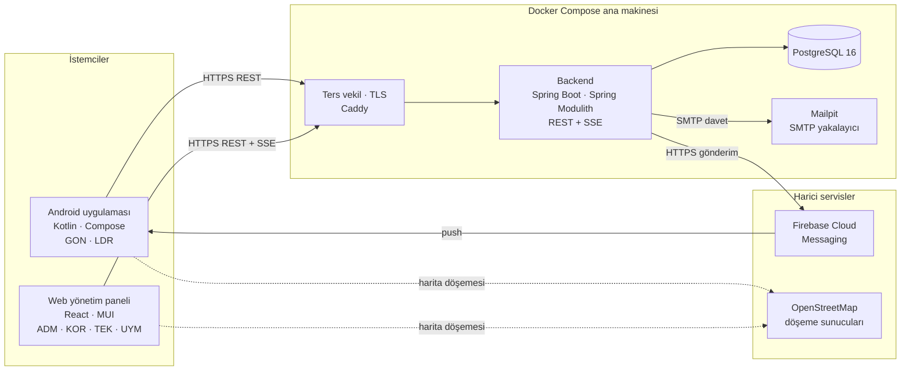
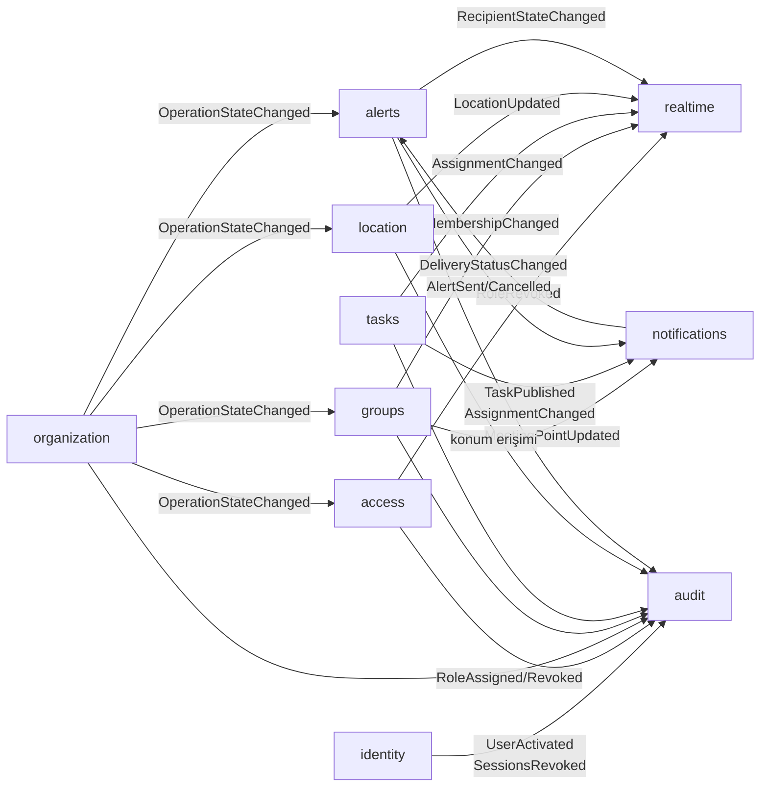

# Sistem Mimarisi Tasarımı

| Alan | Bilgi |
|---|---|
| Sürüm | 1.0, onaylı tasarım |
| Tarih | 14.11.2026 |
| Dayanak | `docs/analysis/*` (K-01 – K-33, VS-01 – VS-23), `docs/architecture/README.md`, ADR-001 – ADR-012 |
| Durum | **Kabul edildi** (14.11.2026). TD-01 – TD-22 onaylandı (§9); TD-02 teknik gerekçeyle güvenli alternatifle uygulandı. DR-01 (tam ekran alarm sınırı) ve DR-12 (Android'den kurumsal işlem yok, ADR-013) kesinleştirildi. Kesinleşmiş K-01 – K-33 kararları değiştirilmedi. |

> Bu doküman `architecture/README.md` (hedefler, ilkeler, modül listesi, sürüm haritası) ile `decisions.md`'yi tekrar etmez; onları **somut bileşen ve etkileşim düzeyine** indirir. Yalnızca **Çekirdek** ve **Genişletilmiş** MVP bileşenleri tasarlanır. R2+ yalnızca bağlanma noktası olarak anılır.

## 1. Genel görünüm

Ayrıntılı diyagramlar: `../diagrams/component-diagram.md`, `../diagrams/deployment-diagram.md`.

## 2. İstemci bileşenleri

### 2.1 Android uygulaması

| Alt bileşen | Sorumluluk | Not |
|---|---|---|
| **Ekranlar (Compose)** | `../ui-flows/android-flows.md` içindeki AND-01 – AND-12 | Material 3, Türkçe metinler kaynak dosyasında (K-21) |
| **ViewModel katmanı** | Ekran durumu, kullanıcı eylemleri | Tek yönlü veri akışı |
| **Depo (repository) katmanı** | REST çağrıları, önbellekte son görülen veriler | Kalıcı yerel veritabanı yok; yalnızca bellekte önbellek (K-24) |
| **API istemcisi** | Retrofit + OkHttp, OpenAPI sözleşmesine göre (ADR-010) | Erişim belirtecinin yenilenmesi araya giren katmanda (interceptor) |
| **Güvenli depo** | Yenileme belirteci ve cihaz kimliği | Android Keystore destekli şifreli depo (ADR-012) |
| **FCM servisi** | Push mesajını alır, sunucudan alarm durumunu doğrular, uygun kanalda bildirim gösterir, "teslim edildi" bilgisini gönderir | TD-08, TD-10 |
| **Bildirim kanalları** | `alarm` (yüksek önem, özel ses), `gorev` (yüksek), `genel` (varsayılan), `konum` (ön plan servisi bildirimi, düşük) | HZ-9. Kanal ayarlarını kullanıcı değiştirebilir; uygulama garanti edemez (`technical-risks-validation.md`) |
| **Alarm ekranı** | Tam ekran alarm Activity'si: mesaj, talep edilen eylem, 3 yanıt düğmesi | Uygulama ön plandayken kendiliğinden açılır; aksi hâlde bildirime dokununca açılır (K-13, §6.1) |
| **Konum ön plan servisi** | Kullanıcı başlatınca 60 sn'de bir konum gönderir; kalıcı bildirimden durdurulabilir | ADR-011, VS-18 |
| **WorkManager işleri** | Yalnızca alarm yanıtının yeniden gönderimi (benzersiz iş, idempotency anahtarıyla) | K-24. İş girdisi WorkManager tarafından kalıcı saklanır |
| **Bağlantı izleyici** | Ağ durumu → çevrimdışı göstergesi (≤ 10 sn) | AC-32.1 |

### 2.2 Web yönetim paneli

| Alt bileşen | Sorumluluk | Not |
|---|---|---|
| **Sayfalar (React + MUI)** | `../ui-flows/web-flows.md` içindeki WEB-01 – WEB-12 | Role göre menü; yetki sunucuda zorlanır (NFR-02) |
| **API istemcisi** | OpenAPI'den üretilen tipler, fetch tabanlı istemci | ADR-010 |
| **Sunucu durumu önbelleği** | TanStack Query; SSE olayı gelince ilgili sorgular geçersiz kılınır | ADR-009 |
| **SSE istemcisi** | `EventSource`; operasyon ve alarm konularına abonelik; kopunca `Last-Event-ID` ile yeniden bağlanma | Yedek: 5 sn yoklama (`mvp-scope.md` §6) |
| **Harita** | Leaflet + OSM; son konumlar ve güncellik etiketleri | Konum verisi döşeme sunucusuna gönderilmez |
| **Kimlik** | HttpOnly + Secure çerezler, CSRF belirteci; ADM/KOR için TOTP adımı | ADR-012, K-19 |

Statik olarak derlenir ve nginx tarafından servis edilir.

## 3. Backend modülleri

Backend tek bir Spring Boot uygulamasıdır (ADR-001). Her modül ayrı bir Java paketi olan Spring Modulith uygulama modülüdür. Modüller birbirinin tablolarına erişmez; **açık arayüz** (senkron sorgu) ya da **uygulama olayı** (asenkron, outbox ile kalıcı) üzerinden konuşur.

| Modül | İstenen bileşen | Sorumluluk | Sahip olduğu varlıklar | Yayınladığı olaylar | Kullandığı arayüzler |
|---|---|---|---|---|---|
| **identity** | Kimlik doğrulama, gönüllü yönetimi | Kullanıcı hesabı ve profil, davet, parola, oturum ve yenileme belirteci, TOTP, cihaz ve FCM token kaydı | USER, INVITATION, REFRESH_TOKEN (TD-04), DEVICE | `UserActivated`, `UserDisabled`, `SessionsRevoked`, `InvitationAccepted` | access (rol ataması) |
| **access** | Yetkilendirme | Rol atamaları (kapsamlı), izin kataloğu, `can()` politika motoru, yetki matrisi | ROLE_ASSIGNMENT | `RoleAssigned`, `RoleRevoked` | organization ve groups'un kapsam sorguları |
| **organization** | Operasyon yönetimi | Kurum (tek, kurgusal), operasyon yaşam döngüsü, operasyona katılım (TD-01), kapatılmamış operasyon hatırlatması | ORGANIZATION, OPERATION | `OperationStateChanged`, `ParticipantAdded`, `ParticipantRemoved` | access |
| **groups** | Gönüllü ve grup yönetimi | Operasyon grubu, üyelik, lider kuralı (K-32), toplanma noktası | GROUP, GROUP_MEMBERSHIP | `MembershipChanged`, `MeetingPointUpdated` | access, organization |
| **tasks** | Görev yönetimi | Görev, kişi bazlı atama, kapasite, yanıt süresi | TASK, TASK_ASSIGNMENT | `TaskPublished`, `TaskUpdated`, `AssignmentChanged` | access, groups (üye anlık görüntüsü), organization |
| **location** | Konum yönetimi | Paylaşım durumu, son konum, güncellik, operasyon kapanınca durdurma | LOCATION_SHARING, LAST_LOCATION | `LocationSharingChanged`, `LocationUpdated` | access, organization |
| **alerts** | Acil alarm | Alarm taslağı, önizleme, onaylı gönderim, alıcı durumu, yanıt, hatırlatma zamanlayıcısı, iptal, kapatma | ALERT, ALERT_RECIPIENT (TD-03) | `AlertSent`, `AlertResponded`, `AlertCancelled`, `AlertClosed`, `RecipientStateChanged` | access, organization, groups, notifications |
| **notifications** | Bildirim sistemi | Hedef kitle çözümleme, öncelik kuyrukları, FCM adaptörü, uygulama içi gelen kutusu, teslim kaydı | NOTIFICATION, DELIVERY | `DeliveryStatusChanged` | identity (cihaz token'ları), access |
| **realtime** | Gerçek zamanlı web güncellemeleri | SSE bağlantıları, konu aboneliği, yetki denetimi, abonelik düşürme | Bellekte bağlantı tablosu | – | access |
| **audit** | Denetim kayıtları | Kritik olayları dinleyip ekleme-yalnız kayıt; ADM ve UYM için sorgu | AUDIT_ENTRY | – | Tüm modüllerin olaylarını dinler |

**Bağımlılık yönü:** `access` çekirdektir ve diğer modüllere bağımlı değildir; kapsam bilgisini `organization` ve `groups`'tan arayüz üzerinden sorar. `audit`, `notifications` ve `realtime` olay tüketicisidir. Döngüsel bağımlılık Spring Modulith doğrulama testiyle CI'da engellenir.

### 3.1 Olay akışı (özet)

`OperationStateChanged(COMPLETED|CANCELLED)` olayı tek bir kapanış zincirini başlatır: konum paylaşımları durur (≤ 1 dk), açık alarmlar kapanır (TD-06), gruplar arşivlenir, operasyon kapsamlı roller pasifleşir, SSE abonelikleri düşer (BR-09, K-11, RO-09).

## 4. Kimlik doğrulama ve yetkilendirme

| Konu | Tasarım | Dayanak |
|---|---|---|
| Hesap oluşturma | Yalnızca davetle; açık kayıt yok | K-06 |
| Parola | Uyarlanabilir özet (bcrypt/Argon2), 5 hatalı deneme → 15 dk kilit | ADR-012, VS-14 |
| Belirteçler | Kısa ömürlü JWT erişim belirteci + veritabanında saklanan, iptal edilebilir yenileme belirteci. Önerilen süreler TD-04'te | ADR-012 |
| Web | Belirteçler HttpOnly, Secure, SameSite çerezlerde; CSRF belirteci; SSE aynı çerezle yetkilendirilir | ADR-009, ADR-012 |
| Android | `Authorization: Bearer` başlığı; yenileme belirteci şifreli depoda | ADR-012 |
| MFA | ADM ve KOR rolüne sahip kullanıcı, web paneline girişte TOTP doğrular. İlk girişte TOTP kurulumu yapılır. MFA tamamlanmamış oturum kurumsal izinleri kullanamaz. Android oturumu yalnızca gönüllü ve lider izinlerini kullanır | K-19, authorization.md §5.4 |
| Oturum iptali | Yenileme belirteçleri iptal edilir; erişim belirtecinin kısa ömrü sayesinde iptal en geç bir belirteç ömrü içinde etkili olur. SSE bağlantıları hemen kapatılır | FR-22, US-06 |
| Yetki denetimi | Her istek: kimlik → aktif hesap → `can(subject, action, resource)` → kaynak kuralı. Liste sorgularında kapsam filtresi veritabanı sorgusuna eklenir | ADR-002, NFR-02 |
| Yetki matrisi | `user-roles.md` §4 makine tarafından okunabilir tek kaynağa dönüştürülür; hem `can()` eşlemesi hem negatif testler buradan üretilir | US-28 |

Akış: `../diagrams/sequence-login.md`.

### 4.1 Android'den kurumsal işlem yapılmaz (DR-12, ADR-013)

- **Kural:** Koordinatör (KOR) ve kurum yöneticisi (ADM) acil alarm gönderme, iptal ve kapatma, görev yönetimi, konum görüntüleme ve kullanıcı yönetimi gibi kurumsal işlemleri **yalnızca MFA ile açılmış web paneli oturumundan** yapar. Android uygulamasında bu işlemler için ekran veya eylem yoktur. Android oturumunun belirteci kurumsal izin taşımaz; sunucu bu istekleri 403 ile reddeder.
- **Güvenlik gerekçesi:**
  1. K-19 MFA'yı yalnızca web panelinde zorunlu kılar. Android'den kurumsal işleme izin vermek MFA'yı fiilen devre dışı bırakır.
  2. Android yenileme belirteci uzun ömürlüdür (30 gün, TD-04) ve cihaz kaybolabilir (RT-13). Uzun ömürlü ve tek faktörlü bir mobil oturuma alarm yetkisi vermek, kayıp bir cihazla yüzlerce kişiye sahte alarm gönderilmesine yol açabilir (RO-01, RO-02).
  3. Konum görüntüleme en riskli veri erişimidir (K-15, RT-07). Erişim yalnızca MFA'lı ve denetlenen kanalda kalmalıdır.
- **MVP'deki yol:** KOR alarmı web panelinden (WEB-09) gönderir. Web paneli tarayıcı tabanlı olduğu için sahada bir telefonun tarayıcısından da MFA ile açılabilir. MVP'de mobil tarayıcı yerleşimi optimize edilmez; WEB-09 ve WEB-10'un dar ekranda kullanılabilirliği yalnızca kontrol edilir (TV-13).
- **Sonraki sürüm önerileri (karar gerektirir, MVP'ye eklenmedi):** (a) Android'de alarm işlemi öncesinde TOTP veya biyometrik doğrulamalı kısa ömürlü "yükseltilmiş oturum" (step-up MFA); (b) cihaz bağlama + passkey/FIDO2; (c) Android'den yalnızca alarm *talebi* oluşturma, gönderimin web'den onaylanması. Ayrıntı: ADR-013.

## 5. Veritabanı

- **PostgreSQL 16**, tek veritabanı. Her modülün tabloları kendi şemasında tutulur (ör. `identity.*`, `alerts.*`). Bu, modül sınırını veritabanında da görünür kılar (TD-20).
- Mantıksal model: `../diagrams/erd.md` (kaynak: `domain-model.md`).
- Teknik tablolar (alan modeli dışında): Spring Modulith olay yayın kaydı (outbox) ve bildirim teslim kuyruğu (`SKIP LOCKED`).
- Tüm zaman damgaları UTC saklanır, Europe/Istanbul gösterilir (VS-21).
- Şema geçişleri Flyway ile yapılır; **bu aşamada şema veya geçiş yazılmaz.**
- Yedek: günlük `pg_dump`, ayrı birimde (RPO 24 sa, RTO 4 sa, VS-04, TD-15).

## 6. Harici servisler

| Servis | Kullanım | Kısıt ve risk |
|---|---|---|
| **Firebase Cloud Messaging** | Android'e alarm, görev, duyuru ve sistem (konum durdurma) mesajları. Firebase Admin SDK, hizmet hesabı anahtarı sır olarak | Teslim garantisi yok; sunucu yalnızca "FCM kabul etti" bilgisini bilir (RT-04). Uygulama zorla durdurulmuşsa mesaj gelmez |
| **OpenStreetMap döşemeleri** | Web (Leaflet) ve Android (MapLibre) harita | Döşeme kullanım politikası; düşük hacim, önbellek, atıf (RT-11). Koordinat gönderilmez |
| **SMTP (Mailpit)** | Davet e-postaları geliştirme ve demoda yakalanır; Mailpit arayüzünden okunur | Gerçek e-posta gönderilmez (K-04) |
| **Firebase App Distribution** *(isteğe bağlı)* | APK test dağıtımı | VS-12 |

## 7. API yüzeyi (kaynak grupları, taslak)

Ayrıntılı sözleşme Hafta 3'te OpenAPI olarak yazılacak (ADR-010). **Uç noktalar bu aşamada uygulanmaz.** Aşağıdaki liste yalnızca sorumluluk dağılımını gösterir:

| Kaynak grubu | Modül | Başlıca istemci |
|---|---|---|
| `/api/v1/auth` (giriş, yenileme, çıkış, TOTP) | identity | Web, Android |
| `/api/v1/invitations` | identity | Web (oluşturma), Android (kabul) |
| `/api/v1/users`, `/api/v1/me` | identity | Web, Android |
| `/api/v1/role-assignments` | access | Web |
| `/api/v1/operations`, `.../participants` | organization | Web, Android (okuma) |
| `/api/v1/groups`, `.../members`, `.../meeting-point` | groups | Web, Android |
| `/api/v1/tasks`, `.../assignments` | tasks | Web, Android |
| `/api/v1/location-sharing`, `/api/v1/locations` | location | Android (yazma), Web (okuma) |
| `/api/v1/alerts`, `.../recipients`, `.../responses` | alerts | Web (yönetim), Android (yanıt) |
| `/api/v1/notifications` (gelen kutusu, alındı bilgisi), `/api/v1/announcements` | notifications | Android, Web |
| `/api/v1/devices` (FCM token) | identity | Android |
| `/api/v1/audit-entries` | audit | Web (ADM, UYM) |
| `/api/v1/stream` (SSE) | realtime | Web |

Tüm değiştirici isteklerde `Idempotency-Key` başlığı desteklenir. Alarm oluşturma, alarm yanıtı ve görev yanıtında zorunludur (NFR-06).

## 8. Kalite nitelikleri: bileşen düzeyinde karşılık

| Nitelik | Karşılayan bileşen | Hedef |
|---|---|---|
| Alarm iletimi (NFR-08) | alerts → notifications (`CRITICAL` havuzu) → FCM | Kayıttan FCM'e p95 ≤ 5 sn |
| Panel güncelliği | realtime (SSE) | Alarm ≤ 5 sn, görev ≤ 10 sn |
| Yetki (NFR-02) | access + kaynak kuralları + liste filtreleri | Tüm negatif testler geçer |
| Ölçek (NFR-12) | Tek örnek, PostgreSQL kuyruğu | 500 kayıtlı, 150 eşzamanlı, 5 aktif operasyon, 500 alıcılı alarm |
| Denetlenebilirlik (NFR-05) | audit | Kritik işlemlerin tamamı; içerik ve sır yok |
| Gizlilik (NFR-15) | access, location | Konumu yalnızca aktif operasyonun KOR'u görür |

## 9. Tasarım kararları (TD) — kabul edildi

Tüm TD kararları 14.11.2026'da **kabul edildi.** Hiçbiri kesinleşmiş gereksinim kararlarını değiştirmez; dokümanlarda tanımsız kalan ayrıntıları tamamlar. Uygulandıkları yerler §9.1'de.

| TD | Karar | Gerekçe ve dayanak |
|---|---|---|
| **TD-01** | **Operasyona katılım**, `ROLE_ASSIGNMENT(role=GON, scope=OPERATION)` kaydıdır. Yeni kullanıcı operasyon davetiyle doğrudan katılır. Kurumda zaten kayıtlı kullanıcıya KOR'un gönderdiği operasyon daveti uygulama içinde ve e-postayla gelir; kullanıcı kabul edince katılım oluşur. KOR yalnızca katılımcıları gruplara ekleyebilir | K-06, K-07, K-14 ("operasyona dahilse"). `domain-model.md` katılımı ayrıca modellemiyordu |
| **TD-02** | Davet e-postası tek kullanımlık bir **https bağlantısı** ve **elle girilebilir davet kodu** içerir. Bağlantı, web sunucusundaki giriş gerektirmeyen statik bir davet sayfasını (`/davet`) açar. Sayfa kodu gösterir ve uygulamayı özel URI şemasıyla açmayı dener; uygulama yoksa APK kurulum yönergesi verir. Asıl güvence, kodun Android'deki "Davet kabulü" ekranına (AND-02) elle girilmesidir. Statik sayfa hiçbir kişisel veri göstermez ve sunucuya istek göndermez; gönüllüler için web paneli değildir | K-06, VS-06. **Öneriden sapma:** e-posta istemcileri (ör. Gmail) özel URI şemalı bağlantıları tıklanamaz kılar veya kaldırır. Bu yüzden bağlantı https'tir. Android App Links ise doğrulanmış bir alan adı gerektirir; demo ortamında alan adı olmayabilir (VS-11) |
| **TD-03** | **ALERT_RECIPIENT** varlığı: alarm başına alıcı satırı (`state`, `response_option`, `responded_at_device`, `responded_at_server`, `reminder_count`, `next_reminder_at`, `seen_at`). DELIVERY kanal ve cihaz bazlı teslim kaydı olarak kalır | FR-15, FR-16, FR-18; `domain-model.md` yanıtı ve hatırlatma sayacını tutacak yeri tanımlamıyordu |
| **TD-04** | **REFRESH_TOKEN** varlığı (kullanıcı, cihaz, belirteç özeti, son kullanım, iptal zamanı). Önerilen süreler: erişim belirteci 15 dk; yenileme belirteci web için 12 sa, Android için 30 gün (her kullanımda döndürülür) *(varsayım)* | ADR-012, FR-22 |
| **TD-05** | **İki adımlı alarm gönderimi:** (1) taslak oluşturulur, sunucu hedef kitleyi çözüp önizleme döner (sayı + liste); (2) KOR onaylar ve gönderim taslağın sürümüyle yapılır. Önizlemeden sonra hedef kitle değiştiyse onay reddedilir ve yeni önizleme istenir | BR-04, AC-20.2 |
| **TD-06** | **Alarm kapatma:** KOR açık alarmı elle "Kapatır". Operasyon kapanınca açık alarmlar otomatik kapanır. Kapanınca hatırlatmalar durur; kapanış sonrası gelen yanıt kabul edilmez ve cihaza "alarm kapatıldı" bilgisi döner | CON-09 durum modelinde "Kapatıldı" vardı, ama geçişi tanımsızdı |
| **TD-07** | **Yanıt değişikliği:** alıcı alarm açıkken yanıtını değiştirebilir (ör. "Göreve gidiyorum" → "Yardım gerekiyor"). Panelde son yanıt görünür, tüm yanıtlar denetim kaydındadır. İlk yanıtla hatırlatmalar durur | FR-15; MVP'de SOS olmadığından (K-23) yardım ihtiyacını sonradan bildirme yolu |
| **TD-08** | **FCM mesaj biçimi:** alarm ve iptal için yüksek öncelikli *data* mesajı (bildirimi uygulama çizer); alarm başına `collapse_key`, TTL 60 dk *(varsayım)*. Hatırlatmalar aynı bildirim kimliğini günceller; iptal mesajı aynı bildirimi "İPTAL EDİLDİ" ile değiştirir | RT-04, US-25 |
| **TD-09** | **Düzeltme**, mevcut alarmın iptali ve `corrects_alert_id` ile bağlı yeni bir alarmın gönderilmesidir (iki ayrı denetim kaydı) | US-25 başlığı "düzeltme" diyor ama kabul kriterleri yalnızca iptali tanımlıyor |
| **TD-10** | Android FCM mesajı aldığında ve uygulama açıldığında alarm durumunu sunucudan doğrular; iptal edilmiş veya kapanmış alarmı tam ekran göstermez | TTL ve çevrimdışı gecikmeler nedeniyle bayat alarm riski |
| **TD-11** | Konum ölçümleri kuyruğa alınmaz. Bağlantı gelince yalnızca o anki ölçüm gönderilir | K-16 (yalnızca son konum), K-24 |
| **TD-12** | Web'e **Duyurular** ekranı (WEB-07) eklendi | FR-06 Çekirdek; tasarım talebindeki web ekran listesinde yoktu |
| **TD-13** | Android **Bildirimler** ekranı, uygulama içi gelen kutusudur (`IN_APP` teslim kayıtları). Bildirim tercihleri yok (R2) | FX-08 R2 |
| **TD-14** | TEK, web panelinde yalnızca hesap durum listesini (görünen ad, hesap durumu) görür; devre dışı bırakma ve oturum iptali yapar. Sistem sağlığı Actuator uçlarıyla, panel dışında izlenir | user-roles.md §3 (TEK iş verisi görmez) |
| **TD-15** | Yedekleme, Docker Compose içinde zamanlanmış bir `pg_dump` servisiyle ayrı birime yapılır | VS-04 |
| **TD-16** | Gruba atanan görevin atamaları yayın anındaki aktif üyelerden oluşur (anlık görüntü). Sonradan katılan üye otomatik atama almaz; KOR elle ekleyebilir | AC-13.2, domain-model §5 (anlık görüntü ilkesi) |
| **TD-17** | İlk girişte Android: bildirim izni (Android 13+) istenir, FCM token kaydedilir, izin reddedilirse kalıcı uyarı gösterilir | AC-31.2, K-03 |
| **TD-18** | Operasyon kapanınca sunucu tüm paylaşımları `STOPPED` yapar ve cihazlara yüksek öncelikli "konumu durdur" data mesajı gönderir. Cihaz mesajı alamazsa sunucu sonraki ölçümleri reddeder ve yanıt cihazdaki servisi durdurur | AC-08.3, BR-09 |
| **TD-19** | Gönüllü birden fazla aktif operasyondaysa Android ana sayfasında operasyon seçici bulunur; konum paylaşımı operasyon başına ayrıdır | K-11 (çoklu operasyon), LOCATION_SHARING operasyon başına |
| **TD-20** | Her backend modülü kendi PostgreSQL şemasına sahiptir | ADR-001 modül sınırlarının veritabanında da görünmesi |
| **TD-21** | Android'de alarm yanıtı, uygulama ön planda değilken de bildirimdeki eylem düğmeleriyle verilebilir ("Aldım" vb.). Tam ekran açmak zorunlu değildir | FR-15; kilit ekranında hızlı yanıt. V-06 doğrulanamazsa düşer |
| **TD-22** | Genişletilmiş MVP'deki aydınlatma metni onayı için `CONSENT_RECORD` varlığı (kullanıcı, metin sürümü, onay zamanı) | US-02 AC-02.2; `domain-model.md`'de varlık tanımlı değildi |

### 9.1 TD kararlarının işlendiği yerler

| TD | İşlendiği dokümanlar |
|---|---|
| TD-01 | domain-model §5A (RoleAssignment, Invitation), authorization §5.4, user-stories AC-01.5, AC-09.7, activity-join-operation |
| TD-02 | sequence-invitation, activity-invitation, deployment-diagram, user-stories AC-01.6 |
| TD-03 | domain-model §5, erd, emergency-alert-design §1.2 |
| TD-04 | domain-model §5A, erd, ADR-012 |
| TD-05 | user-stories AC-20.8, emergency-alert-design Adım 2, sequence-alert |
| TD-06 | user-stories AC-25.3, emergency-alert-design §1.1, authorization §5.3 (`alert.close`) |
| TD-07 | user-stories AC-22.7, emergency-alert-design Adım 5 |
| TD-08 | communication §1.5 (FCM mesaj sözleşmesi) |
| TD-09 | user-stories AC-25.4, domain-model §5 (`corrects_alert_id`) |
| TD-10 | user-stories AC-21.7, communication §1.5 |
| TD-11 | user-stories AC-17.7 |
| TD-12 | web-flows WEB-07, user-stories US-11 |
| TD-13 | android-flows AND-09, user-stories AC-11.5 |
| TD-14 | web-flows WEB-04, user-stories AC-06.5, authorization §5.4 |
| TD-15 | deployment-diagram |
| TD-16 | user-stories AC-13.2, sequence-task-assignment |
| TD-17 | activity-invitation, sequence-invitation |
| TD-18 | user-stories AC-08.3, sequence-location, communication §1.5 |
| TD-19 | android-flows AND-03, user-stories AC-17.6 |
| TD-20 | api-and-data-design-basis §4 |
| TD-21 | user-stories AC-22.6, communication §1.5, TV-06 |
| TD-22 | domain-model §5A (Genişletilmiş), erd §2 |

## 10. İlgili dokümanlar

| Konu | Dosya |
|---|---|
| Acil alarm akışının ayrıntılı tasarımı | `emergency-alert-design.md` |
| Teknik riskler ve doğrulama planı | `technical-risks-validation.md` |
| Diyagramlar | `../diagrams/README.md` |
| Ekran akışları | `../ui-flows/android-flows.md`, `../ui-flows/web-flows.md` |
| Tasarım kontrol raporu | `design-review.md` |
| Sonraki aşama girdileri (OpenAPI ve PostgreSQL tasarımı için temel) | `api-and-data-design-basis.md` |
