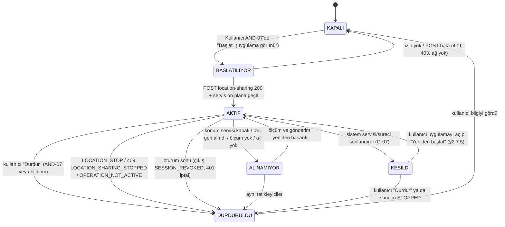

# Android İstemcisi: Teknik Tasarım ve Doğrulama Planı (T-06)

| Alan | Bilgi |
|---|---|
| Sahip | `android-developer` |
| Durum | **Taslak, team-lead kararları (LD-06 – LD-18, LD-30 – LD-32, LD-34, LD-35, LD-37, LD-39) ve backend yanıtları (BS-01 – BS-08) işlendi.** Kod, Gradle, manifest veya prototip içermez |
| Dayanak | `technical-risks-validation.md` (G-01 – G-10, V-01 – V-07, TV-01 – TV-13), `emergency-alert-design.md`, `communication.md` §1.5 ve §2.3, `android-flows.md` (AND-01 – AND-12), ADR-008, ADR-011, ADR-012, ADR-013, `api-and-data-design-basis.md` §2, §3 (A uçları), §5 – §7, US-17, US-21, US-22, US-31, US-32, RT-01 – RT-05 |
| Ne zaman kullanılır | Hafta 1: sürüm sabitleme ve cihaz listesi (VS-05). Hafta 2: teknik keşif (TV-01 – TV-07, TV-09, TV-10; FCM HTTP v1 API'siyle elle data mesajı, §4.1, LD-16). Hafta 8–9: TV-08 ve TV-13 (LD-15). Sonuçlar KP1'de değerlendirilir |

> **Garanti sınırı:** Bu belgede anlatılan istemci davranışı, Android'in ve kullanıcının izin verdiği ölçüde çalışır. Teslim, ses, kilit ekranı görünümü ve arka plan konumu **ölçülür ve raporlanır, garanti edilmez** (§7). "Doğrulanacak" işaretli sürüm davranışları Hafta 2 keşfinde gerçek cihazda sınanmadan kesin kabul edilmez.

**Okuma notu:** Kesinleşmiş kararlar (K-01 – K-33, TD-01 – TD-22, ADR-001 – ADR-013, DR-01, DR-12) değiştirilmedi. Kararla gerilim yaratabilecek bulgular team-lead'e öneri olarak götürüldü ve **LD-06 – LD-17** ile karara bağlandı (§9.1). Belge bu kararlara göre güncellendi.

---

## 1. Kapsam ve sınırlar

### 1.1 Android uygulamasının MVP'de yaptığı teknik işler
- FCM data mesajlarını alır, bildirimi kendisi çizer (`communication.md` §1.5).
- Acil alarmı gösterir (AND-08 / bildirim), alındı, görüldü ve yanıt sinyallerini gönderir.
- Yalnızca alarm yanıtını, ağ yokken WorkManager ile otomatik yeniden dener (K-24).
- Kullanıcının başlattığı konum paylaşımını `location` türünde ön plan servisiyle yürütür (ADR-011).
- Belirteçleri şifreli yerel depoda saklar (ADR-012), FCM token'ını kaydeder (TD-17).
- Bağlantı durumunu ve hazırlık eksiklerini gösterir (US-31, US-32).

### 1.2 Yapılmayacaklar (DR-01, DR-12, ADR-011, ADR-013)

Aşağıdaki izinler ve API'ler **beyan edilmez, istenmez ve kullanılmaz.** Kod incelemesinde kontrol listesi olarak kullanılır.

| Yapılmayan | Neden |
|---|---|
| `USE_FULL_SCREEN_INTENT`, bildirimde full-screen intent | Kilit ekranında kendiliğinden tam ekran MVP'de yok (DR-01, US-42 R3) |
| Etkinlikte "kilit ekranının üstünde göster" ve "ekranı aç" bayrakları | Bildirime dokunulunca kilit açıldıktan sonra AND-08 açılır (`android-flows.md` §3.1). Bu bayraklar kendiliğinden tam ekranın dolaylı yoludur |
| `ACCESS_NOTIFICATION_POLICY`, kanalda DND'yi aşma ayarı | DND aşılmaya çalışılmaz (G-02). Kullanıcı kanal ayarından kendisi açabilir; AND-12 yalnızca yönlendirir |
| Kanal sesinde **alarm ses akışı** (`USAGE_ALARM`) veya uygulamanın kendi döngüsel ses çalması | **Kesin kural (LD-08, `communication.md` §1.5):** kanal sesi `USAGE_NOTIFICATION` kullanır; `USAGE_ALARM` yasaktır. Alarm ses akışı birçok cihazda zil sesi modundan bağımsızdır; bu, sessiz modu dolaylı yoldan aşmak olur (G-01) |
| `SYSTEM_ALERT_WINDOW` (diğer uygulamaların üstünde çizim) | Kendiliğinden tam ekranın başka bir yolu |
| `ACCESS_BACKGROUND_LOCATION` ("her zaman" izni) | ADR-011, VS-18 |
| Açılışta veya yeniden başlatmada konum servisini kendiliğinden başlatma (`RECEIVE_BOOT_COMPLETED` ile) | Paylaşımı yalnızca kullanıcı başlatır (K-14). G-07 |
| `SCHEDULE_EXACT_ALARM` / `USE_EXACT_ALARM` | Hatırlatma sunucudadır (K-13); cihazda zamanlayıcı yok |
| Kurumsal işlem ekranı veya isteği (alarm gönderme/iptal/kapatma, görev yönetimi, konum görüntüleme) | ADR-013, DR-12, AC-20.9 |
| Gerçek zamanlı bağlantı (SSE/WebSocket) | RT-K4: Android FCM + açılışta REST kullanır |
| Konum ölçümü kuyruğu, konum geçmişi | TD-11, K-16 |
| Alarm yanıtı dışında otomatik tekrar kuyruğu | K-24 |

---

## 2. İstemci teknik tasarımı

### 2.1 Bileşenler (mantıksal)

| Bileşen | Sorumluluk | Not |
|---|---|---|
| Mesaj alıcı (`FirebaseMessagingService`) | FCM data mesajını türüne göre yönlendirir (§2.4) | İşini kısa sürede bitirmeli. FCM belgelerine göre `onMessageReceived` için süre sınırlıdır *(yaklaşık 10–20 sn, sürüme göre; doğrulanacak)*. Bu yüzden ağ çağrılarına kısa zaman aşımı konur |
| Bildirim yöneticisi | Kanalları oluşturur, alarm bildirimini çizer, günceller, kaldırır | Tek yerden; tüm bildirim kimlikleri burada üretilir (§2.3) |
| Alarm deposu | Açık alarmların yerel önbelleği (alarm, alıcı kimliği, durum, son yanıt, bekleyen yanıt) | Doğruluk kaynağı sunucudur (TD-10). Önbellek yalnızca çevrimdışı gösterim ve tekrar için |
| Yanıt işçisi (WorkManager) | Alarm yanıtını gönderir ve gerekirse tekrar dener (§2.8) | Alarm başına benzersiz iş |
| Konum servisi (ön plan servisi, tür `location`) | Paylaşımı yürütür (§2.7) | Uygulama sürecinde, ayrı süreç yok |
| Oturum yöneticisi | Belirteç saklama, yenileme, oturum sonu (§2.9) | Yenileme tek seferde bir istek (karşılıklı dışlama) |
| Bağlantı izleyici | Çevrimdışı göstergesi ve son senkronizasyon zamanı (§2.11) | |
| Hazırlık denetleyicisi | Bildirim izni, kanal, konum izni, pil durumu (§2.12) | AC-31.2 bandı ve AND-12 |

**Süreç modeli:** Uygulama **tek süreçte** çalışır. Servis, işçi ve arayüz aynı süreçte olduğu için belirteç yenileme kilidi ve alarm deposu paylaşılabilir. Ayrı süreç (`android:process`) kullanılmaz.

### 2.2 Bildirim kanalları

Kanallar uygulamanın ilk açılışında oluşturulur. **Android, oluşturulduktan sonra kanalın önemini ve sesini uygulamanın değiştirmesine izin vermez** (yalnızca kullanıcı değiştirir). Bu yüzden önem ve ses Hafta 2'de kesinleşir. Sonradan değişiklik gerekirse yeni kanal kimliği gerekir (ör. `alarm_v2`) ve kullanıcının eski kanalda yaptığı ayar kaybolur.

| Kanal kimliği | Görünen ad (TR) | Önem | Ses / titreşim | Kilit ekranı görünürlüğü | Kullanan mesajlar | Not |
|---|---|---|---|---|---|---|
| `alarm` | Acil alarmlar | **Yüksek** (heads-up) | Özel, ayırt edici kısa ses (`USAGE_NOTIFICATION`, LD-08); belirgin titreşim deseni | Herkese açık, **kısa metin** (§2.5.3, LD-12) | `ALERT`, `ALERT_REMINDER`, `ALERT_CANCELLED`, `ALERT_CLOSED` (sessiz güncelleme, LD-09) | DND istisnası **kapalı** oluşturulur (kullanıcıya bırakılır, G-02). Kanal açıklaması: "Koordinatörden gelen acil alarmlar. Bu kanalı kapatmayın." |
| `gorev` | Görevler ve toplanma noktası | Yüksek | Varsayılan bildirim sesi | Özel (içerik gizli) | `TASK`, `MEETING_POINT` | HIGH öncelik sınıfı (`communication.md` §1.2) |
| `genel` | Genel bildirimler | Varsayılan | Varsayılan | Özel | `ANNOUNCEMENT`, `OPERATION_INVITE`, bilgi bildirimleri (ör. "Operasyon kapandı") | |
| `konum` | Konum paylaşımı | **Düşük** (sessiz, heads-up yok) | Yok | Herkese açık ("Konum paylaşımı açık") | Ön plan servisi bildirimi | Yeni kanal önerisi: §1.5'te servis bildiriminin kanalı tanımlı değildi. Ayrı kanal, kullanıcının `genel`'i kapatmasının servis bildirimini gizlemesini önler (V-07 mantığı) |

**Kanal ayrımı (V-07):** Her kanal bağımsızdır. Kullanıcı `genel`'i kapatırsa `alarm` etkilenmez. TV-04 bunu doğrular.

**Not (doğrulanacak):** Bazı üretici arayüzleri yeni kurulan uygulamaların kanallarını veya "kayan bildirim" (heads-up) davranışını varsayılan olarak kapalı başlatabilir. Cihaz matrisinde ilk kurulumdaki kanal durumu kaydedilir (TV-03 ön koşulu).

### 2.3 Bildirim kimlikleri ve güncelleme kuralları

| Kural | Açıklama |
|---|---|
| Kimlik | Alarm bildirimi **etiket + sayı** çiftiyle tanımlanır: etiket `alert:{alertId}`, sayı sabit. Böylece UUID'yi tam sayıya indirgerken çakışma olmaz. Aynı alarmın tüm mesajları (ilk, hatırlatma, iptal, kapanış) **aynı bildirimi** günceller (TD-08) |
| Ongoing | Alarm, kullanıcı yanıtlayana veya alarm iptal/kapanana kadar ongoing (kaydırılamaz) işaretlenir. **Android 14+ bu bayrağı kilit ekranı dışında kullanıcı tarafından kapatılabilir kılar** *(doğrulanacak)*. AC-21.5 "platform izin verdiği ölçüde" okunur; G-11 (LD-06) |
| Ses tekrarı | İlk alarm ve hatırlatma sesle gelir ("yalnızca bir kez uyar" kapalı). Yanıt sonrası güncellemeler ("Yanıtınız iletildi") **sessiz** güncellenir |
| İptal | `ALERT_CANCELLED` aynı bildirimi "ALARM İPTAL EDİLDİ" metniyle, eylem düğmesi olmadan, **bir kez sesli** günceller ve ongoing işaretini kaldırır. Gerekçe: yanıtlamamış kişinin iptali fark etmesi gerekir (AC-25.1) |
| Kapanış | `ALERT_CLOSED` aynı etiket/sayıyla **`alarm` kanalında sessiz** güncellenir (LD-09): "Alarm kapatıldı", yanıt düğmeleri kaldırılır, ongoing kalkar, kaydırılabilir. Aynı kanal kullanıldığından `genel`'in kapalı olması kapanışın görünmesini engellemez |
| Kullanıcı kapatırsa | Bildirimin silme olayı (delete intent) yerelde "kullanıcı kapattı" olarak işaretlenir. Bildirim **hemen yeniden gösterilmez** (kullanıcıyla inatlaşmak olur). Alarm AND-03'teki açık alarm bandında kalır; sunucu hatırlatması (2 dk) bildirimi yeniden getirir |
| Oturum sonu | Çıkış veya `SESSION_REVOKED` sonrası tüm alarm ve servis bildirimleri kaldırılır |

### 2.4 FCM mesaj türü başına işleme akışı

Genel kurallar:
- Mesajlar data mesajıdır. Gerekli alanlar: `type`, kimlikler (`alertId`, `recipientId`, `operationId` vb.), kısa başlık ve kısa metin. Ayrıntı REST'ten alınır.
- Oturum yoksa (çıkış yapılmış) tüm mesajlar yok sayılır ve bildirim gösterilmez. *(Bu durumda sunucu da cihaza göndermemelidir; §8 B-05.)*
- Sözleşme `backend-api-design.md` §12.6'dır. Tüm alanlar dizedir. İstemci `v`="1" bekler; bilinmeyen alanlar yok sayılır. Bilinmeyen `type` ya da desteklenmeyen `v` yok sayılır ve yerel hata günlüğüne yazılır (ileri uyumluluk). Hatırlatma sayısı `reminderCount` alanından okunur; `notificationId` gelen kutusu (AND-09) bağlantısı için kullanılır.
- Ağ çağrıları mesaj alıcının içinde **kısa zaman aşımıyla** (öneri: 4 sn) yapılır. Zaman aşımında mesajdaki bilgiyle devam edilir.
- **Sıra (LD-32):** FCM mesaj sırası garanti etmez. Her mesaj bağımsız işlenir; çelişkide (ör. `ALERT_REMINDER`, `ALERT_CANCELLED`'dan sonra gelirse) yerel durum geri alınmaz ve kesin durum sunucudan okunur. Kapanmış/iptal edilmiş alarm, sonradan gelen hatırlatmayla yeniden açılmaz.
- `onDeletedMessages` geri çağrısı (FCM cihazda bekleyen mesajları sildi) geldiğinde, ağ varsa açık alarmlar sunucudan hemen çekilir; yoksa bir sonraki açılışta çekilir.

| `type` | Ön koşul | Adımlar | Gösterim | Sunucuya giden sinyal |
|---|---|---|---|---|
| `ALERT` | Oturum var | (1) Alarm deposuna yaz. (2) Ağ varsa `GET /alerts/{id}` (4 sn). Yanıt `MyAlertView` olarak gelir: iptal veya kapanmış alarmda da `200` döner, durum `state` alanındadır. `state` `OPEN` değilse → iptal/kapanış gösterimine geç, alarm gösterilmez (TD-10, AC-21.7). `recipient.responseOption` doluysa (başka cihazdan yanıt verilmiş) → sessiz bilgi bildirimi. (3) Bildirimi `alarm` kanalında çiz (her durumda, §1.5 kuralı). (4) Uygulama ön plandaysa AND-08'i aç (§2.5.1). (5) `POST /alert-recipients/{id}/delivered` | Ön plan: AND-08 + bildirim. Arka plan/kilit: yüksek önemli ongoing bildirim + 3 eylem düğmesi (TD-21) | `delivered` (en iyi çaba, otomatik tekrar yok; LD-10) |
| `ALERT_REMINDER` | Oturum var | Yerelde alarm yanıtlanmış veya bekleyen yanıt varsa → **yok say** (bildirim gösterme). Değilse `ALERT` ile aynı akış; aynı bildirim sesli güncellenir; hatırlatma sayısı metne eklenir ("2. hatırlatma") | Aynı bildirim | Henüz gönderilmediyse `delivered` |
| `ALERT_CANCELLED` | – | Alarm deposunda durumu `CANCELLED` yap; bekleyen yanıt işini iptal et; açık AND-08 varsa iptal durumuna geçir | Aynı bildirim "ALARM İPTAL EDİLDİ" (§2.3) | Yok |
| `ALERT_CLOSED` | – | Durumu `CLOSED` yap; bekleyen yanıt işini iptal et; AND-08 "Alarm kapatıldı" | `alarm` kanalında sessiz güncelleme, düğmesiz (LD-09) | Yok |
| `TASK` | Oturum var | Bildirimi çiz; dokununca AND-05 görev detayı | `gorev` | Yok |
| `MEETING_POINT` | Oturum var | Bildirimi çiz; dokununca AND-06 | `gorev` | Yok |
| `ANNOUNCEMENT` | Oturum var | Bildirimi çiz; dokununca AND-09 | `genel` | Yok |
| `OPERATION_INVITE` | Oturum var | Bildirimi çiz; dokununca AND-03 davet kartı | `genel` | Yok |
| `LOCATION_STOP` | – | İlgili operasyonun paylaşımını yerelde durdur (§2.7.4). Servis çalışmıyorsa yalnızca yerel durumu güncelle | Yeni bildirim yok; servis bildirimi "Operasyon kapandı, paylaşım durdu" olarak güncellenip kaydırılabilir bırakılır | Yok (sunucu zaten `STOPPED`) |
| `SESSION_REVOKED` | – | `sessionId` cihazın kendi oturumuysa (LD-39: `LoginResponse` ve yenileme yanıtındaki `sessionId` yerelde saklanır ve karşılaştırılır; başka oturumun iptalinde mesaj yok sayılır) yerel belirteçleri sil, servisi durdur, bekleyen işleri iptal et, bildirimleri kaldır; uygulama açıldığında AND-01 ve açıklama | Bildirim yok | Yok |

**Görünür bildirim kuralı:** `LOCATION_STOP` ve `SESSION_REVOKED` dışında yüksek öncelikli her mesaj görünür bir bildirimle sonuçlanır. `ALERT_REMINDER`'ın yanıtlanmış alarm için yok sayılması bu kuralın istisnasıdır; sunucu yanıt gelince hatırlatmayı durdurduğu için seyrek kalması beklenir *(sunucunun yanıtlanmış alıcıya hatırlatma göndermediği §8 B-06'da beklenti olarak yazıldı)*.

### 2.5 Alarm ekranı (AND-08) ve bildirim eylemleri

#### 2.5.1 Ön plandayken açılış
- Uygulamanın görünür bir ekranı varsa mesaj alıcı, uygulama içi bir olayla gezinmeyi tetikler; AND-08 mevcut ekranın üstüne açılır. Arka plandan etkinlik başlatma kısıtlarına takılmamak için servisten doğrudan etkinlik başlatılmaz.
- "Ön planda" tanımı: uygulamanın bir ekranı kullanıcıya görünür (süreç yaşam döngüsü "başlatılmış" durumda). Ekran kapalıysa veya kilitliyse ön planda **sayılmaz** → yalnızca bildirim.
- Birden çok açık alarm varsa en yeni alarm tam ekran açılır; diğerleri AND-08'in altında "Diğer açık alarmlar (n)" bağlantısı ve AND-03 bandında görünür.

#### 2.5.2 Ekran içeriği ve davranışı
- AC-21.2 / AC-21.3: mesaj, talep edilen eylem, operasyon adı, gönderim zamanı ve üç düğme kaydırmadan görünür; metin ≥ 20 sp; düğmeler ≥ 48×48 dp; TalkBack etiketleri. Büyük yazı tipi (sistem yazı ölçeği %200) ve küçük ekranda (5") TV-03 sırasında görsel kontrol yapılır.
- Android 15+ kenardan kenara (edge-to-edge) yerleşim zorunluluğu nedeniyle düğmeler sistem çubuklarının altında kalmamalıdır *(doğrulanacak)*.
- Ekran açıkken ekran kapanmaz (ekranı açık tut bayrağı yalnızca AND-08 görünürken). Geri tuşu engellenmez; kullanıcı ekrandan çıkabilir, alarm bantta kalır.
- Uygulama kendi ses döngüsünü çalmaz; ses yalnızca kanaldan gelir (§1.2).
- Ekran açıldığında `POST /alert-recipients/{id}/seen` gönderilir (alarm başına bir kez; başarısızsa yalnızca AND-08 bir sonraki açılışında yeniden denenir; otomatik tekrar kuyruğu yok, LD-10).
- Yanıttan sonra seçilen yanıt ve "Değiştir" gösterilir (TD-07). Mevcut seçenek tekrar gönderilmez (düğme pasif).
- Durumlar: "Yanıt gönderiliyor…" → "Yanıtınız iletildi (hh:mm)" / "Yanıt iletilemedi, tekrar deneniyor" / "Bu alarm kapatıldı" / "ALARM İPTAL EDİLDİ".

#### 2.5.3 Bildirim içeriği ve eylemleri (TD-21)
- **Başlık:** FCM `title` (sunucuda "ACİL ALARM" öneki + operasyon adı, ≤ 65). **Metin:** FCM `body` (mesajın ilk 240 karakteri). Talep edilen eylem FCM'de yoktur; doğrulama çağrısı (`GET /alerts/{id}`) başarılıysa genişletilmiş görünüme eklenir, ağ yoksa yalnızca AND-08'de gösterilir.
- **Kilit ekranı (LD-12):** Görünürlük herkese açıktır; kilit ekranında alarm başlığı ve FCM'deki kısa metin görünür. Metin kısadır ve kişisel veri içermez (içerik sorumluluğu sunucu ve alarm formundadır; istemci FCM metnini olduğu gibi gösterir, ayrıntıyı kilit açıldıktan sonra REST'ten alır).
- **Dokunma:** AND-08'i açar. Bildirim tıklaması Android 12+ "trampolin" yasağına uygun olarak doğrudan etkinliği açar (araya alıcı/servis konmaz).
- **Eylem düğmeleri:** "Aldım", "Yardım gerekiyor", "Göreve gidiyorum". Her biri uygulama içi bir yayın alıcısını tetikler; alıcı uygulamayı açmaz, yanıtı yerelde kaydeder ve **§2.8'deki yanıt işini kuyruğa alır** (hızlandırılmış iş, ağ koşullu). Bildirim hemen "Yanıt gönderiliyor…" olarak güncellenir ve eylem düğmeleri kaldırılır.
- **Kilit ekranında eylem:** Bazı sürüm ve üreticilerde eylem düğmesi kilit açmayı gerektirebilir *(doğrulanacak; TV-06 ölçer)*. Uygulama kilit açmayı zorunlu kılan ayarı **açmaz** (TD-21'in amacı kilit ekranında hızlı yanıt). Güvenlik değerlendirmesi: yanıt serbest metin içermez (AC-22.5), yanlış yanıt değiştirilebilir (TD-07).
- **"Yardım gerekiyor"** bildirimden de gönderilebilir; ek onay sorulmaz (tek dokunuş, US-22). Yanlışlıkla seçilirse AND-08'den değiştirilir.

### 2.6 Uygulama açılışında senkronizasyon

Uygulama ön plana her geldiğinde (soğuk açılış ve arka plandan dönüş):
1. Oturumu doğrula (gerekirse yenile, §2.9).
2. **Açık alarmları çek** (TD-10, `emergency-alert-design.md` §3 "Cihaz TTL'den sonra bağlanır"). Yanıt bekleyen alarm varsa AND-03'te bant gösterilir; uygulama ön plana yeni geldiyse ve yanıtsız alarm varsa AND-08 açılır. Yerelde açık görünen ama sunucuda kapanmış/iptal edilmiş alarmların bildirimleri güncellenir. Tek çağrı: `GET /me/alerts?state=OPEN` (AL-08). Her öğe `MyAlertView` olarak gelir: alarm alanları, `operationName` ve `recipient {id, state, responseOption, respondedAt}`. Yerelde açık görünen ama listede olmayan alarmlar için `GET /alerts/{id}` ile son durum alınır.
3. Konum paylaşım durumunu çek (`GET /me/location-sharing`; operasyon başına liste döner) ve her operasyonu servisle uzlaştır (§2.7.5).
4. FCM token'ını kontrol et; değiştiyse kaydet (§2.10).
5. Hazırlık durumunu yeniden değerlendir (§2.12) — kullanıcı ayarlardan dönmüş olabilir.

### 2.7 Konum ön plan servisi yaşam döngüsü (ADR-011)

#### 2.7.1 Durumlar

AND-07'deki dört görünür durum (Kapalı / Aktif / Alınamıyor / Durduruldu, AC-17.1) bu makineden türetilir. `KESILDI` kullanıcıya "Paylaşım kesildi" açıklamasıyla "Alınamıyor" altında gösterilir.

#### 2.7.2 Başlatma
1. Yalnızca uygulama görünürken, kullanıcı AND-07'de "Başlat" dediğinde. Aktif operasyon yoksa düğme pasif (AC-17.4). Birden çok aktif operasyonda seçilen operasyon için (TD-19, AC-17.6).
2. İzin denetimi (§3.2), sırayla:
   - **Bildirim izni (Android 13+, LD-07, AC-17.8):** izin yoksa paylaşım başlatılamaz. AND-07'de "Paylaşım açıkken kalıcı bildirim gösterebilmek için bildirim izni gerekiyor" ve ayarlar bağlantısı. **Tüm sürümlerde** uygulama bildirimleri veya `konum` kanalı kapalıysa da paylaşım başlatılmaz (LD-17, AC-17.8).
   - **Konum izni:** yoksa izin akışı; reddedilirse açıklama ve ayarlara bağlantı (AC-17.2).
   - **Hassas konum (Android 12+, LD-11, AC-17.9):** kullanıcı yalnızca yaklaşık konum verdiyse paylaşım **başlatılmaz**; "Koordinatörün sizi sahada bulabilmesi için hassas konum gerekiyor" gerekçesi ve hassas konuma yükseltme isteği/ayarlar bağlantısı gösterilir.
   - Cihazın konum hizmeti kapalıysa açma yönlendirmesi.
3. `POST /operations/{id}/location-sharing`. Hata: `OPERATION_NOT_ACTIVE` / `NOT_A_PARTICIPANT` → mesaj, başlatma yok. Ağ yok → "Gönderilemedi", elle tekrar (K-24).
4. Servis başlatılır ve kısa süre içinde (Android belgelerinde birkaç saniye) kalıcı bildirimle ön plana geçer. Android 14+'da tür `location`, `FOREGROUND_SERVICE_LOCATION` beyanı ve **o anda verilmiş** konum izni gerekir; yoksa sistem servisi başlatmaz.
5. Sıra gerekçesi: önce sunucu, sonra servis. Sunucu `ACTIVE` demeden ölçüm gönderilmez; servis başlatılamazsa (izin anlık geri alındı vb.) hemen `DELETE` gönderilir.

#### 2.7.3 60 sn ölçüm döngüsü (VS-18)
- Fused Location Provider'dan 60 sn aralıklı güncelleme istenir. Öncelik **yüksek doğruluk** ile başlanır; TV-05 sonucuna göre "dengeli güç" seçeneği değerlendirilir (parametrik, RT-05).
- Her güncellemede: `POST /operations/{id}/locations` gövdesi `lat`, `lon`, `accuracy`, `measuredAt` (cihaz saati). Ağ yoksa ölçüm **atılır**, kuyruğa alınmaz (TD-11, AC-17.7); durum "Alınamıyor · konum gönderilemiyor" (AC-19.4). Bağlantı gelince yalnızca o anki ölçüm gönderilir.
- Servis bildirimi: "Konumunuz {operasyon} koordinatörüyle paylaşılıyor · son gönderim hh:mm" + "Durdur" eylemi. Bildirim dakikada bir sessiz güncellenir.
- Birden çok operasyonda paylaşım (LD-15): **tek servis, tek konum isteği**; aynı ölçüm her aktif paylaşımın operasyonuna ayrı gönderilir. Bir operasyonun durması diğerini etkilemez; set boşalınca servis durur. Servis bildirimi tüm aktif operasyonları listeler.
- **Alınamıyor bildirimi (LD-30, N-07):** Cihaz konum alamazsa (GPS kapalı, konum kilidi yok), durum geçişinde bir kez LC-01'e `availability: UNAVAILABLE` ve `reason` (`GPS_OFF` / `NO_FIX`) gönderilir. Konum yeniden alınınca bir kez `AVAILABLE` gönderilir. Yalnızca durum değişiminde bir kez bildirilir; tekrar edilmez (K-24) ve ağ yoksa gönderilmez.
- Paylaşım sırasında izin yaklaşığa düşürülürse veya bildirim izni kapatılırsa (LD-07, LD-11) servis durur ve AND-07'de neden gösterilir.
- Ölçüm verisi cihazda saklanmaz (yalnızca son gönderim zamanı ve durum, koordinatsız).
- AND-07 bilgi metnine eklenir (LD-35): "Paylaşım durduğunda konumunuz koordinatöre gösterilmez."

#### 2.7.4 Durdurma
| Tetikleyici | İstemci davranışı | Sunucuya |
|---|---|---|
| Kullanıcı "Durdur" (AND-07 veya bildirim eylemi) | Konum isteği iptal; servis durur; bildirim kalkar; AND-07 "Durduruldu" | `DELETE /operations/{id}/location-sharing`. Ağ yoksa servis cihazda **hemen** durur; "Paylaşım durdu; durdurma sunucuya iletilemedi" bilgisi ve elle tekrar düğmesi gösterilir. Otomatik tekrar yok (LD-10, K-24). Ölçüm gitmediği için koordinatör 2 dk sonra "güncel değil" görür |
| `LOCATION_STOP` (FCM) | Konum isteği iptal; servis ön plandan **bildirimi bırakarak** çıkar (detach) ve durur; bildirim "Operasyon kapandı, paylaşım durdu" metniyle kaydırılabilir kalır | Yok |
| Ölçüme `409 LOCATION_SHARING_STOPPED` (TD-18) | `LOCATION_STOP` ile aynı; metin "Paylaşım sunucuda durduruldu" | Yok |
| Ölçüme `409 OPERATION_NOT_ACTIVE` / `403` | Aynı; metin "Operasyon aktif değil" / "Yetki yok" | Yok |
| `401 AUTH_SESSION_REVOKED` / yenileme başarısız / çıkış | Servis durur, bildirim kalkar, AND-01 | Çıkışta `DELETE` denenir (en iyi çaba) |
| Konum izni geri alındı | Servis ölçüm alamaz → "Alınamıyor"; servis durdurulur ve bildirim "Konum izni kapatıldı, paylaşım durdu" | `DELETE` denenir |

**Hedef:** Operasyon kapanınca ≤ 1 dk (AC-08.3). Cihaz `LOCATION_STOP`'u alamazsa en geç bir sonraki ölçümde (≤ 60 sn) `409` ile durur. Cihaz ne mesajı alabiliyor ne ağa erişebiliyorsa servis cihazda çalışmaya devam edebilir, ancak hiçbir ölçüm sunucuya ulaşmaz ve ilk başarılı istekte durur. Bu sınır TV-02 raporunda belirtilir.

#### 2.7.5 Kesinti ve uzlaştırma (G-07)
- Servis sistemi tarafından sonlandırılırsa **kendiliğinden yeniden başlatılmaz** (yapışkan olmayan servis). Gerekçe: Android 11+ arka plandan yeniden başlatılan servise "kullanım sırasında" konum erişimi vermez; ayrıca ADR-011 servisin kendiliğinden dönmediğini kabul eder.
- Telefon yeniden başladığında servis başlatılmaz.
- Uygulama açılışında: sunucu `ACTIVE` diyor ama servis çalışmıyorsa → AND-03 ve AND-07'de "Konum paylaşımınız kesildi (son gönderim hh:mm). Yeniden başlat / Durdur". "Yeniden başlat" §2.7.2'yi izler; "Durdur" `DELETE` gönderir. Kendiliğinden yeniden başlatma yapılmaz (LD-15).
- Android 13+ "Etkin uygulamalar" (görev yöneticisi) üzerinden kullanıcı uygulamayı durdurursa servis ve süreç sonlanır; davranış `KESILDI` ile aynıdır *(sonraki FCM teslimine etkisi doğrulanacak, TV-02)*.

#### 2.7.6 Pil
- Paylaşım yalnızca operasyon aktifken ve kullanıcı açtığında vardır; operasyon dışında sıfır konum (RT-05).
- Pil optimizasyonu muafiyeti **istenmez**; AND-12 (Genişletilmiş) yalnızca bilgilendirir ve sistemin pil optimizasyonu listesine yönlendirir (§2.12).

### 2.8 Alarm yanıtı: WorkManager ile tekrar ve idempotency (K-24, AC-22.4)

| Konu | Tasarım |
|---|---|
| Kalıcı kayıt | Kullanıcı yanıt seçtiği anda yerelde **bekleyen yanıt** yazılır: `alertId`, `recipientId`, `option`, `respondedAtDevice` (o anki cihaz zamanı, UTC), `idempotencyKey` (yeni UUID), oluşturma zamanı. Süreç ölse de kaybolmaz |
| İş | Alarm başına **benzersiz iş**: ad `alert-response:{alertId}`. Kısıt: ağ bağlı. İlk deneme hızlandırılmış (expedited) istenir; kota yoksa normal işe düşer. Yeniden deneme: üstel bekleme (WorkManager alt sınırı 10 sn) |
| Yanıt değişikliği çevrimdışıyken | Aynı ada yeni iş **eskisinin yerine geçer** (değiştir politikası) ve **yeni** idempotency anahtarı taşır. Eski istek sunucuya ulaşmışsa yeni istek TD-07 kapsamında değişiklik olarak kaydedilir; son yanıt geçerli olur |
| Aynı seçeneğin tekrarı | Ağ tekrarlarında **aynı anahtar** kullanılır → sunucu tek yanıt kaydeder (`api-and-data-design-basis.md` §1). Kullanıcı aynı seçeneği yeniden seçemez (düğme pasif) |
| Sonuçlar | `200` → bekleyen kaydı sil, "Yanıtınız iletildi (hh:mm)", bildirimi sessiz güncelle (ongoing kalkar). `409 ALERT_NOT_OPEN` → tekrar yok. Problem yanıtındaki `alertState` uzantısına göre "Bu alarm iptal edildi" (`CANCELLED`) veya "Bu alarm kapatıldı" (`CLOSED`) gösterilir (AC-22.7). `403` → tekrar yok, "Bu alarm için yanıt verilemiyor". `401` → bir kez belirteç yenile; yenileme başarısızsa tekrar yok, "Oturumunuz sona erdi, yanıt gönderilemedi". `422 IDEMPOTENCY_KEY_MISMATCH` → tekrar yok, hata günlüğü (istemci hatası). `429`, `5xx`, zaman aşımı, ağ hatası → tekrar |
| Üst süre | Tekrar, bekleyen kaydın oluşturulmasından **en fazla 12 saat** sürer. Gerekçe: sunucu idempotency anahtarını 24 saat saklar; süre aşılırsa aynı anahtar yeni yanıt sayılabilir. 12 saat sonunda "Yanıt iletilemedi" kalıcı gösterilir ve elle gönderme düğmesi çıkar (yeni anahtar) *(üst süre §9.2 BS-03'te soruldu)* |
| İptal | `ALERT_CANCELLED` / `ALERT_CLOSED` alınınca veya açılış senkronizasyonunda alarm kapalı görülünce iş iptal edilir. Çıkışta tüm işler iptal edilir |
| Kullanıcıya görünen | Bekleyen yanıt varken AND-08 ve bildirimde "Yanıt iletilemedi, tekrar deneniyor"; iletilince "Yanıtınız iletildi" (AC-22.4). Hiçbir yanıt sessizce başarılı gösterilmez (AC-32.2) |
| Doze / pil kısıtı | İş, cihaz Doze'dayken bakım penceresine kadar ertelenebilir. Ağ geldiği anda gönderim **garanti edilmez** *(TV-07 ölçer)* |
| Sunucu zamanı | `respondedAtDevice` cihaz saatidir; sunucu `responded_at_server`'ı kendisi yazar. Fark > 2 dk ise panelde işaret (AC-19.3 mantığı) |

Alındı (`delivered`) ve görüldü (`seen`) sinyalleri bu kuyruğa **alınmaz** (K-24: yalnızca alarm yanıtı). Yanıt başarıyla iletildiğinde sunucu durumu `RESPONDED` olduğundan eksik `delivered`/`seen` işlevsel sorun yaratmaz.

### 2.9 Belirteç saklama ve oturum (ADR-012, TD-04)

| Konu | Tasarım |
|---|---|
| Saklama | Yenileme belirteci (30 gün), erişim belirteci (15 dk) ve `sessionId` (LD-39), **Android Keystore'da üretilen, dışa aktarılamayan bir AES-GCM anahtarıyla** şifrelenip uygulamanın özel deposunda (DataStore) tutulur. Erişim belirteci ayrıca bellekte tutulur |
| Kütüphane notu | Jetpack Security'nin şifreli tercihler kütüphanesi son sürümlerinde kullanımdan kaldırılmıştır *(Hafta 1 sürüm sabitlemesinde doğrulanacak)*. Bu yüzden Keystore + DataStore önerilir |
| Yedekleme | Belirteç dosyaları otomatik yedeklemeye ve cihazdan cihaza aktarıma **dahil edilmez** (yedekleme hariç tutma kuralları). Keystore anahtarı yeni cihaza taşınmadığından aktarılan şifreli veri zaten açılamaz; açılamayan veri sessizce silinir ve AND-01'e dönülür |
| Yenileme | `401 AUTH_TOKEN_EXPIRED` alındığında veya süre dolmadan önce `POST /auth/refresh`. **Süreç içinde tek eşzamanlı yenileme (LD-18)**: aynı anda arayüz, FCM alıcısı, yanıt işçisi ve konum servisi yenileme isterse yalnızca biri istek atar, diğerleri sonucu bekler. **Aynı belirteçle 10 sn içinde ikinci yenileme denemesi yapılmaz** (yanıt kaybolsa bile). Ağ hatasından sonraki yeniden deneme, kalıcı depodaki **güncel** belirteçle ve en erken 10 sn sonra yapılır. Gerekçe: TD-04'teki çalınma tespiti, aynı yenileme belirtecinin iki kez gelmesini zincir iptaliyle cezalandırır |
| Döndürme sırasında çökme | Sunucu toleransı (**LD-18**, N-22): eski belirteç **≤ 10 sn içinde** gelirse, halefi hiç kullanılmamışsa ve istek aynı istemci türündense, sunucu kullanılmamış halefi iptal eder ve **yeni** bir halef verir; zincir kapanmaz. 10 sn'den sonra ya da halef kullanıldıktan sonra gelen eski belirteç çalınma sayılır. Tolerans yalnızca ağ yarışları içindir; istemci tasarımı ona **dayanmaz**. Yanıtı alınamamış bir yenilemeden sonra süreç ölür ve uygulama 10 sn'den geç açılırsa kullanıcı yeniden giriş yapar. Bu nadir durum kabul edilmiş sınırdır. **İstemci yazma sırası:** önce yeni belirteç çifti kalıcı olarak yazılır, yazma tamamlanınca eskisi atılır. Tek kayıtlı atomik değiştirme kullanılır; eski belirteç yeni yazılmadan silinmez. Böylece çökme sonrası elde ya yeni ya eski (≤ 10 sn içinde toleranslı) belirteç kalır |
| 400 yanıtları | Hatalı mevcut parola (AND-11) gibi kimlik bilgisi hataları `400` döner, `401` dönmez. İstemci yalnızca `401` belirteç kodlarında (`AUTH_TOKEN_EXPIRED`, `AUTH_SESSION_REVOKED`) yenileme veya oturum sonu uygular; `400`'ü oturum sonu saymaz |
| 503 yanıtları (LD-48) | `503 SERVICE_UNAVAILABLE` sunucu altyapısının geçici olarak erişilemediğini söyler; **oturum sonu değildir**. Belirteçler silinmez, yenileme denenmez, konum servisi durmaz, bekleyen yanıt işleri iptal edilmez; istek WorkManager'ın üstel geri çekilmesiyle tekrarlanır. Yenileme ucu `503` dönerse bu "yenileme hatası" sayılmaz; oturum sonu yalnızca `401 AUTH_SESSION_REVOKED`, yenilemenin `401` ile reddi, `SESSION_REVOKED` mesajı veya kullanıcı çıkışıdır |
| Oturum sonu | `AUTH_SESSION_REVOKED`, yenileme hatası, `SESSION_REVOKED` mesajı, kullanıcı çıkışı: belirteçler silinir, konum servisi durur, yanıt işleri iptal edilir, bildirimler kaldırılır, alarm deposu temizlenir, AND-01 açıklamayla açılır |
| Ekran kilidi olmayan cihaz | Keystore çalışır; ek koruma yoktur. Hazırlık ekranında bilgi verilmez (MVP kapsamı dışı) |

### 2.10 Cihaz kaydı (TD-17)
- İlk kurulumda rastgele bir `installationId` (UUID) üretilir ve şifresiz uygulama deposunda saklanır (sır değildir).
- İlk girişten sonra ve her FCM token değişiminde (`onNewToken`) `PUT /devices/{installationId}` gövdesi `fcmToken`, `appVersion`. Uç idempotenttir; aynı `fcmToken` başka bir kullanıcının eski kaydındaysa sunucu o kaydı `USER_SWITCH` ile pasifleştirir ve hata dönmez. Yanıtta `fcmToken` geri gelmez; istemci son başarılı kaydedilen token'ı yerelde tutar. Başarısızsa bir sonraki açılışta tekrar (ayrı kuyruk yok). Ayrıca her açılışta token karşılaştırılır.
- Cihazda Google Play Hizmetleri yoksa veya güncel değilse FCM çalışmaz. LD-13'e göre bu Çekirdek kalıcı uyarı kümesinde değildir; AND-12'de (Genişletilmiş) "Bu cihaz acil alarmları alamaz" olarak gösterilir (§7, G-12 önerisi).
- Sunucu davranışı (B-05 yanıtı): `logout` o oturumun cihaz kaydını, `logout-all` / oturum iptali / hesap devre dışı bırakma kullanıcının tüm cihazlarını pasifleştirir. İstemci çıkışta ayrıca bir cihaz silme çağrısı yapmaz.

### 2.11 Bağlantı göstergesi (US-32, AC-32.1)

| Konu | Tasarım |
|---|---|
| Kaynaklar | (1) Sistemin varsayılan ağ geri çağrısı: ağ kaybı ve "doğrulanmış internet" yeteneğinin kaybı. (2) Uygulamanın REST isteklerinin sonucu: bağlantı hatası / zaman aşımı |
| Çevrimdışı | Doğrulanmış ağ yoksa **veya** son istek ağ hatasıyla bittiyse. Ağ kaybı geri çağrısı genelde hemen gelir; hedef ≤ 10 sn |
| Sınır | Ağ var ama sunucu erişilemezse, uygulama istek yapmadıkça bu fark edilmez. Ön plandayken, son 10 sn içinde istek yapılmadıysa hafif bir erişilebilirlik isteği gönderilir: `GET /api/v1/ping` (ID-34; kimlik doğrulamasız, `204`, gövdesiz, önbelleğe alınmaz). `GET /me/context` bu amaçla kullanılmaz. Arka planda yapılmaz |
| Son senkronizasyon | Son başarılı REST yanıtının zamanı (hh:mm, Europe/Istanbul) |
| Gösterim | Tüm ekranlarda üst bant: "Çevrimdışı · son senkronizasyon hh:mm" (`android-flows.md` §3.2). Yazma işlemleri "Gönderilemedi · Tekrar dene" olarak işaretlenir; alarm yanıtı istisnadır (§2.8) |

### 2.12 Hazırlık durumunun algılanması (AC-31.1, AC-31.2)

| Denetim | Nasıl okunur | Uyarı seviyesi |
|---|---|---|
| Uygulama bildirimleri açık mı | Bildirim yöneticisinin "bildirimler etkin" sorgusu (Android 13+ izin dahil) | **Çekirdek kalıcı uyarı** (AC-31.2) |
| `alarm` kanalı kapalı mı / sessize alınmış mı | Kanalın önem değeri (yok / yüksekten düşük, sessiz) | **Çekirdek kalıcı uyarı** (LD-13) |
| Google Play Hizmetleri kullanılabilir mi | Play Hizmetleri kullanılabilirlik denetimi | Genişletilmiş (AND-12; LD-13 Çekirdek kümesi dışında) |
| Arka plan kısıtı (kullanıcı "kısıtla" demiş) | Etkinlik yöneticisinin arka plan kısıtı sorgusu (API 28+) | Genişletilmiş (AND-12) |
| Pil optimizasyonu muafiyeti | Güç yöneticisinin muafiyet sorgusu | Genişletilmiş, yalnızca bilgi (LD-13) |
| Bekleme kovası "kısıtlı" | Kullanım istatistiklerinin kova sorgusu (API 28+, kısıtlı kova API 30+) | Genişletilmiş, yalnızca bilgi |
| Telefon sessizde / titreşimde | Ses yöneticisinin zil modu | AND-12 ve AND-08'de bilgi: "Telefon sessizde; alarm sesi çalmayabilir" |
| Rahatsız Etmeyin açık | Bildirim yöneticisinin geçerli kesinti filtresi (okuma; izin gerektirmediği doğrulanacak) | AND-12 bilgi + kanal ayarına yönlendirme (G-02) |
| Konum izni ve doğruluk | İzin durumu; yaklaşık/kesin | AND-07 ve AND-12 |

Uygulama bu ayarların hiçbirini **değiştirmez**; yalnızca gösterir ve ilgili sistem ayarı ekranını açar. Üreticiye özel pil ayarları için gizli ayar ekranlarına derin bağlantı kullanılmaz (sürümden sürüme kırılır); yerine düz metin yönerge verilir.

### 2.13 Davet kodu ve diğer notlar

| Konu | Tasarım |
|---|---|
| Davet kodu uçları (LD-37) | Kod yol parametresinde değil **istek gövdesinde** gönderilir: doğrulama `POST /invitations/lookup`, kabul `POST /invitations/accept` (AND-02). `api-and-data-design-basis.md` §3.1'deki `.../by-code/{code}` yolları Android'de kullanılmaz |
| Davet bağlantısı | Statik davet sayfası kodu URL parçasında (`#`) taşır; böylece kod sunucu günlüklerine düşmez. Sayfadan uygulamaya özel URI şemasıyla geçildiğinde kod AND-02'deki alana doldurulur. Kod **hiçbir günlüğe yazılmaz** (uygulama günlüğü, hata raporu, keşif yapısının test günlüğü dahil) ve kabul ya da vazgeçme sonrası bellekten atılır. Elle giriş her zaman mümkündür (TD-02) |
| Davet kabulü tekrarı (LD-42) | `Idempotency-Key` form gönderimi başına bir kez üretilir ve yanıt alınana kadar şifreli yerel depoda tutulur. Ağ hatası, zaman aşımı, `429` veya `5xx` durumunda aynı gövde aynı anahtarla yeniden gönderilir. Kullanıcı bir alanı değiştirirse yeni anahtar üretilir. `201` → belirteçler saklanır, anahtar silinir. `409 ALREADY_COMPLETED` → "Hesabınız oluşturuldu. Belirlediğiniz parolayla giriş yapın.", AND-01'e geçilir. `410 INVITATION_INVALID` → `invitationStatus = ACCEPTED` ise "Bu davet daha önce kullanılmış. Hesabınız varsa giriş yapın; yoksa yöneticinizden yeni davet isteyin.", diğer durumlarda süresi dolmuş/iptal mesajı gösterilir. Her iki durumda da kod ve parola bellekten atılır. Ayrım ve gerekçe: backend §3.6 "ID-16 tekrar ayrımı" |
| LDR'nin grup görevleri (LD-34) | `GET /groups/{id}/tasks` (salt-okur) API'de vardır. AND-06'da gösterimi **Genişletilmiş** halkadadır; Çekirdek istemci bu ucu çağırmaz |

---

## 3. İzin akışları

### 3.1 Android sürümüne göre izin ve kısıt tablosu (minSdk 26 → güncel)

| Sürüm (API) | Bildirim (POST_NOTIFICATIONS) | Konum izinleri | Ön plan servisi (konum) | Pil ve arka plan | Bildirim / etkinlik kısıtları | Tasarıma etkisi |
|---|---|---|---|---|---|---|
| **8.0 – 8.1 (26–27)** | Çalışma zamanı izni yok; varsayılan açık, kullanıcı uygulama veya kanal bazında kapatabilir | `ACCESS_FINE_LOCATION` / `ACCESS_COARSE_LOCATION` çalışma zamanı; "yalnızca kullanırken" ayrımı yok | Ön plan servisi başlatma `startForegroundService` ile; servis türü kavramı yok | Doze ve App Standby (6.0'dan beri); arka plan uygulamalarına saatte birkaç konum (8.0) — ön plan servisi bu sınırdan muaf | Bildirim kanalları zorunlu (minSdk 26'nın nedeni) | Konum izni tek adım |
| **9 (28)** | Aynı | Aynı | `FOREGROUND_SERVICE` beyanı gerekir (normal izin) | Bekleme kovaları; kullanıcı "arka plan kısıtı" koyabilir | – | Arka plan kısıtı hazırlıkta okunur |
| **10 (29)** | Aynı | "Yalnızca uygulama kullanılırken" seçeneği; `ACCESS_BACKGROUND_LOCATION` ayrı (istenmez) | Arka planda "kullanırken" konumu için servisin manifestte `location` türü beyanı gerekir | Aynı | Arka plandan etkinlik başlatma kısıtı | `location` türü burada kritik (V-01) |
| **11 (30)** | Aynı | **"Yalnızca bu sefer"** tek seferlik izin; arka plan izni ayrı akış | "Kullanırken" erişimi yalnızca uygulama **görünürken başlatılan** serviste geçerli | Kullanılmayan uygulamalarda izinlerin otomatik sıfırlanması | – | Tek seferlik izinle başlatılan servisin, servis sürdükçe konum alabildiği belgelenmiştir *(doğrulanacak, TV-01 alt senaryosu)* |
| **12 – 12L (31–32)** | Aynı | **Yaklaşık / kesin** seçimi; ikisi birlikte istenmeli. Yalnızca yaklaşık verilirse paylaşım başlatılmaz (LD-11, AC-17.9) | Arka plandan ön plan servisi başlatma yasak (istisnalar dışında) | Uygulama hazırda bekletme; hızlandırılmış işler | Bildirim **trampolini yasak**; bekleyen niyetlerde değişkenlik bayrağı zorunlu | Başlatma yalnızca AND-07'den; durdurma serbest. Eylemler doğrudan alıcı/etkinlik |
| **13 (33)** | **Çalışma zamanı izni** (TD-17). Reddedilirse bildirim gösterilmez, FCM yine teslim edilir | Aynı | Bildirim izni yoksa servis çalışır ama bildirimi çekmecede görünmez (yalnızca "Etkin uygulamalar"da) | "Etkin uygulamalar" görev yöneticisi: kullanıcı uygulamayı durdurabilir | – | LD-07: bildirim izni yoksa paylaşım başlatılmaz (AC-17.8) |
| **14 (34)** | Aynı | Aynı | Servis türü zorunlu; `FOREGROUND_SERVICE_LOCATION` beyanı; başlatma anında konum izni verilmiş olmalı | Aynı | **Ongoing bildirimler kullanıcı tarafından kapatılabilir** (kilit ekranı ve "tümünü temizle" hariç) *(doğrulanacak)*; full-screen intent izni kısıtlı (kullanılmıyor) | LD-06: AC-21.5 "platform izin verdiği ölçüde"; G-11 |
| **15 (35)** | Aynı | Aynı | Açılış yayınından bazı servis türlerini başlatma kısıtları (kullanmıyoruz) | Aynı | Kenardan kenara yerleşim zorunlu (hedef SDK 35+) | AND-08 yerleşimi |
| **16 ve sonrası (36+)** | *Doğrulanacak* | *Doğrulanacak* | *Doğrulanacak* (iş zamanlayıcı kotası ve ön plan servisi etkileşimi) | *Doğrulanacak* | *Doğrulanacak* | Hafta 1'de hedef SDK sabitlenirken sürüm notları okunur; fark çıkarsa bu tablo güncellenir |

### 3.2 İzinlerin ne zaman istendiği

| İzin | Ne zaman | Gerekçe metni (TR, taslak) | Reddedilirse |
|---|---|---|---|
| `POST_NOTIFICATIONS` (13+) | İlk girişten hemen sonra veya davet kabulünde (AND-02, TD-17), önce açıklama ekranı | "Acil alarmları ve görevleri size bildirebilmemiz için bildirim izni gerekiyor. Bu izin olmadan alarmlar telefonunuzda görünmez." | AND-03'te kalıcı uyarı (AC-31.2) + ayarlara bağlantı. İkinci retten sonra sistem diyaloğu bir daha çıkmaz; yalnızca ayarlar bağlantısı |
| `ACCESS_FINE_LOCATION` + `ACCESS_COARSE_LOCATION` | Yalnızca kullanıcı AND-07'de "Başlat" dediğinde (bağlam içinde), bildirim izni denetiminden sonra (LD-07) | "Konumunuz yalnızca paylaşım açıkken, 60 saniyede bir ve yalnızca bu operasyonun koordinatörüne gönderilir. Geçmiş tutulmaz. Koordinatörün sizi sahada bulabilmesi için hassas konum gerekir." | AND-07'de açıklama + ayarlar bağlantısı (AC-17.2). Yalnızca yaklaşık verilirse paylaşım başlatılmaz, hassas konum gerekçesi gösterilir (LD-11, AC-17.9) |
| Arka plan konumu | **İstenmez** | – | – |
| Pil optimizasyonu muafiyeti | **İstenmez.** AND-12 (G) sistem listesine yönlendirir | "Bazı telefonlar pil tasarrufu için uygulamaları kapatır. Alarmları kaçırmamak için bu uygulamayı pil kısıtlamalarından çıkarabilirsiniz." | Bilgi olarak kalır |

### 3.3 Manifest beyanları (metin olarak)

| Beyan | Tür | Neden |
|---|---|---|
| `INTERNET`, `ACCESS_NETWORK_STATE` | Normal | REST, bağlantı göstergesi |
| `POST_NOTIFICATIONS` | Çalışma zamanı (13+) | Bildirim |
| `ACCESS_FINE_LOCATION`, `ACCESS_COARSE_LOCATION` | Çalışma zamanı | Konum |
| `FOREGROUND_SERVICE`, `FOREGROUND_SERVICE_LOCATION` | Normal (34+) | Konum servisi |
| `VIBRATE` | Normal | Kanal titreşimi |
| `WAKE_LOCK` | Normal | WorkManager ve FCM kütüphanelerinin kendi ihtiyacı *(kütüphane birleştirmesiyle gelir; doğrulanacak)* |
| Servis: tür `location`, dışa kapalı | – | ADR-011 |

§1.2'deki izinler beyan edilmez. CI'da birleştirilmiş manifestin bu listeyle karşılaştırılması önerilir (kütüphaneler beklenmeyen izin ekleyebilir).

---

## 4. Teknik doğrulama planı (TV-01 – TV-10, TV-13)

### 4.1 Ortak test düzeni

| Konu | Kural |
|---|---|
| Yapı | Keşif yapısı (debug imzalı APK) + test operasyonu ve sentetik hesaplar (K-04). Hafta 2'de tam uygulama yoksa yalnızca ilgili akışı içeren **keşif yapısı** kullanılır; bu belge kapsamında üretilmez |
| Sunucu ve FCM gönderimi (LD-16) | Hafta 2'de FCM mesajları **FCM HTTP v1 API'sine elle** gönderilir. Bu bir test yöntemidir, uygulama kodu değildir; belgeye komut veya betik konmaz. Firebase konsolu kullanılmaz. Konsolun bildirim oluşturucusu *notification* mesajı gönderir; uygulama arka plandayken bu mesajı sistem çizer ve `onMessageReceived` çalışmaz. Bu yüzden konsol, arka plan, süreç sonlanmış ve Doze hücrelerini doğrulayamaz. Tam backend gerektiren ölçüm (TV-08) Hafta 8–9'dadır (LD-15) |
| HTTP v1 gönderiminin ön koşulları | (1) Test Firebase projesi; yalnızca FCM gönderme yetkisi olan **ayrı bir test hizmet hesabı**. (2) Hizmet hesabı anahtarı **depoya girmez**: yalnızca testçinin makinesinde, depo dışındaki bir klasörde durur ve keşif bitince silinir veya iptal edilir. Sır taramasıyla doğrulanır (AC-29.2). (3) Hedef olarak yalnızca **sentetik test hesaplarıyla oturum açılmış test cihazlarının** FCM token'ları kullanılır. Token, keşif yapısının hata ayıklama ekranından okunur. (4) Testçi makinesinin saati NTP ile otomatik olmalıdır (gönderim zamanı buradan alınır) |
| Mesaj biçimi | `communication.md` §1.5 ile birebir: yalnızca **data** yükü (bildirim yükü yok); Android yapılandırmasında öncelik **yüksek**, `collapse_key` `alert:{id}` (LD-14), TTL türe göre (ör. `ALERT` 60 dk). Data alanları §8 B-07'deki adlarla, sentetik kimlik ve metinlerle doldurulur. Aynı yöntemle `ALERT_REMINDER`, `ALERT_CANCELLED`, `ALERT_CLOSED` ve `LOCATION_STOP` de gönderilir |
| Backend'e bağlı adımlar | Hafta 2'de backend uçları (`GET /alerts/{id}`, `delivered`, `seen`, `responses`) hazır değilse istemci, sunucu doğrulamasında zaman aşımı yoluna girer (§2.4, mesajdaki bilgiyle devam). Bu durumda sinyaller sunucu yerine **cihaz test günlüğünden** ölçülür; yanıt isteği yerel bir sahte uca (keşif yapısı ayarı) gider. Gösterim davranışı (bildirim, kanal, ses, heads-up, kilit ekranı, eylem düğmeleri, AND-08) **tam** doğrulanır. Sunucu saatiyle uçtan uca ölçüm ve `delivered`/`responded` kayıtları backend hazır olunca TV-08 ile tamamlanır |
| Δ ölçümü (Hafta 2) | Gönderim anı (testçi makinesi, NTP) → cihazın mesajı alma anı (cihaz günlüğü, otomatik saat). İki saat de NTP'ye bağlı olduğundan saniye mertebesinde karşılaştırılabilir; ölçüm belirsizliği raporda belirtilir |
| Zaman ölçümü | Uçtan uca süreler **sunucu saatiyle** ölçülür (FCM kabul zamanı → `delivered` alış zamanı). Cihaz günlüğündeki zaman ek bilgidir; cihaz saati NTP ile otomatik olmalı (G-10) |
| Cihaz günlüğü | Keşif yapısında yerel test günlüğü: olay türü, zaman, uygulama durumu, `accuracy`. **Koordinat yazılmaz.** Testçiler gerçek kişiler olduğundan gerçek konumları kalıcı kayda geçmez (K-16 ruhu). Günlük test bitince silinir |
| Sistem durumunu üretme | ADB ile: Doze zorlama (`dumpsys deviceidle force-idle`), bekleme kovası atama (`am set-standby-bucket`), uygulamayı etkin olmayan yapma (`am set-inactive`), zorla durdurma (`am force-stop`), süreç sonlandırma (`am kill`). Ayrıca **doğal** durum: ekran kapalı, cihaz masada hareketsiz ≥ 60 dk (gerçek Doze) |
| Tekrar | Her hücre en az 3 kez; sonuç "3/3", "2/3" gibi yazılır |
| Kayıt | Her test, cihaz matrisindeki cihaz kimliği (§5) ve yapı sürümüyle kaydedilir |

### 4.2 TV-01 — Ön plan servisiyle arka planda konum (V-01)

| Alan | İçerik |
|---|---|
| Amaç | Uygulama görünürken başlatılan `location` türündeki ön plan servisinin, uygulama arka plandayken ve ekran kilitliyken "kullanım sırasında" izniyle 60 sn aralıkla konum almaya ve göndermeye devam ettiğini göstermek |
| Ön koşul | Konum izni "Uygulamayı kullanırken" + kesin; arka plan izni yok; bildirim izni var; pil ayarları **fabrika varsayılanı**; şarj kablosu takılı değil; aktif test operasyonu; Wi-Fi veya mobil veri |
| Prosedür | 1. AND-07'den paylaşımı başlat; servis bildirimini doğrula. 2. 2 dk ön planda bekle (taban çizgisi). 3. Ana ekrana dön. 4. Ekranı kilitle, cihazı hareketsiz bırak. 5. 30 dk bekle. 6. Kilidi aç, uygulamayı aç; paylaşımı durdur. 7. Alt senaryolar (her biri ayrı 30 dk): (a) son uygulamalardan kaydır; (b) cihazın pil tasarrufu modu açık; (c) zorlanmış Doze; (d) Android 11+ "Yalnızca bu sefer" izniyle başlat; (e) Android 12+ yalnızca yaklaşık konum verildiğinde paylaşımın **başlatılmadığı** ve gerekçenin gösterildiği (LD-11, AC-17.9; negatif test); (e2) Android 13+ bildirim izni yokken paylaşımın başlatılmadığı (LD-07, AC-17.8; negatif test); (f) agresif pil yönetimli cihazda üreticinin "uygulamayı uyut" ayarı varsayılan |
| Ölçülecek | Sunucudaki ölçüm istek sayısı ve alış zamanları (erişim günlüğünden, koordinatsız); ardışık aralıkların dağılımı; en uzun boşluk; servisin sonlandırılıp sonlandırılmadığı ve zamanı; `accuracy` ortanca değeri; Doze'a girildi mi |
| Başarı ölçütü | Her cihazda ölçümlerin ≥ %90'ı 60 ± 15 sn aralıkla geliyor (30 dk'da ≥ 27 ölçüm). Sapan cihaz ve alt senaryolar raporlanır |
| Başarısızlıkta | **ADR-011 alternatifi:** konum yalnızca uygulama ön plandayken gönderilir; arka planda koordinatör "güncel değil" etiketini görür (FR-12); AND-07'de "Paylaşım yalnızca uygulama açıkken çalışır" bilgisi. Kapsam değişmez. Kısmi başarısızlıkta (yalnızca bazı üreticiler): yaklaşım korunur, o üreticiler raporda "garanti edilmez" olarak listelenir ve hazırlık ekranında üreticiye özel yönerge verilir |
| İlgili | ADR-011, VS-18, RT-02, AC-17.5, AC-17.8, AC-17.9, AC-19.4 |

### 4.3 TV-02 — Servisin uzaktan ve bildirimden durdurulması (V-02)

| Alan | İçerik |
|---|---|
| Amaç | Paylaşımın (a) kalıcı bildirimdeki "Durdur" ile, (b) `LOCATION_STOP` mesajıyla, (c) mesaj ulaşmazsa `409 LOCATION_SHARING_STOPPED` ile ≤ 1 dk içinde durduğunu göstermek |
| Ön koşul | TV-01 ön koşulları; paylaşım aktif; uygulama arka planda, ekran kilitli |
| Prosedür | (a) Bildirimden "Durdur" → servis durumu ve sunucu `STOPPED` kontrolü. Kilit ekranında da dene. (b) Web panelinden operasyonu kapat → zamanı not et → cihazda servisin durduğu ve bildirimin "Operasyon kapandı, paylaşım durdu" olduğu zamanı not et. Ön plan / arka plan / kilitli / zorlanmış Doze durumlarında tekrarla. (c) Cihaz uçak modunda, operasyonu kapat → 5 dk sonra ağı aç → ilk ölçüm `409` → servis durumu. (d) Android 13+ "Etkin uygulamalar"dan durdur → uygulamayı aç → uzlaştırma ekranı (§2.7.5) ve sonraki alarmın teslimi |
| Ölçülecek | Kapatma → servis durması süresi; `LOCATION_STOP` cihaza ulaştı mı (cihaz günlüğü); (c)'de ağ geldikten sonra durma süresi; kapatmadan sonra sunucuya ulaşan ölçüm sayısı (beklenen: 0 kabul) |
| Başarı ölçütü | (a), (b): ≤ 1 dk (AC-08.3). (c): ağ geldikten sonraki ilk ölçümde (≤ 60 sn) durma. Kapatmadan sonra hiçbir ölçüm **kabul edilmez** (sunucu tarafı, AC-08.2) |
| Başarısızlıkta | (b) başarısızsa TD-18 yedeği asıl yol olur: ölçüm reddi servisi durdurur (kapsam etkisi yok). (a) başarısızsa (bildirim eylemi çalışmıyor) durdurma AND-07'den yapılır; AC-17.5 "bildirimden durdurma" o cihazlar için sınır olarak raporlanır |
| İlgili | TD-18, AC-08.3, AC-17.3, AC-17.5, BR-09 |

### 4.4 TV-03 — Alarm bildirimi davranış matrisi (V-04, V-05)

| Alan | İçerik |
|---|---|
| Gönderim yöntemi | Hafta 2'de FCM HTTP v1 API'siyle elle **data** mesajı gönderilir (§4.1, LD-16). Tüm durumlar (D1 – D13; arka plan, süreç sonlanmış ve Doze dahil) bizim data mesajı yolumuzla **tam** doğrulanır. Yalnızca sunucu saatiyle ölçülen `delivered` alanları backend hazır olunca TV-08 ile tamamlanır |
| Amaç | AC-21.4 raporunun temeli: her cihazda, her uygulama/cihaz durumunda alarmın gelip gelmediğini, nasıl göründüğünü, ses çalıp çalmadığını ve süresini ölçmek |
| Ön koşul | Bildirim izni açık; `alarm` kanalı ilk kurulum durumunda (önemi ve sesi kaydedilir); zil sesi seviyesi orta; tek test alıcısı; alarm sonrası hemen yanıt verilerek hatırlatmalar durdurulur (FCM yüksek öncelik kotasını zorlamamak için alarmlar arası ≥ 2 dk) |
| Durumlar | D1 ön planda (AND-03 açık) · D2 arka planda, ekran açık, başka uygulama açık · D3 süreç sonlanmış (`am kill` veya sistemin sonlandırması) · D4 ekran kilitli (kısa süre) · D5 Doze (zorlanmış ve doğal ≥ 60 dk) · D6 sessiz mod · D7 titreşim modu · D8 Rahatsız Etmeyin açık (kanal istisnası **yok**) · D9 zorla durdurulmuş · D10 son uygulamalardan kaydırılmış · D11 pil tasarrufu modu · D12 kısıtlı bekleme kovası (API 30+) · D13 uygulama içinde başka bir AND-08 açıkken ikinci alarm |
| Prosedür | Her durum için: 1. Durumu oluştur. 2. Panelden (veya test gönderim aracından) alarm gönder; gönderim zamanını not et. 3. 60 sn gözlem. 4. Bildirim/ekran, ses, titreşim, heads-up, kilit ekranı görünümü kaydet. 5. Yanıt ver. 6. Sunucuda `sent`, `delivered`, `seen`, `responded` zamanlarını oku. D9'da ayrıca: uygulamayı aç → açık alarm listelendi mi (TD-10). Ek: `ALERT_REMINDER` ile aynı bildirimin sesli güncellenmesi (D2, D4) ve `ALERT_CANCELLED` sonrası ekranın iptal durumuna geçmesi (D1, D4) |
| Ölçülecek | Hücre başına: bildirim geldi mi (E/H), heads-up (E/H), ses (E/H), titreşim (E/H), kilit ekranında görünüm, AND-08 açıldı mı (D1), FCM kabul → `delivered` süresi (sunucu saati), `delivered` sinyali geldi mi; ilk kurulumdaki kanal ayarı |
| Başarı ölçütü | Bu test bir **ölçüm tablosudur**; geç/kal eşiği yoktur. Ancak şu beklentiler karşılanmazsa hata kaydı açılır: D1 – D4'te bildirim her denemede gelir; D1'de AND-08 açılır; D9'da açılışta alarm listelenir; D6 – D8'de **bildirim görünür** (ses beklenmez); hiçbir durumda kilit ekranında kendiliğinden tam ekran açılmaz (DR-01 negatif testi) |
| Başarısızlıkta | V-04/V-05 başarısızsa (ör. D3/D5'te bildirim gelmiyor): hatırlatmalar ve uygulama açılışında açık alarm kontrolü asıl güvence olur; raporda sınır olarak yazılır (`technical-risks-validation.md` §2.2). Kanal ayarı kaynaklı sorunlarda hazırlık uyarısı güçlendirilir. Üreticiye özel sorunlar §7 uyarılarına eklenir. **Kilit ekranı tam ekranı, USAGE_ALARM veya DND istisnası çözüm olarak önerilmez** (DR-01) |
| İlgili | RT-01, RT-03, RT-04, AC-21.1, AC-21.4 – AC-21.7, AC-24.1, AC-24.2, AC-25.1 |

### 4.5 TV-04 — Kanal ayrımı (V-07)

| Alan | İçerik |
|---|---|
| Amaç | Kullanıcının `genel` (ve `gorev`) kanalını kapatmasının alarmı etkilemediğini; `alarm` kanalı kapatıldığında hazırlık uyarısının çıktığını göstermek |
| Ön koşul | Bildirim izni açık |
| Prosedür | 1. Sistem ayarlarından `genel`'i kapat. 2. Duyuru gönder → görünmemeli. 3. Alarm gönder → görünmeli. 4. `gorev`'i kapat, alarm gönder. 5. `alarm`'ı kapat → uygulamayı aç → kalıcı uyarı. 6. `alarm`'ın önemini düşür (sessiz) → uyarı. 7. `genel` kapalıyken alarm kapat → `ALERT_CLOSED` `alarm` kanalında **sessiz** güncelleme olarak görünmeli; yanıt düğmeleri kalkmalı (LD-09) |
| Ölçülecek | Her adımda görünürlük; uyarının çıkma süresi (uygulama açılışından) |
| Başarı ölçütü | 3 ve 4'te alarm etkilenmiyor; 5 ve 6'da kalıcı uyarı görünüyor (AC-31.2); 7'de kapanış sessiz ve düğmesiz görünüyor |
| Başarısızlıkta | Kanal ayrımı çalışmıyorsa (beklenmez): hata kaydı ve hazırlık uyarısı güçlendirilir. Adım 7 sesli çalıyorsa güncellemede "yalnızca bir kez uyar" ayarı kontrol edilir (istemci hatası) |
| İlgili | HZ-9, AC-21.1, AC-31.2 |

### 4.6 TV-05 — Pil tüketimi (V-03)

| Alan | İçerik |
|---|---|
| Amaç | 60 sn aralıklı paylaşımın bir demo günü için pil maliyetini gözlemek |
| Ön koşul | Pil ≥ %90, şarj takılı değil, parlaklık sabit, diğer uygulamalar kapalı; pil istatistikleri sıfırlanmış (`dumpsys batterystats --reset`) |
| Prosedür | 1. Taban: 2 saat paylaşım **kapalı**, ekran kapalı. 2. 2 saat paylaşım açık (yüksek doğruluk), ekran kapalı, arka planda. 3. Zaman varsa 2 saat "dengeli güç" önceliğiyle. 4. Her adımın sonunda pil yüzdesi ve sistem pil istatistikleri (uygulama payı, GPS süresi, uyanma sayısı) kaydedilir |
| Ölçülecek | Saat başına pil yüzdesi kaybı (taban farkıyla), uygulamanın pil payı, gönderilen ölçüm sayısı |
| Başarı ölçütü | **Kabul eşiği yok, gözlem** (`technical-risks-validation.md` TV-05). Rapor, 8 saatlik demo gününe izdüşüm verir |
| Başarısızlıkta | Tüketim yüksekse: öncelik "dengeli güç"e düşürülür veya aralık parametrik olarak büyütülür (VS-18 değişikliği team-lead kararı gerektirir); kullanıcıya "Paylaşımı işiniz bitince durdurun" yönergesi |
| İlgili | RT-05, VS-18 |

### 4.7 TV-06 — Bildirimden yanıt (V-06, TD-21)

| Alan | İçerik |
|---|---|
| Gönderim yöntemi | Alarm, FCM HTTP v1 API'siyle elle **data** mesajı olarak gönderilir (§4.1, LD-16); eylem düğmeli bildirim tam doğrulanır. Backend yanıt ucu Hafta 2'de hazır değilse süre, dokunma anından keşif yapısının yerel sahte ucuna ulaşmaya kadar ölçülür. Sunucu kaydına kadar olan ≤ 10 sn ölçütü backend hazır olunca yinelenir |
| Amaç | Uygulama açılmadan, bildirim eylem düğmesiyle verilen yanıtın sunucuya ≤ 10 sn içinde ulaştığını göstermek |
| Ön koşul | Ağ açık; alarm bildirimi görünür |
| Prosedür | Durumlar: arka planda/ekran açık; kilit ekranında (kilit açmadan); süreç sonlanmış iken gelen alarm; zorlanmış Doze sonrası gelen alarm. Her durumda üç düğmeden biriyle yanıt; dokunma zamanı (cihaz günlüğü) ve sunucu `responded_at_server` kaydedilir. Ek: yanıt sonrası bildirimin "Yanıtınız iletildi" olduğu ve düğmelerin kalktığı; kilit ekranında düğmenin kilit açmayı isteyip istemediği |
| Ölçülecek | Dokunma → sunucu kaydı süresi; kilit açma gerekti mi; hızlandırılmış iş mi normal iş mi çalıştı |
| Başarı ölçütü | ≤ 10 sn, her durumda 3/3 |
| Başarısızlıkta | TD-21 düşer: AC-22.6 kaldırılır, yanıt yalnızca AND-08'den verilir; bildirim düğmesiz olur, dokununca AND-08. Yalnızca kilit ekranında kilit açma gerekiyorsa TD-21 korunur, sınır raporlanır |
| İlgili | TD-21, AC-22.6, AC-22.2 |

### 4.8 TV-07 — Çevrimdışı alarm yanıtı (K-24)

| Alan | İçerik |
|---|---|
| Amaç | Ağ yokken verilen yanıtın kaybolmadığını, ağ gelince tek kayıtla iletildiğini ve kullanıcı bilgilendirmesinin doğru olduğunu göstermek |
| Ön koşul | Alarm cihazda görünür (ağ varken alındı); sonra uçak modu |
| Prosedür | 1. Uçak modunda AND-08'den "Aldım". 2. "Yanıt iletilemedi, tekrar deneniyor" görünüyor mu. 3. Uygulamayı kapat, süreci sonlandır. 4. 5 dk bekle, ağı aç. 5. Gönderim zamanı ve "Yanıtınız iletildi" görünümü. 6. Sunucuda yanıt kaydı sayısı ve denetim kaydı. Varyantlar: (a) bildirim düğmesinden çevrimdışı yanıt; (b) çevrimdışıyken "Aldım" sonra "Yardım gerekiyor" (son yanıt geçerli olmalı); (c) çevrimdışıyken alarm iptal edildi → ağ gelince `409` → "Bu alarm iptal edildi"; (d) ağ, isteğin sunucuya ulaştığı ama yanıtın kaybolduğu an kesilir (ters vekilde gecikme veya cihazda istek sırasında uçak modu) → tekrarda aynı anahtar → tek kayıt; (e) cihaz Doze'dayken ağ gelir; (f) telefon yeniden başlatılır, sonra ağ gelir |
| Ölçülecek | Ağ gelmesi → sunucu kaydı süresi; sunucudaki yanıt kaydı sayısı (beklenen 1; (b)'de 1 yanıt + 1 değişiklik); kullanıcı mesajlarının sırası |
| Başarı ölçütü | Her varyantta çift yanıt yok; kullanıcıya hiçbir zaman sessiz başarı gösterilmiyor; (a) – (d), (f)'de ağ geldikten sonra iletim. (e)'de süre raporlanır (garanti yok) |
| Başarısızlıkta | Yeniden başlatma sonrası iş çalışmıyorsa: açılışta bekleyen yanıtlar taranır ve iş yeniden kuyruğa alınır. İdempotency hatası varsa sunucu tarafı hata kaydı (backend). Doze gecikmesi raporda sınır olarak yazılır |
| İlgili | K-24, AC-22.4, AC-22.7, AC-32.2, TD-07 |

### 4.9 TV-08 — FCM uçtan uca gecikme (NFR-08) · **Hafta 8–9** (LD-15)

| Alan | İçerik |
|---|---|
| Zamanlama | Hafta 8–9'a taşındı; tam backend (outbox, `CRITICAL` kuyruk, `delivered` ucu) gerekir. Hafta 2'de FCM HTTP v1 API'siyle elle data mesajı gönderilir (§4.1, LD-16); sunucu saatiyle uçtan uca ölçüm yalnızca bu testte yapılır |
| Amaç | Alarm kaydından cihazın alındı bilgisine kadar gecikme dağılımını ölçmek; sunucu tarafı p95 ≤ 5 sn'yi ayrıca ölçmek |
| Ön koşul | En az 3 cihaz alıcı; cihazlar ekran kapalı, arka planda; ağ türü kaydedilir (Wi-Fi/mobil) |
| Prosedür | 50 alarm, aralarında ≥ 2 dk; her alarm hemen yanıtlanır (hatırlatma kotasını zorlamamak için). Gönderimler yarı Wi-Fi yarı mobil veriyle. Alarm gönderimi test operasyonunda MFA'lı web panelinden yapılır (ADR-013); otomasyon yöntemi Hafta 8 başında web-developer ile belirlenir |
| Ölçülecek | T0 alarm `OPEN` kaydı, T1 FCM kabulü, T2 `delivered` alışı (hepsi sunucu saati). T1−T0 ve T2−T1 için ortanca, p95, en büyük; kayıp oranı (`delivered` gelmeyen) |
| Başarı ölçütü | T1−T0 p95 ≤ 5 sn (NFR-08). T2−T1 dağılımı **raporlanır**, eşik yok |
| Başarısızlıkta | T1−T0 aşıyorsa backend kuyruğu incelenir (ADR-004). T2−T1 uzun kuyruklu çıkarsa raporda sınır; hatırlatma tasarımı (2 dk) bu gecikmeyi kapsar |
| İlgili | NFR-08, RT-04, AC-24.1 |

### 4.10 TV-09 — Bildirim izni reddi (Android 13+)

| Alan | İçerik |
|---|---|
| Amaç | İzin reddedildiğinde kalıcı uyarının göründüğünü ve alarmın uygulama içinde listelendiğini göstermek |
| Ön koşul | Android 13+ cihaz; uygulama temiz kurulum |
| Prosedür | 1. Girişte izni reddet. 2. AND-03'te kalıcı uyarı. 3. Uygulamayı arka plana al; alarm gönder → bildirim görünmemeli; `delivered` sunucuya gelmeli (FCM teslim edilir). 4. Uygulamayı aç → AND-03 bandı ve AND-08 (açılışta açık alarm). 5. Uyarıdaki bağlantıyla ayarlara git, izni ver, geri dön → uyarı kalkmalı. 6. Android 12 ve altı cihazda uygulama bildirimlerini ayarlardan kapatıp aynı adımlar. 7. İzin yokken konum paylaşımı başlatma girişimi → başlatılmamalı, gerekçe ve ayarlar bağlantısı görünmeli (LD-07, AC-17.8). 8. Paylaşım açıkken bildirim iznini kapat → servis durmalı ve AND-07'de neden görünmeli. 9. Tüm sürümlerde (Android 12 ve altı dahil) yalnızca `konum` kanalını kapat → paylaşım başlatılmamalı; paylaşım açıkken kapatılırsa servis durmalı (LD-17) |
| Ölçülecek | Uyarı görünüyor mu; açılışta alarm listelendi mi; `delivered` geldi mi; izin verildikten sonra uyarının kalkma süresi |
| Başarı ölçütü | Kalıcı uyarı görünüyor; alarm uygulama içinde listeleniyor (AC-31.2, TD-17); izin yokken paylaşım başlatılmıyor (AC-17.8) |
| Başarısızlıkta | Hata kaydı (istemci). Tasarım alternatifi gerekmez |
| İlgili | AC-31.2, TD-17, G-08 |

### 4.11 TV-10 — OSM döşemelerinin Android haritada çalışması (MapLibre)

| Alan | İçerik |
|---|---|
| Amaç | MapLibre Native Android'in OSM raster döşemeleriyle AND-04/AND-06/AND-06a haritasını gösterdiğini ve OSM döşeme politikasına uyduğunu göstermek |
| Ön koşul | Raster stil tanımı (OSM standart döşeme sunucusu); ağ |
| Prosedür | 1. Toplanma noktasını haritada göster (AND-04). 2. AND-06a'da nokta seçimi. 3. Yakınlaştır/uzaklaştır, kaydır. 4. Atıf görünürlüğünü kontrol et ("© OpenStreetMap katkıda bulunanlar"). 5. Ağ trafiğinde döşeme isteklerinin kullanıcı aracısı başlığını incele (uygulamayı tanımlayan, kişisel bilgi içermeyen genel bir ad). 6. Önbellek başlıklarına uyulduğunu ve toplu ön yükleme/çevrimdışı indirme yapılmadığını doğrula. 7. Ağ yokken davranış (boş döşeme, uygulama çökmez). 8. Uygulama boyutuna etkiyi kaydet |
| Ölçülecek | Harita açılış süresi; atıf; kullanıcı aracısı; istek sayısı; APK boyutu artışı |
| Başarı ölçütü | Harita açılıyor; politika uyumlu kullanıcı aracısı ve atıf (ADR-008, RT-11) |
| Başarısızlıkta | Kullanıcı aracısı ayarlanamıyorsa veya kütüphane sorun çıkarırsa ADR-008'deki alternatif **osmdroid**. Döşeme politikası sorunu çıkarsa haritasız yedek: adres metni + "Haritada aç" (cihazın harita uygulamasına koordinat gönderen niyet) *(team-lead kararı gerektirir)* |
| İlgili | ADR-008, RT-11, AC-12.3 |

### 4.12 TV-13 — Web panelinin telefon tarayıcısında kullanılabilirliği (DR-12)

| Alan | İçerik |
|---|---|
| Amaç | Sahadaki KOR'un Android telefonda Chrome ile MFA'lı web oturumu açıp alarm gönderebildiğini, onay penceresini ve alıcı durumunu dar ekranda kullanabildiğini göstermek (yerleşim optimize edilmez) |
| Ön koşul | Hafta 8–9 yapısı; KOR test hesabı ve TOTP uygulaması aynı veya ayrı telefonda; en az bir küçük ekranlı (≤ 6") ve bir büyük ekranlı telefon; Chrome güncel |
| Prosedür | 1. WEB-01: e-posta/parola + TOTP; TOTP uygulamasıyla tarayıcı arasında geçiş (aynı telefonda) ve kopyala/yapıştır. 2. WEB-09: yeni alarm formu, hedef seçimi, onay penceresi; varsayılan odak "İptal"; "BU BİR ACİL ALARMDIR" ve alıcı listesinin okunabilirliği; yatay kaydırma gerekip gerekmediği. 3. Onayla gönder. 4. WEB-10: alıcı tablosu, özet sayıları, SSE güncellemesi; telefon ekranı kapanıp açıldığında SSE'nin yeniden bağlanması. 5. İptal akışı. 6. Mobil veride tekrar. 7. Yanlışlıkla çift dokunma (AC-20.5) |
| Ölçülecek | Her adımın tamamlanıp tamamlanmadığı; tamamlama süresi; engelleyici yerleşim sorunları (düğme ekran dışında, metin kesilmesi); SSE yeniden bağlanma süresi |
| Başarı ölçütü | Giriş, alarm oluşturma, onay ve alıcı durumu dar ekranda tamamlanabiliyor (`technical-risks-validation.md` TV-13) |
| Başarısızlıkta | Engelleyici sorunlar web-developer'a hata olarak gider (asgari düzeltme: onay penceresi ve alıcı tablosunun dar ekranda kaydırılabilir olması). ADR-013'ün "sonraki sürüm seçenekleri" MVP'ye **eklenmez**; RO-13 riski raporda güncellenir |
| İlgili | ADR-013, DR-12, RO-13, AC-20.2, AC-20.5, AC-23.1 |

### 4.13 Test – kabul kriteri eşleşmesi (özet)

| AC | TV |
|---|---|
| AC-08.3, AC-17.3 | TV-02 |
| AC-17.1, AC-17.2, AC-17.5, AC-17.7, AC-19.4 | TV-01, TV-02 (AC-17.2 ve AC-17.7 ayrıca istemci işlev testinde) |
| AC-17.8, AC-17.9 | TV-01 (e, e2), TV-09 |
| AC-21.1, AC-21.4 – AC-21.7 | TV-03, TV-04 |
| AC-22.2, AC-22.6 | TV-06 |
| AC-22.4, AC-22.7, AC-32.2 | TV-07 |
| AC-24.1, AC-24.2 | TV-03, TV-08 |
| AC-25.1 | TV-03 (iptal ek senaryosu) |
| AC-31.2 | TV-04, TV-09 |
| AC-32.1 | İstemci işlev testi (uçak modu → ≤ 10 sn gösterge); TV listesinde ayrı madde yok |
| AC-12.3 | TV-10 |
| AC-20.2, AC-20.5, AC-23.1 (telefon tarayıcısı) | TV-13 |

---

## 5. Cihaz matrisi şablonu (VS-05)

Hafta 1'de ekip cihazlarıyla doldurulur. Zorunlu: en az 3 gerçek cihaz; en az biri Android 14+, en az biri Android 10–13; en az iki farklı üretici, biri agresif pil yönetimli; ek olarak emülatör.

| Cihaz kimliği | Rol | Üretici / model | Android sürümü (API) | Üretici arayüzü ve sürümü | Güvenlik yaması | Play Hizmetleri sürümü | Pil yönetimi notu | Ekran boyutu | Ağ | Sahibi (rol adı) |
|---|---|---|---|---|---|---|---|---|---|---|
| C-01 | Android 14+ | … | … | … | … | … | … | … | … | … |
| C-02 | Android 10–13 | … | … | … | … | … | … | … | … | … |
| C-03 | Agresif pil yönetimli, farklı üretici | … | … | … | … | … | … | … | … | … |
| C-04 *(isteğe bağlı)* | En güncel Android sürümü | … | … | … | … | … | … | … | … | … |
| E-01 | Emülatör, minSdk 26 (Google API'li görüntü) | Android Emulator | 8.0 (26) | – | – | … | Yok | … | Sanal | – |
| E-02 | Emülatör, güncel hedef SDK (Google API'li görüntü) | Android Emulator | … | – | – | … | Yok | … | Sanal | – |

**Seçim notları:**
- Agresif pil yönetimli cihaz **Google Play Hizmetleri olan** bir cihaz olmalıdır; Play Hizmetleri olmayan cihazlar FCM alamaz ve testi anlamsızlaştırır.
- Emülatör ancak "Google API'li" sistem görüntüsüyle FCM alır. Emülatör sonuçları üretici pil davranışını temsil etmez; AC-21.4 raporunda ayrı sütun olarak işaretlenir.
- Matris eksik kalırsa (ör. Android 10–13 cihaz yok) RP-04 kabulü gereği eksiklik raporda yazılır.

---

## 6. AC-21.4 sonuç rapor şablonu

### 6.1 Rapor üst bilgisi

| Alan | Değer |
|---|---|
| Rapor sürümü / tarihi | … |
| Uygulama yapısı (sürüm, derleme) | … |
| Backend sürümü / ortam | … |
| Test eden(ler) (rol adı) | … |
| Cihazlar | §5 tablosundan C-xx, E-xx |
| Kanal ilk durumu (cihaz başına) | `alarm` önemi, sesi, heads-up açık mı, kilit ekranı görünürlüğü |

### 6.2 Davranış tablosu (cihaz başına bir tablo)

Hücre biçimi: **B** bildirim (E/H) · **H** heads-up (E/H) · **S** ses (E/H) · **T** titreşim (E/H) · **K** kilit ekranı görünümü (tam / kısa / gizli / yok) · **A** AND-08 açıldı mı (yalnızca D1) · **Δ** FCM kabul → `delivered` (sn, ortanca / en büyük) · **n** başarılı / deneme.

| Durum | B | H | S | T | K | A | Δ | n | Not |
|---|---|---|---|---|---|---|---|---|---|
| D1 Ön planda | | | | | – | | | | |
| D2 Arka planda, ekran açık | | | | | – | – | | | |
| D3 Süreç sonlanmış ("kapalı") | | | | | | – | | | |
| D4 Ekran kilitli | | | | | | – | | | |
| D5a Doze (zorlanmış) | | | | | | – | | | |
| D5b Doze (doğal, ≥ 60 dk) | | | | | | – | | | |
| D6 Sessiz mod | | | | | | – | | | |
| D7 Titreşim modu | | | | | | – | | | |
| D8 Rahatsız Etmeyin | | | | | | – | | | |
| D9 Zorla durdurulmuş | | | | | | – | | | Açılışta listelendi mi: |
| D10 Son uygulamalardan kaydırılmış | | | | | | – | | | |
| D11 Pil tasarrufu modu | | | | | | – | | | |
| D12 Kısıtlı bekleme kovası | | | | | | – | | | |
| D13 İkinci alarm (AND-08 açıkken) | | | | | – | | | | |
| Hatırlatma (D2/D4) | aynı bildirim güncellendi mi / ses tekrar çaldı mı | | | | | | | | |
| İptal (D1/D4) | "ALARM İPTAL EDİLDİ" göründü mü | | | | | | | | |
| Kilit ekranında kendiliğinden tam ekran (negatif) | Beklenen: **hiçbir durumda yok** | | | | | | | | |

### 6.3 Özet tablosu (tüm cihazlar)

| Durum | C-01 | C-02 | C-03 | C-04 | E-01 | E-02 | Genel sonuç |
|---|---|---|---|---|---|---|---|
| D1 … D13 | ✓ / kısmi / ✗ | | | | | | Garanti edilir mi: Evet (uygulama içi) / Kanal ayarına bağlı / **Hayır** |

### 6.4 Zorunlu "garanti edilmez" beyanı (rapora aynen girer)

> Bu prototip, acil alarmın FCM'e iletildiğini ve uygulamanın bildirdiği teslim, görülme ve yanıt sinyallerini ölçer ve gösterir. Alarmın her cihazda ses çıkaracağı, sessiz modu veya Rahatsız Etmeyin'i aşacağı, kilit ekranında kendiliğinden tam ekran açılacağı, zorla durdurulmuş veya üretici tarafından kapatılmış bir uygulamaya ulaşacağı **garanti edilmez.** Uygulama bu ayarları aşmaya çalışmaz (DR-01). Yukarıdaki tablolar, test edilen cihazlarda gözlenen davranışı gösterir; başka cihaz ve sürümlerde farklı olabilir.

### 6.5 Bulgular ve kararlar
| # | Bulgu | Etkilenen cihaz/durum | Etki (AC / V) | Önerilen eylem | Karar sahibi |
|---|---|---|---|---|---|
| B-1 | … | … | … | … | team-lead / KP1 |

### 6.6 V-01 – V-07 sonuç özeti
| Varsayım | Sonuç (doğrulandı / kısmen / doğrulanmadı) | Kanıt (TV) | Alternatif devreye girdi mi |
|---|---|---|---|
| V-01 … V-07 | | | |

---

## 7. "Garanti edilemez" listesinin istemci tarafındaki karşılıkları

Metinler Türkçe ve taslaktır (K-21). Uyarılar suçlayıcı değil, yönlendiricidir; uygulama hiçbir ayarı kendisi değiştirmez.

| # | Davranış | İstemcide nerede | Kullanıcıya gösterilen (taslak) | Eylem |
|---|---|---|---|---|
| G-01 | Sessiz/titreşim modunda ses | AND-12; AND-08 alt bilgi (zil modu sessizse) | "Telefonunuz sessizde. Alarmlar ekranda görünür ama ses çalmayabilir." | Ses ayarlarına bağlantı (bilgi) |
| G-02 | DND'yi aşma | AND-12 | "Rahatsız Etmeyin açıkken alarm sesi duyulmayabilir. İsterseniz 'Acil alarmlar' kanalına Rahatsız Etmeyin istisnası verebilirsiniz." | `alarm` kanal ayarına bağlantı (kullanıcı kararı) |
| G-03 | Kilit ekranında kendiliğinden tam ekran | AND-12 bilgi metni; ilk alarm eğitim kartı | "Telefonunuz kilitliyken alarm bir bildirim olarak gelir. Bildirime dokunarak alarm ekranını açın veya bildirimdeki düğmelerle yanıt verin." | – |
| G-04 | Push'un ulaşması | AND-03 (açılışta senkronizasyon); yardım metni | "Uygulamayı açtığınızda açık alarmlar her zaman yeniden kontrol edilir." | Açılışta açık alarm çekimi (§2.6) |
| G-05 | Zorla durdurulmuş uygulama | AND-12; eğitim kartı | "Uygulamayı 'Durmaya zorla' ile kapatırsanız veya bazı telefonlarda son uygulamalardan kaydırırsanız alarm alamazsınız. Uygulamayı açık bırakın." | Üreticiye özel düz metin yönerge (AND-12) |
| G-06 | "Teslim edildi" sinyali | (Panel tarafında "bilinmiyor") | Android'de gösterim yok | – |
| G-07 | Arka planda kesintisiz konum | AND-07; AND-03 bandı | "Telefonunuz pil tasarrufu için konum paylaşımını durdurmuş olabilir. Son gönderim: hh:mm. [Yeniden başlat] [Durdur]" | §2.7.5 uzlaştırma |
| G-08 | Bildirim izni | AND-03 kalıcı bant (Çekirdek) | "Bildirim izni kapalı. Acil alarmlar telefonunuzda görünmeyecek. [Ayarları aç]" | Uygulama bildirim ayarları |
| G-08b | `alarm` kanalı kapalı / önemi düşük | AND-03 kalıcı bant (Çekirdek) | "'Acil alarmlar' bildirimleri kapalı veya sessiz. [Ayarları aç]" | Kanal ayarları |
| G-09 | Konum doğruluğu | AND-07 | Hassas izin varken düşük doğruluk: "Konum doğruluğu düşük (yaklaşık ±… m)." Yalnızca yaklaşık izin: paylaşım başlatılmaz, "Koordinatörün sizi sahada bulabilmesi için hassas konum gerekiyor." (LD-11) | Hassas konum izni için ayarlar |
| G-10 | Cihaz saati | AND-10 / AND-12 bilgi. Sunucu zamanı her REST yanıtının standart HTTP `Date` başlığından okunur (LD-31); cihaz saatiyle fark 2 dk'yı aşarsa uyarı gösterilir. Ağ gecikmesi nedeniyle saniye düzeyi farklar yok sayılır | "Telefonunuzun saati sunucudan farklı görünüyor. Otomatik saat ayarını açın." | Tarih/saat ayarları |
| G-11 (LD-06) | Android 14+ ongoing alarm bildiriminin kaydırılabilmesi | Alarm bildirimi kapatılınca AND-03 bandı | "Yanıtlanmamış bir acil alarmınız var. [Aç]" | Hemen yeniden bildirim **yok**; sunucu hatırlatması getirir (§2.3) |
| G-12 *(öneri, Genişletilmiş)* | Play Hizmetleri yok/güncel değil | AND-12 (LD-13 gereği Çekirdek kalıcı bant değil) | "Bu cihaz acil alarmları alamıyor (Google Play Hizmetleri gerekli)." | Play Hizmetleri güncelleme diyaloğu |
| G-13 (LD-07) | Bildirim izni yokken konum servisi bildiriminin görünmemesi (13+) | AND-07 | "Paylaşım açıkken kalıcı bildirim gösterebilmek için bildirim izni gerekiyor. [Ayarları aç]" — paylaşım başlatılmaz (AC-17.8) | Uygulama bildirim ayarları |
| – (LD-10) | Çevrimdışıyken paylaşımı durdurma | AND-07 | "Paylaşım bu telefonda durdu. Durdurma bilgisi sunucuya iletilemedi. [Tekrar dene]" | Elle tekrar (K-24) |

---

## 8. Backend'den beklentiler (Android istemcisi için)

> **Durum:** B-01 – B-05, B-07, B-09 ve B-10 `backend-api-design.md` v1.0'da karşılandı. B-06 ve B-08 mevcut tasarımla sağlanıyor. Ayrıntı §9.2'de.

| # | Beklenti | Gerekçe | Dayanak |
|---|---|---|---|
| B-01 | Kullanıcının tüm operasyonlardaki **açık ve kendisinin alıcı olduğu** alarmlarını tek çağrıda veren uç (ör. `GET /me/alerts?state=OPEN` ya da `MeContext.openAlerts[]`), her alarmda `recipientId`, alıcı durumu ve son yanıt | Açılış senkronizasyonu (§2.6, TD-10); `GET /operations/{id}/alerts` operasyon başına N çağrı gerektirir | AC-21.7, TD-19 |
| B-02 | `GET /alerts/{id}` alıcı için çağrıldığında `AlertView` içinde **kendi alıcı kaydı** (`recipientId`, `state`, `responseOption`, `respondedAt`) ve operasyon adı dönmesi | Bildirimi yanıtlanmış/iptal durumuna göre çizmek; başka cihazdan verilen yanıtı tanımak | TD-10, TD-07 |
| B-03 | `delivered` ve `seen` uçlarının tekrar çağrıda `204` dönmesi ve durumu **geri almaması** (ör. `RESPONDED` iken `seen` gelirse durum değişmez, yalnızca `seen_at` boşsa dolar) | İstemci en iyi çabayla birden çok kez gönderebilir | AC-24.1 |
| B-04 | Yanıt ucunda: aynı anahtar + aynı gövde → ilk yanıt; `ALERT_NOT_OPEN` → `409` gövdesinde alarm durumu (`CANCELLED`/`CLOSED`) | İstemci "kapatıldı" ile "iptal edildi"yi ayırt eder (AC-22.7) | §6 adım 6 |
| B-05 | Çıkış ve oturum iptalinde, o oturumun cihaz kaydının pasifleşmesi (FCM gönderilmemesi) | Çıkış yapmış telefona alarm metni gitmemeli; panelde yanlış `SENT` olmamalı | ADR-012, FR-22 |
| B-06 | Yanıtlanmış alıcıya `ALERT_REMINDER` gönderilmemesi; iptal/kapanış mesajının **tüm alıcılara** (yanıtlamış olanlar dahil) gitmesi | §2.4 görünür bildirim kuralı; AC-25.1 | K-13, TD-08 |
| B-07 | FCM data alanları `backend-api-design.md` §12.6'daki sözleşmeyle: `v`, `type`, kimlikler, `operationName` (≤ 60), `title` (≤ 65), `body` (≤ 240), `sentAt`, `reminderCount`. Hepsi dize; toplam yük FCM sınırının (4 KB) çok altında | İstemci ağsız da çizebilmeli (`emergency-alert-design.md` adım 4.2) | §1.5 |
| B-08 | Ölçüm ucunun `409 LOCATION_SHARING_STOPPED` ile `409 OPERATION_NOT_ACTIVE`'i `code` alanında ayırması; `204` yanıtında isteğe bağlı sunucu zamanı başlığı | §2.7.4 metinleri; saat farkı uyarısı | TD-18, AC-19.3 |
| B-09 | `PUT /devices/{installationId}` idempotent; aynı token başka kullanıcıya/kuruluma bağlıysa eski kaydı devralması (cihazda kullanıcı değişimi) | `devices.fcm_token` benzersiz kısıtı (§4.3) çakışma üretebilir | TD-17 |
| B-10 | Android'den kurumsal uçlara gelen isteklerde `403 CLIENT_NOT_ALLOWED` (istemci bu uçları zaten çağırmaz; negatif test için) | ADR-013 | AC-20.9 |

---

## 9. Kararlar, yanıtlar ve açık noktalar

### 9.1 team-lead kararları (LD-06 – LD-18, LD-30 – LD-32, LD-34, LD-35, LD-37, LD-39)

İlk taslaktaki Ö-01 – Ö-06 ve S-04 – S-12 önerileri team-lead tarafından karara bağlandı. Belgedeki ilgili bölümler güncellendi.

| Öneri | Karar | Özet | Belgede işlendiği yer |
|---|---|---|---|
| Ö-01 | **LD-06** | AC-21.5 "platform izin verdiği ölçüde" okunur; G-11 `technical-risks-validation.md`'ye eklendi. Güvence: sunucu hatırlatmaları + AND-03 bandı | §2.3, §7 G-11, §6.2 |
| Ö-02 | **LD-07** | Android 13+'da bildirim izni yoksa konum paylaşımı başlatılamaz (AC-17.8) | §2.7.2, §2.7.3, §3.1, §3.2, TV-01 (e2), TV-09, §7 G-13 |
| Ö-03 | **LD-08** | Kesin kural: kanal sesi `USAGE_NOTIFICATION`; `USAGE_ALARM` yasak | §1.2, §2.2 |
| Ö-04 | **LD-09** | `ALERT_CLOSED` `alarm` kanalında sessiz güncelleme olarak gider | §2.2, §2.3, §2.4, TV-04 adım 7 |
| Ö-05, Ö-06 | **LD-10** | `delivered`/`seen` ve çevrimdışı paylaşım durdurma otomatik tekrar edilmez (K-24). Servis yerelde hemen durur, "durdurma sunucuya iletilemedi" gösterilir | §2.4, §2.5.2, §2.7.4, §7 |
| S-05 | **LD-11** | Yaklaşık konumla paylaşım başlatılmaz; hassas konum gerekçesi gösterilir (AC-17.9) | §2.7.2, §3.1, §3.2, TV-01 (e), §7 G-09 |
| S-04 | **LD-12** | Kilit ekranında alarm başlığı ve kısa metin görünür (herkese açık görünürlük); metin kısa ve kişisel veri içermez | §2.2, §2.5.3 |
| S-08 | **LD-13** | AC-31.2 Çekirdek kümesi = bildirim izni kapalı veya `alarm` kanalı kapalı/sessiz. Pil optimizasyonu Genişletilmiş | §2.10, §2.12, §7 G-12 |
| S-09 | **LD-14** | `collapse_key` biçimi `alert:{id}` | İstemciyi etkilemez |
| S-06, S-07, S-10 | **LD-15** | İki operasyonda tek ön plan servisi, aynı ölçüm her aktif paylaşıma gider. Servis kendiliğinden başlamaz; açılışta "paylaşım kesildi". TV-08 Hafta 8–9'a taşındı. ("Yalnızca Firebase konsolu" ifadesinin yerini LD-16 aldı) | §2.7.3, §2.7.5, §4.1, TV-08 |

| S-11 | **LD-16** | Hafta 2'de FCM HTTP v1 API'sine test hizmet hesabıyla elle **data** mesajı gönderilir. Bu bir test yöntemidir, uygulama kodu değildir. Anahtar depoya girmez; yalnızca sentetik test cihazları kullanılır. Böylece TV-03 ve TV-06 Hafta 2'de tam doğrulanabilir. LD-15'teki "yalnızca Firebase konsolu" ifadesinin yerini alır | §4.1, TV-03, TV-06, TV-08 |
| S-12 | **LD-17** | AC-17.8 tüm sürümlere genişletildi: bildirimler veya `konum` kanalı kapalıysa paylaşım başlatılmaz | §2.7.2, TV-09 |
| BS-01 | **LD-18** | Yenileme döndürme toleransı ≤ 10 sn (halef kullanılmamış, aynı istemci türü). Android yenilemeyi tek eşzamanlı istekle yapar; tolerans yalnızca ağ yarışları içindir | §2.9, §9.2 |
| N-07 | **LD-30** | `UNAVAILABLE` yalnızca durum değişiminde bir kez bildirilir; tekrar yok, ağ yoksa gönderilmez | §2.7.3 |
| BS-06 | **LD-31** | Sunucu zamanı HTTP `Date` başlığından; G-10 buna dayanır | §7 G-10 |
| BS-09 | **LD-32** | FCM sırası garanti değil; bağımsız işleme, kesin durum sunucudan | §2.4 |
| BS-10 | **LD-39** | `LoginResponse` ve yenileme yanıtı `sessionId` taşır; `SESSION_REVOKED` yalnızca kendi oturumunda çıkış yaptırır | §2.4, §2.9 |
| – | **LD-34, LD-35, LD-37** | LDR grup görevleri Genişletilmiş; durdurulmuş paylaşımın koordinatı gösterilmez (AND-07 bilgisi); davet kodu gövdede, kod günlüğe yazılmaz | §2.7.3, §2.13 |

Açık karar kalmadı.

### 9.2 backend-architect yanıtları (`backend-api-design.md` v1.0)

| # | Soru | Yanıt | Belgede işlendiği yer |
|---|---|---|---|
| BS-01 | Döndürme toleransı | **Kabul, LD-18 ile daraltıldı (N-22).** Team-lead kararı **LD-18**: tolerans **≤ 10 sn**, halef hiç kullanılmamış ve aynı istemci türü. Bu koşulda kullanılmamış halef iptal edilir ve yeni halef verilir; zincir kapanmaz. Tolerans yalnızca ağ yarışları içindir. Aynı ham belirteç geri dönmez, çünkü DB yalnızca özetini saklar. İstemci "önce yeni yaz, sonra eskiyi at" sırasını korur | §2.9 |
| BS-02 / B-01 | Açık alarmlarım | `GET /me/alerts?state=OPEN` (AL-08), `MyAlertView` listesi | §2.6 |
| B-02 | Alıcı için alarm detayı | `GET /alerts/{id}` alıcıya `MyAlertView` döner; iptal/kapalıda da `200`, durum `state` alanında | §2.4 |
| B-03 | `delivered`/`seen` tekrarı | Her durumda `204`, durum geri alınmaz; otomatik tekrar yok (LD-10) | §2.4, §2.5.2 |
| BS-03 | 12 saat tekrar üst süresi | Uygun (anahtar 24 sa saklanır). `409 ALERT_NOT_OPEN` gelince tekrar durur | §2.8 |
| BS-04 / B-05 / B-09 | Cihaz kaydı | `logout` o oturumun cihazını, `logout-all` / oturum iptali / devre dışı bırakma tüm cihazları pasifleştirir. `PUT /devices/{installationId}` aynı token'ı devralır; başka kullanıcıdaki eski kayıt `USER_SWITCH` ile pasifleşir, hata dönmez; yanıtta `fcmToken` yok | §2.10 |
| BS-05 | Erişilebilirlik ucu | `GET /api/v1/ping` (ID-34): kimlik doğrulamasız, `204`, gövdesiz, `no-store`. `/me/context` bu amaçla kullanılmaz | §2.11 |
| BS-07 | `ALERT_NOT_OPEN` ayrıntısı | ProblemDetail uzantısı `alertState`: `CANCELLED` / `CLOSED` (`backend-api-design.md` §4.1) | §2.8 |
| BS-08 / B-07 | FCM data sözleşmesi | `backend-api-design.md` §12.6. Tüm alanlar dizedir: `v`="1", `type`, `alertId`, `recipientId`, `operationId`, `operationName` (≤ 60), `title` (≤ 65), `body` (≤ 240), `sentAt` (ISO, ilk gönderim), `reminderCount` ("0".."5"), `taskId`, `assignmentId`, `groupId`, `invitationId`, `notificationId` (= gelen kutusu kimliği), `sessionId` (`SESSION_REVOKED`). Bilinmeyen alanlar yok sayılır. `collapse_key` `alert:{id}` | §2.4, §8 |
| Ek | Diğer uçlar | `GET /me/assignments` (TK-10); `GET /me/location-sharing` operasyon başına liste; LC-01'de isteğe bağlı `availability` gövdesi (N-07 → LD-30 kabul); hatalı TOTP/parola `400` (401 değil) | §2.6, §2.7.3, §2.9 |
| BS-06 | Sunucu zamanı (saat farkı uyarısı) | **LD-31:** ayrı uç yok; standart HTTP `Date` başlığı kullanılır | §7 G-10 |
| BS-09 | `LOCATION_STOP` ile `ALERT_CLOSED` sıralaması | **LD-32:** FCM sıra garantisi vermez; mesajlar bağımsız işlenir, kesin durum sunucudan okunur | §2.4 |
| BS-10 | `SESSION_REVOKED` için istemcinin kendi `sessionId`'si | **LD-39:** `LoginResponse` ve yenileme yanıtı `sessionId` taşır. İstemci bunu belirteçlerle birlikte saklar ve `SESSION_REVOKED` mesajındaki değerle karşılaştırır. Geçici "her `SESSION_REVOKED`'da çık" davranışı kaldırıldı. Yalnızca yerelde `sessionId` yoksa (ör. eski sürümden yükseltme) güvenli tarafta kalınıp çıkış yapılır | §2.4, §2.9 |
| Uyum | §12.6 ↔ `communication.md` §1.5 | Türler, `collapse_key` `alert:{id}`, alarm kanalı ve LD-09/LD-12 uyumlu. Alarm dışı türlerin `collapse_key`'leri (`task:{id}`, `group:{id}:mp`, `invite:{id}`, `loc:{operation}`, `session`) §12.6'da tekrar edilmiyor; §1.5'e atıf yeterli. Talep edilen eylem yükte yok (REST'ten alınır) | §2.4, §2.5.3 |
| B-06 / B-08 | Yanıtlanmış alıcıya hatırlatma gönderilmemesi; ölçüm `409` kodlarının ayrılması | Ayrıca yanıtlanmadı. B-06 `emergency-alert-design.md` adım 6 koşuluyla zaten sağlanıyor; B-08 hata kataloğundaki ayrı kodlarla (§2) sağlanıyor | §2.4, §2.7.4 |

---

## 10. "Doğrulanacak" sürüm davranışları (toplu liste)

| # | Davranış | Nerede doğrulanır |
|---|---|---|
| DV-01 | `onMessageReceived` için süre sınırı ve yüksek öncelikli mesajın Doze/kısıtlı kovada uygulamayı uyandırması | TV-03 (D5, D12), TV-08 |
| DV-02 | Android 14+ ongoing alarm bildiriminin kaydırılabilmesi; kilit ekranında kaydırılamaması | TV-03 |
| DV-03 | Aynı etiket/kimlikle farklı kanalda yeniden çizilen bildirimin eskisinin yerini alması | TV-04 adım 7 |
| DV-04 | Kilit ekranında bildirim eylem düğmesinin kilit açma isteyip istemediği (sürüm/üretici) | TV-06 |
| DV-05 | Android 11+ "Yalnızca bu sefer" izniyle başlatılan servisin arka planda konum almaya devam etmesi | TV-01 (d) |
| DV-06 | Ön plan servisi çalışırken Doze'a girilip girilmediği ve ağ erişimi | TV-01 (c), TV-05 |
| DV-07 | Android 13+ "Etkin uygulamalar"dan durdurmanın sonraki FCM teslimine etkisi (zorla durdurma gibi mi) | TV-02 (d), TV-03 |
| DV-08 | Üretici arayüzlerinde yeni kurulumda kanal/heads-up varsayılanları | TV-03 ön koşul |
| DV-09 | DND kesinti filtresinin izinsiz okunabilmesi | İstemci işlev testi (AND-12) |
| DV-10 | Android 15+ kenardan kenara yerleşimde AND-08 düğmelerinin konumu | TV-03 görsel kontrol |
| DV-11 | Android 16+ (ve Hafta 1'deki en güncel sürüm) davranış değişiklikleri: ön plan servisi, iş zamanlayıcı kotası, bildirim | Hafta 1 sürüm notu incelemesi, §3.1 güncellemesi |
| DV-12 | Jetpack Security şifreli depolama kütüphanesinin durumu; Keystore + DataStore yaklaşımı | Hafta 1 sürüm sabitleme |
| DV-13 | MapLibre Native Android'de döşeme istekleri için kullanıcı aracısı ayarlanabilmesi | TV-10 |
| DV-14 | Yeniden başlatma sonrası WorkManager işinin ağ gelince çalışması | TV-07 (f) |
