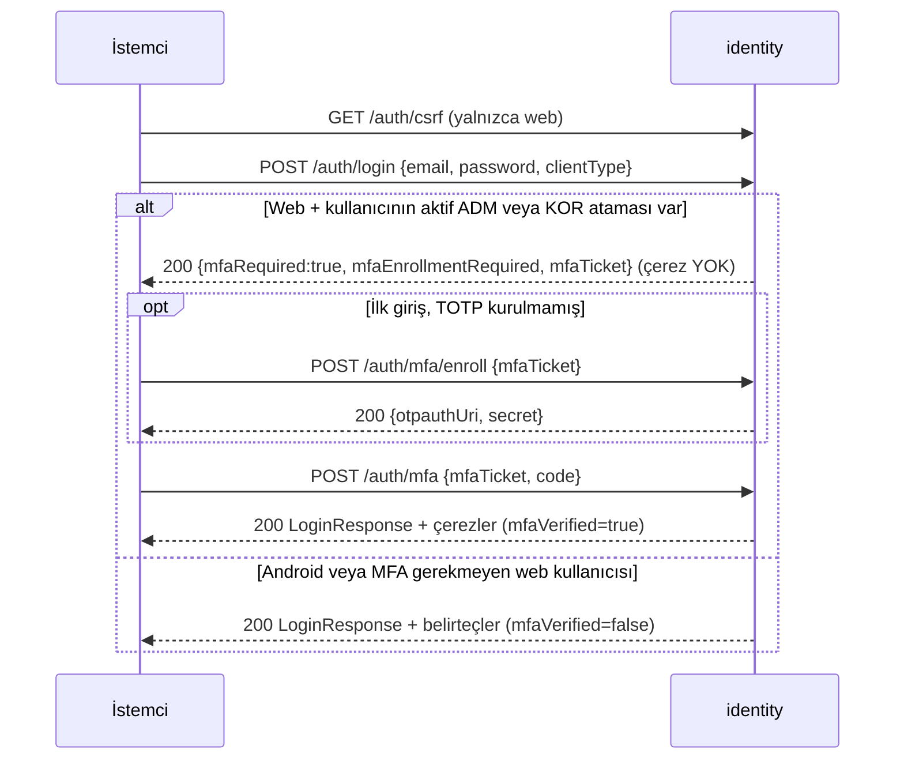
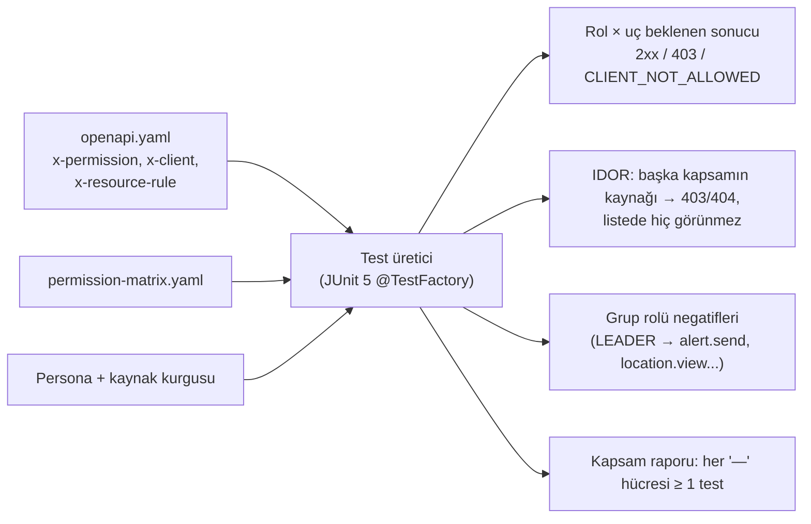

# Backend API Tasarımı: OpenAPI 3 Sözleşmesinin Yazılmaya Hazır Tasarımı

| Alan | Bilgi |
|---|---|
| Sahip | `backend-architect` (T-01, T-03) |
| Sürüm | 1.0 taslak (LD-01 – LD-05 işlendi; web-developer ve android-developer soruları yanıtlandı; T-03 uyumu §15) |
| Tarih | 14.11.2026 |
| Durum | **İncelemede.** team-lead kararı bekleyen noktalar §14'te. Kesinleşmiş K-01 – K-33, TD-01 – TD-22, ADR-001 – ADR-013, LD-01 – LD-15 ve MVP halkaları değiştirilmedi |
| Ana girdi | `../api-and-data-design-basis.md` (§1 kurallar, §2 hata kataloğu, §3 kaynak envanteri, §5 şema envanteri, §6 – §8 akışlar) |
| Diğer girdiler | `../system-architecture.md`, `../emergency-alert-design.md`, `../../authorization.md`, `../../domain-model.md`, `../../communication.md`, `../../decisions.md`, `../../../analysis/*` |
| Bu doküman ne değildir | OpenAPI YAML/JSON dosyası, Java kodu, SQL veya proje iskeleti **değildir.** YAML bu tabloların birebir çevirisi olarak Hafta 3'te (KP1) yazılır |

**Okuma kılavuzu.** §1 – §4 tüm uçlar için ortak kurallardır. §5 – §11 modül başına uç noktaları ve şemaları verir. §12 ortak bileşenler ve SSE sözleşmesidir. §13 test stratejisidir. §15 database-architect ile uyumdur (T-03). Envanterde (`api-and-data-design-basis.md` §3) bulunmayan her uç veya alan **"Ek"** olarak işaretlendi ve §14'te team-lead onayına sunuldu.

**Tablo kısaltmaları.**

| Kısaltma | Anlamı |
|---|---|
| İst. | İstemci: **W** = yalnızca web oturumu (kurumsal izinlerde MFA kuralı §2.4), **A** = yalnızca Android oturumu, **W/A** = ikisi |
| H | Halka: **Ç** = Çekirdek, **G** = Genişletilmiş |
| I | `Idempotency-Key` **zorunlu** (Z) veya **desteklenir** (d) (§3.6) |
| D | Denetim kaydı eylem adı (§12.5). Boşsa denetim yok |
| Hata | Yalnızca uca özgü hatalar. Ortak hatalar (§3.4) her uçta geçerlidir ve tekrar yazılmadı |

---

## 1. Sözleşmenin biçimi ve OpenAPI uzantıları

| Konu | Karar |
|---|---|
| Sürüm | OpenAPI **3.1** (JSON Schema 2020-12 uyumu; `null` tipi doğal). springdoc 3.1 çıktısı verir; web tip üretici (openapi-typescript) ve Android (kotlinx.serialization elle veya openapi-generator) 3.1'i destekler. Sorun çıkarsa 3.0.3'e düşülür, tablolar değişmez |
| Kaynak | **Tasarım önce (design-first).** `api/openapi.yaml` depodaki tek kaynaktır (ADR-010). Backend, openapi-generator ile `interfaceOnly` Spring arayüzleri üretip uygular. CI, çalışan uygulamanın springdoc çıktısını dosyayla karşılaştırır (§13.6) |
| Dosya yapısı | Tek kök dosya + `components/schemas/*`, `paths/<modül>.yaml`. Etiketler (`tags`) modül adlarıdır: `identity`, `access`, `organization`, `groups`, `tasks`, `location`, `alerts`, `notifications`, `realtime`, `audit` |
| `operationId` | `<modül>_<fiil><Kaynak>` biçiminde, ör. `alerts_sendAlert`, `tasks_acceptAssignment`. Web ve Android istemci metot adları buradan gelir |
| Sunucular | `https://{host}/api/v1` |

**Makine tarafından okunan uzantılar.** Her işlem aşağıdaki uzantıları taşır. Yetki matrisi testleri (§13.3), denetim kontrolü ve CI kuralları bu alanlardan beslenir. Eksik uzantılı uç CI'da hata verir.

| Uzantı | Değer | Kullanan |
|---|---|---|
| `x-permission` | `authorization.md` §5 izin adı (ör. `alert.send`) veya `self`, `public`, `authenticated` | `can()` eşlemesi, negatif test üretici |
| `x-resource-rule` | Kaynak kuralı kimliği (ör. `operation.active`, `assignment.pending`) | Test üretici, dokümantasyon |
| `x-client` | `[WEB]`, `[ANDROID]`, `[WEB, ANDROID]` | İstemci kapısı (§2.4) |
| `x-idempotency` | `required` / `supported` | Idempotency filtresi (§3.6) |
| `x-audit` | Denetim eylem adı (§12.5) | Denetim kapsam testi |
| `x-ring` | `CORE` / `EXTENDED` | Özellik bayrağı, kapsam raporu |
| `x-ac` | `["AC-20.2", ...]` | İzlenebilirlik raporu |
| `x-rate-limit` | Kova adı (§3.7) | Hız sınırı filtresi |

---

## 2. Güvenlik şemaları ve oturum modeli

### 2.1 OpenAPI `securitySchemes`

| Ad | Tür | Ayrıntı | Kullanıldığı yer |
|---|---|---|---|
| `cookieAuth` | `apiKey`, `in: cookie`, `name: __Host-access` | Web erişim belirteci (JWT, 15 dk). `HttpOnly; Secure; SameSite=Strict; Path=/` | Web oturumlu tüm uçlar |
| `csrfToken` | `apiKey`, `in: header`, `name: X-CSRF-Token` | Çift gönderimli CSRF belirteci. Değer, `XSRF-TOKEN` çerezinden (HttpOnly **değil**) okunur. `GET`, `HEAD` ve `/stream` dışında **her** çerezli istekte zorunlu; `POST /auth/login` ve `POST /auth/mfa` dahil (giriş CSRF'i). Giriş öncesi belirteç `GET /auth/csrf` ile alınır (S-02). Spring'in varsayılan başlık adı (`X-XSRF-TOKEN`) yapılandırmayla `X-CSRF-Token` yapılır. Eksik veya hatalı belirteç → `403 CSRF_TOKEN_INVALID` (Ek kod); istemci `GET /auth/csrf` ile tazeleyip **bir kez** tekrar dener | `cookieAuth` ile birlikte (mantıksal VE) |
| `bearerAuth` | `http`, `scheme: bearer`, `bearerFormat: JWT` | Android erişim belirteci (15 dk) | Android oturumlu tüm uçlar |
| `mfaTicket` | – (gövde alanı) | Kısa ömürlü (5 dk), tek kullanımlık MFA bileti. Şema değil, `MfaVerifyRequest.mfaTicket` alanı | `/auth/mfa`, `/auth/mfa/enroll` |

Her uçta `security: [{cookieAuth: [], csrfToken: []}, {bearerAuth: []}]` biçiminde iki alternatif yazılır. `x-client` hangisinin geçerli olduğunu daraltır. Herkese açık uçlarda `security: []`.

### 2.2 Belirteçler ve çerezler

| Öğe | Web | Android | Dayanak |
|---|---|---|---|
| Erişim belirteci | JWT, 15 dk, `__Host-access` çerezi | JWT, 15 dk, yanıt gövdesinde; `Authorization: Bearer` | TD-04, ADR-012 |
| Yenileme belirteci | Opak, 12 sa, `__Secure-refresh` çerezi (`Path=/api/v1/auth`, HttpOnly, Secure, SameSite=Strict) | Opak, 30 gün, gövdede; Keystore destekli şifreli depoda | TD-04 |
| Döndürme | Her `/auth/refresh` çağrısında yeni çift; eskisinin tekrar kullanımı zinciri iptal eder (çalınma tespiti) | Aynı | ADR-012 |
| CSRF | `XSRF-TOKEN` çerezi + `X-CSRF-Token` başlığı. Girişten önce `GET /auth/csrf` ile alınır | Yok (çerez kullanılmaz) | ADR-012 |

**Oturum ömrü ve döndürme ayrıntıları (S-06, BS-01):**

| Konu | Kural |
|---|---|
| Oturum kimliği | `sid` = `refresh_tokens.session_id` (zincirin ilk belirtecinin kimliği, §15). `LoginResponse.session.sessionId` ve `TokenResponse.sessionId` olarak istemciye de döner (BS-10): Android, `SESSION_REVOKED` FCM mesajındaki `sessionId` kendi oturumuysa yerel belirteçleri siler, değilse yok sayar |
| Web ömrü (**LD-19**) | 12 sa **mutlak**: zincirin başlangıcından 12 sa sonra yenileme reddedilir, yeniden giriş (ve ADM/KOR için TOTP) gerekir. Her döndürmede yeni belirtecin `expires_at`'i zincir başlangıcı + 12 sa'dir (LD-19) |
| Android ömrü | 30 gün **kayan**: her döndürmede yeni belirteç 30 gün geçerlidir (TD-04) |
| `mfaVerified` | Döndürmede korunur (zincir özelliğidir) |
| Döndürme toleransı (**LD-18**, kesin) | Değiştirilmiş (`replaced_by` dolu) bir belirteç tekrar gelirse **yalnızca şu üç koşulun hepsi** sağlanıyorsa tolerans uygulanır: (1) halef hiç kullanılmamış (`last_used_at IS NULL`), (2) istek aynı istemci türünden (`client` aynı), (3) önceki döndürmeden bu yana ≤ **10 sn**. O zaman kullanılmamış halef `ROTATION_RETRY` gerekçesiyle iptal edilir ve yeni halef verilir; zincir iptal edilmez. Diğer her durumda çalınma tespiti: zincirin tamamı iptal (`AUTH_SESSION_REVOKED`; TD-04, ADR-012). Gerekçe: Android'de yeni belirteç kaydedilmeden süreç çökmesi (BS-01) ve web sekme yarışı (S-06). Web istemcisi yine de Web Locks ile tek sekmede yeniler; Android süreç içi kilit ve "önce yeni belirteci kaydet" sırasını korur |
| SSE ve belirteç süresi | Akış açılışta doğrulanır; erişim belirtecinin süresi dolunca **kapatılmaz**, oturum (`sid`) iptal edilince veya yetki düşünce hemen kapanır. Ayrıca bayat kimlikle süresiz akışı önlemek için sunucu akışı en geç 30 dk'da bir kapatır; tarayıcının yerel yeniden bağlanması `Last-Event-ID` ile kaldığı yerden sürer **Sonraki aşama (SSE ile birlikte):** İstek başı denetim (LD-47) açık akışları kapatmaz, çünkü akış her olayda yeniden doğrulanmaz. İptal eden işlem bir uygulama olayıyla aynı örnekteki akışları kapatmalıdır. Çoklu örnekte bu olay örnekler arası bir kanal (ör. PostgreSQL `LISTEN/NOTIFY`) gerektirir; o zamana kadar sınır, en geç 30 dk'lık zorunlu yeniden bağlanmadır. Yeniden bağlanmada iptal edilmiş oturum reddedilir |

**JWT içeriği (claim'ler).** `sub` (kullanıcı id), `sid` (oturum = yenileme zinciri kimliği), `cli` (`WEB` / `ANDROID`), `mfa` (bool), `iat`, `exp`, `jti`. **Roller ve izinler JWT'de taşınmaz**; her istekte sunucuda hesaplanır. Gerekçe: AC-05.2 (rol kaldırılınca erişim bir sonraki istekte biter).

**Her istekte sunucu denetimi (sıra önemlidir, §3.3):**
1. Belirteç imzası ve süresi → değilse `401 AUTH_TOKEN_EXPIRED` / `401 AUTH_UNAUTHENTICATED` (Ek kod, §14).
2. Taşıma kuralı: `cli=WEB` belirteci yalnızca çerezden, `cli=ANDROID` belirteci yalnızca `Authorization` başlığından kabul edilir. Uyuşmazlık → `401 AUTH_UNAUTHENTICATED`.
3. **Oturum iptal kontrolü (LD-47):** `sid` geçerli mi? Değilse → `401 AUTH_SESSION_REVOKED`. Bu kontrol AC-03.3 ve AC-06.1'in "aynı belirteçle istek 401 döner" koşulu için zorunludur; yalnızca 15 dk'lık JWT ömrü yetmez. **Uygulama:** Her istekte veritabanından, hesap durumuyla (adım 4) **aynı sorguda** denetlenir; istek başına tek gidiş (`pk_users` + `ix_refresh_tokens_family`). Bellek içi iptal kümesi ve açılış yüklemesi **yoktur**. Oturum geçerli ⇔ aynı kullanıcının (`user_id = sub`) `family_id = sid` zincirinde `revoked_at IS NULL AND replaced_by IS NULL AND expires_at > now()` olan bir belirteç var. Sonuçlar: iptal eden her yol yalnızca veritabanını günceller; uygulama dışından ya da başka bir uygulama örneğinden yapılan iptal sonraki istekte etkilidir. Veritabanına ulaşılamazsa kimlik doğrulanmaz ve `503 SERVICE_UNAVAILABLE` döner (LD-48); bu, geçersiz belirteç veya iptal edilmiş oturum (401) değildir ve istemci oturumu sonlandırmaz. Önbelleğe veya eski listeye geri dönülmez. Yenileme belirtecinin süresi kendiliğinden dolan oturumun erişim belirteci de reddedilir (LD-19 mutlak süreyle uyumlu). **Döndürme atomik olmalıdır (ID-05):** halef satırın eklenmesi ve eski satırın `replaced_by` ile değiştirilmesi **aynı işlemde** yapılır (DB E-15); böylece eşzamanlı bir istek zinciri hiçbir an "canlı belirteç yok" olarak görmez.
4. Hesap durumu `ACTIVE` mi → değilse `403 ACCOUNT_DISABLED` (`authorization.md` §2 ilk katman).
5. `must_change_password` → izinli uçlar dışında `403 AUTH_PASSWORD_CHANGE_REQUIRED` (§5.1).
6. İstemci ve MFA kapısı (§2.4) → `403 CLIENT_NOT_ALLOWED`.
7. `can(subject, action, resource)` ve kaynak kuralı.

Hesap durumu önbelleğe alınmaz; oturum denetimiyle aynı sorguda okunur (LD-47). Rol atamaları küçük bir önbellekte tutulur (tek örnek); `RoleAssigned`, `RoleRevoked`, `UserDisabled`, `SessionsRevoked` olaylarında anında boşaltılır.

### 2.3 Giriş ve MFA akışı



- **`clientType` beyanı neden güvenlidir:** Beyan yalnızca oturumun türünü seçer. `ANDROID` oturumu hiçbir koşulda kurumsal izin taşımaz; `WEB` oturumu ADM/KOR için MFA olmadan oluşmaz. Yanlış beyan yetki kazandırmaz. İstek sonrası türü belirteçteki `cli` belirler, beyan değil (`api-and-data-design-basis.md` §1).
- **Web girişi rol ister (LD-03):** `clientType=WEB` girişinde parola doğrulandıktan sonra kullanıcının aktif ADM, KOR, TEK veya UYM ataması yoksa (yalnızca GON/LDR) `403 CLIENT_NOT_ALLOWED` döner; oturum oluşmaz. Android girişinde bu denetim yoktur. Parola yanlışsa önce `AUTH_INVALID_CREDENTIALS` döner (hesap ve rol bilgisi açık edilmez).
- **Uygulama notları (LD-57):** MFA bileti DB'de yalnızca özetiyle, 5 dk ve tek kullanımlık tutulur; en çok 5 hatalı kod. Kabul edilen TOTP adımı saklanır, aynı kod ikinci kez kullanılamaz. TOTP anahtarı AES-256-GCM ile şifreli saklanır (`GKS_TOTP_ENCRYPTION_KEY`). Bilet bir erişim belirteci değildir; ID-04 başarılı olana kadar çerez ve oturum satırı yoktur.
- `AUTH_MFA_REQUIRED` (401) kodu, MFA bileti geçersiz veya süresi dolmuşsa döner; istemci e-posta/parola adımına döner. Giriş yanıtının kendisi 200'dür (`LoginResponse.mfaRequired`), çünkü şema envanteri bu alanı tanımlıyor (§14 N-12).
- **Hatalı TOTP kodu (S-03):** `400 VALIDATION_FAILED`, `errors[0] = {field: "code", code: "INVALID_CODE"}`. Aynı biletle 5 hatalı kod → bilet geçersizleşir ve hesap kilidi sayacı artar (`423 ACCOUNT_LOCKED` olabilir). 401 kullanılmaz; böylece istemcinin 401 → yenileme mantığı tetiklenmez.
- **TOTP kurulumu iki adımlıdır (S-03, BOŞLUK-12):** (1) `POST /auth/mfa/enroll` gizli anahtarı ve `otpauthUri`'yi döner (kurulum henüz kalıcı değil); (2) `POST /auth/mfa` ile ilk kod doğrulanınca kurulum kalıcılaşır ve oturum açılır. Ayrı "kurulum onayı" ucu gerekmez. Oturum açıkken yeniden kurulum (WEB-12): ID-32 ve ID-33.
- **Zorunlu parola değişikliği (S-04):** `mustChangePassword=true` iken oturum yalnızca şu uçlara izin verir: `GET /me`, `GET /me/context`, `POST /me/password`, `POST /auth/refresh`, `POST /auth/logout`, `GET /auth/csrf`. Diğerleri `403 AUTH_PASSWORD_CHANGE_REQUIRED`. ADM/KOR önce TOTP adımını tamamlar (oturum `mfaVerified=true` ile açılır), sonra parolayı değiştirir; parola değişince çağıran yeni oturum ve belirteç çifti alır (`mfaVerified` korunur; LD-58), diğer oturumlar iptal edilir. TOTP tekrar sorulmaz.

### 2.4 İstemci ve MFA kapısı (ADR-013 → **ADR-014**, K-19)

> **ADR-014 (15.11.2026, LD-61):** Aşağıdaki tabloda `x-client: [WEB]` olan yönetim uçları web oturumuna **veya ADM/KOR'un TOTP ile açtığı 12 sa mutlak Android yönetim oturumuna** açıktır (`requireManagementSession`). Android'de kurumsal izin yalnızca ADM/KOR rolünden ve yalnızca `mfaVerified` oturumda türer; TEK/UYM izinleri web'de kalır. Tablonun geri kalanı ve MFA kuralı (LD-01) geçerlidir.

| Uç sınıfı | Kabul edilen oturum | Red |
|---|---|---|
| `x-client: [WEB]` ve kurumsal izin (`authorization.md` §5.4 son paragraf listesi) | `cli=WEB` **ve** MFA kuralı sağlanıyor | `403 CLIENT_NOT_ALLOWED` |
| `x-client: [WEB]` ve kendi hesabı (ör. `/me/password` web'den) | `cli=WEB` | `403 CLIENT_NOT_ALLOWED` |
| `x-client: [ANDROID]` (alarm yanıtı, konum paylaşımı, görev yanıtı, davet kabulü) | `cli=ANDROID` | `403 CLIENT_NOT_ALLOWED` |
| `x-client: [WEB, ANDROID]` | İkisi; ama izin hesabı oturuma göre süzülür | İzin yoksa `403 FORBIDDEN` |

**Etkin izin = rol izinleri ∩ oturumun izin verdiği küme.** Android oturumunun kümesi `authorization.md` §5.4'teki listedir: `task.respond`, `location.share`, `alert.respond`, `invitation.respond`, `meeting_point.update` (yalnızca LEADER), `group.view`, kendi profili ve oturumu. KOR olan bir kullanıcı Android'den `GET /operations/{id}/tasks` çağırırsa yalnızca **kendi atamalarını** görür (gönüllü izdüşümü).

**MFA kuralı (LD-01, kesin):** Kurumsal izinler yalnızca `cli=WEB` oturumunda kullanılır. İzin **ADM veya KOR rol atamasına dayanıyorsa** oturum ayrıca `mfaVerified=true` olmalıdır. TEK ve UYM izinleri (`user.status.view`, `account.disable`, `session.revoke`, `audit.view`) MFA istemez (K-19 TOTP'yi yalnızca ADM/KOR için zorunlu kılar). Android oturumu hiçbir kurumsal izin taşımaz (ADR-013). Uygulama: `can()` izni hangi rol atamasından türettiğini bilir; türetilen atama ADM/KOR ise MFA koşulu eklenir. Örnek: hem ADM hem UYM olan bir kullanıcı, MFA'sız bir web oturumu olamayacağından (ADM için TOTP zorunlu, §2.3) pratikte her zaman `mfaVerified=true` taşır; kural yine de izin bazında değerlendirilir. MFA koşulu sağlanmazsa `403 CLIENT_NOT_ALLOWED`.

---

## 3. Genel API kuralları

### 3.1 Biçim

| Konu | Kural |
|---|---|
| Taban yol | `/api/v1`. Geriye uyumsuz değişiklik `/api/v2` gerektirir (ADR-010) |
| İçerik | İstek `application/json; charset=utf-8`. Hata `application/problem+json`. SSE `text/event-stream` |
| Alan adları | `camelCase`. Enum değerleri `UPPER_SNAKE_CASE`, `domain-model.md` ile aynı |
| Bilinmeyen alan | **Reddedilir** → `400 VALIDATION_FAILED` (`errors[].code = UNKNOWN_FIELD`). AC-04.2 (değiştirilemez alan) bunun özel hâlidir: `READ_ONLY` |
| Boş ve eksik | Yanıtta değeri olmayan isteğe bağlı alan **yazılmaz** (gizlilik izdüşümü, §3.8). İstisna: `AlertRecipientView` zaman alanlarında `null` = "bilinmiyor" anlamı taşır (AC-24.2) ve **her zaman yazılır** |
| Kısmi güncelleme (`PATCH`, **LD-52**) | Gönderilmeyen alan **korunur**. Açıkça `null` gönderilen **isteğe bağlı** alan **temizlenir** (ör. `description`, `plannedEndAt`, görevde `capacity: null` = sınırsız). Zorunlu alana `null` → `400 VALIDATION_FAILED` (`REQUIRED`). Boş metin (`""`) kırpıldıktan sonra isteğe bağlı alanda `null` sayılır. Değiştirilemez alan `READ_ONLY`, bilinmeyen alan `UNKNOWN_FIELD`. Uygulama gövdeyi ağaç olarak okur, çünkü "gönderilmedi" ile "`null`" ayrımı gerekir |
| Kimlikler | UUIDv7, `string(format=uuid)`. İstemci kimlik üretmez; istisna `Idempotency-Key` ve `installationId` |
| Zaman | ISO-8601 UTC, `string(format=date-time)`, milisaniye isteğe bağlı. Cihaz zamanları ayrı alan: `measuredAt`, `respondedAtDevice`. Gösterim Europe/Istanbul istemcidedir (VS-21) |
| Koordinat | `lat` (−90..90), `lon` (−180..180) `number(double)`; `accuracy` metre `number`, ≥ 0 |
| Metin | Baştaki ve sondaki boşluk kırpılır; kontrol karakterleri reddedilir. Uzunluk sınırları §12.4 (öneri, §14 N-15) |

### 3.2 Durum kodları

| Kod | Kullanım |
|---|---|
| `200` | Okuma; gövde dönen değiştirici işlem (durum geçişi, yanıt) |
| `201` | Kaynak oluşturma; `Location` başlığı |
| `202` | Asenkron teslim başlatan işlem: alarm gönderimi, yeniden gönderim, duyuru gönderimi. Gövde güncel durumu verir; teslim sonuçları SSE ve REST ile izlenir |
| `204` | Gövdesiz başarı (çıkış, ölçüm, alındı/görüldü, okundu) |
| `400` | Sözdizimi / alan doğrulama (`VALIDATION_FAILED`) |
| `401` | Kimlik doğrulama |
| `403` | Yetki veya istemci kapısı |
| `404` | Kaynak yok |
| `409` | Durum veya eşzamanlılık çatışması |
| `410` | Davet geçersiz |
| `422` | Anlamsal hata: idempotency uyuşmazlığı, hedef kitle sınırı, boş hedef kitle |
| `423` | Hesap kilitli |
| `429` | Hız sınırı; `Retry-After` |
| `503` | Altyapı geçici olarak erişilemez (`SERVICE_UNAVAILABLE`, LD-48); oturum sona ermiş **sayılmaz** |

### 3.3 Denetim sırası (deterministik negatif testler için)

Bir istek, aşağıdaki sırada **ilk** başarısız denetimin hatasını alır. Negatif testler geçerli gövde gönderir; böylece beklenen kod yalnızca yetkiye bağlı kalır.

| Sıra | Denetim | Hata |
|---|---|---|
| 1 | Hız sınırı | `429 RATE_LIMITED` |
| 2 | Kimlik doğrulama, taşıma, oturum iptali | `401 AUTH_*` |
| 3 | Hesap durumu, parola değiştirme zorunluluğu | `403 ACCOUNT_DISABLED`, `403 AUTH_PASSWORD_CHANGE_REQUIRED` |
| 4 | İstemci / MFA kapısı (uç düzeyi, kaynak yüklenmeden) | `403 CLIENT_NOT_ALLOWED` |
| 5 | Sözdizimi ve alan doğrulama, `Idempotency-Key` varlığı | `400 VALIDATION_FAILED` |
| 6 | Kaynak yükleme | `404 NOT_FOUND` |
| 7 | `can()` (rol, kapsam, grup rolü) | `403 FORBIDDEN` |
| 8 | Idempotency tekrar / uyuşmazlık | önceki yanıt / `422 IDEMPOTENCY_KEY_MISMATCH` |
| 9 | Kaynak kuralı (durum, kapasite, sürüm) | `409 …`, `410 INVITATION_INVALID` |
| 10 | Anlamsal kurallar (hedef kitle sınırı vb.) | `422 …` |

**403 / 404 ilkesi** (`api-and-data-design-basis.md` §1): kaynak varsa ve kapsam dışıysa `403 FORBIDDEN`; yoksa `404`. Kimlikler tahmin edilemez olduğundan bu kabul edilmiş risktir. Liste uçları kapsam dışı kaydı **hiç** döndürmez (filtre sorgu düzeyinde, `authorization.md` §6).

### 3.4 Ortak hatalar (her uçta geçerli, tablolarda tekrarlanmadı)

| Uç türü | Ortak hatalar |
|---|---|
| Kimlik doğrulamalı her uç | `401 AUTH_UNAUTHENTICATED`, `401 AUTH_TOKEN_EXPIRED`, `401 AUTH_SESSION_REVOKED`, `403 ACCOUNT_DISABLED`, `403 AUTH_PASSWORD_CHANGE_REQUIRED`, `429 RATE_LIMITED` |
| Gövde alan her uç | `400 VALIDATION_FAILED` |
| Yol parametreli her uç | `404 NOT_FOUND`, `403 FORBIDDEN` |
| `x-client` tek istemcili her uç | `403 CLIENT_NOT_ALLOWED` |
| `x-idempotency: required` | `400 VALIDATION_FAILED` (başlık eksik), `422 IDEMPOTENCY_KEY_MISMATCH` |
| `version` taşıyan her uç | `409 VERSION_CONFLICT` |

### 3.5 Sayfalama

| Konu | Kural |
|---|---|
| İstek | `?limit=50&cursor=<opak>`. `limit` 1..100, varsayılan 50. **İstisnalar:** `GET /alerts/{id}/recipients` sayfalanmaz: tüm alıcılar (≤ 500) tek yanıtta döner, `cursor`/`limit` yok sayılır; sıralama uygulamada yapılır çünkü `displayName` identity modülündedir (DB T-04 B-06, N-16). `GET /audit-entries` imleci `(at, id)` çiftidir (denetim kayıtları zaman uyumsuz yazılır; DB T-04 B-07) |
| Yanıt | `{ "items": [...], "nextCursor": "…" }`. Son sayfada `nextCursor` yazılmaz |
| İmleç | Opak, base64url; içinde sıralama anahtarı + `id`. İstemci çözmez. Geçersiz imleç → `400 VALIDATION_FAILED` (`cursor`) |
| Sıralama | Varsayılan `id` azalan (UUIDv7 = oluşturma zamanı). Uç bazında farklıysa tabloda yazılır |
| Toplam sayı | Döndürülmez (sayım maliyeti). Özet sayılar ilgili görünümde ayrı alandır (`AlertView.counts`, `TaskView.acceptedCount`) |

### 3.6 Idempotency

| Konu | Kural |
|---|---|
| Başlık | `Idempotency-Key: <UUID>` (istemcide üretilir; 36 karakter UUID biçimi zorunlu) |
| Zorunlu uçlar | **Tek kaynak `api-and-data-design-basis.md` §3'teki "I" işaretleridir (LD-04).** Bu tablolardaki **Z** işaretleri onunla birebir aynıdır: davet oluşturma, davet kabulü (kodla ve operasyon daveti kabul/ret), görev yayını, görev kabul/ret, alarm gönderimi, yeniden gönderim, iptal, alarm yanıtı, duyuru gönderimi. Envanter değişirse bu doküman ve `x-idempotency` uzantısı ona göre güncellenir; CI, OpenAPI'deki `x-idempotency: required` kümesini envanterden üretilen listeyle karşılaştırır |
| Desteklenen uçlar | Tabloda **d** işaretli uçlar başlığı kabul eder ve aynı kurallarla işler. Diğer uçlar başlığı **yok sayar**: özellikle LC-03 ölçümleri, AL-13/AL-14 sinyalleri, NT-05 ve tüm `/auth/*` uçları (yüksek hacim veya sır içeren yanıt; DB T-04 B-15) |
| Sır içeren değerler (**güvenlik kuralı**, LD-42, DB T-04 B-02) | Idempotency tablosuna sır içeren **hiçbir** değer yazılmaz: erişim/yenileme belirteci, MFA bileti, davet kodu veya bağlantı belirteci, TOTP gizli anahtarı, parola. **(1) Yanıt:** Bu kapsamdaki tek zorunlu uç ID-16'dır (davet kabulü; `201 LoginResponse` Android belirteçleriyle). OpenAPI'de `x-idempotency: required-redacted` ile işaretlenir. Kayıt `response_status = 201`, `response_body = NULL`, `body_redacted = true`, `resource_type = USER`, `resource_id` = yeni kullanıcı ile yazılır. Aynı anahtar + aynı özetle gelen tekrar ilk yanıtı **döndürmez** ve **yeni belirteç üretmez**: `409 ALREADY_COMPLETED` (`resourceId` = kullanıcı id'si, `next = LOGIN`); istemci normal girişe yönlenir. Aynı anahtar + farklı özet `422 IDEMPOTENCY_KEY_MISMATCH` alır. Farklı anahtarla gelen ikinci kabul `410 INVITATION_INVALID` (`invitationStatus = ACCEPTED`) alır; ayrım ve gerekçe tablonun altındaki "ID-16 tekrar ayrımı"ndadır. **(2) İstek:** Gövde saklanmaz; yalnızca anahtarlı özeti saklanır ("İstek özeti"). **(3) Kapsam:** Davet kodu `principal_key`'e açık yazılmaz ("Kapsam anahtarı"). **(4) Diğer uçlar:** Sır dönen `/auth/*` uçları (ID-02, ID-04, ID-05) ile TOTP anahtarı dönen ID-03 ve ID-32 başlığı yok sayar ve kayıt yazmaz. Sır dönen yeni bir uç ya `required-redacted` olur ya idempotency dışında kalır; CI bunu denetler (T-IDEM-06) |
| Durum değiştirip 4xx dönen uçlar (DB T-04 B-04) | İşlemin başında eklenen anahtar satırı, commit'ten önce aynı işlemde **silinir**; böylece 2xx olmayan yanıt saklanmaz ve bekleyen eşzamanlı tekrar normal işlenir. MVP'de bu sınıftaki tek yol, TK-11'in **kapasite doluyken `PENDING` atama** savunma yoludur (§9.1). Atama zaten `CAPACITY_FULL` ise durum değişmez; normal geri alma uygulanır. **Commit güvencesi (LD-45):** Satır işlem başında `response_status = NULL` ile eklenir ve yanıt kodu commit'ten önce yazılır. Ertelenmiş kısıt tetikleyicisi `ct_idempotency_keys_completed`, commit anında satırı birincil anahtarla **yeniden okur**: satır silinmişse geçer, durum `NULL` kalmışsa commit'i reddeder (işlemin tamamı geri alınır, `500` + alarm). İşlem geri alınırsa tetikleyici hiç çalışmaz. `ck_idempotency_keys_status (200..299)` ise 4xx yazılmasını engeller (DB §8.3) |
| Kapsam anahtarı | `(principal_key, key)`: `principal_key` = kullanıcı id'si; kimliksiz ID-16'da (`POST /invitations/accept`, LD-37) `anon:` + davet kodunun HMAC özeti. Bu, `identity.invitations.code_hash` ile aynı değerdir; kod açık hâliyle yazılmaz (§15.4, DB §8.3, LD-42) |
| İstek özeti | HMAC-SHA-256(sunucu sırrı; `method` + yol şablonu + yol parametreleri + kanonik JSON gövde), hex. **Anahtarlıdır** (LD-42): ID-16 gövdesi parola ve davet kodu içerir; anahtarsız SHA-256 yedekten çevrimdışı parola denemesine açık olurdu. Sır, davet `code_hash` sırrıyla aynı sır deposundan gelen **ayrı** bir anahtardır; veritabanında ve yedekte bulunmaz. Anahtar sürümlüdür; döndürme kuralı bir sonraki satırdadır. Aynı anahtar başka uçta kullanılırsa özet farklıdır → `422 IDEMPOTENCY_KEY_MISMATCH` |
| Özet anahtarı döndürme (LD-42) | **Sürümlü anahtar:** Her satır özeti üreten anahtarın sürümünü taşır (`hash_key_version`). Tekrar geldiğinde özet, **satırdaki sürümün** anahtarıyla yeniden hesaplanıp karşılaştırılır; böylece döndürme sırasında meşru tekrarlar `422` almaz. Aynı anda en fazla iki anahtar yüklüdür: **etkin** (yeni satırların özeti) ve **doğrulama-yalnız** (yalnızca eski sürümlü satırları karşılaştırır, yeni özet üretemez). **Olağan döndürme:** (1) Yeni anahtar sır deposuna eklenip etkin yapılır; eski anahtar aynı anda doğrulama-yalnız olur. (2) **Geçiş penceresi 25 saattir:** satır ömrü 24 saat + saatlik temizlik payı 1 saat. Pencere, eski anahtarla yazılabilecek son satırın süresi dolup temizlenmesini kapsar. (3) Kaldırmadan önce `SELECT count(*) FROM platform.idempotency_keys WHERE hash_key_version = <eski>` sonucunun 0 olduğu doğrulanır; değilse temizlik çalıştırılır ve tekrar denetlenir. (4) Eski anahtar sır deposundan **silinir**, uygulama yeniden yüklenir ve döndürme işletim günlüğüne yazılır (yalnızca sürüm numaraları ve zaman; anahtar değeri yok). **Eksik anahtar (fail-closed):** Süresi dolmamış bir satırın sürümü için yüklü anahtar yoksa satır yok sayılmaz ve istek yeni istek olarak **işlenmez**. Yanıt `500` olur ve alarm üretilir; anahtar değeri ya da sürüm bilgisi yanıta yazılmaz. İstemci `5xx` için tekrar dener. Satırın süresi dolunca istek normal kurala göre yeni sayılır; bu, olağan 24 saatlik güvenceyle aynıdır. **Sürüm numaraları yeniden kullanılmaz:** Yeni sürüm = max(sır deposundaki sürümler, veritabanındaki sürümler, sır deposunda tutulan "son verilen sürüm") + 1. Böylece kaybolmuş bir anahtarın numarası başka bir anahtara verilmez. Yedekten geri yüklemedeki adımlar DB §9.5'tedir. **Eski anahtarın saklanması:** Etkin anahtarla aynı sır deposunda, aynı erişim denetimiyle tutulur; veritabanında, yedekte, kaynak deposunda, günlükte ve hata raporunda bulunmaz. Pencere sonunda silinir; arşivlenmez ve geri yüklenmez. **Acil döndürme (anahtar sızdı veya sızmış olabilir):** Pencere beklenmez. Eski anahtar hemen kaldırılır ve o sürümle yazılmış satırlar silinir (`DELETE … WHERE hash_key_version = <eski>`). Bu satırların tekrarları yeni istek sayılır: ID-16'da `410 INVITATION_INVALID` döner. Diğer zorunlu uçlarda alan düzeyi korumalar ("Alana özgü yedek" satırı, durum geçişlerinin koşullu güncellemesi) çift işlemeyi sınırlar; kalan çift işleme riski acil durumda kabul edilir. Sızan anahtarla üretilmiş özetler saklanan yedeklerde (7 günlük + 4 haftalık, DB §9.5) kalır; bu yedeklere erişim `app_backup` ve ayrı birim güvencesiyle sınırlıdır (TD-15). **Kapsam:** Davet `code_hash` anahtarı ayrıdır ve bu kuralın dışındadır |
| Aynı anahtar + aynı özet | İlk başarılı yanıt (durum kodu + gövde) **aynen** döner; `Idempotent-Replayed: true` başlığı eklenir |
| Aynı anahtar + farklı özet | `422 IDEMPOTENCY_KEY_MISMATCH` |
| Saklanan yanıt | **Yalnızca 2xx** saklanır. 4xx/5xx'te iş işlemi geri alındığından anahtar kaydı da yoktur; istemci aynı anahtarla yeniden deneyebilir. Gerekçe: `AUDIENCE_CHANGED` sonrası yeni önizlemeyle aynı anahtarın kullanılabilmesi |
| İşlem bütünlüğü | Anahtar kaydı iş kaydıyla **aynı veritabanı işleminde** yazılır. Eşzamanlı ikinci istek benzersiz indekste bekler; ilki commit edince saklı yanıtı döner, geri alınırsa kendisi işlenir. Ayrı "işleniyor" durumu ve yeni hata kodu gerekmez |
| Süre | 24 saat; sonra temizlenir. Süresi geçmiş anahtar yeni istek sayılır. **Süre, temizlik işine bırakılmaz:** arama `expires_at > now()` koşuluyla yapılır. Süresi geçmiş satır, aynı işlemde silinip yeni satır eklenerek yok sayılır; sürüm denetimine hiç girmez (LD-42 (7)) |
| Alana özgü yedek | Alarm yanıtında ayrıca alıcı satırındaki `response_idempotency_key` ile aynı yanıtın tekrarı tek yanıt sayılır (AC-20.5, K-24). Aynı taslak sürümünün farklı anahtarla ikinci gönderimi `409 INVALID_STATE_TRANSITION` alır (taslak artık `OPEN`, `emergency-alert-design.md` §3) |

**ID-16 tekrar ayrımı (LD-42).** `Idempotency-Key`, istemcinin "aynı gönderimi yeniden deniyorum" beyanıdır. Davet kodu ise tek kullanımlık bir yetkidir (AC-01.2, DB E-18). Sunucu yalnızca neyin kanıtlandığına bakar:

| Gelen istek | Neyi kanıtlar | Sonuç | Gerekçe | İstemci |
|---|---|---|---|---|
| Aynı anahtar + aynı özet, 24 saat içinde | İstek, ilk başarılı isteğin anahtarını ve gövdesini (belirlenen parola dahil) bilen istemciden geliyor: yanıtı kaybolmuş **aynı gönderim** | `409 ALREADY_COMPLETED` (`resourceId`, `next = LOGIN`) | Yanıt saklanmadığı için tekrar edilemez. Yeni belirteç üretmek gerekmez; kullanıcı az önce belirlediği parolayla girebilir | "Hesabınız oluşturuldu. Belirlediğiniz parolayla giriş yapın." → AND-01 |
| Aynı anahtar + farklı özet | Anahtar başka bir içerikle yeniden kullanıldı (istemci hatası) | `422 IDEMPOTENCY_KEY_MISMATCH` | §3.6 genel kuralı; kaynak kuralından önce denetlenir (§3.3 sıra 8) | Hata günlüğe yazılır; form yeni anahtarla gönderilir |
| Farklı anahtar, ya da 24 saat sonra aynı anahtar | Yalnızca davet kodunun bilindiğini; yeni bir kabul girişimi | `410 INVITATION_INVALID` (`invitationStatus = ACCEPTED`) | Bu anahtar için kayıt yoktur; istek kaynak kuralına düşer (§3.3 sıra 9) ve davet artık `ACCEPTED`'tır. Kabulden sonra kod bir kimlik bilgisi değildir. Bu yolda oturum ya da `resourceId` verilirse, kodu ele geçiren (e-posta kutusu, ekran görüntüsü) hesabı ele geçirir veya kullanıcı kimliğini öğrenir. Sunucu yeni anahtarlı isteğin meşru kullanıcıdan gelip gelmediğini ayırt edemez; bu yüzden en dar yanıt verilir. `invitationStatus` yalnızca kodu bilene o kodun durumunu söyler; ID-15 bu bilgiyi zaten verir | "Bu davet daha önce kullanılmış. Hesabınız varsa giriş yapın; yoksa yöneticinizden yeni davet isteyin." → AND-01 |

İstemci kuralı: Anahtar **form gönderimi başına bir kez** üretilir ve yanıt alınana kadar kalıcı tutulur. Ağ hatası, zaman aşımı, `429` veya `5xx` durumunda aynı gövde aynı anahtarla yeniden gönderilir. Kullanıcı formdaki bir alanı değiştirirse yeni anahtar üretilir.

### 3.7 Hız sınırı (GAP-12, AC-03.2)

| Kova | Uçlar | Sınır (öneri) | Anahtar |
|---|---|---|---|
| `auth-login` | `POST /auth/login` | 10 / dk / IP; 5 hatalı deneme / e-posta → 15 dk kilit | IP ve normalize e-posta |
| `auth-mfa` | `POST /auth/mfa`, `/auth/mfa/enroll` | 5 / bilet; 10 / dk / IP | bilet, IP |
| `invite-code` | `GET /invitations/by-code/{code}`, `POST …/accept` | 10 / dk / IP | IP |
| `password` | `POST /me/password`, (G) parola sıfırlama | 5 / 15 dk / kullanıcı veya IP | kullanıcı, IP |
| `location` | `POST /operations/{id}/locations` | 6 / dk / kullanıcı / operasyon (60 sn aralık + pay) | kullanıcı |
| `default` | Diğer kimlikli uçlar | 300 / dk / kullanıcı | kullanıcı |

**Hesap varlığını açık etmeme:** `ACCOUNT_LOCKED` sayacı e-posta anahtarıyla tutulur; kayıtlı olmayan e-postalar da 5 denemeden sonra aynı `423` yanıtını alır (AC-03.1). `ACCOUNT_DISABLED` yalnızca parola doğruysa döner.

### 3.8 Gizlilik izdüşümleri (user-roles §5, NFR-15)

Aynı kaynak role göre farklı alan kümesiyle döner. OpenAPI'de tek şema, isteğe bağlı alanlarla yazılır; hangi rolün hangi alanı gördüğü şema açıklamasında ve §13.3 testlerinde tanımlıdır.

| Alan | Kendisi | Aynı grubun üyesi (GON) | Grup lideri | KOR (kendi operasyonu) | ADM | TEK |
|---|---|---|---|---|---|---|
| `id`, `displayName` | ✓ | ✓ | ✓ | ✓ | ✓ | ✓ |
| `status` | ✓ | – | – | ✓ | ✓ | ✓ |
| `fullName` | ✓ | – | ✓ | ✓ | ✓ | – |
| `email`, `phone` | ✓ | – | – | ✓ | ✓ | – |
| Roller, gruplar, görevler | ✓ | – | – | ✓ (kendi operasyonu) | ✓ | – |

---

## 4. Hata modeli

### 4.1 `ProblemDetail` (RFC 9457)

| Alan | Tip | Zorunlu | Açıklama |
|---|---|---|---|
| `type` | string (uri-reference) | ✓ | `/problems/<kod-kebab>` (ör. `/problems/operation-not-active`) |
| `title` | string | ✓ | Kısa Türkçe başlık |
| `status` | integer | ✓ | HTTP kodu |
| `code` | `ErrorCode` enum | ✓ | Makine kodu; istemci mesajı buna göre seçer |
| `detail` | string | | Kişisel veri, iç bilgi, SQL veya yığın izi içermez |
| `errors` | `FieldError[]` | | Yalnızca `VALIDATION_FAILED` ve `422`'lerde |
| `traceId` | string | ✓ | Günlük eşleştirme |
| Uzantılar | – | | Koda özgü, aşağıda |

`FieldError`: `field` (JSON yolu, ör. `targets.userIds[2]` veya başlık adı `Idempotency-Key`), `code` (`REQUIRED`, `TOO_LONG`, `TOO_SHORT`, `OUT_OF_RANGE`, `INVALID_FORMAT`, `READ_ONLY`, `UNKNOWN_FIELD`, `NOT_ALLOWED_VALUE`, `EMPTY_AUDIENCE`, `CONFIRMATION_REQUIRED`), `message` (Türkçe).

**Koda özgü uzantılar:**

| Kod | Uzantı alanı |
|---|---|
| `AUTH_MFA_REQUIRED` | `mfaTicket` (yeniden doğrulama için) |
| `ACCOUNT_LOCKED` | `lockedUntil` (date-time); `Retry-After` başlığı |
| `AUDIENCE_CHANGED` | `preview` (`AlertPreview`; istemci yeni önizlemeyi doğrudan gösterir) |
| `CAPACITY_FULL` | `acceptedCount`, `capacity` |
| `CAPACITY_BELOW_ACCEPTED` | `acceptedCount` |
| `VERSION_CONFLICT` | `currentVersion` |
| `ALERT_NOT_OPEN` | `alertState` (`CANCELLED` / `CLOSED`) |
| `INVALID_STATE_TRANSITION` | `currentState`, `requestedState` |
| `AUDIENCE_TOO_LARGE` | `recipientCount`, `limit` |
| `RATE_LIMITED` | `Retry-After` başlığı |
| `ALREADY_EXISTS` | `conflict`: `EMAIL_REGISTERED`, `INVITATION_PENDING`, `ALREADY_PARTICIPANT`, `ALREADY_MEMBER`, `ROLE_ACTIVE`, `ASSIGNMENT_ACTIVE`, `ALERT_ALREADY_CORRECTED`, `CLOSURE_REQUESTED` (G). İstemci mesajı bu alana göre seçer (BOŞLUK-11) |
| `GROUP_FULL` | `memberCount`, `limit` |
| `ALREADY_COMPLETED` | `resourceId`, `next` (`LOGIN`) |
| `INVITATION_INVALID` | `invitationStatus`: `ACCEPTED`, `DECLINED`, `EXPIRED`, `REVOKED`. Yalnızca kodu veya davet kimliğini zaten bilen istekte döner (§3.6 "ID-16 tekrar ayrımı") |

### 4.2 `ErrorCode` kataloğu

Katalog `api-and-data-design-basis.md` §2'dir. Aşağıdaki **Ek** kodlar team-lead onayı bekler (§14 N-05). Onaylanmazsa karşılık sütunundaki mevcut kod kullanılır.

| Ek kod | HTTP | Anlamı | Onaylanmazsa |
|---|---|---|---|
| `AUTH_UNAUTHENTICATED` | 401 | Belirteç yok, bozuk veya yanlış taşımada | `AUTH_TOKEN_EXPIRED` (yanıltıcı) |
| `CSRF_TOKEN_INVALID` | 403 | CSRF belirteci eksik veya hatalı (S-02) | `FORBIDDEN` (istemci yetki hatasıyla karıştırır) |
| `ALREADY_EXISTS` | 409 | Benzersizlik çatışması; ayrıntı `conflict` uzantısında (§4.1). database-architect'in önerdiği `EMAIL_ALREADY_REGISTERED`, `INVITATION_ALREADY_PENDING` ve web-developer'ın önerdiği `ALREADY_PARTICIPANT` kodları **tek kod + neden alanı** olarak birleştirildi (katalog büyümez, istemci yine ayrı mesaj gösterir) | `VALIDATION_FAILED` |
| `GROUP_FULL` | 409 | Grup 50 üye sınırında (D-04, VS-02). Ad database-architect önerisiyle birleştirildi | `VALIDATION_FAILED` |
| `ALREADY_COMPLETED` | 409 | Sır içeren yanıtı olan işlem **aynı idempotency anahtarı ve aynı gövdeyle** tekrarlandı; yanıt tekrar edilmez, istemci girişe yönlenir. Farklı anahtarla tekrar bu kodu değil kaynağın kendi kuralını alır (ID-16'da `410`) (§3.6; DB T-04 B-02) | – (güvenlik gereği zorunlu) |
| `OPERATION_CLOSED` | 409 | `COMPLETED`/`CANCELLED` operasyonun kaynağında yazma (grup, görev, davet) | `INVALID_STATE_TRANSITION` |
| `SERVICE_UNAVAILABLE` | 503 | **LD-48 (kabul edildi).** Kimlikli istekte oturum denetimi (§2.2 adım 3) veritabanına ulaşamadı. Belirteç geçersiz **değildir** ve oturum iptal **edilmemiştir**: istemci belirteçleri silmez, yenileme denemez, oturumu sonlandırmaz; isteği üstel geri çekilmeyle tekrarlar. Problem gövdesi diğer kodlarla aynıdır (`type`, `title`, `status`, `code`, `traceId`); ayrıntı ve iç hata bilgisi yazılmaz | `AUTH_UNAUTHENTICATED` (yanıltıcı: istemci oturumu sonlandırır) |
| `RESET_TOKEN_INVALID` (G) | 410 | Parola sıfırlama belirteci süresi dolmuş veya kullanılmış (AC-03.4) | `INVITATION_INVALID` (yanıltıcı) |

---

## 5. identity modülü

### 5.1 Uç noktalar

| # | Yöntem ve yol | İzin / kaynak kuralı | İst. | H | İstek | Yanıt | Uca özgü hatalar | I | D | AC |
|---|---|---|---|---|---|---|---|---|---|---|
| ID-01 | `GET /auth/csrf` **(Ek)** | `public` | W | Ç | – | `200` `CsrfToken`; `XSRF-TOKEN` çerezi | – | | | ADR-012 |
| ID-02 | `POST /auth/login` | `public`; hız sınırı | W/A | Ç | `LoginRequest` | `200` `LoginResponse` (+ web çerezleri veya Android belirteçleri) | `401 AUTH_INVALID_CREDENTIALS`, `423 ACCOUNT_LOCKED`, `403 ACCOUNT_DISABLED` (yalnızca parola doğruysa), `403 CLIENT_NOT_ALLOWED` (web girişi, web rolü yok; LD-03), `403 CSRF_TOKEN_INVALID` | | `AUTH_LOGIN_SUCCEEDED` / `AUTH_LOGIN_FAILED` / `AUTH_ACCOUNT_LOCKED` | AC-03.1, 03.2, 03.5 |
| ID-03 | `POST /auth/mfa/enroll` | Geçerli MFA bileti; TOTP kurulmamış | W | Ç | `MfaEnrollRequest` | `200` `MfaEnrollResponse` | `401 AUTH_MFA_REQUIRED` (bilet geçersiz/süresi dolmuş), `409 INVALID_STATE_TRANSITION` (zaten kurulu) | | | AC-07.1 |
| ID-04 | `POST /auth/mfa` | Geçerli MFA bileti | W | Ç | `MfaVerifyRequest` | `200` `LoginResponse` + çerezler (`mfaVerified=true`) | `401 AUTH_MFA_REQUIRED` (bilet geçersiz/süresi dolmuş), `400 VALIDATION_FAILED` (`code`: `INVALID_CODE`), `423 ACCOUNT_LOCKED` (5 hatalı kod). Kurulum sürecindeyse ilk doğru kod kurulumu kalıcılaştırır | | `AUTH_MFA_VERIFIED`; ilk kurulumda `AUTH_MFA_ENROLLED` | AC-07.1 |
| ID-05 | `POST /auth/refresh` | Geçerli yenileme belirteci | W/A | Ç | Web: gövde yok (çerez). Android: `RefreshRequest` | `200` `TokenResponse` (web: belirteçler yalnızca çerezde, gövde `{sessionId, accessTokenExpiresAt}`; LD-57 (7)) | `401 AUTH_SESSION_REVOKED` (iptal, 12 sa mutlak süre doldu veya tolerans dışı tekrar kullanım → zincir iptal; tolerans §2.2) | | Tekrar kullanımda `AUTH_REFRESH_REUSE_DETECTED` | ADR-012, TD-04 |
| ID-06 | `POST /auth/logout` | `self` | W/A | Ç | – | `204`; web çerezleri silinir | – | | `AUTH_LOGOUT` | AC-03.3 |
| ID-07 | `POST /auth/logout-all` | `self` | W/A | Ç | – | `204` | – | | `AUTH_LOGOUT_ALL` | AC-06.4 |
| ID-08 | `POST /me/password` | `self`; `must_change_password` iken de izinli | W/A | Ç | `PasswordChangeRequest` | `200` `TokenResponse` (web: çerezler); tüm eski oturumlar iptal, çağıran yeni oturum alır (LD-58) | `400 VALIDATION_FAILED` (`currentPassword`: `INVALID`; `newPassword` kuralları). 401 kullanılmaz (istemcinin oturum yenileme mantığını tetiklememek için, S-03) | | `PASSWORD_CHANGED` | AC-03.5 |
| ID-09 | `GET /me` | `self` | W/A | Ç | – | `200` `MeProfile` | – | | | AC-04.1 |
| ID-10 | `PATCH /me` | `self` | W/A | Ç | `MeProfileUpdate` | `200` `MeProfile` | `400` (`READ_ONLY`: `email`, `status`, `roles`, `id`; `REQUIRED`: boş zorunlu alan) | | | AC-04.1 – 04.3 |
| ID-11 | `GET /me/context` | `self`; `must_change_password` iken de izinli | W/A | Ç | – | `200` `MeContext` | – | | | – |
| ID-12 | `POST /invitations` | `invitation.create` (ADM: kurum veya herhangi bir operasyon; KOR: yalnızca kendi operasyonu) | W | Ç | `InvitationCreateRequest` | `201` `InvitationView` | `409 ALREADY_EXISTS` (kayıtlı kullanıcıya kurum daveti; zaten katılımcı; aynı e-posta+kapsam için bekleyen davet), `409 OPERATION_CLOSED` | Z | `INVITATION_CREATED` | AC-01.1, 01.3, 01.4, 01.5 |
| ID-13 | `GET /invitations` **(Ek)** | `invitation.create` kapsamı (ADM kurum; KOR kendi operasyonları) | W | Ç | Sorgu: `scopeType?`, `scopeId?`, `status?` (çoklu), `includeTotal?`, `limit`, `cursor` | `200` `Page<InvitationView>` (+ `includeTotal=true` ise `totalCount`) | – | | | WEB-02, WEB-03, BOŞLUK-1, 6 |
| ID-14 | `POST /invitations/{id}/revoke` **(Ek)** | `invitation.create` (oluşturan kapsamı) | W | Ç | – | `200` `InvitationView` (`REVOKED`) | `409 INVALID_STATE_TRANSITION` (`PENDING` değil) | | `INVITATION_REVOKED` | domain §5A `REVOKED` |
| ID-15 | `GET /invitations/by-code/{code}` | `public`; hız sınırı | A | Ç | Yol: `code` | `200` `InvitationPublicView` | `404 NOT_FOUND` (bilinmeyen kod), `410 INVITATION_INVALID` (süresi dolmuş, kullanılmış, iptal) | | | AC-01.2, 01.6, TD-02 |
| ID-16 | `POST /invitations/by-code/{code}/accept` | `public`; `kind=NEW_USER`, `PENDING`, süresi dolmamış | A | Ç | `InvitationAcceptRequest` | `201` `LoginResponse` (Android belirteçleriyle; hesap `ACTIVE`). Yanıt gövdesi idempotency tablosuna **yazılmaz** (§3.6) | `410 INVITATION_INVALID` (zaten kabul edilmiş dahil), `409 ALREADY_COMPLETED` (aynı anahtarla tekrar), `409 ALREADY_EXISTS` (e-posta yarış durumunda kayıtlı) | Z | `INVITATION_ACCEPTED` (+ `USER_ACTIVATED`) | AC-01.2, 02.1 – 02.2 |
| ID-17 | `POST /invitations/{id}/accept` | `invitation.respond`: davetin `user_id`'si istekte bulunan; `kind=OPERATION`, `PENDING` | A | Ç | – | `200` `InvitationView` (`ACCEPTED`); katılım oluşur (TD-01) | `410 INVITATION_INVALID` (süre doldu, operasyon kapandı) | Z | `INVITATION_ACCEPTED` (+ `ROLE_ASSIGNED` GON/OPERATION) | AC-01.5 |
| ID-18 | `POST /invitations/{id}/decline` | `invitation.respond` | A | Ç | – | `200` `InvitationView` (`DECLINED`) | `410 INVITATION_INVALID` | Z | `INVITATION_DECLINED` | AC-01.5 |
| ID-19 | `GET /users` | ADM: kurum; KOR: kendi operasyonlarının katılımcıları; TEK: `user.status.view` (yalnızca `displayName`, `status`) | W | Ç | Sorgu: `status?`, `operationId?`, `includeTotal?`, `limit`, `cursor` (sıralama `id`; ad sıralaması istemcide, ≤ 500 kayıt — database-physical-design §7.4); (G) `closureRequested?` | `200` `Page<UserSummary>` (izdüşüm §3.8; `includeTotal=true` ise `totalCount`) | – | | | AC-06.5, BOŞLUK-1 |
| ID-20 | `GET /users/{id}` | Aynı kapsam | W | Ç | – | `200` `UserDetail` (izdüşüm) | – | | | AC-06.5 |
| ID-21 | `POST /users/{id}/disable` | `account.disable` (ADM; TEK) | W | Ç | `ReasonRequest` (isteğe bağlı gerekçe) | `200` `UserSummary`; oturumlar iptal, cihazlar pasif, SSE akışları kapanır | `409 INVALID_STATE_TRANSITION` (zaten devre dışı), `403 FORBIDDEN` (kendi hesabı; kaynak kuralı `not.self`, S-09) | | `ACCOUNT_DISABLED` | AC-06.2, 06.3 |
| ID-22 | `POST /users/{id}/enable` **(Ek)** | `account.disable` (ADM) | W | Ç | – | `200` `UserSummary` | `409 INVALID_STATE_TRANSITION` | | `ACCOUNT_ENABLED` | FR-22 (geri alma) |
| ID-23 | `POST /users/{id}/revoke-sessions` | `session.revoke` (ADM; TEK) | W | Ç | – | `204`; tüm zincirler iptal, cihazlar pasif, `session.revoked` SSE, isteğe bağlı FCM `SESSION_REVOKED` | – | | `SESSIONS_REVOKED` | AC-06.1, 06.3, SC-07 |
| ID-24 | `POST /users/{id}/reset-password` | ADM (`account.disable` ailesi; ayrı izin adı önerisi `password.reset`, §14 N-13) | W | Ç | – | `204`; geçici parola **e-postayla** (Mailpit) gider, `must_change_password=true`, oturumlar iptal | – | | `PASSWORD_RESET_BY_ADMIN` | AC-03.5 |
| ID-25 | `POST /users/{id}/reset-mfa` | `mfa.reset` (ADM) | W | Ç | – | `204`; TOTP silinir, web oturumları iptal | `409 INVALID_STATE_TRANSITION` (TOTP kurulu değil) | | `MFA_RESET` | AC-07.2 |
| ID-26 | `PUT /devices/{installationId}` | `self` | A | Ç | `DeviceRegisterRequest` | `200` `DeviceView` (ilk kayıtta `201`) | – | | | TD-17 |
| ID-27 | `POST /auth/password-reset` **(G, Ek)** | `public`; hız sınırı | W/A | G | `PasswordResetRequest` (`email`) | `202` (hesap varlığı açık edilmez) | – | | `PASSWORD_RESET_REQUESTED` | AC-03.4 |
| ID-28 | `POST /auth/password-reset/confirm` **(G, Ek)** | Tek kullanımlık, 30 dk belirteç | W/A | G | `PasswordResetConfirmRequest` (`token`, `newPassword`) | `204`; tüm oturumlar iptal | `410 RESET_TOKEN_INVALID` (Ek kod) | | `PASSWORD_RESET_COMPLETED` | AC-03.4 |
| ID-29 | `POST /me/consents` **(G, Ek)** | `self` | A | G | `ConsentRequest` (`textVersion`) | `201` `ConsentView` | – | | `CONSENT_RECORDED` | AC-02.2, 02.3, TD-22 |
| ID-30 | `POST /me/closure-request` **(G, Ek)** | `self` | A | G | – | `202` | `409 ALREADY_EXISTS` | | `ACCOUNT_CLOSURE_REQUESTED` | AC-30.1 |
| ID-31 | `POST /users/{id}/close` **(G, Ek)** | ADM | W | G | – | `200` `UserSummary` (`CLOSED`); anonimleştirme, son konumlar silinir | `409 INVALID_STATE_TRANSITION` | | `ACCOUNT_CLOSED` | AC-30.2 |
| ID-32 | `POST /me/mfa/enroll` **(Ek)** | `self`; ADM/KOR; `mfaVerified=true` web oturumu | W | Ç | `MfaReenrollRequest` (`currentPassword`, `currentCode`) | `200` `MfaEnrollResponse` (yeni anahtar **beklemede**; eski TOTP geçerli kalır) | `400 VALIDATION_FAILED` (`currentPassword`/`currentCode`: `INVALID`) | | | WEB-12, BOŞLUK-12 |
| ID-33 | `POST /me/mfa/enroll/confirm` **(Ek)** | `self`; bekleyen kurulum | W | Ç | `MfaCodeRequest` (`code`, yeni anahtarla) | `204`; yeni anahtar etkin, diğer web oturumları iptal | `400 VALIDATION_FAILED` (`INVALID_CODE`), `409 INVALID_STATE_TRANSITION` (bekleyen kurulum yok / 10 dk'yı aştı) | | `AUTH_MFA_ENROLLED` | WEB-12 |
| ID-34 | `GET /ping` **(Ek)** | `public`; hız sınırı `default`(IP) | W/A | Ç | – | `204`; gövde ve sürüm bilgisi yok, `Cache-Control: no-store` | – | | | AC-32.1, BS-05 (hafif erişilebilirlik denetimi; Actuator dışarı açılmaz) |

**Davet türünün belirlenmesi (ID-12):** İstemci `kind` göndermez. Sunucu: e-posta kurumda kayıtlı ve `scopeType=OPERATION` → `kind=OPERATION` (uygulama içi `OPERATION_INVITE` bildirimi + e-posta, TD-01); kayıtlı değil → `kind=NEW_USER`; kayıtlı ve `scopeType=ORGANIZATION` → `409 ALREADY_EXISTS` (`conflict=EMAIL_REGISTERED`); zaten katılımcı → `ALREADY_PARTICIPANT`; aynı e-posta + kapsam için bekleyen davet → `INVITATION_PENDING` (yeniden gönderim = ID-14 ile iptal + yeni davet; DB `ux_invitations_pending_email_scope`). `NEW_USER` + `OPERATION` kabulü hem hesabı hem katılımı (GON/OPERATION) oluşturur. `NEW_USER` + `ORGANIZATION` kabulü yalnızca hesabı oluşturur, rol ataması oluşturmaz; `GON` yalnızca operasyon kapsamındadır (**LD-23**). Operasyon kapanınca o operasyonun `PENDING` davetleri kapanış zincirinde `EXPIRED` olur. *Not:* KOR yanıttaki `kind` alanından e-postanın kurumda kayıtlı olup olmadığını öğrenir; KOR zaten kurum içi yetkili olduğundan kabul edilebilir sayıldı (§14 N-14).

**Davet kodu biçimi (TD-02):** 10 karakter Crockford base32, `XXXX-XXXX-XX` gösterimi (~50 bit) + hız sınırı. E-postadaki https bağlantısı kodu **URL parçasında** (`/davet#kod=…`) taşır; böylece statik sayfa sunucuya istek göndermeden kodu gösterir ve kod erişim günlüğüne düşmez. **Risk (§14 N-08):** ID-15/ID-16'da kod yol parametresidir ve ters vekil günlüğüne yazılır. Öneri: Caddy'de bu yollar için günlük maskeleme veya uçları `POST /invitations/lookup {code}` biçimine çevirmek.

### 5.2 Şemalar

| Şema | Alan | Tip | Z | Doğrulama / not |
|---|---|---|---|---|
| `CsrfToken` | `headerName` | string | ✓ | `X-CSRF-Token` |
| | `token` | string | ✓ | |
| `LoginRequest` | `email` | string(email) | ✓ | ≤ 254, küçük harfe normalize |
| | `password` | string(password) | ✓ | 1..128 (girişte yalnızca uzunluk) |
| | `clientType` | `ClientType` | ✓ | `WEB`, `ANDROID` (§2.3) |
| | `installationId` | string | Android'de ✓ | 8..64, `[A-Za-z0-9-]`; cihaz kaydıyla bağlanır |
| `LoginResponse` | `mfaRequired` | boolean | ✓ | `true` ise belirteç alanları yok |
| | `mfaEnrollmentRequired` | boolean | | `mfaRequired=true` iken TOTP kurulmamışsa `true` |
| | `mfaTicket` | string | | Yalnızca `mfaRequired=true` |
| | `mustChangePassword` | boolean | ✓ | |
| | `accessToken`, `refreshToken` | string | | **Yalnızca Android**; web'de çerezde |
| | `accessTokenExpiresAt` | date-time | | |
| | `session` | `SessionInfo` | | `mfaRequired=false` iken |
| `SessionInfo` | `sessionId` | uuid | ✓ | JWT `sid` (BS-10) |
| | `clientType` | `ClientType` | ✓ | |
| | `mfaVerified` | boolean | ✓ | |
| | `expiresAt` | date-time | ✓ | Yenileme belirtecinin bitişi |
| `MfaEnrollRequest` | `mfaTicket` | string | ✓ | |
| `MfaEnrollResponse` | `otpauthUri` | string | ✓ | QR için; `secret` yalnızca bu yanıtta bir kez |
| | `secret` | string | ✓ | base32 |
| `MfaReenrollRequest` | `currentPassword` | string | ✓ | ID-32 |
| | `currentCode` | string | ✓ | `^[0-9]{6}$`, mevcut TOTP |
| `MfaCodeRequest` | `code` | string | ✓ | `^[0-9]{6}$` |
| `MfaVerifyRequest` | `mfaTicket` | string | ✓ | |
| | `code` | string | ✓ | `^[0-9]{6}$` (RFC 6238, 30 sn, ±1 pencere) |
| `RefreshRequest` | `refreshToken` | string | ✓ | Yalnızca Android |
| `TokenResponse` | `accessToken`, `refreshToken` | string | | Yalnızca Android |
| | `sessionId` | uuid | ✓ | Döndürmede değişmez (BS-10) |
| | `accessTokenExpiresAt` | date-time | ✓ | |
| `PasswordChangeRequest` | `currentPassword` | string | ✓ | |
| | `newPassword` | string | ✓ | 10..128; e-postayı içeremez; mevcut parolayla aynı olamaz; yaygın parola listesinde olamaz |
| `MeProfile` | `id`, `email`, `fullName`, `displayName`, `status` | – | ✓ | |
| | `phone` | string | | |
| | `mfaEnrolled` | boolean | ✓ | ADM/KOR için anlamlı |
| | `createdAt` | date-time | ✓ | |
| `MeProfileUpdate` | `fullName` | string | | 2..100 |
| | `displayName` | string | | 2..40 |
| | `phone` | string \| null | | E.164 `^\+[1-9][0-9]{7,14}$`; `null` siler |
| `MeContext` | `user` | `UserRef` (+ `fullName`) | ✓ | |
| | `session` | `SessionInfo` (+ `mustChangePassword`) | ✓ | |
| | `roles[]` | `RoleAssignmentView` | ✓ | Yalnızca aktif atamalar |
| | `operations[]` | `MyOperationView` | ✓ | Katılımcı veya KOR olduğu `PLANNED`/`ACTIVE`/(G) `SUSPENDED` operasyonlar; `myRoles[]` |
| | `groups[]` | `MyGroupView` | ✓ | `id`, `name`, `operationId`, `role` (`LEADER`/`MEMBER`) |
| | `pendingInvitations[]` | `InvitationView` | ✓ | `kind=OPERATION`, `PENDING` |
| | `permissions` | `EffectivePermissions` | ✓ | **Bu oturumun** etkin izinleri (istemci kapısı ve MFA kuralı uygulanmış): `organization: string[]` (ör. `["invitation.create","audit.view"]`), `operations: { <operationId>: string[] }` (ör. `["alert.send","task.manage","location.view"]`), `groups: { <groupId>: string[] }` (ör. `["group.update","meeting_point.update"]`). İzin adları `authorization.md` §5 ile aynı. Menü ve düğmeler için (BOŞLUK-21); **yetki kaynağı değildir**, sunucu her istekte yeniden denetler. İzin değişince (`subscription.revoked`, `session.revoked`) istemci bağlamı yeniden çeker |
| `InvitationCreateRequest` | `email` | string(email) | ✓ | ≤ 254 |
| | `scopeType` | `ScopeType` | ✓ | `ORGANIZATION` (yalnızca ADM), `OPERATION` |
| | `scopeId` | uuid | ✓ | `ORGANIZATION` için kurum id'si |
| `InvitationView` | `id`, `kind`, `status`, `email`, `scopeType`, `scopeId`, `scopeName`, `expiresAt`, `createdAt` | – | ✓ | `email` yalnızca oluşturan kapsam ve davet edilen için |
| | `createdBy` | `UserRef` | | |
| `InvitationPublicView` | `kind`, `scopeName`, `expiresAt` | – | ✓ | **E-posta ve kişisel veri yok** |
| | `organizationName` | string | ✓ | |
| | `consentTextVersion` | string | | (G) gösterilecek aydınlatma metni sürümü |
| `InvitationAcceptRequest` | `password` | string | ✓ | `PasswordChangeRequest.newPassword` kuralları |
| | `fullName` | string | ✓ | 2..100 |
| | `displayName` | string | ✓ | 2..40 |
| | `phone` | string | | E.164 |
| | `installationId` | string | ✓ | Otomatik giriş oturumu için |
| | `consentTextVersion` | string | (G) ✓ | AC-02.2; Çekirdekte alan yok sayılır |
| `UserSummary` | `id`, `displayName`, `status` | – | ✓ | TEK yalnızca bu alanları görür (TD-14) |
| | `fullName`, `email`, `phone` | string | | Izdüşüm §3.8 |
| `UserDetail` | `UserSummary` alanları + `roles[]`, `groups[]`, `mfaEnrolled`, `lockedUntil`, `createdAt` | – | | ADM tam; KOR kendi operasyonuyla sınırlı `roles`/`groups` |
| `ReasonRequest` | `reason` | string | | ≤ 300; denetim ayrıntısına yalnızca "gerekçe var" bilgisi yazılır, metin yazılmaz |
| `DeviceRegisterRequest` | `fcmToken` | string | ✓ | 1..4096 |
| | `appVersion` | string | ✓ | ≤ 32 |
| | `notificationsEnabled` | boolean | (G) | AC-31.3 için izin durumu |
| `DeviceView` | `installationId`, `active`, `registeredAt`, `lastSeenAt` | – | ✓ | `fcmToken` **döndürülmez** |

**Cihaz kuralları:** Aynı `fcmToken` başka kullanıcıyla kayıtlıysa eski kayıt pasifleşir (cihaz el değiştirdi). `POST /auth/logout` o oturumun cihazını, `logout-all`/`revoke-sessions`/`disable` kullanıcının tüm cihazlarını pasifleştirir (SC-07 "push token'ı geçersiz kılınır"). Kalıcı FCM hatası `active=false` yapar.

---

## 6. access modülü

| # | Yöntem ve yol | İzin / kaynak kuralı | İst. | H | İstek | Yanıt | Uca özgü hatalar | I | D | AC |
|---|---|---|---|---|---|---|---|---|---|---|
| AC-01 | `POST /role-assignments` | `role.assign` (yalnızca ADM, **yalnızca K1**) | W | Ç | `RoleAssignmentCreateRequest` | `201` `RoleAssignmentView` | `409 ALREADY_EXISTS`, `409 OPERATION_CLOSED`, `400 NOT_ALLOWED_VALUE` (geçersiz rol–kapsam çifti) | d | `ROLE_ASSIGNED` (eski/yeni değer) | AC-05.1, 05.3 |
| AC-02 | `DELETE /role-assignments/{id}` | `role.assign` | W | Ç | – | `204`; ilgili SSE abonelikleri düşer | `409 INVALID_STATE_TRANSITION` (zaten iptal), `409 LEADER_REQUIRED` (bkz. not) | | `ROLE_REVOKED` | AC-05.1 – 05.3 |
| AC-03 | `GET /role-assignments` **(Ek)** | ADM | W | Ç | Sorgu: `userId?`, `scopeId?`, `role?`, `active?` | `200` `Page<RoleAssignmentView>` | – | | | WEB-04 |

**Geçerli rol–kapsam çiftleri:** `ADM/ORGANIZATION`, `TEK/ORGANIZATION`, `UYM/ORGANIZATION`, `KOR/OPERATION`, `GON/OPERATION` (= katılım, TD-01). ADM'nin kendini KOR olarak ataması AC-01 ile yapılır ve denetime yazılır (K-07); ek kural yoktur. Operasyon oluşturulduktan sonra KOR ekleme/kaldırma da AC-01/AC-02 ile yapılır (S-07). Operasyonun son KOR'unun kaldırılmasına izin verilir (emergency-alert-design §3: "yoksa ADM kendini KOR olarak atar"). ADM kendi ADM atamasını kaldıramaz ve kendini devre dışı bırakamaz → `403 FORBIDDEN` (`not.self`, S-09); kurumun son aktif ADM atamasının kaldırılması da `403 FORBIDDEN` alır. KOR'un "yalnızca grup lideri atama" yetkisi bu uçtan değil, grup uçlarından (GR-06) kullanılır.

**Katılımın kaldırılması (AC-02, `GON/OPERATION`):** Kişinin o operasyondaki aktif üyelikleri `REMOVED` olur; kişi bir grubun **son lideri** ise istek `409 LEADER_REQUIRED` ile reddedilir (K-32). Bekleyen görev atamaları `REMOVED` olur. (§14 N-10)

**İlk yönetici (LD-54):** Kurumda aktif ADM ataması yoksa uygulama açılışta bir kez `GKS_BOOTSTRAP_ADMIN_EMAIL` ve `GKS_BOOTSTRAP_ADMIN_PASSWORD` ile hesap açar ve `ADM/ORGANIZATION` atar (`granted_by` boş, DB §4.1). Hesap `must_change_password = true` ile açılır; ADM olduğu için ilk web girişinde TOTP zorunludur (K-19). Aktif ADM varsa değişkenler yok sayılır; e-posta zaten kayıtlıysa var olan hesap ADM yapılmaz (yetki yükseltme riski). Parola kuralına uymayan parola açılışı durdurur; parola ve e-posta günlüğe yazılmaz. Hesap ve atama tek işlemdedir.

**Uygulanış (LD-55):** `can()` üç sonuç döndürür: `ALLOW`, `FORBIDDEN`, `CLIENT_NOT_ALLOWED`. İzin öznenin bir rolünden gelirdi ama oturum web değilse ya da ADM/KOR rolüne dayanan izinde `mfaVerified = false` ise sonuç `CLIENT_NOT_ALLOWED`; rol yoksa `FORBIDDEN`. Birden fazla yol varsa (ör. KOR veya katılımcı olarak görüntüleme) biri izin veriyorsa izin. Uç düzeyi istemci kapısı (§2.4, §3.3 adım 4) kaynak yüklenmeden uygulanır: `x-client: [WEB]` uçları Android oturumunu, `x-client: [ANDROID]` uçları web oturumunu `403 CLIENT_NOT_ALLOWED` ile reddeder. Roller her kararda veritabanından okunur (`ix_role_assignments_user_active`); rol kaldırılınca erişim bir sonraki istekte biter (AC-05.2). Katılım kaldırma etkileri (üyelikler, bekleyen atamalar, `LEADER_REQUIRED`) aynı işlemde, eşzamanlı bir uygulama olayıyla (`ParticipationRevoked`) groups ve tasks tarafından uygulanır; access bu modüllere bağımlı değildir. Kullanıcı adı ve kapsam bilgisi için access kendi arayüzlerini tanımlar, identity ve organization gerçekleştirir.

| Şema | Alan | Tip | Z | Not |
|---|---|---|---|---|
| `RoleAssignmentCreateRequest` | `userId`, `role`, `scopeType`, `scopeId` | uuid / `Role` / `ScopeType` / uuid | ✓ | |
| `RoleAssignmentView` | `id`, `user` (`UserRef`), `role`, `scopeType`, `scopeId`, `scopeName`, `grantedBy` (`UserRef`), `grantedAt` | – | ✓ | |
| | `revokedAt` | date-time | | |

---

## 7. organization modülü

### 7.1 Uç noktalar

| # | Yöntem ve yol | İzin / kaynak kuralı | İst. | H | İstek | Yanıt | Uca özgü hatalar | I | D | AC |
|---|---|---|---|---|---|---|---|---|---|---|
| OR-01 | `POST /operations` | `operation.create` (ADM) | W | Ç | `OperationCreateRequest` | `201` `OperationView` (`PLANNED`); her `coordinatorId` için KOR/OPERATION ataması | `400` (`coordinatorIds` aktif kullanıcı değil) | d | `OPERATION_CREATED` (+ `ROLE_ASSIGNED`) | AC-08.4 |
| OR-02 | `PATCH /operations/{id}` **(Ek)** | `operation.manage` | W | Ç | `OperationUpdateRequest` | `200` `OperationView` | `409 OPERATION_CLOSED` | | `OPERATION_UPDATED` | SC-02 (ad, açıklama, planlanan bitiş) |
| OR-03 | `POST /operations/{id}/state` | `operation.manage` (ADM kurum; KOR kendi operasyonu); geçiş tablosu §7.2 | W | Ç (G: `SUSPENDED`) | `OperationStateRequest` | `200` `OperationView`; kapanışta zincir (§7.3) | `409 INVALID_STATE_TRANSITION`. Aktif operasyon sayısı zorlanmaz (LD-20; K-02 kapasite hedefidir) | d | `OPERATION_STATE_CHANGED` (eski/yeni) | AC-08.1 – 08.4 |
| OR-04 | `GET /operations` | Kapsam filtresi: ADM tüm; KOR koordine ettikleri; GON/LDR katılımcısı olduğu | W/A | Ç | Sorgu: `state?` (çoklu), `limit`, `cursor` | `200` `Page<OperationView>` | – | | | AC-17.6, TD-19 |
| OR-05 | `GET /operations/{id}` | Aynı kapsam | W/A | Ç | – | `200` `OperationView` (GON için `coordinators[]` yalnızca `displayName`) | – | | | – |
| OR-06 | `GET /operations/{id}/participants` | KOR (kendi), ADM | W | Ç | Sorgu: `limit`, `cursor`, `notInGroup?` (uuid; grup ekleme seçicisi için) | `200` `Page<ParticipantView>` | – | | | TD-01, AC-09.7 |

**Uygulama notları (LD-56):** OR-01 tek işlemdir: operasyon satırı ve her `coordinatorId` için KOR/OPERATION ataması birlikte yazılır; aktif olmayan kullanıcı `400 VALIDATION_FAILED` (`coordinatorIds[i]`: `NOT_ALLOWED_VALUE`) alır ve hiçbir satır kalmaz. `coordinatorIds` 1..10 (`REQUIRED`, `OUT_OF_RANGE`), tekrar eden kimlik `NOT_ALLOWED_VALUE`. OR-04 `state` çoklu değer alır. İzdüşüm: yönetim yetkisi olan (ADM, kendi operasyonunun KOR'u) `coordinators[]`'ı kimlikle, ayrıca `overdue` (kapanmamış ve planlanan bitiş + 2 sa geçmiş) ve `pendingAssignmentCount`'u görür; katılımcı `coordinators[]`'ta yalnızca `displayName` görür, özet alanları görmez. OR-06 `user` alanı KOR izdüşümündeki `UserSummary`'dir (§3.8); `notInGroup` bu operasyonun arşivlenmemiş grubu değilse `400` (`notInGroup`: `NOT_ALLOWED_VALUE`). Katılımcı grupları ve atama sayıları groups ve tasks'ın gerçekleştirdiği arayüzlerden okunur (organization onlara bağımlı değildir).

### 7.2 Operasyon durum geçişleri (AC-08.1)

Envanter yalnızca örnek veriyor ("Tamamlandı'dan Aktif'e reddedilir"). Önerilen tablo (§14 N-11):

| Kaynak → Hedef | `ACTIVE` | `SUSPENDED` (G) | `COMPLETED` | `CANCELLED` |
|---|---|---|---|---|
| `PLANNED` | ✓ | – | – | ✓ |
| `ACTIVE` | – | ✓ | ✓ | ✓ |
| `SUSPENDED` (G) | ✓ | – | ✓ | ✓ |
| `COMPLETED`, `CANCELLED` | – | – | – | – |

### 7.3 Kapanış ve askıya alma zinciri

`ACTIVE`/`SUSPENDED` → `COMPLETED`/`CANCELLED` geçişi aynı işlemde `OperationStateChanged` olayını outbox'a yazar. Tüketiciler (ayrı işlemlerde, ≤ 1 dk hedefli): konum paylaşımları `STOPPED` + FCM `LOCATION_STOP` (TD-18); açık alarmlar `CLOSED` (`closeReason=OPERATION_CLOSED`, TD-06) + FCM `ALERT_CLOSED`; gruplar arşivlenir; operasyon kapsamlı rol atamaları `revoked_at` alır; `PENDING` davetler `EXPIRED`; `operation:{id}` SSE abonelikleri `subscription.revoked` ile düşer. **`SUSPENDED` (G):** konum ölçümleri reddedilir (`OPERATION_NOT_ACTIVE`), paylaşımlar `STOPPED`, yeni alarm reddedilir; açık alarmların durumu §14 N-11'de.

### 7.4 Şemalar

| Şema | Alan | Tip | Z | Doğrulama / not |
|---|---|---|---|---|
| `OperationCreateRequest` | `name` | string | ✓ | 3..120 |
| | `description` | string | | ≤ 2000 |
| | `plannedEndAt` | date-time | | Gelecekte olmalı |
| | `coordinatorIds[]` | uuid[] | ✓ | 1..10, tekil |
| `OperationUpdateRequest` | `name`, `description`, `plannedEndAt` | | | Kısmi |
| `OperationStateRequest` | `targetState` | `OperationState` | ✓ | |
| `OperationView` | `id`, `name`, `state`, `createdAt` | – | ✓ | |
| | `description`, `plannedEndAt`, `activatedAt`, `closedAt` | | | |
| | `coordinators[]` | `UserRef` | ✓ | |
| | `overdue` | boolean | | Planlanan bitiş + 2 sa geçti ve kapanmadı (KOR/ADM) |
| | `activeSharingCount` | integer | | Paylaşımı `ACTIVE` kişi sayısı. **Yalnızca `location.view` sahibine** (KOR, aktif operasyon) yazılır. Konum verisi değildir; denetim kaydı üretmez (BOŞLUK-4) |
| | `openAlertCount`, `pendingAssignmentCount` | integer | | KOR/ADM panel özeti (WEB-02, BOŞLUK-1/3) |
| `MyOperationView` | `id`, `name`, `state`, `myRoles[]` (`Role`) | – | ✓ | `MeContext` içinde |
| `ParticipantView` | `user` (`UserSummary`, KOR izdüşümü) | – | ✓ | |
| | `joinedAt` | date-time | ✓ | Katılım atamasının `grantedAt`'i |
| | `groups[]` | `GroupRef` | ✓ | |
| | `openAssignmentCount` | integer | ✓ | Bu operasyondaki `PENDING` + `ACCEPTED` atama sayısı (S-08; görev ayrıntısı TK-09'dan) |
| | `notificationPermission` | `GRANTED` / `DENIED` / `UNKNOWN` | (G) | AC-31.3; konum değil |

---

## 8. groups modülü

### 8.1 Uç noktalar

| # | Yöntem ve yol | İzin / kaynak kuralı | İst. | H | İstek | Yanıt | Uca özgü hatalar | I | D | AC |
|---|---|---|---|---|---|---|---|---|---|---|
| GR-01 | `POST /operations/{id}/groups` | `group.create.operational` (KOR kendi operasyonu; ADM yalnızca KOR olarak); operasyon `PLANNED`/`ACTIVE` | W | Ç | `GroupCreateRequest` | `201` `GroupView` | `409 LEADER_REQUIRED` (lider yok), `409 NOT_A_PARTICIPANT` (lider veya üye katılımcı değil), `409 GROUP_FULL`, `409 OPERATION_CLOSED` | d | `GROUP_CREATED` (+ `GROUP_MEMBER_ADDED` ×n, `GROUP_LEADER_CHANGED`) | AC-09.1, 09.5, 09.7 |
| GR-02 | `GET /groups` | `group.view`: ADM kurum (salt-okur); KOR kendi operasyonları; LDR/GON aktif üyelikleri. **Operasyonun grupları** = `?operationId=` (BOŞLUK-8; hedef seçiciler) | W/A | Ç | Sorgu: `operationId?`, `includeArchived?` (varsayılan `false`), `limit`, `cursor` | `200` `Page<GroupSummary>` | – | | | AC-10.1 |
| GR-03 | `GET /groups/{id}` | `group.view`; alan izdüşümü role göre | W/A | Ç | – | `200` `GroupView` | – (üye olmayan GON → `403`) | | | AC-10.2, 10.3 |
| GR-04 | `POST /groups/{id}/members` | `membership.add` (KOR kendi operasyonu); katılımcı kuralı | W | Ç | `GroupMemberAddRequest` | `201` `GroupMemberView`; üyeye `HIGH` bildirim | `409 NOT_A_PARTICIPANT`, `409 ALREADY_EXISTS`, `409 GROUP_FULL`, `409 OPERATION_CLOSED` | d | `GROUP_MEMBER_ADDED` | AC-09.2, 09.4, 09.6, 09.7 |
| GR-05 | `DELETE /groups/{id}/members/{userId}` | `membership.remove` (KOR) | W | Ç | – | `204`; üyenin `group:`/görev erişimi bir sonraki istekte biter (D-01) | `409 LEADER_REQUIRED` (aktif lider çıkarılamaz; önce GR-06) | | `GROUP_MEMBER_REMOVED` | AC-09.3, 09.4, 09.5 |
| GR-06 | `PUT /groups/{id}/leader` | `membership.role.update` (KOR) | W | Ç | `GroupLeaderRequest` | `200` `GroupView`; eski lider `MEMBER` olur | `409 NOT_A_PARTICIPANT`, `409 GROUP_FULL` (yeni lider üye değilse eklenir) | d | `GROUP_LEADER_CHANGED` (eski/yeni) | AC-09.4, 09.5, K-32 |
| GR-07 | `PATCH /groups/{id}` | `group.update` (KOR kendi operasyonu; LEADER kendi grubu) | W/A | Ç | `GroupUpdateRequest` | `200` `GroupView` | `409 OPERATION_CLOSED` | | `GROUP_UPDATED` | AC-09.6 |
| GR-08 | `PUT /groups/{id}/meeting-point` | `meeting_point.update` (KOR kendi operasyonu; LEADER kendi grubu) | W/A | Ç | `MeetingPointRequest` | `200` `MeetingPoint`; üyelere `HIGH` `MEETING_POINT` bildirimi | `409 OPERATION_CLOSED` | | `MEETING_POINT_UPDATED` | AC-12.1 – 12.3 |
| GR-09 | `DELETE /groups/{id}/meeting-point` **(G)** | `meeting_point.update` | W/A | G | – | `204`; üyelere "iptal edildi" bildirimi | `409 INVALID_STATE_TRANSITION` (aktif nokta yok) | | `MEETING_POINT_CANCELLED` | AC-12.2 (iptal) |
| GR-10 | `GET /groups/{id}/meeting-points` **(G)** | `group.view` | W/A | G | Sorgu: `limit`, `cursor` | `200` `Page<MeetingPoint>` (geçmiş, `status`) | – | | | AC-12.2 ("güncellendi" işareti) |

**Android'de lider:** GR-07 ve GR-08, Android'de yalnızca `LEADER` üyelik rolünden kullanılabilir (K2). `authorization.md` §5.4'teki Android izin listesinde `group.update` yok; AND-06a ve envanter (`W/A`) ise lideri Android'de grup açıklaması düzenler olarak tanımlıyor. Bu tasarım envanteri izler (§14 N-09).

**Grup lideri için kural:** `LEADER` rolü GR-04/05/06'yı **hiçbir zaman** açmaz (AC-09.6 → `403 FORBIDDEN`). Bu, `authorization.md` §7'deki "grup rolünden gelen istek reddedilir" negatif testlerinin bir parçasıdır.

### 8.2 Şemalar

| Şema | Alan | Tip | Z | Doğrulama / not |
|---|---|---|---|---|
| `GroupCreateRequest` | `name` | string | ✓ | 2..80 (DB §1.4, LD-49); operasyonda arşivlenmemiş gruplar arasında büyük/küçük harf duyarsız benzersiz → aksi `400 VALIDATION_FAILED` (`name`: `DUPLICATE`; DB `ux_groups_operation_name`) |
| | `description` | string | | ≤ 1000 |
| | `leaderUserId` | uuid | ✓ | Katılımcı olmalı |
| | `memberUserIds[]` | uuid[] | | 0..49, tekil; lider listede olmamalı (varsa yok sayılır) |
| `GroupSummary` | `id`, `name`, `operationId`, `operationName`, `leader` (`UserRef`), `memberCount`, `archived` | – | ✓ | |
| | `myRole` | `MembershipRole` | | İstekte bulunan üyeyse |
| `GroupView` | `GroupSummary` alanları + `description`, `members[]` (`GroupMemberView`), `meetingPoint` (`MeetingPoint`), `createdAt` | – | | `type` ve `joinPolicy` MVP'de sabit (`OPERATIONAL`, `MANAGED`); yanıtta yazılır, istekte kabul edilmez |
| `GroupMemberView` | `user` (`UserSummary`, izdüşüm §3.8), `role`, `joinedAt` | – | ✓ | GON yalnızca `user.id`, `user.displayName`, `role` görür |
| `GroupMemberAddRequest` | `userId` | uuid | ✓ | |
| `GroupLeaderRequest` | `userId` | uuid | ✓ | |
| `GroupUpdateRequest` | `name` (yalnızca KOR), `description` | | | LEADER `name` gönderirse `403 FORBIDDEN` mı `READ_ONLY` mı: öneri `400 READ_ONLY` |
| `MeetingPointRequest` | `address` | string | koşullu | ≤ 300; `address` veya (`lat`,`lon`) en az biri zorunlu (AC-12.1) |
| | `lat`, `lon` | number | koşullu | Birlikte verilir |
| | `description` | string | | ≤ 500 |
| | `time` | date-time | ✓ | Buluşma zamanı |
| `MeetingPoint` | `address`, `lat`, `lon`, `description`, `time` | | | |
| | `updatedBy` (`UserRef`), `updatedAt` | | ✓ | AC-12.3 |
| | `status` | `ACTIVE` / `UPDATED` / `CANCELLED` | (G) | Ayrı nesne (G); ERD §2 adları (DB T-04 B-24) |

---

## 9. tasks modülü

### 9.1 Uç noktalar

| # | Yöntem ve yol | İzin / kaynak kuralı | İst. | H | İstek | Yanıt | Uca özgü hatalar | I | D | AC |
|---|---|---|---|---|---|---|---|---|---|---|
| TK-01 | `POST /operations/{id}/tasks` | `task.manage` (KOR kendi operasyonu; **yalnızca K1**); operasyon `PLANNED`/`ACTIVE` | W | Ç | `TaskCreateRequest` | `201` `TaskView` (`DRAFT`, `version=1`; DB v1.2 varsayılanıyla aynı) | `403 FORBIDDEN` (hedef kapsam dışı), `409 OPERATION_CLOSED` | d | `TASK_CREATED` | AC-13.1, 13.3, 13.6 |
| TK-02 | `PATCH /tasks/{id}` | `task.manage`; `version` | W | Ç | `TaskUpdateRequest` | `200` `TaskView`; yayındaysa atananlara `HIGH` değişiklik bildirimi | `409 CAPACITY_BELOW_ACCEPTED`, `409 INVALID_STATE_TRANSITION` (`DONE`/`CANCELLED`), `400 READ_ONLY` (`targets` yayından sonra) | | `TASK_UPDATED` | AC-13.5, 13.7 |
| TK-03 | `POST /tasks/{id}/publish` | `task.manage`; durum `DRAFT`; `version` | W | Ç | `TaskPublishRequest` | `200` `TaskView` (`PUBLISHED`); atama anlık görüntüsü (TD-16), `HIGH` `TASK` bildirimleri | `409 INVALID_STATE_TRANSITION`, `422 VALIDATION_FAILED` (`EMPTY_AUDIENCE`) | Z | `TASK_PUBLISHED` (atama sayısı) | AC-13.2 – 13.4 |
| TK-04 | `POST /tasks/{id}/state` | `task.manage`; geçiş tablosu §9.2 | W | Ç | `TaskStateRequest` | `200` `TaskView`; iptalde atananlara bildirim | `409 INVALID_STATE_TRANSITION` | d | `TASK_STATE_CHANGED` | AC-15.1 – 15.3 |
| TK-05 | `POST /tasks/{id}/assignments` | `task.manage`; görev `PUBLISHED`/`IN_PROGRESS`; kişi katılımcı | W | Ç | `AssignmentAddRequest` | `201` `AssignmentView` (`PENDING`); mevcut `REMOVED`/`REJECTED`/`CAPACITY_FULL` satırı varsa yeniden `PENDING` olur; `assigned_at` yenilenir (§15.3) | `409 NOT_A_PARTICIPANT`, `409 ALREADY_EXISTS` (`conflict=ASSIGNMENT_ACTIVE`: `PENDING`/`ACCEPTED` atama var), `409 CAPACITY_FULL`, `409 INVALID_STATE_TRANSITION` | d | `ASSIGNMENT_ADDED` | TD-16, AC-13.2 |
| TK-06 | `DELETE /tasks/{id}/assignments/{assignmentId}` | `task.manage` | W | Ç | – | `204`; atama `REMOVED`, kişiye bildirim | `409 INVALID_STATE_TRANSITION` (zaten `REMOVED`) | | `ASSIGNMENT_REMOVED` | AC-14.4 |
| TK-07 | `GET /operations/{id}/tasks` | KOR: tüm; ADM: salt-okur; GON/LDR: yalnızca kendilerine atanmış (§14 N-03) | W/A | Ç (G: filtre) | Sorgu: `state?`, (G) `hasPendingAssignments?`, `limit`, `cursor` | `200` `Page<TaskSummary>` | – | | | AC-16.1 – 16.3 |
| TK-08 | `GET /tasks/{id}` | Aynı kapsam; GON/LDR yalnızca `myAssignment` alanını görür, diğer atamaları görmez | W/A | Ç | – | `200` `TaskView` | – | | | AC-16.1, AC-13.6 |
| TK-09 | `GET /tasks/{id}/assignments` **(Ek)** | KOR, ADM (salt-okur) | W | Ç | Sorgu: `status?` (çoklu), `overdue?`, `limit`, `cursor` | `200` `Page<AssignmentView>` | – | | | AC-16.1, 16.3 |
| TK-10 | `GET /me/assignments` **(Ek)** | `self` | A | Ç | Sorgu: `status?` (çoklu), `operationId?`, `limit`, `cursor` | `200` `Page<MyAssignmentView>` | – | | | AND-05 |
| TK-11 | `POST /assignments/{id}/accept` | `task.respond`: atanan kişi; atama `PENDING`; görev `PUBLISHED`/`IN_PROGRESS`; kapasite | A | Ç | `AssignmentResponseRequest` | `200` `MyAssignmentView` (`ACCEPTED`) | `409 CAPACITY_FULL` (`acceptedCount`, `capacity`): atama **zaten `CAPACITY_FULL`** ise durum değişmeden; kapasite doluyken `PENDING` ise atama `CAPACITY_FULL` yapılarak (LD-46). `409 ASSIGNMENT_NOT_PENDING`: atama `ACCEPTED`, `REJECTED` veya `REMOVED`, `409 INVALID_STATE_TRANSITION` (görev iptal/tamam) | Z | `ASSIGNMENT_ACCEPTED` | AC-14.1, 14.3, 14.5, 14.6 |
| TK-12 | `POST /assignments/{id}/reject` | `task.respond`; atama `PENDING` | A | Ç | `AssignmentResponseRequest` | `200` `MyAssignmentView` (`REJECTED`) | `409 ASSIGNMENT_NOT_PENDING` (kabulden sonra ret yok, AC-14.4), `409 INVALID_STATE_TRANSITION` | Z | `ASSIGNMENT_REJECTED` | AC-14.1, 14.4 |

**Kapasite ve eşzamanlılık (K-12, AC-14.5, AC-14.6):** TK-11 tek işlemdedir; adımlar DB E-1 ile aynıdır:
1. Atama yüklenir (yoksa `404`); atanan kişi istekte bulunan değilse `403` (§3.3 sırası, LD-53: yetki 409'dan önce; `user_id` değişmediği için kilitsiz okuma yeterli). Ardından idempotency denetimi (§3.3 adım 8).
2. Görev satırı `FOR UPDATE`; görev `PUBLISHED`/`IN_PROGRESS` değilse `409 INVALID_STATE_TRANSITION` (`currentState` = görev durumu, `requestedState` = `ACCEPTED`/`REJECTED`). Sonra atama satırı `FOR UPDATE`. TK-12 aynı sırayı izler.
3. Atama durumu (LD-46):
   - `CAPACITY_FULL` → `409 CAPACITY_FULL`. Durum değişmez. `acceptedCount` ve `capacity` 1. adımda kilitlenen görev satırından okunur. İşlem normal geri alınır, idempotency satırı da onunla gider.
   - `ACCEPTED`, `REJECTED`, `REMOVED` → `409 ASSIGNMENT_NOT_PENDING` (değişmedi).
   - `PENDING` → 4. adım.
4. `acceptedCount < capacity` (veya `capacity` boş) → atama `ACCEPTED`, `accepted_count + 1`. Kabulle kapasite dolduysa aynı işlemde kalan `PENDING` atamalar `CAPACITY_FULL` olur ve bildirim gider. `200` yanıtı idempotency satırına yazılır.
5. **Savunma yolu:** Kapasite doluyken `PENDING` atama bulunması (4. adımın ve TK-02/TK-05 kurallarının kırıldığı durum) → atama `CAPACITY_FULL` yapılır ve **işlem commit edilir**; durum değişikliği kalıcıdır, hata yalnızca yanıttır. İşlem commit'ten önce kendi idempotency satırını siler (§3.6), `409 CAPACITY_FULL` (`acceptedCount`, `capacity`) döner.

Sonuç: Geç gelen kabul; ilk denemede, aynı anahtarla tekrarda ve bekleyen eşzamanlı tekrarda aynı kodu alır: `409 CAPACITY_FULL`. Bekleyen tekrar, birinci işlemin sildiği satırdan sonra kendi satırını ekler, 3. adımda `CAPACITY_FULL` görür ve geri alınır. İstemci `CAPACITY_FULL` için "Kapasite doldu" gösterir (AC-14.5). `ASSIGNMENT_NOT_PENDING` kendi mesajını korur.

**Kapasite değişikliği (TK-02):** Yeni kapasite < `acceptedCount` → `409 CAPACITY_BELOW_ACCEPTED`. Yeni kapasite = `acceptedCount` → `PENDING` atamalar `CAPACITY_FULL`. Kapasite artırılırsa `CAPACITY_FULL` atamalar kendiliğinden açılmaz; KOR TK-05 ile yeniden ekler (§14 N-17).

**Yanıt süresi:** `responseWindowMinutes` (varsayılan 60, VS-14). Her atamanın `respondBy` zamanı atamanın oluşturulma (yayın veya elle ekleme / yeniden `PENDING`'e alma) anı + süredir: `respondBy = assigned_at + response_window_minutes`; DB'de `task_assignments.respond_by` olarak saklanır ve yeniden `PENDING`'e alınınca yeniden hesaplanır (DB v1.2 ile mutabık). `overdue` = `PENDING` ve `now > respondBy` (AC-16.3). Görev düzeyinde tek bir `response_deadline` zamanı, yayından sonra elle eklenen atamayı **anında** süresi geçmiş gösterirdi (T-05 bulgusu B-05). Envanterdeki `responseDeadline?` alanı bu iki alanla karşılanır (§14 N-17).

**Taslak silme (BOŞLUK-14):** Ayrı `DELETE` ucu yoktur; `DRAFT` görev TK-04 ile `CANCELLED` yapılır (iş kayıtları silinmez, database-physical-design §1.1).

### 9.2 Görev durum geçişleri (K-12, VS-17)

| Kaynak → Hedef | `PUBLISHED` | `IN_PROGRESS` | `DONE` | `CANCELLED` |
|---|---|---|---|---|
| `DRAFT` | yalnızca TK-03 | – | – | ✓ |
| `PUBLISHED` | – | ✓ | – (öneri: önce `IN_PROGRESS`) | ✓ |
| `IN_PROGRESS` | – | – | ✓ | ✓ |
| `DONE`, `CANCELLED` | – | – | – | – |

Görev `DONE`/`CANCELLED` olunca `PENDING` atamalar yanıtlanamaz (`409 INVALID_STATE_TRANSITION`, AC-15.3); durumları değişmez, görünümde görev durumuyla birlikte yorumlanır.

### 9.3 Şemalar

| Şema | Alan | Tip | Z | Doğrulama / not |
|---|---|---|---|---|
| `TaskCreateRequest` | `title` | string | ✓ | 3..120 (DB §1.4, LD-51) |
| | `description` | string | | ≤ 2000 |
| | `priority` | `TaskPriority` | | `LOW`, `NORMAL`, `HIGH`, `URGENT`; varsayılan `NORMAL` (DB v1.2 ile mutabık; team-lead onayı N-06) |
| | `meetingPoint` | string | | ≤ 300; serbest metin yer/buluşma noktası (AC-13.1). Grubun yapılandırılmış toplanma noktasından (§8) ayrıdır; DB `tasks.meeting_point text` ile mutabık |
| | `timeWindow` | `TimeWindow` | | `start` < `end`. `start` tek başına verilebilir (açık uçlu); `end` verildiyse `start` zorunlu (DB `ck_tasks_time_window`, LD-53). `{}` veya `null` alanı temizler (LD-52) |
| | `targets` | `TaskTargets` | ✓ | En az bir kişi veya grup |
| | `capacity` | integer | | 1..500; boş = sınırsız |
| | `responseWindowMinutes` | integer | | 5..1440; varsayılan 60 |
| `TaskTargets` | `userIds[]`, `groupIds[]` | uuid[] | | Kişiler katılımcı, gruplar bu operasyonun aktif grupları olmalı; aksi `403 FORBIDDEN` (kapsam dışı) |
| `TaskUpdateRequest` | `TaskCreateRequest` alanları (kısmi) + `version` | | `version` ✓ | `targets` yalnızca `DRAFT` iken |
| `TaskPublishRequest` | `version` | integer | ✓ | |
| `TaskStateRequest` | `targetState` | `TaskState` | ✓ | `PUBLISHED` bu uçtan istenemez (TK-03) |
| `TaskSummary` | `id`, `title`, `priority`, `state`, `acceptedCount`, `pendingCount`, `overdueCount`, `capacity`, `timeWindow`, `createdAt` | | | `pendingCount`/`overdueCount` yalnızca KOR/ADM (BOŞLUK-3). GON/LDR için `acceptedCount`/`capacity` (AC-13.6 "3/5" Android'de de gösterilir) + `myAssignment` |
| `TaskView` | `TaskSummary` + `description`, `meetingPoint`, `targets`, `responseWindowMinutes`, `version`, `createdBy` (`UserRef`), `publishedAt`, `history[]` (`TaskStateChange`) | | | `targets` ve `history` yalnızca KOR/ADM. `history` kaynağı tasks modülünün kendi durum geçmişidir; denetim tablosu okunmaz (K-26: denetimi yalnızca ADM/UYM okur; ADR-001 modül sınırı). DB'de küçük bir `tasks.task_state_changes` tablosu önerildi (T-05 B-07) |
| `TaskStateChange` | `state`, `changedBy` (`UserRef`), `changedAt` | | ✓ | AC-15.2 |
| `AssignmentView` | `id`, `taskId`, `user` (`UserSummary`), `status`, `respondBy`, `overdue` | | ✓ | |
| | `respondedAt`, `removedBy` (`UserRef`) | | | |
| `MyAssignmentView` | `id`, `status`, `respondBy`, `overdue`, `task` (`TaskSummary`, operasyon adıyla) | | ✓ | |
| `AssignmentAddRequest` | `userId` | uuid | ✓ | |
| `AssignmentResponseRequest` | `respondedAtDevice` | date-time | | Bilgi amaçlı; sunucu zamanı esastır (AC-14.1) |
| `TimeWindow` | `start`, `end` | date-time | | |

---

## 10. location modülü

### 10.1 Uç noktalar

| # | Yöntem ve yol | İzin / kaynak kuralı | İst. | H | İstek | Yanıt | Uca özgü hatalar | I | D | AC |
|---|---|---|---|---|---|---|---|---|---|---|
| LC-01 | `POST /operations/{id}/location-sharing` | `location.share`: kendisi; operasyon `ACTIVE`; katılımcı (GON/OPERATION) | A | Ç | `LocationSharingStartRequest` (isteğe bağlı gövde) | `200` `LocationSharingView` (`ACTIVE` veya `UNAVAILABLE`). Zaten `ACTIVE` ise aynı yanıt (doğal idempotent) | `409 OPERATION_NOT_ACTIVE`, `409 NOT_A_PARTICIPANT` | | `LOCATION_SHARING_STARTED` (yalnızca durum değişiminde) | AC-17.1 – 17.4, 17.6 |
| LC-02 | `DELETE /operations/{id}/location-sharing` | `self` | A | Ç | – | `204`; `STOPPED`; sonraki ölçümler reddedilir | – (paylaşım yoksa da `204`) | | `LOCATION_SHARING_STOPPED` | AC-17.3 |
| LC-03 | `POST /operations/{id}/locations` | `location.share`; paylaşım `ACTIVE`/`UNAVAILABLE` | A | Ç | `LocationMeasurementRequest` | `204` | `409 LOCATION_SHARING_STOPPED` (cihaz servisi durdurur, TD-18), `409 OPERATION_NOT_ACTIVE` | | – (yüksek hacim; denetim yok) | AC-17.5, 17.7, 19.3, TD-11 |
| LC-04 | `GET /me/location-sharing` | `self` | A | Ç | – | `200` `LocationSharingView[]` (operasyon başına, TD-19) | – | | | AC-17.1, 17.6 |
| LC-05 | `GET /operations/{id}/locations` | `location.view` (**yalnızca K1**, KOR kendi operasyonu); operasyon `ACTIVE` | W | Ç | Sorgu: `groupId?`, `freshness?` | `200` `LocationListView` | `409 OPERATION_NOT_ACTIVE` (AC-08.2: aktif değilse konum gösterilmez) | | `LOCATION_VIEWED`, **5 dk pencerede birleştirilir** (LD-05; aşağıda) | AC-18.1 – 18.3, 19.1 – 19.2 |

**Ölçüm işleme (LC-03):** `last_locations` satırı `(user_id, operation_id)` için üzerine yazılır (K-16). `measuredAt` mevcut kayıttan eskiyse yazılmaz ama `204` döner (sıra dışı ölçüm). `|receivedAt − measuredAt| > 2 dk` → `clockSkew=true` (AC-19.3); `measuredAt` gelecekte 2 dk'dan fazlaysa yine kabul edilir ve işaretlenir (reddetmek veri kaybı olur). Biriken ölçüm yoktur (TD-11); istek gövdesi dizi değil tek nesnedir. Başarılı yazımdan sonra `location.updated` SSE olayı (yalnızca `userId`, `measuredAt`).

**Konum denetimi birleştirme (LD-05, kesin; uygulama LD-22, LD-44):** Aynı `(kullanıcı, operasyon)` için 5 dk'lık pencerede **tek** `LOCATION_VIEWED` kaydı yazılır. Kaydın `details` alanı: `windowStart`, `windowEnd` (= `windowStart` + 5 dk), `queryCount`, `lastViewedAt`, `filtersUsed` (kullanılan filtre adları; kimlik ve koordinat yok). Birleştirme sunucudadır, istemci kısıtlamasına bırakılmaz. `audit_entries` yalnızca eklemelidir (UPDATE yok, K-26); bu yüzden sayaç kalıcı ara tabloda tutulur: `audit.location_view_windows`, şema ve adımlar **DB §6.7**'dedir. **İşlem sınırı:** Pencere LC-05'in **kendi işleminde**, audit modülünün açık arayüzü üzerinden güncellenir (ADR-001; tabloya doğrudan yazılmaz). Olay dinleyicisi kullanılmaz. Sıra: yetki ve operasyon durumu (403/409, bu durumda pencereye dokunulmaz) → konumların okunması → pencere güncellemesi → commit → yanıt. Commit başarısız olursa `500` döner ve konum verisi yanıta yazılmaz; böylece kaydı olmayan konum erişimi olamaz. **Eşzamanlılık:** İlk eklemede `INSERT … ON CONFLICT DO NOTHING`, sonra `SELECT … FOR UPDATE` kullanılır. Kapatma işi satırı o arada sildiyse ekleme bir kez yeniden denenir. Pencere ölçütü `:now < window_start + 5 dk` ifadesidir; `:now`, enjekte edilen `Clock`'tan (§12) alınır. Kapatma işi aynı ölçütün tersini (`window_start <= :now − 5 dk`) kullanır. Denetim kaydı en geç ~6 dk sonra görünür; uygulama çökerse ara satır korunur ve kapatma işi yeniden başlayınca kaydı yazar. Pencere başlangıcı ilk sorgunun anıdır (kayan değil, sabit 5 dk). İstemcideki 15 sn yeniden çekim sınırı performans için ayrıca kalır.

**Güncellik hesabı (AC-19.1 – 19.3):** Referans zaman `measuredAt`; ancak `clockSkew=true` ise `receivedAt` kullanılır (cihaz saatine güvenilmez). `age < 2 dk` → `LIVE`; `2 dk ≤ age < 15 dk` → `STALE`; `≥ 15 dk` → `LAST_KNOWN`. Eşikler yapılandırılabilir (decision-log §5).

**`UNAVAILABLE` durumu (§14 N-07):** Domain'de `LocationSharing.state = UNAVAILABLE` var, envanterde onu bildiren uç yok. Öneri: LC-01 isteğe bağlı gövde `{ "availability": "AVAILABLE" | "UNAVAILABLE", "reason": "PERMISSION_DENIED" | "GPS_OFF" | "NO_FIX" }` kabul eder; cihaz konum alamayınca aynı uca `UNAVAILABLE` gönderir. Yeni uç gerekmez.

**Paylaşımı durdurmuş kişinin son konumu (§14 N-04, S-13):** Öneri: `STOPPED`/`OFF` durumundaki kişinin koordinatı LC-05'te **döndürülmez**; kişi `notSharing[]` listesinde yalnızca durumla ("paylaşım durduruldu", AC-17.3) yer alır. `UNAVAILABLE` kişinin son konumu güncellik etiketiyle `items[]`'te döner. Güncellik sunucuda `generatedAt` anına göre hesaplanır; istemci, ekran açıkken etiketi `generatedAt` + geçen süreyle (ve `measuredAt`/`receivedAt` ile) yerelde yeniler; ayrıca `Date` başlığı gerekmez.

### 10.2 Şemalar

| Şema | Alan | Tip | Z | Doğrulama / not |
|---|---|---|---|---|
| `LocationSharingStartRequest` | `availability`, `reason` | enum | | §10.1, öneri |
| `LocationSharingView` | `operationId`, `operationName`, `state`, `startedAt` | | ✓ | |
| | `stoppedAt`, `lastSentAt` | date-time | | `lastSentAt` = son kabul edilen ölçümün `receivedAt`'i (AC-17.1) |
| | `stopReason` | `USER`, `OPERATION_CLOSED`, `PARTICIPATION_REVOKED`, `SESSION_ENDED`, `ACCOUNT_DISABLED`, (G) `OPERATION_SUSPENDED` | | DB `location_sharings.stop_reason` ile aynı (T-04 B-24) |
| | `availabilityReason` | `PERMISSION_DENIED` / `GPS_OFF` / `NO_FIX` | | Yalnızca `UNAVAILABLE` iken; DB `availability_reason` |
| `LocationMeasurementRequest` | `lat`, `lon` | number | ✓ | Aralık §3.1 |
| | `accuracy` | number | ✓ | 0..10000 m |
| | `measuredAt` | date-time | ✓ | Cihaz zamanı |
| `LocationListView` | `operationId`, `generatedAt` | | ✓ | |
| | `items[]` | `LocationView` | ✓ | Sayfalama yok (operasyon başına ≤ 500) |
| | `notSharing[]` | `ParticipantSharingState` | ✓ | Paylaşım yapmayan katılımcılar (WEB-08): `user` (`UserRef`), `state` (`OFF`/`STOPPED`) |
| `LocationView` | `user` (`UserRef`), `sharingState`, `lat`, `lon`, `accuracy`, `measuredAt`, `receivedAt`, `freshness`, `clockSkew` | | ✓ | |
| | `groups[]` | `GroupRef` | | |

---

## 11. alerts ve notifications modülleri

### 11.1 Alarm uçları

| # | Yöntem ve yol | İzin / kaynak kuralı | İst. | H | İstek | Yanıt | Uca özgü hatalar | I | D | AC |
|---|---|---|---|---|---|---|---|---|---|---|
| AL-01 | `POST /operations/{id}/alerts` | `alert.send` (**yalnızca K1**, KOR kendi operasyonu); operasyon `ACTIVE`; hedefler operasyon kapsamında | W | Ç | `AlertDraftRequest` | `201` `AlertPreview` (`DRAFT`, `version=1`) | `409 OPERATION_NOT_ACTIVE`, `403 FORBIDDEN` (kapsam dışı hedef, AC-20.3/20.7), `422 AUDIENCE_TOO_LARGE`, `422 VALIDATION_FAILED` (`EMPTY_AUDIENCE`), düzeltmede: `409 INVALID_STATE_TRANSITION` (eski alarm `CANCELLED` değil), `409 ALREADY_EXISTS` (`conflict=ALERT_ALREADY_CORRECTED`) | d | `ALERT_DRAFTED` (operasyon, hedef sayısı); düzeltmede `ALERT_CORRECTED` gönderimde yazılır | AC-20.1, 20.3, 20.6, 20.7, 25.4 |
| AL-02 | `PATCH /alerts/{id}` **(Ek)** | `alert.send`; durum `DRAFT`; `version` | W | Ç | `AlertDraftUpdateRequest` | `200` `AlertPreview` (`version+1`, yeni önizleme) | AL-01 ile aynı + `409 INVALID_STATE_TRANSITION` | | `ALERT_DRAFT_UPDATED` | TD-05 (`DRAFT → DRAFT`) |
| AL-03 | `DELETE /alerts/{id}` **(Ek)** | `alert.send`; durum `DRAFT` | W | Ç | – | `204` (taslak silinir; tek silinen alarm durumu budur) | `409 INVALID_STATE_TRANSITION` | | – | emergency-alert-design §1.1 ("taslak silinir") |
| AL-04 | `GET /alerts/{id}/preview` | `alert.send`; durum `DRAFT` | W | Ç | – | `200` `AlertPreview` (hedef kitle **yeniden çözülür**; `audienceHash` güncel değeri) | `409 INVALID_STATE_TRANSITION` | | | AC-20.2 |
| AL-05 | `POST /alerts/{id}/send` | `alert.send`; `DRAFT`; `version`; `audienceHash` eşleşmeli; operasyon `ACTIVE` | W | Ç | `AlertSendRequest` | `202` `AlertView` (`OPEN`) | `409 AUDIENCE_CHANGED` (+ `preview`), `409 VERSION_CONFLICT`, `409 OPERATION_NOT_ACTIVE`, `409 INVALID_STATE_TRANSITION` (zaten gönderildi), `422 AUDIENCE_TOO_LARGE` | Z | `ALERT_SENT` (alıcı sayısı, idempotency anahtarı); düzeltmeyse `ALERT_CORRECTED` | AC-20.2, 20.4, 20.5, 20.8 |
| AL-06 | `GET /operations/{id}/alerts` | `alert.view` (KOR kendi; ADM kurum salt-okur) | W | Ç | Sorgu: `state?` (çoklu), `limit`, `cursor` | `200` `Page<AlertSummary>` | – | | | WEB-09 |
| AL-07 | `GET /alerts/{id}` | `alert.view` → `AlertView`; alıcı → `MyAlertView` (TD-10). **Gönderen olmayan, alıcı olmayan GON → `403`** | W/A | Ç | – | `200` `AlertView` veya `MyAlertView`; iptal/kapalı alarm da `200` döner, durum alanda (§14 N-18) | – | | | AC-21.7, TD-10 |
| AL-08 | `GET /me/alerts` **(Ek)** | `self` (alıcısı olduğu alarmlar) | A | Ç | Sorgu: `state?` (varsayılan `OPEN`), `limit`, `cursor` | `200` `Page<MyAlertView>` (her öğede `recipient.id`, alıcı durumu, son yanıt, operasyon adı; tek çağrı, operasyon sayısından bağımsız) | – | | | AND-03 alarm bandı, TD-10 açılış senkronizasyonu, B-01/BS-02 |
| AL-16 | `GET /alerts` **(Ek)** | `alert.view` kapsamı (KOR koordine ettiği operasyonlar; ADM kurum, salt-okur) | W | Ç | Sorgu: `state?` (çoklu; varsayılan `OPEN`), `limit`, `cursor` | `200` `Page<AlertSummary>` (operasyon adıyla) | – | | | WEB-02 ve üst çubuk açık alarm kartı (BOŞLUK-2) |
| AL-09 | `GET /alerts/{id}/recipients` | `alert.view` | W | Ç | Sorgu: `state?` (çoklu), `responseOption?`, `limit` (≤ 500), `cursor`; sıralama: `NEED_HELP` önce, sonra durum, sonra `displayName` | `200` `Page<AlertRecipientView>` | – | | | AC-22.3, 23.1, 24.1 – 24.3 |
| AL-10 | `POST /alerts/{id}/resend` | `alert.resend` (**yalnızca K1**, KOR); alarm `OPEN` | W | Ç | `AlertResendRequest` | `202` `AlertResendResult` | `409 ALERT_NOT_OPEN` | Z | `ALERT_RESENT` (alıcı sayısı) | AC-23.4 |
| AL-11 | `POST /alerts/{id}/cancel` | `alert.cancel` (**yalnızca K1**); alarm `OPEN` | W | Ç | `ReasonRequest` | `200` `AlertView` (`CANCELLED`); tüm alıcılara `CRITICAL` `ALERT_CANCELLED` | `409 ALERT_NOT_OPEN` | Z | `ALERT_CANCELLED` | AC-25.1, 25.2 |
| AL-12 | `POST /alerts/{id}/close` | `alert.close` (**yalnızca K1**, KOR kendi operasyonu); alarm `OPEN` | W | Ç | – | `200` `AlertView` (`CLOSED`, `closeReason=MANUAL`); `ALERT_CLOSED` bildirimi | `409 ALERT_NOT_OPEN` | d | `ALERT_CLOSED` | AC-25.3, TD-06 |
| AL-13 | `POST /alert-recipients/{id}/delivered` | Alıcının kendisi | A | Ç | `RecipientSignalRequest` | `204`. Yalnızca `SENT → DELIVERED`; diğer durumlarda (zaten `SEEN`/`RESPONDED`, alarm kapalı, tekrar çağrı) etkisiz `204`; durum **asla geri alınmaz** (B-03). Otomatik tekrar edilmez (LD-10) | – | | | AC-24.1, 24.2 |
| AL-14 | `POST /alert-recipients/{id}/seen` | Alıcının kendisi | A | Ç | `RecipientSignalRequest` | `204`. `SENT`/`DELIVERED → SEEN`; aksi etkisiz | – | | | AC-24.1 |
| AL-15 | `POST /alert-recipients/{id}/responses` | `alert.respond`: alıcının kendisi; alarm `OPEN` | A | Ç | `AlertResponseRequest` | `200` `MyAlertView` (alıcı `RESPONDED`) | `409 ALERT_NOT_OPEN` (+ `alertState`; cihaz "Bu alarm kapatıldı / iptal edildi" gösterir) | Z | `ALERT_RESPONDED` (seçenek, önceki seçenek) | AC-22.1 – 22.7, TD-07 |

**Önizleme ve onay sözleşmesi (TD-05, AC-20.2, AC-20.8).** Envanterdeki `AlertSendRequest` yalnızca `version` taşıyor; ancak `version` içerik düzenlemesini, hedef kitle değişimi ise **taslak değişmeden** (ör. üye gruptan çıkarıldı) olur. Bu yüzden önizleme bir `audienceHash` döner ve gönderim onu da taşır (§14 N-02):

| Adım | Sunucu davranışı |
|---|---|
| AL-01 / AL-02 / AL-04 | Hedef kitle çözülür: gruplardaki **aktif** üyeler ∪ seçili kişiler; **gönderen hariç**; tekil; operasyon katılımcısı olmayanlar elenir. `audienceHash` = SHA-256(sıralı alıcı `userId` listesi). AL-04 durumu değiştirmez (güvenli `GET`) |
| AL-05 | Hedef kitle yeniden çözülür. `version` uyuşmazsa `409 VERSION_CONFLICT`; `audienceHash` uyuşmazsa `409 AUDIENCE_CHANGED` + `preview` (yeni hash ile). Uyuşursa tek işlemde: `DRAFT → SENT → OPEN`, alıcı satırları `QUEUED`, `CRITICAL` bildirim, outbox `AlertSent`, denetim, idempotency kaydı |
| Kullanıcı yeni önizlemeyi onaylar | Aynı uç, yeni `audienceHash` ile tekrar çağrılır. Önceki deneme 409 aldığı için idempotency kaydı yoktur; **aynı anahtar** kullanılabilir (§3.6) |

**Düzeltilmiş alarm sırası (S-17):** İstemci önce AL-11 ile eski alarmı iptal eder, sonra AL-01'i `correctsAlertId` ile çağırır. Sunucu taslak gönderilince eskisini **kendiliğinden iptal etmez**; `correctsAlertId` bir `CANCELLED` alarmı göstermelidir. Böylece iptal, yeni alarmın onay adımını beklemez (yanlış alarm en kısa sürede geri alınır).

**Yeniden gönderim (AL-10, S-16):** Gövde `recipientIds[]`'tir (durum listesi değil); `recipientIds[]` boşsa alarmın tüm `UNANSWERED` ve `FAILED` alıcıları seçilir. Bu durumlarda olmayan kimlikler atlanır ve yanıtta sayılır. Seçilenler `QUEUED`, `reminder_count=0`, `resend_count + 1`; yeni teslim satırları **aynı bildirim kaydında** `round = resend_count`, `attempt = 0` ile açılır. Teslim tekilliği `(notification, user, device, round, attempt)` olduğundan yeniden gönderim sessizce düşmez (DB T-04 B-01, `deliveries.round`). **Hatırlatmalar da turludur (LD-43):** hatırlatma zamanlayıcısı alıcı satırını `FOR UPDATE SKIP LOCKED` ile kilitler ve yeni teslim satırını `round = resend_count`, `attempt = reminder_count + 1` ile, ikisini de kilitli satırdan okuyarak açar (DB §7.1). Yeniden gönderim (`UNANSWERED`/`FAILED`) ile zamanlayıcı (`SENT`/`DELIVERED`/`SEEN`) ayrık durum kümelerinde çalıştığı ve aynı satır kilidini kullandığı için bir hatırlatma eski turun numarasıyla yazılamaz.

**Yanıt değişikliği (TD-07):** Yeni seçenek yeni bir `Idempotency-Key` ile gelir; satır güncellenir, önceki seçenek denetim ayrıntısına yazılır. Aynı anahtar aynı gövdeyle → önceki yanıt; farklı gövdeyle → `422`. İlk yanıtla `next_reminder_at` temizlenir. `UNANSWERED` ve `FAILED` alıcı da alarm açıkken yanıt verebilir.

**Kurumsal izin ile alıcılık ayrımı:** KOR kendi gönderdiği alarmın alıcısı olmaz (K-07). Başka bir KOR'un alarmına alıcı olan KOR, yanıtı **Android'den** verir; web oturumundan AL-15 `403 CLIENT_NOT_ALLOWED` alır (`x-client: [ANDROID]`).

### 11.2 Duyuru ve gelen kutusu uçları

| # | Yöntem ve yol | İzin / kaynak kuralı | İst. | H | İstek | Yanıt | Uca özgü hatalar | I | D | AC |
|---|---|---|---|---|---|---|---|---|---|---|
| NT-01 | `POST /announcements/preview` **(Ek)** | `announcement.send.group` (KOR kendi operasyonu) veya `announcement.send.organization` (ADM, **yalnızca K1**) | W | Ç | `AnnouncementTargetRequest` | `200` `AnnouncementPreview` | `403 FORBIDDEN` (kapsam dışı hedef), `409 OPERATION_NOT_ACTIVE` (§14 N-19) | | | AC-11.1, 11.2 |
| NT-02 | `POST /announcements` | Aynı | W | Ç | `AnnouncementCreateRequest` | `202` `AnnouncementView`; `NORMAL` öncelik, `IN_APP` + `PUSH` | `422 VALIDATION_FAILED` (`errors[0] = {field: "confirm", code: "CONFIRMATION_REQUIRED"}`, > 50 alıcı ve `confirm` ≠ `true`, AC-11.3; BOŞLUK-16'daki ayrı `409` kodu yerine alan hatası — katalog büyümez), `403 FORBIDDEN`, `409 OPERATION_NOT_ACTIVE` | Z | `ANNOUNCEMENT_SENT` (alıcı sayısı; içerik yok) | AC-11.1 – 11.4 |
| NT-03 | `GET /announcements` **(Ek)** | Gönderen kapsamı (KOR kendi operasyonları; ADM kurum) | W | Ç | Sorgu: `operationId?`, `limit`, `cursor` | `200` `Page<AnnouncementView>` (teslim özeti) | – | | | WEB-07, BOŞLUK-17 |
| NT-06 | `GET /announcements/{id}` **(Ek)** | Aynı kapsam | W | Ç | – | `200` `AnnouncementView` (+ `body`, teslim sayıları) | – | | | WEB-07, BOŞLUK-17 |
| NT-04 | `GET /me/notifications` | `self` (`IN_APP` teslim kayıtları) | W/A (LD-60) | Ç | Sorgu: `unreadOnly?`, `category?`, `limit`, `cursor` (sıralama `id` azalan; açık alarmlar AL-08 ile ayrıca çekilir — DB `ix_deliveries_inbox`) | `200` `Page<NotificationInboxItem>` | – | | | AC-11.5, TD-13 |
| NT-05 | `POST /me/notifications/{id}/read` | `self` | W/A (LD-60) | Ç | – | `204`; `read_at` dolar (ilk okumada) | – | | | AC-11.5 |
| NT-07 | `GET /me/notifications/{id}` **(Ek, LD-60)** | `self` | W/A | Ç | – | `200` `NotificationInboxItem` (okundu işaretlemez) | `404` (başkasının kaydı) | | | AC-11.5 |
| NT-08 | `GET /me/notifications/unread-count` **(Ek, LD-60)** | `self` | W/A | Ç | – | `200` `{unreadCount}` (`ix_deliveries_unread`) | – | | | AC-11.5 |

### 11.3 Şemalar

| Şema | Alan | Tip | Z | Doğrulama / not |
|---|---|---|---|---|
| `AlertDraftRequest` | `message` | string | ✓ | 1..500 (kilit ekranı için kısa; LD-12: kişisel veri yazılmaması arayüzde uyarılır) |
| | `requestedAction` | string | | ≤ 200 |
| | `priority` | `AlertPriority` | | `CRITICAL`, `HIGH`; varsayılan `CRITICAL` (database-architect ile mutabık); iletim önceliğini **değiştirmez** |
| | `targets` | `AlertTargets` | ✓ | En az bir kişi veya grup |
| | `correctsAlertId` | uuid | | Aynı operasyonda, `CANCELLED` alarm (TD-09) |
| `AlertTargets` | `userIds[]`, `groupIds[]` | uuid[] | | Her biri ≤ 500; operasyon kapsamı (K-31) |
| `AlertDraftUpdateRequest` | `AlertDraftRequest` alanları (kısmi, `correctsAlertId` hariç) + `version` | | `version` ✓ | |
| `AlertPreview` | `alertId`, `operationId`, `operationName`, `version`, `audienceHash`, `recipientCount`, `recipients[]` | | ✓ | `recipients[]`: `UserRef` + `groups[]` (`GroupRef`) |
| | `message`, `requestedAction`, `priority`, `correctsAlertId` | | | Onay penceresi için (AC-20.2) |
| `AlertSendRequest` | `version` | integer | ✓ | |
| | `audienceHash` | string | ✓ | **Ek alan** (§14 N-02); DB `alerts.audience_hash` ile aynı hesap |
| `AlertSummary` | `id`, `state`, `message` (ilk 120 karakter), `priority`, `sentAt`, `counts` | | | Liste |
| `AlertView` | `id`, `operationId`, `state`, `message`, `requestedAction`, `priority`, `responseOptions[]` (sabit `RECEIVED`, `NEED_HELP`, `ON_MY_WAY`), `createdBy` (`UserRef`), `sentAt`, `counts`, `deliveryDelayed` | | ✓ | |
| | `deliveryDelayed` | boolean | ✓ | **LD-02:** bu alarmın `CRITICAL` kuyruktaki en eski bekleyen teslim kaydı 30 sn'den uzun süredir `QUEUED` (VS-14). Hesap: alarmın gönderim bildirimine ait `QUEUED` PUSH teslimlerinden `min(queued_at) < now() − 30 sn`. WEB-10 "Gönderim gecikiyor" bandı buna dayanır; değişince `alert.recipient.changed` olayı tetiklenir. `DRAFT` ve kapalı alarmda `false` |
| | `sentBy` (`UserRef`), `recipientCount` | | | Gönderimde sabitlenen değerler (DB `sent_by`, `recipient_count`) |
| | `cancelledBy`, `cancelledAt`, `closedBy`, `closedAt`, `closeReason`, `correctsAlertId`, `correctedByAlertId` | | | |
| `AlertCounts` | `total`, `responded`, `pending`, `unanswered`, `failed`, `needHelp` | integer | ✓ | `pending` = `QUEUED`+`SENT`+`DELIVERED`+`SEEN`; `needHelp` ⊂ `responded` (AC-23.1, 22.3) |
| `MyAlertView` | `id`, `operationId`, `operationName`, `state`, `message`, `requestedAction`, `priority`, `responseOptions[]`, `sentAt` | | ✓ | Alıcının gördüğü; sayılar ve diğer alıcılar yok |
| | `recipient` | `{ id, state, responseOption, respondedAt }` | ✓ | `id` = AL-13 – AL-15 yol parametresi |
| `AlertRecipientView` | `id`, `user` (`UserRef`), `group` (`GroupRef`, nullable; alıcının geldiği grup, DB `via_group_id`), `state`, `reminderCount` | | ✓ | |
| | `responseOption`, `sentAt`, `deliveredAt`, `seenAt`, `respondedAt`, `respondedAtDevice`, `failureReason` | | ✓ (**nullable**) | `null` = "bilinmiyor" / olmadı (AC-24.2). `failureReason`: `NO_ACTIVE_DEVICE`, `TOKEN_INVALID`, `TRANSIENT_EXHAUSTED`, `FCM_UNAVAILABLE` (DB ile mutabık) |
| `AlertResendRequest` | `recipientIds[]` | uuid[] | | ≤ 500; boş = tüm `UNANSWERED`+`FAILED` |
| `AlertResendResult` | `alert` (`AlertView`), `requeuedCount`, `skippedCount` | | ✓ | |
| `RecipientSignalRequest` | `at` | date-time | | Cihaz zamanı (bilgi amaçlı) |
| `AlertResponseRequest` | `option` | `ResponseOption` | ✓ | Serbest metin yok (AC-22.5) |
| | `respondedAtDevice` | date-time | ✓ | |
| `AnnouncementTargetRequest` | `operationId` | uuid | KOR için ✓ | |
| | `userIds[]`, `groupIds[]` | uuid[] | | Operasyon kapsamı |
| | `organization` | boolean | | Yalnızca ADM; `true` ise diğer hedefler yok sayılmaz → `400 NOT_ALLOWED_VALUE` |
| `AnnouncementPreview` | `recipientCount`, `recipients[]` (`UserRef`), `confirmationRequired` | | ✓ | `confirmationRequired = recipientCount > 50` |
| `AnnouncementCreateRequest` | `AnnouncementTargetRequest` alanları + `title` (3..120), `body` (1..2000; DB §1.4 `notifications.body` ≤ 2000, duyuruda zorunlu; LD-51), `confirm` (boolean) | | `title`, `body` ✓ | |
| `AnnouncementView` | `id`, `title`, `createdBy`, `createdAt`, `recipientCount`, `delivery` (`{sent, failed, read}`) | | ✓ | `body` yalnızca gönderen kapsamına |
| `NotificationInboxItem` | `id` (IN_APP teslim kaydı), `category`, `kind`, `priority`, `title`, `body`, `createdAt`, `link` | | ✓ | `link`: `{ type: ALERT/TASK/GROUP/ANNOUNCEMENT/INVITATION, id }`; istemci rotaya çevirir |
| | `readAt` | date-time | | |

---

## 12. realtime, audit ve ortak bileşenler

### 12.1 realtime ve audit uçları

| # | Yöntem ve yol | İzin / kaynak kuralı | İst. | H | İstek | Yanıt | Uca özgü hatalar | I | D | AC |
|---|---|---|---|---|---|---|---|---|---|---|
| RT-01 | `GET /stream` | `authenticated` (web çerezi; CSRF gerekmez); her konu için abonelikte `can()` | W | Ç | Sorgu: `topics` (virgüllü, 1..10), `lastEventId?` (yeni `EventSource` başlık gönderemediği için; BOŞLUK-20). Başlık: `Last-Event-ID?` (tarayıcının yerel yeniden bağlanması). İkisi birden gelirse başlık esastır | `200 text/event-stream` (§12.2) | `403 FORBIDDEN` (konulardan biri yetkisiz; kısmi abonelik yok), `400` (bilinmeyen konu biçimi) | | | ADR-009, AC-14.2, 22.2 |
| AU-01 | `GET /audit-entries` | `audit.view` (**yalnızca K1**: ADM, UYM salt-okur) | W | Ç (G: filtreler) | Sorgu: `limit`, `cursor`; (G) `from`, `to`, `actorId`, `action` (çoklu), `resourceType`, `resourceId` | `200` `Page<AuditEntryView>` (zaman azalan) | – | | | AC-27.1 – 27.4 |

Denetim kayıtları için değiştirme veya silme ucu **yoktur** (AC-27.3); sözleşme testi bu yolların `405` döndüğünü doğrular.

### 12.2 SSE olay sözleşmesi

**Bağlantı.** `EventSource('/api/v1/stream?topics=operation:{id},alert:{id}', {withCredentials:true})`. Kullanıcının `user:{id}` konusu her bağlantıya otomatik eklenir (S-18). Sunucu 15 sn'de bir `: ping` yorum satırı gönderir; istemci 45 sn olay/ping almazsa bağlantıyı kopmuş sayar. Yeniden bağlanma aralığı için ilk olayda `retry: 3000` gönderilir. Akış en geç 30 dk'da bir sunucu tarafından kapatılır (§2.2). Konu değiştirmek için istemci bağlantıyı yeniden açar (MVP; tek yönlü kanal).

**Çerçeve.**

```
id: 1731578400123-000042
event: alert.recipient.changed
data: {"topic":"alert:0193…","operationId":"0193…","alertId":"0193…","recipientIds":["0193…"],"at":"2026-11-14T10:00:00Z"}
```

| Alan | Kural |
|---|---|
| `id` | Sunucu genelinde artan, `<epochMillis>-<sıra>`; `Last-Event-ID` ile yeniden oynatma |
| `event` | Olay türü (aşağıda) |
| `data` | JSON; **yalnızca kimlikler, durumlar ve zaman** (RT-K3). Koordinat, mesaj metni, kişisel veri yok. Her olayda `topic`, `operationId` (kullanıcı konusundakiler hariç) ve `at` bulunur; alt kaynak kimlikleri (`taskId`, `assignmentId`, `groupId`, `alertId`, `recipientIds[]`) tabloda (S-18) |
| Birleştirme | `alert.recipient.changed` ve `location.updated` 1 sn içinde konu başına birleştirilir (`recipientIds[]` / `userIds[]`); 500 alıcılı alarmda olay seli önlenir |
| Arabellek | Bellekte son 5 dk veya 10 000 olay (hangisi önce dolarsa; değer §14 N-20). `Last-Event-ID` arabellekte yoksa önce `resync` gönderilir |

| `event` | Konu | `data` alanları | Abone olabilen |
|---|---|---|---|
| `operation.state.changed` | `operation:{id}` | `operationId`, `state` | KOR, ADM |
| `group.changed` | `operation:{id}` | `groupId`, `change` (`CREATED`, `UPDATED`, `MEMBERS`, `LEADER`, `MEETING_POINT`, `ARCHIVED`) | KOR, ADM |
| `task.changed` | `operation:{id}` | `taskId`, `state`, `acceptedCount` | KOR, ADM |
| `assignment.changed` | `operation:{id}` | `taskId`, `assignmentId`, `status` | KOR, ADM |
| `alert.opened`, `alert.cancelled`, `alert.closed` | `operation:{id}` **(Ek yayın)** | `alertId`, `state` | KOR, ADM. Aynı olaylar `alert:{id}` konusuna da gider; operasyon konusundaki yayın, panelin yeni açılan alarmın kimliğini öğrenip `alert:{id}`'ye abone olabilmesi içindir (BOŞLUK-5) |
| `participant.changed` **(Ek)** | `operation:{id}` | `userId`, `change` (`JOINED`, `LEFT`) | KOR, ADM (BOŞLUK-13) |
| `location.updated` | `operation:{id}` | `userIds[]`, `measuredAt` (en yeni) | **Yalnızca `location.view`** (KOR); ADM aboneliği bu olayları almaz |
| `location.sharing.changed` | `operation:{id}` | `userId`, `state` | Yalnızca `location.view` |
| `alert.opened` | `alert:{id}` | `alertId`, `recipientCount` | `alert.view` |
| `alert.recipient.changed` | `alert:{id}` | `alertId`, `recipientIds[]`, `counts` (`AlertCounts`), `deliveryDelayed` | `alert.view` |
| `alert.cancelled`, `alert.closed` | `alert:{id}` | `alertId`, `state` | `alert.view` |
| `session.revoked` | `user:{id}` | – | Kendisi; ardından akış kapanır |
| `subscription.revoked` **(Ek)** | ilgili konu | `topic`, `reason` (`PERMISSION_REVOKED`, `OPERATION_CLOSED`, `MEMBERSHIP_ENDED`) | Etkilenen abone; konu akıştan çıkarılır, kalan konu yoksa akış kapanır (RT-K1) |
| `resync` | tümü | `topics[]` | İstemci ilgili REST sorgularını yeniler (RT-K2) |

**Yetki düşmesi.** `RoleRevoked`, `MembershipChanged`, `OperationStateChanged(kapanış)`, `UserDisabled`, `SessionsRevoked` olaylarında realtime modülü etkilenen abonelikleri yeniden değerlendirir; yetkisi düşen konu için `subscription.revoked` gönderir. Test: §13.4 T-SSE-02.

**Konum ve denetim etkileşimi.** `location.updated` koordinat taşımadığından istemci LC-05'i yeniden çağırır. Denetim kaydı sunucuda 5 dk'lık pencerede birleştirilir (LD-05, §10.1); istemci performans için yeniden çekimi en fazla 15 sn'de bir yapar. `location.updated` olayları kalıcı outbox'tan **geçmez** (bellek içi olay; DB önerisi AN-19 ile mutabık).

### 12.3 Ortak bileşen şemaları

| Şema | Alanlar | Not |
|---|---|---|
| `Page<T>` | `items: T[]` (✓), `nextCursor: string` | OpenAPI 3.1'de genel tip yok; her `T` için `XxxPage` adıyla açılır (`AlertRecipientPage` vb.) |
| `UserRef` | `id`, `displayName` | En dar kişi gösterimi; tüm izdüşümlerde güvenli |
| `GroupRef` | `id`, `name` | |
| `ProblemDetail`, `FieldError` | §4.1 | |
| `TimeWindow` | §9.3 | |
| `MeetingPoint` | §8.2 | |

**Ortak başlıklar:** `Idempotency-Key` (istek), `Idempotent-Replayed` (yanıt), `Retry-After` (429, 423), `Location` (201), `X-Request-Id` (isteğe bağlı istek; yoksa sunucu üretir ve `traceId` olarak döner).

### 12.4 Enum'lar

Tümü `domain-model.md` ile aynıdır; "öneri" işaretliler team-lead onayı bekler (§14 N-06) ve database-architect ile eşlenir (§15).

| Enum | Değerler | Kaynak |
|---|---|---|
| `ClientType` | `WEB`, `ANDROID` | RefreshToken.client |
| `Role` | `ADM`, `KOR`, `GON`, `TEK`, `UYM` | RoleAssignment.role (LDR rol değildir) |
| `ScopeType` | `ORGANIZATION`, `OPERATION` | |
| `UserStatus` | `ACTIVE`, `DISABLED`, `CLOSED` (G) | |
| `InvitationKind` | `NEW_USER`, `OPERATION` | |
| `InvitationStatus` | `PENDING`, `ACCEPTED`, `DECLINED`, `EXPIRED`, `REVOKED` | |
| `OperationState` | `PLANNED`, `ACTIVE`, `SUSPENDED` (G), `COMPLETED`, `CANCELLED` | |
| `GroupType` | `OPERATIONAL` | Yalnızca yanıtta |
| `JoinPolicy` | `MANAGED` | Yalnızca yanıtta |
| `MembershipRole` | `LEADER`, `MEMBER` | |
| `MembershipStatus` | `ACTIVE`, `REMOVED` | API'de görünmez (yalnızca aktif üyelikler döner) |
| `TaskState` | `DRAFT`, `PUBLISHED`, `IN_PROGRESS`, `DONE`, `CANCELLED` | |
| `TaskPriority` | `LOW`, `NORMAL`, `HIGH`, `URGENT` | DB v1.2 ile mutabık (AN-08); team-lead onayı N-06 |
| `AssignmentStatus` | `PENDING`, `ACCEPTED`, `REJECTED`, `CAPACITY_FULL`, `REMOVED` | |
| `LocationSharingState` | `OFF`, `ACTIVE`, `UNAVAILABLE`, `STOPPED` | |
| `Freshness` | `LIVE`, `STALE`, `LAST_KNOWN` | Hesaplanır, saklanmaz |
| `AlertState` | `DRAFT`, `SENT`, `OPEN`, `CANCELLED`, `CLOSED` | `SENT` aynı işlemde `OPEN`'a geçer; API'de pratikte görünmez |
| `AlertPriority` | `CRITICAL`, `HIGH` | Mutabık (AN-08); team-lead onayı §14 N-06 |
| `AlertCloseReason` | `MANUAL`, `OPERATION_CLOSED` | |
| `AlertRecipientState` | `QUEUED`, `SENT`, `DELIVERED`, `SEEN`, `RESPONDED`, `UNANSWERED`, `FAILED` | |
| `ResponseOption` | `RECEIVED` ("Aldım"), `NEED_HELP` ("Yardım gerekiyor"), `ON_MY_WAY` ("Göreve gidiyorum") | K-13 |
| `NotificationCategory` | `ALERT`, `TASK`, `ANNOUNCEMENT`, `MEETING_POINT`, `OPERATION_INVITE`, `SYSTEM` | R2+ değerler eklenmez |
| `NotificationPriority` | `CRITICAL`, `HIGH`, `NORMAL`, `LOW` | `LOW` MVP'de kullanılmaz ama enumda kalır (domain) |
| `NotificationKind` | `ALERT_SENT`, `ALERT_CANCELLED`, `ALERT_CLOSED`, `TASK_ASSIGNED`, `TASK_UPDATED`, `TASK_CANCELLED`, `TASK_CAPACITY_FULL`, `TASK_ASSIGNMENT_REMOVED`, `MEETING_POINT_UPDATED`, `GROUP_MEMBER_ADDED`, `ANNOUNCEMENT`, `OPERATION_INVITE`, `OPERATION_CLOSE_REMINDER`, `LOCATION_STOP`, `SESSION_REVOKED`; (G) `MEETING_POINT_CANCELLED` | database-physical-design §12.2 listesiyle mutabık. Hatırlatma ayrı tür değildir (aynı bildirimin teslim denemesi; FCM `type=ALERT_REMINDER`) |
| `DeliveryChannel` | `PUSH`, `IN_APP` | |
| `DeliveryStatus` | `QUEUED`, `SENT`, `FAILED` | |
| `ErrorCode` | §4.2 + `api-and-data-design-basis.md` §2 | |

**Alan uzunlukları (database-physical-design §1.4 ile hizalandı; §14 N-15):** e-posta 3..254; parola 10..128 (yalnızca API; DB özet saklar); `fullName` 2..100; `displayName` 2..40; telefon E.164 (DB 7..20); operasyon adı 3..120, grup adı 2..80 (LD-49); görev başlığı 3..120; görev yeri ≤ 300; açıklamalar ≤ 2000 (grup ≤ 1000); alarm mesajı 1..500; talep edilen eylem ≤ 200; duyuru başlığı 3..120, gövde 1..2000; toplanma adresi ≤ 300, açıklaması ≤ 500; gerekçe ≤ 300; `Idempotency-Key` 36 (UUID; DB 8..64). **Kural:** API sınırı DB `CHECK` sınırını hiçbir zaman aşamaz; ikisi aynı yapılandırma tablosundan üretilir.

### 12.5 Denetim eylem kataloğu (`x-audit`)

Kayıt alanları: `actorId` (sistemde boş), `action`, `resourceType`, `resourceId`, `at`, `details` (yapısal; **mesaj içeriği, parola, belirteç, koordinat yok**, AC-27.2). Denetim, iş işlemiyle aynı işlemde outbox'a yazılan olaydan üretilir; kaybolmaz.

| Alan | Eylemler |
|---|---|
| Kimlik | `AUTH_LOGIN_SUCCEEDED`, `AUTH_LOGIN_FAILED`, `AUTH_ACCOUNT_LOCKED`, `AUTH_MFA_ENROLLED`, `AUTH_MFA_VERIFIED`, `AUTH_LOGOUT`, `AUTH_LOGOUT_ALL`, `AUTH_REFRESH_REUSE_DETECTED`, `PASSWORD_CHANGED`, (G) `PASSWORD_RESET_REQUESTED`, `PASSWORD_RESET_COMPLETED` |
| Davet ve hesap | `INVITATION_CREATED`, `INVITATION_REVOKED`, `INVITATION_ACCEPTED`, `INVITATION_DECLINED`, `USER_ACTIVATED`, `ACCOUNT_DISABLED`, `ACCOUNT_ENABLED`, `SESSIONS_REVOKED`, `PASSWORD_RESET_BY_ADMIN`, `MFA_RESET`, (G) `CONSENT_RECORDED`, `ACCOUNT_CLOSURE_REQUESTED`, `ACCOUNT_CLOSED` |
| Yetki | `ROLE_ASSIGNED`, `ROLE_REVOKED` (`details`: hedef kullanıcı, rol, kapsam, eski/yeni; AC-05.3) |
| Operasyon ve grup | `OPERATION_CREATED`, `OPERATION_UPDATED`, `OPERATION_STATE_CHANGED`, `GROUP_CREATED`, `GROUP_UPDATED`, `GROUP_MEMBER_ADDED`, `GROUP_MEMBER_REMOVED`, `GROUP_LEADER_CHANGED`, `GROUP_ARCHIVED`, `MEETING_POINT_UPDATED`, (G) `MEETING_POINT_CANCELLED` |
| Görev | `TASK_CREATED`, `TASK_UPDATED`, `TASK_PUBLISHED`, `TASK_STATE_CHANGED`, `ASSIGNMENT_ADDED`, `ASSIGNMENT_REMOVED`, `ASSIGNMENT_ACCEPTED`, `ASSIGNMENT_REJECTED`, `ASSIGNMENT_CAPACITY_FULL` |
| Konum | `LOCATION_SHARING_STARTED`, `LOCATION_SHARING_STOPPED`, `LOCATION_VIEWED` |
| Alarm | `ALERT_DRAFTED`, `ALERT_DRAFT_UPDATED`, `ALERT_SENT`, `ALERT_RESPONDED`, `ALERT_RESENT`, `ALERT_CANCELLED`, `ALERT_CORRECTED`, `ALERT_CLOSED`, `ALERT_DELIVERY_FAILED` (emergency-alert-design §2 Adım 9) |
| Duyuru | `ANNOUNCEMENT_SENT` |


### 12.6 FCM data mesajı sözleşmesi (B-07, BS-08)

`communication.md` §1.5 türleri ve davranışı esastır; bu tablo yalnızca **alan adlarını ve sınırlarını** sabitler. FCM `data` alanında **tüm değerler dizedir** (FCM gereği). Toplam yük 4 KB sınırının çok altında tutulur (hedef ≤ 1 KB). Kişisel veri yok; kilit ekranında görünen `title`/`body` kısa ve genel tutulur (LD-12). Bilinmeyen alan istemcide yok sayılır (ileriye uyum).

| Alan | Türler | Biçim / sınır | Not |
|---|---|---|---|
| `v` | tümü | `"1"` | Sözleşme sürümü |
| `type` | tümü | `ALERT`, `ALERT_REMINDER`, `ALERT_CANCELLED`, `ALERT_CLOSED`, `TASK`, `MEETING_POINT`, `ANNOUNCEMENT`, `OPERATION_INVITE`, `LOCATION_STOP`, `SESSION_REVOKED` | |
| `alertId`, `recipientId` | `ALERT*` | UUID | `recipientId` = AL-13 – AL-15 yol parametresi |
| `operationId` | `ALERT*`, `TASK`, `MEETING_POINT`, `OPERATION_INVITE`, `LOCATION_STOP` | UUID | |
| `operationName` | `ALERT*`, `TASK`, `OPERATION_INVITE` | ≤ 60 karakter (uzunsa `…` ile kısaltılır) | |
| `title` | görünür bildirimli türler | ≤ 65 karakter | Alarmda sabit önek "ACİL ALARM" + operasyon adı |
| `body` | görünür bildirimli türler | ≤ 240 karakter | Alarmda mesajın ilk 240 karakteri; tam metin `GET /alerts/{id}` ile |
| `sentAt` | `ALERT*`, `TASK`, `ANNOUNCEMENT` | ISO-8601 UTC | Alarmın ilk gönderim zamanı (hatırlatmada değişmez) |
| `reminderCount` | `ALERT_REMINDER` | `"1"`..`"5"`; `ALERT`'te `"0"` | |
| `taskId`, `assignmentId` | `TASK` | UUID | |
| `groupId` | `MEETING_POINT` | UUID | |
| `invitationId` | `OPERATION_INVITE` | UUID | |
| `notificationId` | gelen kutusuna düşen türler | UUID (= `NotificationInboxItem.id`) | Okundu işaretlemek için |
| `sessionId` | `SESSION_REVOKED` | UUID | Yalnızca o oturuma aitse cihaz yerel belirteci siler |

`collapse_key` = `alert:{alertId}` (LD-14), TTL ve öncelik `communication.md` §1.5. `ALERT_CLOSED` alarm kanalında sessiz güncellemedir (LD-09).

---

## 13. Backend test stratejisi

### 13.1 Katmanlar

| Katman | Araç | Kapsam | Ne zaman |
|---|---|---|---|
| Birim | JUnit 5, AssertJ | Durum makineleri (operasyon, görev, atama, alarm, alıcı), güncellik hesabı, hedef kitle çözümü, `audienceHash`, `can()` politika tablosu, hata kodu çevirici | Her derleme |
| Modül yapısı | Spring Modulith `ApplicationModules.of(App.class).verify()` | Döngüsel bağımlılık yok; modüller yalnızca açık arayüzlere (`api` paketleri) erişir; `access` başka modüle bağımlı değil | Her derleme (CI kapısı) |
| Modül entegrasyonu | `@ApplicationModuleTest` + `Scenario` / `PublishedEvents` | Olay sözleşmeleri: ör. `OperationStateChanged(COMPLETED)` → location paylaşımları `STOPPED`, alerts `CLOSED`; `AlertSent` → notifications teslim kayıtları; `MembershipChanged` → realtime abonelik düşürme | Her derleme |
| API entegrasyonu | Spring Boot Test + MockMvc (SSE için `WebTestClient` veya gerçek HTTP istemcisi), **Testcontainers PostgreSQL 16** (tek paylaşılan konteyner, Flyway geçişleriyle) | Uç başına mutlu yol, hata kodları, izdüşümler, idempotency, denetim kaydı | Her derleme (paralel) |
| Yetki matrisi | Üretilen parametreli testler (§13.3) | Her uç × her persona | Her derleme |
| Sözleşme | openapi-diff, Spectral kuralları, şema doğrulayıcı | Geriye uyumsuzluk, uzantı eksikliği, yanıt gövdelerinin şemaya uyumu | Her PR |
| Eşzamanlılık | JUnit + `ExecutorService`/`CountDownLatch`, Testcontainers | AC-14.6 kapasite yarışı, alarm çift gönderim, idempotency eşzamanlı tekrar, lider değişimi yarışı | Her derleme (kısa), gece (uzun) |
| Yük | k6 (ayrı iş akışı) | 500 kullanıcı / 5 operasyon / 500 alıcılı alarm; NFR-08 hedefleri | H12 ve KP2 |

**Zaman ve dış servisler.** Tüm zaman hesapları enjekte edilen `java.time.Clock` üzerinden yapılır; testte değiştirilebilir saat ile 2 dk × 5 hatırlatma (AC-23.2) ve güncellik eşikleri (AC-19.1 – 19.3) saniyeler içinde test edilir. Zamanlayıcı işçiler test içinden doğrudan tetiklenir. FCM, `PushGateway` arayüzünün sahte uygulamasıyla değiştirilir; geçici/kalıcı hata senaryoları programlanır. E-posta Mailpit yerine bellek içi yakalayıcıyla doğrulanır.

### 13.2 Test veri kurgusu (fixture)

Her yetki testi aynı sabit kurguyu kullanır (sentetik veri üreticisinin küçük bir alt kümesi, K-04):

| Persona | Tanım |
|---|---|
| `ADM` | Kurum yöneticisi, MFA'lı web oturumu |
| `ADM_AS_KOR` | ADM, op-A'ya kendini KOR atamış |
| `KOR_A` | op-A koordinatörü, MFA'lı web oturumu |
| `KOR_A_ANDROID` | Aynı kullanıcı, Android oturumu (ADR-013 negatifleri) |
| `KOR_B` | op-B koordinatörü (IDOR ve kapsam dışı) |
| `LDR_A1` | op-A grup-1 lideri (Android) |
| `LDR_A2` | op-A grup-2 lideri |
| `GON_A1` | op-A grup-1 üyesi |
| `GON_A_NOGROUP` | op-A katılımcısı, grupsuz |
| `GON_B1` | op-B grup üyesi |
| `TEK`, `UYM` | Web oturumu, **MFA'sız** (LD-01: işlemleri yine çalışmalı) |
| `GON_A1_WEB` | Yalnızca GON/LDR olan kullanıcının web girişi denemesi (LD-03 → `CLIENT_NOT_ALLOWED`) |
| `WEB_NO_MFA_KOR` | KOR'un MFA bileti doğrulanmamış oturumu (yalnızca `AUTH_MFA_REQUIRED` testleri) |
| Kaynaklar | op-A `ACTIVE`, op-B `ACTIVE`, op-C `PLANNED`, op-D `COMPLETED`; her aktif operasyonda 2 grup, 1 yayınlanmış görev, 1 açık alarm, son konumlar |

### 13.3 Yetki matrisinden otomatik negatif test üretimi (US-28)

**Kaynak dosya (Hafta 3'te yazılır, bu aşamada değil):** `authz/permission-matrix.yaml`. `user-roles.md` §4 ve `authorization.md` §5'in makine tarafından okunur hâlidir ve **tek kaynaktır**: hem `can()` statik eşleme tablosu (uygulamada derleme anında Java sabitlerine çevrilir veya açılışta okunur) hem testler buradan beslenir.

| Matris öğesi | İçerik |
|---|---|
| `permissions.<izin>` | `layer` (`K1`, `K1_OR_K2`), `corporate` (bool → istemci/MFA kapısı), `grants`: rol başına kapsam (`ORGANIZATION`, `OPERATION`, `GROUP_LEADER`, `SELF`, `NONE`), `readOnly` |
| `resourceRules.<kural>` | Açıklama ve test için kaynak hazırlama kancası (ör. `operation.active` → op-C üzerinde dene) |
| `orgRoleOnly` | `authorization.md` §4 listesi |

**Üretim adımları:**



1. **Beklenen sonuç hesaplayıcı.** Her `(uç, persona, hedef kaynak)` için matris ve `x-client` kurallarından beklenen kod hesaplanır: istemci kapısı reddi → `403 CLIENT_NOT_ALLOWED`; izin yok veya kapsam dışı → `403 FORBIDDEN`; liste uçlarında → `200` ama kapsam dışı kimlik **içermez**.
2. **Dinamik testler.** JUnit 5 `@TestFactory` her üçlü için bir `DynamicTest` üretir; ad biçimi `[US-28] KOR_B → POST /alerts/{opA-alert}/cancel → 403 FORBIDDEN`. İstek gövdeleri uç başına bir "geçerli örnek" fabrikasından gelir (§3.3: yalnızca yetki değişkeni farklıdır).
3. **IDOR (AC-28.2).** Kimlik parametreli her uç, personanın kapsamı dışındaki gerçek bir kaynağın kimliğiyle çağrılır; ayrıca var olmayan rastgele UUIDv7 ile `404` doğrulanır.
4. **Grup rolü negatifleri (`authorization.md` §4, §7).** `orgRoleOnly` listesindeki her izin için yalnızca `LEADER` üyeliği olan persona (`LDR_A1`) çağrı yapar → `403`. Ayrıca `LDR_A1` için GR-04/05/06 → `403` (AC-09.6).
5. **ADR-013 negatifleri.** `corporate=true` her uç `KOR_A_ANDROID` ile → `403 CLIENT_NOT_ALLOWED` (AC-20.9). `x-client: [ANDROID]` uçlar web oturumuyla → `403 CLIENT_NOT_ALLOWED`.
6. **Pozitif kontrol.** Aynı üretici izinli persona için `2xx` bekler; böylece "her şeyi reddeden" hatalı bir uygulama testi geçemez.
7. **İzdüşüm testleri.** `GET /groups/{id}`, `GET /users/{id}`, `GET /tasks/{id}` yanıtları persona başına izin verilen alan kümesiyle karşılaştırılır (ör. `GON_A1` yanıtında `email` alanı **yoktur**, AC-06.5, user-roles §5).
8. **Kapsam raporu ve CI kapısı.** (a) `x-permission` taşımayan uç → derleme hatası (varsayılan red ilkesi). (b) Matristeki her `—` hücresi için en az bir üretilmiş test yoksa hata (AC-28.1). (c) Spring MVC'de kayıtlı olup OpenAPI'de olmayan uç → hata (gizli uç yok).

### 13.4 Kritik senaryo testleri (kabul kriteriyle)

| Kimlik | Senaryo | AC |
|---|---|---|
| T-AUTH-01 | Çıkıştan hemen sonra aynı erişim belirteci → `401 AUTH_SESSION_REVOKED` | AC-03.3 |
| T-AUTH-02 | `revoke-sessions` sonrası tüm cihazların belirteci ve yenileme belirteci → `401`; SSE akışı kapanır | AC-06.1 |
| T-AUTH-03 | Yenileme belirtecinin ikinci kullanımı → zincir iptal | ADR-012 |
| T-AUTH-04 | 5 hatalı giriş → `423`; kayıtlı olmayan e-postada da aynı yanıt | AC-03.1, 03.2 |
| T-AUTH-05 | ADM/KOR web oturumu MFA'sız açılamaz; TEK/UYM MFA'sız web oturumuyla kendi izinlerini kullanır (LD-01) | AC-07.1, LD-01 |
| T-AUTH-06 | Yalnızca GON/LDR olan kullanıcının web girişi `403 CLIENT_NOT_ALLOWED`; Android girişi başarılı | LD-03 |
| T-AUTH-07 | Döndürme toleransı (LD-18): halef kullanılmadan, aynı istemci türünden ≤ 10 sn içinde eski belirteç; 10 sn sonra veya farklı istemci türünden gelirse zincir iptal. Ayrıca → yeni halef, zincir açık; halef kullanıldıktan sonra eski belirteç → zincir iptal | §2.2, N-22 |
| T-IDEM-01 | ID-16 başarılı → `idempotency_keys` satırı `201`, `response_body IS NULL`, `body_redacted = true`, `resource_id` = yeni kullanıcı. Satırın **tüm kolonları** metne çevrilip aranır: yanıttaki `accessToken`, `refreshToken`, istekteki parola ve davet kodu hiçbirinde alt dize olarak geçmez | LD-42, B-02 |
| T-IDEM-02 | ID-16 aynı anahtar + aynı gövdeyle tekrar → `409 ALREADY_COMPLETED` (`resourceId`, `next = LOGIN`). Gövdede belirteç alanı yok, `Idempotent-Replayed` başlığı yok; `identity.refresh_tokens` ve oturum sayısı değişmez | LD-42 |
| T-IDEM-03 | ID-16 aynı anahtar + farklı gövde (başka parola) → `422 IDEMPOTENCY_KEY_MISMATCH`; yeni oturum yok | §3.6 |
| T-IDEM-04 | Kabul edilmiş davet koduyla (a) farklı anahtar, (b) 24 saat sonra aynı anahtar → ikisinde de `410 INVITATION_INVALID` (`invitationStatus = ACCEPTED`). Yanıtta `resourceId` ve belirteç yok; yeni oturum ve yeni idempotency satırı yok. (c) Aynı anahtar 24 saat içinde → `409`, `410` değil (ayrım T-IDEM-02 ile birlikte doğrulanır) | §3.6 ID-16 tekrar ayrımı |
| T-IDEM-05 | Aynı anahtarla eşzamanlı iki ID-16 → tam olarak biri `201` + belirteçler, diğeri `409 ALREADY_COMPLETED`; tek kullanıcı, tek oturum zinciri | DB §8.3 |
| T-IDEM-06 | CI sözleşme kapısı: yanıt şemasında `accessToken`, `refreshToken`, `mfaTicket`, `secret`, `otpauthUri` alanlarından biri bulunan her uç ya `x-idempotency: required-redacted` ya idempotency dışıdır. `/auth/*`, ID-03, ID-32 `Idempotency-Key` ile çağrılınca tabloya satır yazılmaz | LD-42 |
| T-IDEM-07 | Özet anahtarlı: saklanan `request_hash` aynı isteğin anahtarsız SHA-256'sına eşit değildir ve başka HMAC anahtarıyla farklı çıkar. DB: `body_redacted = true` iken dolu `response_body` eklemek `ck_idempotency_keys_redacted` ihlalidir; `principal_key` davet kodunun açık hâlini içermez | LD-42 |
| T-IDEM-08 | Olağan döndürme: (a) etkin anahtar v1 iken ID-16 ve bir `d` uç çağrılır; v2 etkin, v1 doğrulama-yalnız yapılır. (b) Aynı anahtar + aynı gövdeyle tekrar → `409` / ilk yanıt; `422` **değil**. (c) Yeni satırlar `hash_key_version = 2`. (d) v1 satırı varken kaldırma ön denetimi başarısız olur; 25 saat (saat sahte) ve temizlikten sonra sayım 0 olur ve v1 kaldırılır. (e) v1 kaldırıldıktan sonra v1 sürümlü bir satır elle eklenirse istek `500` + alarm alır, sessizce yeni istek sayılmaz. (f) İşletim günlüğünde yalnızca sürüm numaraları bulunur | LD-42 |
| T-IDEM-09 | Acil döndürme: v1 satırları silinir ve v1 hemen kaldırılır → ID-16 tekrarı `410`. Alarm yanıtı tekrarı alan düzeyi anahtarla tek yanıt kalır. Sır deposu dışında (DB, günlük, hata yanıtı) anahtar değeri hiçbir yerde görünmez | LD-42 |
| T-IDEM-10 | Yedekten geri yükleme (DB §9.5): (a) Süresi dolmuş ve sürüm anahtarı silinmiş satır temizlenmeden bile tekrar yeni istek sayılır; `500` olmaz. (b) Süresi dolmamış, anahtarı yüklü olmayan satırın tekrarı `500` + alarm alır; iş işlemi çalışmaz (iş tablolarında yeni satır yok). Süre dolunca yeni istek olur. (c) Açılış denetimi eksik sürümü satır sayısıyla raporlar ve readiness'ı düşürmez. (d) Sır yedeğinden geri yüklenen anahtar yalnızca doğrulama-yalnız yüklenebilir; etkin yapılamaz. Sızmış olarak işaretli sürüm geri yüklenemez. (e) Geri yüklemeden sonra üretilen yeni sürüm, veritabanındaki ve sır deposundaki en büyük sürümden büyüktür | LD-42 (7) |
| T-ROLE-01 | Rol kaldırıldıktan sonraki ilk istek `403`; abonelik `subscription.revoked` | AC-05.2 |
| T-GRP-01 | Lidersiz grup oluşturma ve son lideri çıkarma → `409 LEADER_REQUIRED` | AC-09.5 |
| T-GRP-02 | Katılımcı olmayan kişiyi ekleme → `409 NOT_A_PARTICIPANT` | AC-09.7 |
| T-TSK-01 | Kapasite 1, 20 eşzamanlı kabul → tam 1 `ACCEPTED`, 19 `CAPACITY_FULL`; DB'de kabul sayısı ≤ kapasite | AC-14.5, 14.6 |
| T-TSK-02 | Kapasite dolduktan sonra `CAPACITY_FULL` olmuş atamanın kabulü → `409 CAPACITY_FULL` (`acceptedCount = capacity`); atama ve görev değişmez; idempotency satırı yok | AC-14.5, LD-46 |
| T-TSK-03 | `REJECTED`, `REMOVED` ve `ACCEPTED` atamanın kabulü → `409 ASSIGNMENT_NOT_PENDING`; `CAPACITY_FULL` kodu bu durumlarda dönmez | AC-14.4, LD-46 |
| T-TSK-04 | Savunma yolu: DB'de kapasitesi dolu görevde `PENDING` atama hazırlanır → kabul `409 CAPACITY_FULL` (`acceptedCount`, `capacity`); atama `CAPACITY_FULL` olarak **commit edilir**; idempotency satırı yok | AC-14.5, LD-45 |
| T-TSK-05 | T-TSK-04 sonrası aynı anahtarla tekrar → yine `409 CAPACITY_FULL`; durum değişmez; satır yok | LD-46 |
| T-TSK-06 | T-TSK-04 yolunda aynı anahtarla eşzamanlı ikinci istek → birinci commit edene kadar bekler, sonra kendi satırını ekler, `409 CAPACITY_FULL` alır ve geri alınır; tek durum değişikliği, tabloda satır yok | DB §8.3, LD-45 |
| T-TSK-07 | Kapasite 1, 20 eşzamanlı kabul: idempotency tablosunda yalnızca kabul edilen isteğin `200` satırı kalır; diğer 19'un satırı yok | LD-45 |
| T-IDEM-11 | Ertelenmiş tetikleyici, satır var ve durum `NULL`: işlem satırı ekler, iş değişikliği yapar, durum yazmadan commit eder → commit `ct_idempotency_keys_completed` ile reddedilir; iş değişikliği ve satır geri alınır; API `500` + alarm | LD-45 |
| T-IDEM-12 | Ertelenmiş tetikleyici, satır silindi: satır eklenir ve aynı işlemde silinir → commit başarılı (tetikleyici satırı bulamaz ve geçer); iş değişikliği kalıcı | LD-45 |
| T-IDEM-13 | Ertelenmiş tetikleyici, geri alma: (a) satır eklenip işlem geri alınır → tetikleyici çalışmaz, hata yok, satır yok; (b) satır geri alınan bir savepoint içinde eklenir, dış işlem başka satırla commit eder → yalnızca dış satır denetlenir | LD-45 |
| T-IDEM-14 | Ertelenmiş tetikleyici: süresi dolmuş satır silinip aynı anahtarla yeniden eklenir ve `200` yazılır → commit başarılı; yeni satırın durumu denetlenir (LD-42 (7) ile uyum). Satıra `409` yazmak `ck_idempotency_keys_status` ihlali | LD-45 |
| T-TSK-02 | Yayın sonrası gruba katılan üyeye atama yok | AC-13.2, TD-16 |
| T-LOC-01 | Operasyon `COMPLETED` → ≤ 1 dk içinde paylaşımlar `STOPPED`, sonraki ölçüm `409 LOCATION_SHARING_STOPPED` | AC-08.3 |
| T-LOC-02 | 2 dk / 15 dk eşikleri ve saat farkı işareti (değiştirilebilir saat) | AC-19.1 – 19.3 |
| T-LOC-03 | 5 dk içinde N kez LC-05 → tek `LOCATION_VIEWED`, `details.queryCount = N`, kaydın `at` değeri ilk sorgunun anı; `details`'te koordinat yok | AC-18.3, LD-05 |
| T-LOC-04 | Değiştirilebilir saatle tam `window_start + 5 dk` anında gelen çağrı yeni pencere açar ve önceki pencereyi aynı işlemde denetime yazar; kapatma işi aynı pencereyi ikinci kez yazmaz | LD-44 |
| T-LOC-05 | Satır yokken eşzamanlı iki ilk LC-05 → ikisi de `200`, birincil anahtar ihlali yok; tek satır, `query_count = 2` | LD-44 |
| T-LOC-06 | Kapatma işi ile LC-05 eşzamanlı (kapatma satırı sildikten hemen sonra LC-05'in 2. adımı) → LC-05 bir kez yeniden dener ve yeni pencere açar. Kayıtlardaki `queryCount` toplamı başarılı çağrı sayısına eşit; aynı pencere iki kez yazılmaz | LD-44 |
| T-LOC-07 | Pencere açıkken uygulama yeniden başlatılır → ara satır korunur, kapatma işi ≤ 1 dk içinde kaydı yazar | LD-22 |
| T-LOC-08 | `403` veya `409 OPERATION_NOT_ACTIVE` alan LC-05 → ara tablo değişmez | LD-44 |
| T-LOC-09 | Pencere güncellemesi veya commit başarısız (hata enjeksiyonu) → `500`; yanıt gövdesinde konum verisi yok | LD-44, AC-18.3 |
| T-LOC-10 | `app_runtime` rolü `audit_entries` üzerinde `UPDATE`/`DELETE` yapamaz, `location_view_windows` üzerinde yapabilir; farklı kullanıcı ve operasyonların pencereleri ayrıdır | K-26 |
| T-ALR-01 | Aynı `Idempotency-Key` ile 2 eşzamanlı gönderim → tek alarm, ikinci yanıt `Idempotent-Replayed: true` | AC-20.5 |
| T-ALR-02 | Önizlemeden sonra üye çıkarıldı → `409 AUDIENCE_CHANGED` + yeni önizleme; aynı anahtarla yeni hash → başarı | AC-20.8 |
| T-ALR-03 | `PLANNED`/`COMPLETED` operasyonda taslak → `409 OPERATION_NOT_ACTIVE` | AC-20.6 |
| T-ALR-04 | 2 dk × 5 hatırlatma, yanıtla durma, sonra `UNANSWERED` | AC-23.2, 23.3 |
| T-ALR-R01 | 0. turdaki 5 hatırlatmadan sonra `UNANSWERED` alıcıya AL-10 → her etkin cihaz için `round = 1`, `attempt = 0` PUSH satırı; `resend_count = 1`, alıcı `QUEUED` | AC-23.4, LD-43 |
| T-ALR-R02 | 1. turun hatırlatmaları `round = 1`, `attempt = 1..5` olarak eklenir; hiçbiri `ON CONFLICT` ile düşmez (FCM sahtesi 5 gönderim görür); tur sonunda `UNANSWERED` | K-13, LD-43 |
| T-ALR-R03 | İkinci AL-10 → `round = 2`; alıcının `IN_APP` teslim satırı tek kalır | LD-43 |
| T-ALR-R04 | Farklı anahtarlarla eşzamanlı iki AL-10 → tek tur artışı; ikinci istek alıcıyı "atlandı" sayar; çift PUSH satırı yok | LD-43 |
| T-ALR-R05 | Hatırlatma zamanlayıcısı ile AL-10 aynı alıcıda yarışır (zamanlayıcı satırı kilitliyken AL-10 bekler ve tersi): hiçbir hatırlatma satırı eski tur numarasıyla yazılmaz | LD-43 |
| T-ALR-R06 | AL-10 ile yanıt yarışı → yanıt önceyse alıcı atlanır; AL-10 önceyse yanıt kabul edilir ve 1. tur hatırlatmaları durur | TD-07, LD-43 |
| T-ALR-R07 | AL-10 ile iptal yarışı → ya `409 ALERT_NOT_OPEN`, ya 1. tur satırları iptalden sonra gönderilmez (LD-40) | TD-06 |
| T-ALR-R08 | Aynı ekleme işçi tarafından tekrarlanır → aynı `(round, attempt)` için tek satır. Aynı idempotency anahtarıyla AL-10 tekrarı → kayıtlı `202`, yeni tur yok | ADR-004, §3.6 |
| T-ALR-R09 | DB: aynı `(notification, user, device, round, attempt)` ikinci satırı `ux_deliveries_push_unique` ihlali; `round = 1` olan `IN_APP` satırı `ck_deliveries_in_app_shape` ihlali | DB §6.6 |
| T-ALR-05 | İptal sonrası yanıt → `409 ALERT_NOT_OPEN`; iptal bildirimi yanıtlamış alıcılar dahil herkese | AC-22.7, 25.1 |
| T-ALR-06 | Bilinmeyen sinyal alanları `null` döner, olumlu varsayılmaz | AC-24.2 |
| T-ALR-07 | Gönderen alıcı listesinde yok | K-07, TD-03 |
| T-SSE-01 | Alarm yanıtından SSE olayına ≤ 5 sn (ölçülür) | AC-22.2 |
| T-SSE-02 | Üye çıkarılınca / rol kaldırılınca o konudan olay gelmez | authorization §7 |
| T-AUD-01 | AC-27.1 listesindeki her işlem bir kayıt üretir; kayıtlarda mesaj metni, parola, belirteç yok | AC-27.1, 27.2 |
| T-AUD-02 | Denetim için değiştirme/silme yolu yok; uygulama DB kullanıcısının UPDATE/DELETE izni yok | AC-27.3 |

### 13.5 Denetim kapsam testi

`x-audit` taşıyan her uç için entegrasyon testi, başarılı çağrıdan sonra outbox işlenince tam bir eşleşen `audit_entries` satırı oluştuğunu ve `details` alanında yasaklı anahtar (`message`, `body`, `password`, `token`, `lat`, `lon`) bulunmadığını doğrular.

### 13.6 Sözleşme ve CI kapıları

| Kapı | Kural |
|---|---|
| Spectral | Her işlemde `operationId`, `tags`, `x-permission`, `x-client`, `x-ring`; her 4xx yanıtı `ProblemDetail`; `Idempotency-Key` parametresi `x-idempotency: required` ile tutarlı |
| openapi-diff | `main`'e göre geriye uyumsuz değişiklik (alan silme, zorunlu yapma, enum değeri silme) → başarısız (ADR-010) |
| Uygulama–sözleşme | Test profilinde springdoc çıktısı ile `openapi.yaml` eşdeğer olmalı |
| Yanıt doğrulama | Entegrasyon testlerinde her yanıt gövdesi şemaya karşı doğrulanır (ör. swagger-request-validator MockMvc filtresi) |

---


## 14. team-lead için açık noktalar

Hiçbiri kesinleşmiş kararı değiştirmez; karar team-lead'indir. "Varsayılan" sütunu, karar gelene kadar bu dokümanda kullanılan seçenektir. **"Karar gerekir"** işaretli satırlar bir kararı yorumlar veya kapsamı etkiler.

### 14.1 Kapananlar

| # | Konu | Sonuç |
|---|---|---|
| N-01 | TEK/UYM izinlerinin MFA koşulu | **Kapandı (LD-01).** §2.4 güncellendi |
| – | Web girişi rol kontrolü | **Kapandı (LD-03).** §2.3, ID-02 |
| – | Idempotency tek kaynağı | **Kapandı (LD-04).** §3.6 |
| – | Konum denetim kaydı | **Kapandı (LD-05).** §10.1; uygulama biçimi N-28 |
| – | Push gecikmesi göstergesi | **Kapandı (LD-02).** `AlertView.deliveryDelayed` |

### 14.2 Açık noktalar

| # | Ciddiyet | Konu | Seçenekler | Varsayılan (öneri) |
|---|---|---|---|---|
| N-02 | **Yüksek** | Envanterdeki `AlertSendRequest { version }` AC-20.8'i karşılayamaz: hedef kitle taslak değişmeden de değişir ve `GET /alerts/{id}/preview` durum değiştirmemeli | **A:** `AlertSendRequest`'e `audienceHash` eklemek (GET güvenli kalır; DB `audience_fingerprint` aynı hesap). **B:** Önizlemeyi `POST /alerts/{id}/preview` yapıp her yenilemede `version`'ı artırmak | **A** |
| N-22 | Kapandı | Yenileme belirteci döndürme toleransı | **Kapandı (LD-18):** halef hiç kullanılmamış + aynı istemci türü + ≤ 10 sn; aksi hâlde zincir iptali (TD-04). Kural §2.2'de. *(Lider düzeltmesi, 15.11.2026: üye limit nedeniyle bu satırı güncelleyemeden durdu.)* | LD-18 |
| N-03 | Orta | user-roles §4.3: LDR "yalnızca kendi grubuna atanan görevler, salt-okur" görür; envanter §3.3 "GON/LDR yalnızca kendi atamaları" diyor | **A:** Envanteri izle. **B:** LDR için `GET /groups/{id}/tasks` (salt-okur, Android) eklemek | **A** için matris güncellenmeli; **B** matrise uyar. Negatif testler karara göre üretilir |
| N-04 | Orta | Paylaşımı durduran gönüllünün son koordinatı KOR'a gösterilsin mi? (AC-17.3 yalnızca "işaretlenir" diyor) | **A:** `STOPPED`/`OFF` iken koordinat dönmez. **B:** Son konum etiketle gösterilir | **A** (K-14, NFR-15). database-architect'in AN-14 önerisiyle (kapanışta `last_locations` silinir) uyumlu |
| N-05 | Orta | Ek hata kodları: `AUTH_UNAUTHENTICATED`, `CSRF_TOKEN_INVALID`, `ALREADY_EXISTS` (+ `conflict` nedeni), `GROUP_FULL`, `OPERATION_CLOSED`, `ACTIVE_OPERATION_LIMIT`; (G) `RESET_TOKEN_INVALID`. database-architect'in (`EMAIL_ALREADY_REGISTERED`, `INVITATION_ALREADY_PENDING`) ve web-developer'ın (`ALREADY_PARTICIPANT`, `CONFIRMATION_REQUIRED`) önerileri `ALREADY_EXISTS.conflict` ve alan hatasıyla karşılandı | Ekle / mevcut kodlarla karşıla (§4.2) | Ekle |
| N-06 | Orta | `Task.priority` = `HIGH`/`NORMAL`/`LOW`, `Alert.priority` = `CRITICAL`/`HIGH`, `Notification.kind` listesi (§12.4) | database-architect ile **mutabık**; onay | Onay |
| N-07 | Orta | `LocationSharing.UNAVAILABLE` durumunu bildiren uç yok | LC-01'e isteğe bağlı `availability` gövdesi / ayrı uç / yalnızca cihazda | LC-01 gövdesi |
| N-08 | Orta | Davet kodu yol parametresi (`/invitations/by-code/{code}`) ters vekil günlüğüne yazılır | Caddy günlük maskeleme / `POST /invitations/lookup` | Günlük maskeleme |
| N-24 | Orta — karar gerekir | `NEW_USER` + `ORGANIZATION` davetinin sonucu: rol ataması oluşur mu (database-physical-design AN-11)? | **A:** Rol yok; hesap = kurum üyeliği; `ck_role_assignments_role_scope` `GON`'u yalnızca `OPERATION` kapsamına daraltır. **B:** `(GON, ORGANIZATION)` ataması | **A** (TD-01 katılımı operasyon kapsamlı tanımlıyor) |
| N-25 | Orta — karar gerekir | "5 operasyon" (K-02, D-04) etkinleştirmede **zorlayıcı üst sınır** mı (database-architect E-7)? | **A:** Yapılandırılabilir sınır, `409 ACTIVE_OPERATION_LIMIT`. **B:** Yalnızca kapasite hedefi, zorlama yok | **A** (D-04 "üst sınırlar yapılandırılabilir") |
| N-28 | Orta | LD-05 birleştirmesi, yalnızca eklemeli `audit_entries` ile ancak kalıcı bir ara tabloyla (`audit.location_view_windows`) güvenli uygulanabilir; kayıt pencere bitince (~5 – 6 dk gecikmeyle) görünür | **A:** Ara tablo + dakikalık aktarım işi (§10.1). **B:** Bellek içi pencere; çökmede ≤ 5 dk'lık görüntüleme kaydı kaybolabilir | **A** |
| N-09 | Düşük | `authorization.md` §5.4 Android izin listesinde `group.update` (LEADER) yok; AND-06a ve envanter `PATCH /groups` için W/A diyor | Listeye eklenmesi | Ekle |
| N-10 | Düşük | Katılımın kaldırılmasının üyeliklere ve atamalara etkisi | §6 kuralı | §6 kuralı (DB `PARTICIPATION_REVOKED` ile uyumlu) |
| N-11 | Düşük | Operasyon geçiş tablosu (§7.2) ve `SUSPENDED` (G) sırasında açık alarmlar | Tablo; askıda alarm açık kalır, hatırlatma sürer | Bu |
| N-12 | Düşük | `AUTH_MFA_REQUIRED` ile `LoginResponse.mfaRequired` aynı durumu iki yolla anlatıyor | Giriş 200 + alan; kod yalnızca bilet hatalarında | Bu |
| N-13 | Düşük | Yönetici parola sıfırlaması için izin adı katalogda yok | `password.reset` (yalnızca K1, ADM) | Ekle |
| N-14 | Düşük | Davet yanıtındaki `kind`, KOR'a e-postanın kurumda kayıtlı olduğunu açık eder | Kabul / gizle | Kabul |
| N-15 | Düşük | Alan uzunluk sınırları | database-physical-design §1.4 ile **hizalandı** (§12.4) | Onay |
| N-16 | Düşük | `GET /alerts/{id}/recipients` için `limit` ≤ 500 istisnası (S-15) | İstisna / 5 sayfa | İstisna |
| N-17 | Düşük | Görev yanıt süresi: `responseWindowMinutes` + atama başına hesaplanan `respondBy`; kapasite artışında `CAPACITY_FULL` atamalar açılmaz (DB AN-09 ile aynı) | Öneri / alternatif | Öneri |
| N-18 | Düşük | Envanter §6 adım 4: `GET /alerts/{id}` iptal/kapalı alarmda hata dönecek gibi yazılmış | `200` + `state` | `200` |
| N-19 | Düşük | KOR duyurusu yalnızca `ACTIVE` operasyonda mı (K-17, VS-19)? | `ACTIVE` zorunlu / `PLANNED` da | `ACTIVE` |
| N-20 | Düşük | SSE arabellek boyutu | 5 dk / 10 000 olay | Bu |
| N-23 | Düşük | Web yenileme belirteci 12 sa: mutlak mı kayan mı (S-06; TD-04 belirtmiyor) | Mutlak / kayan | Mutlak (iş günü oturumu; ADM/KOR günde bir kez TOTP) |
| N-26 | Düşük — karar gerekir | Kullanıcı arama `GET /users?q=` (BOŞLUK-10). FR-21 gelişmiş arama R2'dedir | Eklenmez (istemci ≤ 500 kaydı süzer) / basit ad öneki araması | **Eklenmez**; R2'ye ait olabilir |
| N-21 | Düşük | Envanter dışı **Ek** uçlar ve olaylar: ID-01, ID-13, ID-14, ID-22, ID-32, ID-33, ID-34 (`/ping`), AC-03, OR-02, TK-09, TK-10, AL-02, AL-03, AL-08, AL-16, NT-01, NT-03, NT-06; `operation:{id}` konusunda alarm yaşam döngüsü olayları, `participant.changed`, `subscription.revoked`; `includeTotal` sorgu parametresi ve `OperationView` sayaçları (ayrı `/dashboard` ucu yerine, BOŞLUK-1). Genişletilmiş: ID-27 – ID-31, GR-09, GR-10 | Onay / çıkarma | Hepsi mevcut AC veya ekran gereksinimlerinden türedi; R2+ özelliği eklenmedi |

---

## 15. Uyum (T-03, database-architect ile)

> **Durum (v1.0):** database-architect'e 14.11.2026'da erken uyum önerileri iletildi; `database-physical-design.md` v1 (§12 Uyum, §13 AN-01 – AN-20) incelendi. Aşağıda **Mutabık** = iki dokümanda aynı; **DB'ye önerildi** = backend önerisi, database-architect onayı bekleniyor; **Lider** = team-lead kararı gerekiyor. Ayrıntılı inceleme: `backend-review-of-database.md` (T-05).

### 15.1 Kimlik ve tip eşlemesi

| API | Java | PostgreSQL | Durum |
|---|---|---|---|
| `string(format=uuid)` | `UUID` (uygulamada UUIDv7) | `uuid` | Mutabık |
| `string(format=date-time)` | `Instant` | `timestamptz` (UTC) | Mutabık |
| `TimeWindow {start,end}` | `record` | `tstzrange` `[start,end)` | Mutabık |
| Enum | Java `enum`, `EnumType.STRING` | `text` + `CHECK` | Mutabık |
| `targets {userIds[], groupIds[]}` | `record` | `target_expr jsonb` (`{users:[…], groups:[…]}`) | Mutabık (DB AN-01; `jsonb` kullanım listesine ekleme lider onayı) |
| `version` | `int` | `integer`, ilk değer `1` | Mutabık (TK-01 ve DB §5.3 ile aynı; önceki "0" ifadesi LD-53 ile düzeltildi) |

### 15.2 Alan adı istisnaları

Genel kural `camelCase` ↔ `snake_case` birebir; istisnalar database-physical-design §12.3 tablosudur ve **Mutabık**. Ek olarak:

| API | DB | Durum |
|---|---|---|
| JWT `sid` | `refresh_tokens.family_id` | Mutabık (önerdiğim `session_id` yerine DB adı) |
| `AlertSendRequest.audienceHash`, `AlertPreview.audienceHash` | `alerts.audience_fingerprint` | Mutabık (hesap aynı: sıralı alıcı kimliklerinin SHA-256'sı). Fark: DB değeri önizlemede günceller; API'de `GET` yazmaz, karşılaştırma **istemcinin gördüğü** hash ile yapılır (review B-06) |
| `AlertRecipientView.group` | `alert_recipients.via_group_id` | Mutabık (API `groups[]` → tek `group` yapıldı) |
| `AlertView.sentBy`, `recipientCount` | `alerts.sent_by`, `recipient_count` | Mutabık (API'ye eklendi) |
| `TaskCreateRequest.meetingPoint` (string) | `tasks.meeting_point text` | Mutabık (API nesneden metne çevrildi) |
| `responseWindowMinutes`, `AssignmentView.respondBy` | DB'de `tasks.response_deadline timestamptz` | **DB'ye önerildi:** `response_window_minutes integer` + `respondBy = assigned_at + window` (review B-05) |
| `TaskView.history[]` | DB: denetimden okunur (AN-10) | **DB'ye önerildi:** `tasks.task_state_changes` (review B-07) |
| `NotificationInboxItem.id` | `deliveries.id` (IN_APP) | Mutabık |
| `AlertView.deliveryDelayed` (LD-02) | Hesaplanır: gönderim bildiriminin `QUEUED` PUSH teslimlerinde `min(queued_at)` | Mutabık bekleniyor (yeni kolon gerekmez; `ix_deliveries_notification` yeterli) |

### 15.3 Hata kodu ↔ kısıt eşlemesi (DB adlarıyla)

DB'nin adlandırma kuralı (`pk_`, `fk_`, `uq_`, `ux_`, `ck_`, `ix_`, `ct_`) benimsendi. Çevirici kısıt adını koda eşler; eşlenmeyen ihlal `500` + alarm günlüğü.

| Kısıt | API kodu | Durum |
|---|---|---|
| `ck_tasks_capacity_not_exceeded` (kabul) | `409 CAPACITY_FULL` | Mutabık |
| `ck_tasks_capacity_not_exceeded` (düzenleme) | `409 CAPACITY_BELOW_ACCEPTED` | Mutabık |
| `ux_group_memberships_active_leader` | `409 VERSION_CONFLICT` (eşzamanlı lider değişimi; istemci yeniden dener). DB önerisi `LEADER_REQUIRED` anlamca yanlış: lider eksik değil, fazla | DB'ye önerildi (B-08) |
| `ux_group_memberships_active_member` | Açık API çağrısında `409 ALREADY_EXISTS` (`ALREADY_MEMBER`); iç akışta idempotent | DB'ye önerildi (DB: idempotent başarı) |
| `ux_role_assignments_active` | AC-01'de `409 ALREADY_EXISTS` (`ROLE_ACTIVE`); davet kabulü gibi iç akışta idempotent | DB'ye önerildi (DB: idempotent başarı) |
| `uq_task_assignments_task_user` | Yeniden ekleme UPDATE ile yapılır; yarışta `409 ALREADY_EXISTS` (`ASSIGNMENT_ACTIVE`) | Mutabık (AN-09 yeni geçiş: `REMOVED`/`REJECTED`/`CAPACITY_FULL` → `PENDING`, yalnızca KOR) |
| `ux_alerts_corrects` | `409 ALREADY_EXISTS` (`ALERT_ALREADY_CORRECTED`) | DB'ye önerildi (DB: `INVALID_STATE_TRANSITION`) |
| `ux_alerts_sender_idempotency` | Mevcut alarmı döndür (24 sa sonrası tekrar) | Mutabık |
| `uq_users_email` | `409 ALREADY_EXISTS` (`EMAIL_REGISTERED`) | Lider (N-05; DB: `EMAIL_ALREADY_REGISTERED`) |
| `ux_invitations_pending_email_scope` | `409 ALREADY_EXISTS` (`INVITATION_PENDING`) | Lider (N-05; DB: `INVITATION_ALREADY_PENDING`) |
| `ux_groups_operation_name` | `400 VALIDATION_FAILED` (`name`: `DUPLICATE`) | Mutabık |
| `ct_idempotency_keys_completed` | `500` + alarm: yanıt kodu yazılmadan commit, yani programlama hatası. İş değişiklikleri de geri alınır (LD-45) | Mutabık (DB §8.3) |
| Grup > 50 (uygulama) | `409 GROUP_FULL` | Mutabık (ad DB'den) |
| Aktif operasyon > 5 (uygulama) | `409 ACTIVE_OPERATION_LIMIT` | Lider (N-25) |
| `ux_notifications_alert_lifecycle`, `ux_deliveries_*`, `uq_consent_records_user_version` | İç: yok say / idempotent | Mutabık |
| `fk_*` | `500` (API referansları önceden yükler; FK ihlali programlama hatasıdır). DB önerisi "404 veya 500" | DB'ye önerildi (B-08) |
| Diğer `ck_*` | `400 VALIDATION_FAILED` (Bean Validation kaçırdıysa) | Mutabık |

### 15.4 Idempotency saklama

| Konu | Karar | Durum |
|---|---|---|
| Tablo | `platform.idempotency_keys`, PK `(principal_key, idem_key)`; `principal_key` = kullanıcı id'si veya kimliksiz davet kabulünde `anon:` + davet kodunun HMAC özeti (DB §8.3; önceki `principal_type`/`principal_id` taslağının yerini aldı, LD-42). Sır içeren yanıt için `body_redacted` (§3.6) | Mutabık |
| İstek özeti | HMAC-SHA-256(sunucu sırrı; yöntem + rota şablonu + yol parametreleri + kanonik gövde); başlıklar hariç (LD-42) | Mutabık |
| Saklanan yanıtlar | Yalnızca `2xx` (`202` dahil); `4xx`/`5xx` saklanmaz | Mutabık |
| İşlem deseni | Anahtar satırı iş işleminin başında aynı işlemde eklenir; eşzamanlı ikinci istek bekler | Mutabık |
| Alan katmanı | `alerts (sent_by, idempotency_key)`, `notifications (created_by, idempotency_key)`, `alert_recipients.response_idempotency_key`, `ux_notifications_alert_lifecycle` (olay tüketicisi tekrarı) | Mutabık |
| Süre | 24 sa, saatlik temizlik | Mutabık |

### 15.5 Diğer konular

| Konu | Karar | Durum |
|---|---|---|
| Oturum iptal denetimi (AC-03.3, AC-06.1) | **LD-47:** Her istekte veritabanından, hesap durumuyla aynı sorguda: aynı kullanıcının `family_id = sid` zincirinde `revoked_at IS NULL AND replaced_by IS NULL AND expires_at > now()` satırı var mı? (`ix_refresh_tokens_family`). Bellek içi küme kaldırıldı; tek ve çoklu örnekte iptal sonraki istekte etkilidir. Veritabanı hatasında kimlik doğrulanmaz: `503 SERVICE_UNAVAILABLE` (LD-48) | Lider (LD-47; B-22 alternatifi) |
| Döndürme toleransı | `refresh_tokens.revoke_reason` değerine `ROTATION_RETRY` | Lider (N-22) |
| Cihaz | `installation_id`, `ux_devices_fcm_token_active` (kullanıcı değişiminde eski satır `USER_SWITCH`), çıkış/iptalde pasifleştirme | Mutabık; `deactivation_reason`'a `SESSIONS_REVOKED` eklenmesi önerildi (B-11) |
| Konum | Koşullu upsert (yeni `measured_at`), kapanışta `last_locations` silme (AN-14) | Mutabık |
| LD-05 ara tablosu | `audit.location_view_windows (actor_id, operation_id, window_start, last_viewed_at, query_count, client, filters_used)`, PK `(actor_id, operation_id)` (kişi × operasyon başına tek açık pencere; DB §6.7 esas, LD-44). Güncelleme LC-05 işleminde, eşzamanlı ekleme deseni DB §6.7; `app_runtime` tam yetki (yalnızca bu tabloda); dakikalık aktarım işi | DB'ye önerildi (B-01), Lider (N-28) |
| Teslim işçisi | FCM çağrısı açık işlem dışında; `available_at` kira olarak kullanılır | DB'ye önerildi (B-02) |
| Konum SSE olayları | Kalıcı outbox dışında (AN-19) | Mutabık |
| Rol–kapsam `CHECK` | N-24 kararına göre `GON` yalnızca `OPERATION` | Lider (N-24) |
| Kapanış zinciri | `PENDING` davetlerin `EXPIRED` yapılması; indeks `(scope_id) WHERE status='PENDING'` | DB'ye önerildi (B-12) |

---

## 16. Değişiklik geçmişi

| Sürüm | Tarih | Değişiklik |
|---|---|---|
| 0.9 | 14.11.2026 | İlk taslak (T-01) |
| 1.0 | 14.11.2026 | LD-01 – LD-05 işlendi (MFA kuralı, `deliveryDelayed`, web girişinde rol, idempotency tek kaynağı, konum denetimi birleştirme). web-developer boşlukları (BOŞLUK-1 – 21) ve S-02 – S-18, android-developer B-01 – B-07 / BS-01 – BS-08 yanıtlandı: CSRF, TOTP kurulum/yeniden kurulum, belirteç döndürme toleransı, operasyon konusunda alarm olayları, `lastEventId`, `GET /alerts`, `GET /me/alerts`, `/ping`, FCM data sözleşmesi (§12.6). Uyum (§15) database-physical-design v1 ile yapıldı; enum, uzunluk, idempotency, kısıt adları hizalandı |
| 1.1 | 15.11.2026 | B-02 kapatıldı (LD-42): §3.6 sır kuralı istek özeti ve kapsam anahtarını da kapsar; özet HMAC-SHA-256; ID-16 tekrarı `409 ALREADY_COMPLETED`; §15.4 DB §8.3 ile hizalandı; T-IDEM-01 – 07 |
| 1.2 | 15.11.2026 | LD-42 netleştirmesi: sürümlü özet anahtarı ve döndürme kuralı (25 sa pencere, doğrulama-yalnız eski anahtar, kaldırma ön denetimi, acil döndürme); "ID-16 tekrar ayrımı" tablosu (aynı anahtar `409`, farklı anahtar `410` gerekçesi, istemci anahtar kuralı); `INVITATION_INVALID.invitationStatus` uzantısı; T-IDEM-04, 08, 09 |
| 1.3 | 15.11.2026 | LD-42 (7): yedekten geri yükleme. Süre denetimi aramada yapılır; eksik anahtarda fail-closed `500`; sürüm numarası yeniden kullanılmaz; T-IDEM-10. Geri yükleme adımları DB §9.5'te |
| 1.4 | 15.11.2026 | B-01, B-03, B-04 kapatıldı. LD-43: hatırlatma turu kilitli `resend_count`'tan. LD-44: LD-05 penceresi DB §6.7 şemasıyla hizalandı (`maxItemCount` kaldırıldı); LC-05 işlem sınırı ve eşzamanlı upsert. LD-45: `response_status` işlem sürerken `NULL`, ertelenmiş `ct_idempotency_keys_completed`. LD-46: `CAPACITY_FULL` atamanın kabulü `409 CAPACITY_FULL`. Testler: T-ALR-R01 – R09, T-LOC-03 – 10, T-TSK-02 – 07, T-IDEM-11 – 14 |
| 1.5 | 15.11.2026 | LD-47: oturum iptal denetimi her istekte veritabanından (hesap durumuyla tek sorgu); bellek içi iptal kümesi ve açılış yüklemesi kaldırıldı; döndürmenin atomikliği kural olarak yazıldı; SSE akışlarının iptalde kapatılması sonraki aşamaya bırakıldı (§2.2) |
| 1.6 | 15.11.2026 | LD-48: oturum denetiminde veritabanı erişim hatası `503 SERVICE_UNAVAILABLE` (Ek kod); istemci bunu oturum sonu saymaz. §2.2, §3.2, §4.2, §15.5 |
| 1.7 | 15.11.2026 | LD-49: grup adı 2..80 (DB §1.4); §8.2 ve §12 alan uzunlukları notu düzeltildi |
| 1.8 | 15.11.2026 | LD-50: §12 alan uzunlukları notunda `fullName` 2..100, `displayName` 2..40, grup açıklaması ≤ 1000 (DB §1.4 ve identity uygulamasıyla aynı) |
| 1.9 | 15.11.2026 | LD-51: görev başlığı 3..120; duyuru başlığı 3..120, gövde 1..2000 (DB §1.4); §9 `TaskCreateRequest`, §11 `AnnouncementCreateRequest` ve §12 notu hizalandı |
| 1.10 | 15.11.2026 | LD-52: kısmi güncelleme kuralı §3.1'e yazıldı (gönderilmeyen alan korunur, `null` isteğe bağlı alanı temizler) |
| 1.11 | 15.11.2026 | LD-53: Tasks uygulamasından gelen netleştirmeler (§9.1 TK-11/12 denetim sırası, §9.3 `timeWindow`, §15.1 `version` ilk değeri 1, `EMPTY_AUDIENCE` 422). LD-52'ye varsayılanlı alanlar eklendi |
| 1.12 | 15.11.2026 | LD-54 ilk yönetici kurulumu; LD-55 `can()` karar türü (`ALLOW`/`FORBIDDEN`/`CLIENT_NOT_ALLOWED`), uç düzeyi istemci kapısı ve katılım kaldırma olayı (§6) |
| 1.13 | 15.11.2026 | LD-56: OR-01, OR-04, OR-06 uygulama notları ve `OperationView` izdüşümü (§7.1) |
| 1.14 | 15.11.2026 | LD-57: MFA bileti/TOTP saklama notları (§2.3), ID-05 web gövdesi `TokenResponse` ile hizalandı, ID-08 mevcut oturum sürer |
