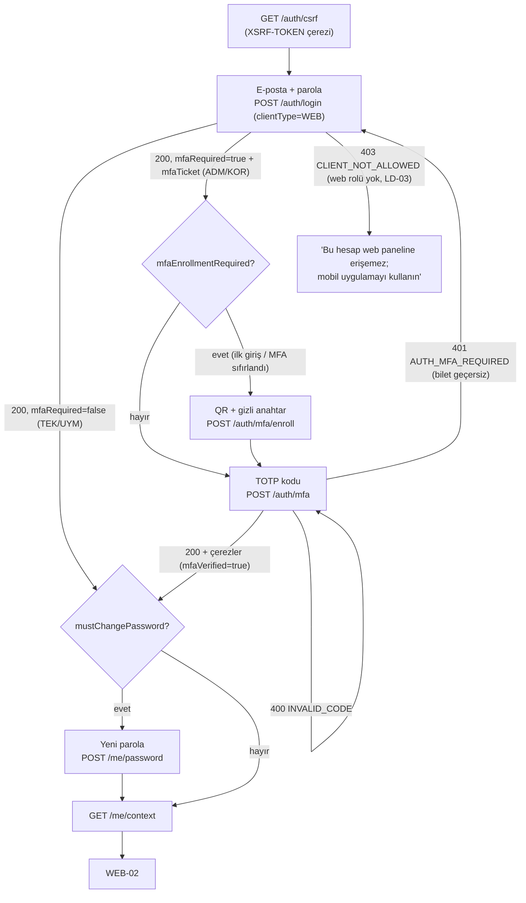

# Web Paneli: Ekran ↔ API ↔ SSE Eşleştirmesi (T-07)

| Alan | Bilgi |
|---|---|
| Sahip | `web-developer` |
| Durum | **v1.0 — `backend-api-design.md` v1.0 ile mutabık.** Kod, proje iskeleti veya OpenAPI dosyası değildir |
| Backend mutabakatı | Boşluk listesi ve S-02 – S-18, S-20 backend-architect yanıtlarıyla kapatıldı (uç kimlikleri parantez içinde, ör. ID-01, AL-16). Lider kararı bekleyenler: **N-22** (yenileme döndürme toleransı), **N-23** (12 sa mutlak), **N-25** (aktif operasyon üst sınırı), **N-26** (kullanıcı araması) |
| Girdiler | `ui-flows/web-flows.md` (WEB-01 – WEB-12), `design/api-and-data-design-basis.md` (§1 – §8), `design/emergency-alert-design.md` (Adım 1, 2, 7, 8), `analysis/user-roles.md` §4, `analysis/user-stories.md`, `authorization.md`, `decisions.md` (ADR-008, 009, 012, 013) |
| Korunan kararlar | K-01 – K-33, TD-01 – TD-22, ADR-001 – ADR-013, MVP kapsamı. Web rolleri yalnızca ADM, KOR, TEK, UYM (VS-06). R2+ ekranı **yok** |
| Lider kararları | **LD-01** (MFA kapsamı), **LD-02** (push gecikmesi göstergesi), **LD-03** (web rolü olmayan girişin reddi), **LD-04** (idempotency tek kaynağı basis §3), **LD-05** (konum denetimi sunucuda 5 dk birleştirme) işlendi; S-01, S-05, S-12, S-13 ve S-19 kapandı. LocationView sorusu S-13'ten S-20'ye taşındı |
| Etiketler | **Ç** = Çekirdek, **G** = Genişletilmiş (KP3). Yollar `/api/v1` öneklidir ve basis §3'teki gibi **taslaktır.** `[BOŞLUK-n]` = §3.2'deki boşluk listesine bağlantı. `[S-n]` = §8'deki açık soru |
| Güncelleme | **16.11.2026 — ADR-014 ve ADR-015 sonrası.** Aşağıdaki "Güncel durum" bölümü bu belgenin eski metinleriyle çelişirse **esastır** |

> **Güncel durum (16.11.2026)**
>
> - **ADR-014 (LD-61):** Kurumsal yönetim uçları yalnızca web değildir; `x-client: [WEB]` işaretli yönetim uçları `[WEB, ANDROID(MFA)]` okunur (ADM/KOR, TOTP ile açılan 12 sa mutlak Android oturumu). TEK ve UYM izinleri yalnızca web'dedir. Belgedeki "kurumsal işlemler yalnızca MFA'lı web oturumunda (ADR-013)" ifadeleri bu notla birlikte okunur; web panelinin kendi davranışı değişmedi.
> - **ADR-015 (LD-62):** ADM, KOR ataması olmadan **tüm operasyonlarda** KOR'un operasyon yönetimi izinlerine sahiptir (`task.manage`, `group.*`, `membership.*`, `meeting_point.update`, `announcement.send.group`; `operation.manage` ve `invitation.create` zaten vardı). §0.1 madde 2'deki "ADM operasyonel salt-okur" kuralı ve "kendini KOR olarak ata" yönlendirmesi **WEB-03, WEB-05, WEB-06 ve WEB-07 için kalktı.** Salt-okur bandı artık rol adından değil, sunucunun `MeContext.permissions.operations[opId]` alanında `task.manage` olmamasından hesaplanır (normalde ADM'de görünmez). **Konum (WEB-08) ve acil alarm (WEB-09/10) ADR-015'e dahil değildir;** bu ekranlarda ADM kuralı değişmedi (K-15, alarm kararı bekliyor).
> - **Uygulanan ekran düzeni (WEB-04):** WEB-04 web panelinde üç rotaya bölündü: `/davetler` (ID-12 – ID-14), `/roller` (AC-01 – AC-03; yalnızca `role.assign`, ADM) ve `/kullanicilar` (ID-19 – ID-25; `user.status.view`, ADM ve TEK). WEB-03 operasyon detayında ADM için "Koordinatörleri yönet" bağlantısı `/roller?rol=KOR&operasyon={opId}` sayfasını açar. Web'den GON rolü atanmaz (katılım davetle oluşur), yalnızca kaldırılabilir.
> - **Kullanıcı yönetimi kuralları (uygulama):** Kendi hesabında devre dışı bırakma, parola ve MFA sıfırlama `403`; TEK, ADM rolü olan hesabı devre dışı bırakamaz (`403`); MFA sıfırlama web ve MFA'lı Android dahil tüm oturumları kapatır; KOR `GET /users` için `operationId` vermek zorundadır (kendi operasyonu; ADM tümü).

---

## 0. Ortak kurallar (tüm ekranlar)

### 0.1 Yetki ve görünürlük ilkesi
1. **Arayüz gizler, sunucu karar verir (NFR-02).** Menü ve düğmeler `GET /me/context` yanıtındaki rol ve kapsamlara göre çizilir. Sunucu `403` dönerse arayüz bunu her zaman doğru kabul eder: önce `me/context`'i yeniler, sonra mesaj gösterir.
2. **~~ADM operasyonel salt-okur (K-07)~~ — ADR-015 ile WEB-03/05/06/07 için kalktı (bkz. "Güncel durum"); WEB-08/09/10 için geçerli.** Eski metin: WEB-05, 06, 09, 10'da ADM yalnızca okur; işlem düğmeleri hiç çizilmez. Ekranın üstünde bilgi bandı çıkar: "Salt-okur görünüm. İşlem yapmak için kendinizi bu operasyona koordinatör olarak atayın." Bant WEB-03'teki "KOR ata" eylemine götürür (yeni ekran değildir; atama denetime yazılır). WEB-08 ADM'ye hiç gösterilmez; ADM kendini KOR olarak atarsa o operasyon için KOR gibi davranılır.
3. **Konum yalnızca aktif operasyonun KOR'u (K-15).** ADM, TEK ve UYM konum uçlarını çağırmaz ve konum olaylarına abone olmaz.
4. **Denetim yalnızca ADM ve UYM (K-26).**
5. **TEK yalnızca görünen ad + hesap durumu (TD-14).** TEK'in istemcisi başka alan beklememeli; bileşenler eksik alanı "–" ile göstermez, sütunu hiç çizmez.
6. **Kurumsal işlemler yalnızca MFA'lı web oturumunda (ADR-013).** `CLIENT_NOT_ALLOWED` veya `AUTH_MFA_REQUIRED` gelirse kullanıcı WEB-01'in TOTP adımına yönlendirilir ve dönüş adresi saklanır. **LD-01:** ADM/KOR rolüne dayanan izinler ayrıca `mfa_verified = true` ister; TEK ve UYM izinleri (`user.status.view`, `account.disable`, `session.revoke`, `audit.view`) yalnızca web oturumu ister, MFA istemez (K-19 değişmedi).

### 0.2 Rota ve bağlam
- Operasyonel ekranlar operasyon kimliğini URL'de taşır: `/operasyonlar/:opId/{gruplar|gorevler|duyurular|harita|alarmlar}`, alarm detayı `/operasyonlar/:opId/alarmlar/:alertId`. Üst çubuktaki **operasyon seçici** bu parametreyi değiştirir. Seçili operasyon yalnızca kolaylık olarak `localStorage`'da tutulur; doğruluk kaynağı URL'dir.
- Seçici kaynağı: `GET /operations` (kapsam filtreli). Liste `state` değerini taşır; `ACTIVE` olmayanlar seçilebilir, ama konum ve "Yeni alarm" kapalıdır (K-17, BR-09).

### 0.3 Ortak ekran durumları

| Durum | Davranış |
|---|---|
| **Yükleniyor** | İlk yüklemede iskelet (MUI `Skeleton`). Arka plan yenilemesinde ekran korunur, yalnızca üst çubukta ince ilerleme çubuğu çıkar. Kritik ekranlarda (WEB-10) veri hiçbir zaman boşaltılmaz |
| **Boş** | Ekrana özel açıklama ve varsa birincil eylem (ör. "Henüz grup yok. Grup oluşturun"). Salt-okur rollerde eylem düğmesi gösterilmez |
| **Hata** | `problem+json` → §0.4 tablosu. Ağ hatası: "Sunucuya ulaşılamıyor. Bağlantınızı kontrol edin." 5xx: "Beklenmeyen bir hata oluştu" + `traceId` (kopyalanabilir). "Tekrar dene" düğmesi |
| **Yetkisiz** | Doğrudan URL ile açılan ve `403 FORBIDDEN` dönen ekran: tam sayfa "Bu sayfayı görüntüleme yetkiniz yok" ve "Panele dön". Bu sırada `me/context` yenilenir ve menü yeniden kurulur (rol yeni kaldırılmış olabilir, AC-05.2) |
| **Bulunamadı** | `404` → "Kayıt bulunamadı veya kaldırılmış" |
| **Operasyon aktif değil** | WEB-08 ve "Yeni alarm" kapalı; bilgi bandı: "Alarm ve konum yalnızca aktif operasyonda kullanılabilir" (K-17, BR-09). Operasyon durumu `PLANNED` ise WEB-03'teki "Aktif et" eylemine bağlantı verilir (yalnızca yetkiliye) |
| **Canlı güncelleme kesik** | Üst çubukta bant: "Canlı güncelleme kesildi, yeniden bağlanılıyor". Yoklama yedeğine geçince: "Canlı güncelleme yerine 5 sn'de bir yenileniyor" (ADR-009, §5) |
| **MFA tamamlanmadı** | Kurumsal ekranlar açılmaz; WEB-01 TOTP adımı |

### 0.4 Hata kodu → kullanıcı mesajı (genel katalog)

İstemci mesajı **yalnızca `code`'a göre** seçer; `title`/`detail` gösterilmez (yalnızca geliştirici aracında). `errors[]` varsa form alanlarının altına yazılır. Ekrana özel farklılıklar ekran bölümlerinde belirtilir.

| `code` | HTTP | Kullanıcı mesajı | İstemci eylemi |
|---|---|---|---|
| `VALIDATION_FAILED` | 400 | "Formda düzeltilmesi gereken alanlar var." Alan koduna göre özel mesajlar: `code`/`INVALID_CODE` → "Doğrulama kodu hatalı veya süresi geçmiş."; `currentPassword`/`INVALID` → "Mevcut parola hatalı."; `confirm`/`CONFIRMATION_REQUIRED` → ek onay penceresi açılır (hata gösterilmez); `EMPTY_AUDIENCE` → "Seçilen hedefte alıcı yok." | `errors[].field` → alan hatası; ilk hatalı alana odak (AC-04.3) |
| `AUTH_UNAUTHENTICATED` | 401 | (mesaj yok) | Oturum yok veya bozuk: yenileme denenmez; oturum temizliği ve WEB-01 |
| `CSRF_TOKEN_INVALID` | 403 | (ilk seferde mesaj yok) | `GET /auth/csrf` ile tazele, isteği **bir kez** tekrarla; yine olursa "Oturum doğrulanamadı. Sayfayı yenileyin." |
| `AUTH_INVALID_CREDENTIALS` | 401 | "E-posta veya parola hatalı." | Alanlar korunur, parola temizlenir. Hesap varlığı açık edilmez (AC-03.1) |
| `AUTH_MFA_REQUIRED` | 401 | (mesaj yok) | TOTP adımına geç; `mfaTicket` yalnızca bellekte tutulur |
| `AUTH_TOKEN_EXPIRED` | 401 | (mesaj yok) | Tekil yenileme → isteği bir kez tekrarla (§4.3) |
| `AUTH_SESSION_REVOKED` | 401 | "Oturumunuz sonlandırıldı. Lütfen yeniden giriş yapın." | Oturum temizliği (§4.4) |
| `AUTH_PASSWORD_CHANGE_REQUIRED` | 403 | "Devam etmek için yeni bir parola belirleyin." | WEB-01 parola değiştirme adımı (AC-03.5) |
| `ACCOUNT_LOCKED` | 423 | "Çok sayıda hatalı deneme yapıldı. Bir süre sonra tekrar deneyin." | Gönder düğmesi `Retry-After` varsa geri sayımla kapalı. Kayıtlı olmayan e-posta da aynı yanıtı alır; hesap varlığı açık edilmez (S-14 kapandı) |
| `ACCOUNT_DISABLED` | 403 | "Hesabınız devre dışı. Kurum yöneticinizle iletişime geçin." | Oturum temizliği |
| `FORBIDDEN` | 403 | "Bu işlem için yetkiniz yok." | `me/context` yenile; ilgili sorguyu geçersiz kıl |
| `CLIENT_NOT_ALLOWED` | 403 | "Bu işlem iki adımlı doğrulamalı web oturumu gerektirir." Giriş adımında (WEB-01): "Bu hesap web paneline erişemez; mobil uygulamayı kullanın." (LD-03) | Oturum içinde: TOTP adımına yönlendir. Girişte: yönlendirme yok, mesaj |
| `NOT_FOUND` | 404 | "Kayıt bulunamadı veya kaldırılmış." | Detay sorgusunu önbellekten çıkar, listeye dön |
| `INVITATION_INVALID` | 410 | "Davet artık geçerli değil (süresi dolmuş, kullanılmış veya iptal edilmiş)." | Davet listesini yenile |
| `OPERATION_NOT_ACTIVE` | 409 | "Bu işlem yalnızca aktif operasyonda yapılabilir." | Operasyon sorgusunu yenile; ekranı "Operasyon aktif değil" durumuna al |
| `ALREADY_EXISTS` | 409 | `conflict` alanına göre: `INVITATION_PENDING` → "Bu kişiye bu kapsamda bekleyen bir davet zaten var."; `ALREADY_PARTICIPANT` → "Bu kişi zaten operasyon katılımcısı."; `EMAIL_REGISTERED` → "Bu e-posta kurumda zaten kayıtlı. Kişiyi operasyona davet edin."; `ALREADY_MEMBER` → "Kişi zaten bu grubun üyesi."; `ROLE_ACTIVE` → "Bu rol ataması zaten etkin."; `ASSIGNMENT_ACTIVE` → "Kişinin bu görevde etkin ataması var."; `ALERT_ALREADY_CORRECTED` → "Bu alarm için düzeltme zaten gönderilmiş."; bilinmeyen → "Bu kayıt zaten var." | İlgili listeyi yenile |
| `OPERATION_CLOSED` | 409 | "Operasyon kapandı; bu kayıt artık değiştirilemez." | Operasyonu yenile, ekranı salt-okura al |
| `GROUP_FULL` | 409 | "Grup 50 üye sınırına ulaştı." | Grup detayını yenile |
| `ACTIVE_OPERATION_LIMIT` | 409 | "Aynı anda en fazla {limit} aktif operasyon olabilir." | Yalnızca N-25 zorlayıcı sınırı kabul ederse döner |
| `NOT_A_PARTICIPANT` | 409 | "Seçilen kişi bu operasyona katılmamış. Önce operasyona davet edin." | Katılımcı listesini yenile (AC-09.7) |
| `LEADER_REQUIRED` | 409 | "Grup lidersiz bırakılamaz. Önce yeni bir lider seçin." | Lider seçim alanına odak (AC-09.5) |
| `CAPACITY_FULL` | 409 | "Görevin kapasitesi dolu." | Görev detayını yenile |
| `CAPACITY_BELOW_ACCEPTED` | 409 | "Kapasite, görevi kabul etmiş kişi sayısının altına indirilemez." | Kapasite alanında hata; güncel `acceptedCount` gösterilir (AC-13.7) |
| `ASSIGNMENT_NOT_PENDING` | 409 | "Bu atama artık yanıt bekleme durumunda değil." | Atama tablosunu yenile |
| `INVALID_STATE_TRANSITION` | 409 | "Bu durum değişikliği yapılamaz. Güncel durum yüklendi." | Kaynağı yenile |
| `AUDIENCE_CHANGED` | 409 | "Önizlemeden sonra alıcı listesi değişti. Yeni listeyi kontrol edip yeniden onaylayın." | Yeni önizleme (§2 WEB-09) |
| `ALERT_NOT_OPEN` | 409 | "Bu alarm iptal edilmiş veya kapatılmış." | Alarm detayını yenile; işlem düğmelerini kapat |
| `LOCATION_SHARING_STOPPED` | 409 | – | Web'de beklenmez (Android ucu) |
| `VERSION_CONFLICT` | 409 | "Bu kayıt siz düzenlerken değişti. Güncel hâli yüklendi; değişikliklerinizi kontrol edin." | Sunucu sürümünü yükle; kullanıcının girdisi formda korunur, farklı alanlar işaretlenir |
| `IDEMPOTENCY_KEY_MISMATCH` | 422 | "İstek tutarsız. Sayfayı yenileyip yeniden deneyin." | İstemci hatası olarak günlüğe yaz (`traceId`); anahtarı yenile |
| `AUDIENCE_TOO_LARGE` | 422 | "Alıcı sayısı 500 sınırını aşıyor. Hedefi daraltın." | Hedef seçiciye odak (VS-02) |
| `RATE_LIMITED` | 429 | "Çok fazla deneme yapıldı. {n} sn sonra tekrar deneyin." | `Retry-After` ile geri sayım |
| `SERVICE_UNAVAILABLE` | 503 | "Sunucuya şu an ulaşılamıyor. Biraz sonra yeniden denenecek." | **Oturum sonu değildir (LD-48):** oturum temizliği yapılmaz, yenileme denenmez, WEB-01'e gidilmez; çerezler korunur. Sorgular üstel geri çekilmeyle yeniden denenir; form verisi korunur |
| Ağ hatası / zaman aşımı | – | "Sunucuya ulaşılamıyor." | Idempotent mutasyonlarda aynı anahtarla otomatik tekrar (§6.3); diğerlerinde "Tekrar dene" |
| 5xx / bilinmeyen `code` | – | "Beklenmeyen bir hata oluştu. (İz no: {traceId})" | – |

### 0.5 Idempotency-Key ve onay pencereleri (özet)

| İşlem | Uç | `Idempotency-Key` | Onay penceresi | Ekran |
|---|---|---|---|---|
| Alarm gönderimi | `POST /alerts/{id}/send` | **Zorunlu** | **Evet**, "BU BİR ACİL ALARMDIR", odak İptal'de (AC-20.2) | WEB-09 |
| Alarm yeniden gönderimi | `POST /alerts/{id}/resend` (AL-10) | Zorunlu (basis §3.5) | Evet, seçili alıcı sayısıyla; gövde `recipientIds[]` (boş = tüm `UNANSWERED` + `FAILED`) | WEB-10 |
| Alarm iptali | `POST /alerts/{id}/cancel` (AL-11, gövde `ReasonRequest`) | Zorunlu (basis §3.5) | **Evet**, yıkıcı eylem; isteğe bağlı gerekçe alanı | WEB-10 |
| Alarm kapatma | `POST /alerts/{id}/close` | Yok (tekrar `ALERT_NOT_OPEN` döner; §6.3) | Evet | WEB-10 |
| Görev yayını | `POST /tasks/{id}/publish` | **Zorunlu** | Evet, hedef ve kişi sayısıyla | WEB-06 |
| Görev iptali | `POST /tasks/{id}/state` | Yok | Evet | WEB-06 |
| Davet oluşturma | `POST /invitations` | **Zorunlu** | Hayır | WEB-03, WEB-04 |
| Duyuru gönderimi | `POST /announcements` | Zorunlu (basis §3.5) | Alıcı önizlemesi her zaman; **> 50 alıcıda ek onay** (`confirm=true`, AC-11.3) | WEB-07 |
| Operasyon kapatma | `POST /operations/{id}/state` | Yok | **Evet**, sonuç uyarısıyla (konum durur, alarmlar kapanır, gruplar arşivlenir) | WEB-03 |
| Rol kaldırma, devre dışı bırakma, oturum iptali, parola/MFA sıfırlama | ilgili uçlar | Yok | Evet | WEB-04 |
| Tüm cihazlardan çık | `POST /auth/logout-all` | Yok | Evet | WEB-12 |

**Anahtar üretimi:** Anahtar, kullanıcı onay penceresini **açtığında** (veya formu gönderdiğinde) `crypto.randomUUID()` ile üretilir. O niyet için ağ tekrarlarında, çift tıklamada ve "Tekrar dene"de aynı anahtar kullanılır. Gövde değişirse **yeni anahtar** üretilir. İstisna: `AUDIENCE_CHANGED` sonrası onayda gövdedeki `audienceHash` değişir; önceki deneme 409 aldığı için sunucu aynı anahtarı da kabul eder (backend §3.6). Panel yine de sadelik için yeni anahtar üretir. Anahtar başarıdan sonra atılır. **LD-04:** Hangi işlemin `Idempotency-Key` istediğinin tek kaynağı basis §3'teki "I" işaretleridir; yukarıdaki tablo onlarla birebir eşleşir.

---

## 1. Oturum ve kimlik akışı

### 1.1 Çerez ve CSRF
- Erişim belirteci (15 dk) ve yenileme belirteci (web 12 sa, döndürülür) **HttpOnly, Secure, SameSite** çerezlerde taşınır (ADR-012, TD-04). JavaScript belirteçleri hiçbir zaman okumaz ve saklamaz.
- Çerez adları: `__Host-access` (erişim), `__Secure-refresh` (`Path=/api/v1/auth`, SameSite=Strict).
- **CSRF (S-02 kapandı):** Çift gönderim. Uygulama açılışında ve girişten önce `GET /auth/csrf` (ID-01) çağrılır; sunucu okunabilir `XSRF-TOKEN` çerezini yazar. İstemci değeri her istekte çerezden taze okuyup `X-CSRF-Token` başlığına koyar. `POST /auth/login` ve `POST /auth/mfa` dahil tüm çerezli `POST/PUT/PATCH/DELETE` isteklerinde zorunludur; `GET` ve `/stream` taşımaz. Hata: `403 CSRF_TOKEN_INVALID` → `GET /auth/csrf` ile tazele, bir kez tekrarla.
- Tüm istekler aynı kökten (`/api/v1`, nginx/Caddy arkası) yapılır; CORS gerekmez.

### 1.2 Giriş ve TOTP (WEB-01)

| Adım | İstek | Başarı | Hata → davranış |
|---|---|---|---|
| CSRF | `GET /auth/csrf` (ID-01) | `XSRF-TOKEN` çerezi | – |
| Kimlik bilgileri | `POST /auth/login` (ID-02; `email`, `password`, `clientType=WEB`) | `LoginResponse`: `mfaRequired`, `mfaEnrollmentRequired`, `mfaTicket`, `mustChangePassword`. MFA gerekiyorsa çerez yazılmaz | `AUTH_INVALID_CREDENTIALS`, `ACCOUNT_LOCKED`, `ACCOUNT_DISABLED` (yalnızca parola doğruysa), `RATE_LIMITED` (geri sayım), `CLIENT_NOT_ALLOWED` (LD-03), `CSRF_TOKEN_INVALID` |
| TOTP kurulumu (ilk giriş) | `POST /auth/mfa/enroll` (`mfaTicket`) | `otpauthUri`, `secret` → QR istemcide yerel üretilir; "elle gir" seçeneği. Kurulum henüz kalıcı değildir | Bilet geçersiz → `401 AUTH_MFA_REQUIRED` → giriş adımı |
| TOTP doğrulama | `POST /auth/mfa` (`mfaTicket`, `code`) | Oturum açılır, `mfaVerified=true`; kurulum adımından gelindiyse kurulum bu çağrıyla kalıcılaşır (ayrı onay ucu yok) | `400 VALIDATION_FAILED` (`code`/`INVALID_CODE`) → "Doğrulama kodu hatalı veya süresi geçmiş."; aynı biletle 5 hatalı kod bileti geçersiz kılar ve kilit sayacını artırır (`423` olabilir); `401 AUTH_MFA_REQUIRED` → giriş adımına dön ("Doğrulama süresi doldu, yeniden giriş yapın") |
| Zorunlu parola değişikliği | `POST /me/password` (ID-08) | `204`; mevcut oturum yeni belirteç çifti alır (`mfaVerified` korunur), diğer oturumlar iptal. TOTP tekrar sorulmaz | `VALIDATION_FAILED` (`newPassword` kuralları; `currentPassword`/`INVALID`). Bu adımda oturum yalnızca `GET /me`, `GET /me/context`, `POST /me/password`, `/auth/refresh`, `/auth/logout`, `GET /auth/csrf` uçlarına izinlidir; diğerleri `403 AUTH_PASSWORD_CHANGE_REQUIRED` (S-04 kapandı) |
| Bağlam | `GET /me/context` | `MeContext` (`permissions`, `session.mfaVerified`, `session.clientType`) → menü ve düğmeler | – |

- **Sıra (S-04):** ADM/KOR önce TOTP, sonra zorunlu parola değişikliği. TEK/UYM doğrudan parola değişikliğine geçer.
- **Web rolü olmayan hesap** (GON/LDR, **LD-03**): Sunucu web girişini parola doğrulandıktan sonra `403 CLIENT_NOT_ALLOWED` ile reddeder; oturum oluşmaz. WEB-01 bu kodu giriş adımında aldığında TOTP adımına **yönlendirmez**; formun üstünde "Bu hesap web paneline erişemez; mobil uygulamayı kullanın." mesajını gösterir. Savunma amaçlı ek kontrol: `MeContext.permissions` hiçbir web izni içermiyorsa aynı mesaj gösterilir ve `POST /auth/logout` çağrılır.
- Kilit bilgisi (AC-03.2) yalnızca genel mesajla gösterilir; kayıtlı olmayan e-posta da aynı `423`'ü alır (S-14 kapandı).
- **Halka:** Ç. **AC:** AC-03.1, AC-03.2, AC-03.3, AC-03.5, AC-07.1.

### 1.3 Belirteç yenileme
- **Tetik:** Herhangi bir istek `401 AUTH_TOKEN_EXPIRED` dönerse. Ayrıca proaktif olarak erişim belirtecinin ömründen önce (ör. 13. dk) ve sekme görünür olduğunda. `401 AUTH_UNAUTHENTICATED` yenileme tetiklemez; doğrudan oturum temizliğine gider. Hatalı TOTP ve hatalı mevcut parola `400` döndüğü için yenileme mantığına hiç girmez (S-03).
- **Tekil uçuş (single-flight):** Aynı anda gelen birden çok 401 için tek bir `POST /auth/refresh` yapılır; diğer istekler sonucunu bekler, sonra **bir kez** tekrar denenir. Yenileme de başarısız olursa (401) oturum temizliğine geçilir (§1.4) ve dönüş adresi saklanarak WEB-01'e gidilir.
- **Sekmeler arası yarış:** Yenileme belirteci her kullanımda döndürülür ve eski belirtecin tekrar kullanılması zincirin tamamını iptal eder (TD-04). Panel yenilemeyi tarayıcı genelinde **Web Locks API** (`navigator.locks`) ile tek sekmede yapar; sonuç `BroadcastChannel` ile diğer sekmelere duyurulur. Sunucu ayrıca dar bir döndürme toleransı uygular: halef hiç kullanılmamış, istek aynı istemci türünden ve ≤ 10 sn içindeyse eski belirtecin tekrarı zinciri kapatmaz (**LD-18**, backend §2.2). *(Lider düzeltmesi, 15.11.2026.)* Panel tasarımı toleransa dayanmaz; Web Locks her durumda kalır.
- **Oturum ömrü (S-06 kapandı):** Web oturumu zincir başlangıcından itibaren 12 sa **mutlak** (öneri, **N-23**). Süre dolunca yenileme reddedilir; panel "Oturum süreniz doldu, yeniden giriş yapın" mesajıyla WEB-01'e gider (ADM/KOR için TOTP yeniden istenir). `mfaVerified` döndürmede korunur.
- **SSE ve belirteç:** Akış erişim belirtecinin süresi dolunca kapanmaz; oturum iptalinde veya yetki düşünce hemen, aksi hâlde en geç 30 dk'da bir sunucu tarafından kapatılır (backend §2.2). Tarayıcının yerel yeniden bağlanması geçerli çerezle sürer; bu yüzden proaktif yenileme yeniden bağlanmalarda 401'i önler.

### 1.4 Oturum iptali ve sonlanma
| Tetik | Davranış |
|---|---|
| `401 AUTH_SESSION_REVOKED`, `401 AUTH_UNAUTHENTICATED`, `403 ACCOUNT_DISABLED` veya SSE `user:{id}` → `session.revoked` | (1) SSE bağlantısını kapat, (2) TanStack Query önbelleğini **tamamen temizle** (`queryClient.clear()`; başka kullanıcının verisi ekranda kalmasın), (3) `BroadcastChannel` ile diğer sekmelere bildir, (4) açık formlardaki taslaklar atılır, (5) WEB-01'e "Oturumunuz sonlandırıldı" mesajıyla yönlendir |
| Kullanıcı "Çıkış" (WEB-12 veya üst menü) | `POST /auth/logout` → aynı temizlik. İstek başarısız olsa da yerel temizlik yapılır |
| "Tüm cihazlardan çık" (WEB-12) | Onay → `POST /auth/logout-all` → temizlik (AC-06.4) |
| Yenileme başarısız | Temizlik + dönüş adresiyle WEB-01 |
| Rol kaldırıldı / operasyon kapandı (yetki düştü) | Oturum sürer. Sunucu ilgili konu için `subscription.revoked` gönderir (§5.4); istemci `me/context`'i yeniler, menüyü yeniden kurar, yetkisiz ekrandaysa "Yetkisiz" durumuna geçer (AC-05.2) |

---

## 2. Ekranlar

Her ekran için: amaç, rol farkları, API çağrıları, SSE, durumlar, ekrana özel hata mesajları, idempotency/onay, AC ve halka. Sorgu anahtarları §6'daki adlarla anılır (ör. `Q.alert(id)`).

### WEB-01 Yönetici girişi
- **Amaç:** Panele güvenli giriş; ADM/KOR için TOTP; ilk girişte TOTP kurulumu; yönetici sıfırlamasından sonra yeni parola.
- **Roller:** ADM, KOR (TOTP zorunlu, K-19); TEK, UYM (TOTP adımı yok; işlemleri MFA'sız web oturumunda geçerli, LD-01).
- **API ve SSE:** §1.2. SSE yok.
- **Durumlar:** Gönderiliyor (düğme kilitli, çift gönderim yok); kilit/hız sınırı geri sayımı; TOTP bileti süresi doldu ("Doğrulama süresi doldu, yeniden giriş yapın").
- **Ekrana özel:** Giriş adımında `CLIENT_NOT_ALLOWED` → "Bu hesap web paneline erişemez; mobil uygulamayı kullanın." (LD-03; genel katalogdaki TOTP yönlendirmesi bu adımda uygulanmaz). TOTP adımında `AUTH_INVALID_CREDENTIALS` gelirse "Doğrulama kodu hatalı veya süresi geçmiş." (ayrı kod önerisi [S-03]).
- **Idempotency/onay:** Yok.
- **AC:** AC-03.1, 03.2, 03.3, 03.5, AC-07.1. **Halka:** Ç (kullanıcının kendi başlattığı parola sıfırlama AC-03.4 G'dir; bu belgede ekran akışı eklenmedi).

### WEB-02 Yönetim paneli
- **Amaç:** Role göre özet ve kısayollar; açık alarm uyarı kartı.

| Rol | Görünenler | Çağrılar |
|---|---|---|
| **KOR** | Kendi operasyonları; açık alarmlar ve yanıt özeti; yanıt bekleyen görev atamaları; paylaşım yapan kişi sayısı | `GET /operations` (OR-04; `OperationView.openAlertCount`, `pendingAssignmentCount`, `activeSharingCount`); açık alarmlar ve yanıt özeti `GET /alerts?state=OPEN` (AL-16, `AlertSummary`) |
| **ADM** | Operasyon listesi ve durumları; kullanıcı ve davet sayıları; açık alarmlar (salt-okur); kapatılmamış operasyon uyarısı | `GET /operations` (istemci `plannedEndAt < şimdi ∧ state ∉ {COMPLETED, CANCELLED}` uyarısını hesaplar); `GET /users?includeTotal=true&limit=1` ve `GET /invitations?status=PENDING&includeTotal=true&limit=1` (`totalCount`); `GET /alerts?state=OPEN` (AL-16) |
| **TEK** | Hesap durum listesi kısayolu | Çağrı yok (kısayol WEB-04'e) |
| **UYM** | Denetim kayıtları kısayolu | Çağrı yok (kısayol WEB-11'e) |

- `activeSharingCount` yalnızca `location.view` sahibine (KOR) döner; ADM'de alan yoktur. Sayı konum verisi değildir ve konum ucunu çağırmadan gösterilir.
- **SSE:** KOR ve ADM: görünür aktif operasyonlar için `operation:{id}` ve açık alarmlar için `alert:{id}`. Bağlantı başına en fazla 10 konu vardır (RT-01). Sınır aşılırsa alarm konuları bırakılır; sayılar `operation:{id}` üzerindeki yaşam döngüsü olayları ve 15 sn'lik `refetchInterval` ile güncellenir.

| Olay | Geçersiz kılınan |
|---|---|
| `operation.state.changed` | `Q.operations()`, `Q.operation(id)`, `Q.meContext()`, `Q.openAlerts()` |
| `alert.opened` / `alert.cancelled` / `alert.closed` (`operation:{id}`) | `Q.openAlerts()`, `Q.operations()` (`openAlertCount`); konu kümesi yeniden hesaplanır (yeni alarm için `alert:{id}` eklenir) |
| `alert.recipient.changed` (`alert:{id}`, `counts` taşır) | `Q.openAlerts()` önbelleğindeki ilgili öğenin `counts` alanı olay verisiyle **doğrudan güncellenir** (`setQueryData`); yeniden çekim yok |
| `assignment.changed` / `task.changed` | `Q.operations()` (`pendingAssignmentCount`); 2 sn birleştirme |
| `location.sharing.changed` | `Q.operations()` (`activeSharingCount`); 5 sn birleştirme |

- **Açık alarm kartı:** Panelde ve üst çubukta kalıcıdır, kaynağı `Q.openAlerts()`; tıklanınca WEB-10. "Yardım gerekiyor > 0" kırmızı vurguyla gösterilir.
- **Durumlar:** Boş (KOR: "Size atanmış operasyon yok"; ADM: "Henüz operasyon yok" + "Operasyon oluştur").
- **AC:** – (web-flows). AC-22.3 vurgusu karta da uygulanır. **Halka:** Ç.

### WEB-03 Operasyon yönetimi
- **Amaç:** Operasyon yaşam döngüsü, KOR ataması, katılımcılar ve operasyon daveti.

| Rol | Görünürlük | İşlemler |
|---|---|---|
| ADM | Tüm operasyonlar | Oluştur + KOR ata; KOR ekle/kaldır (`/roller`); aktif et; kapat (Tamamlandı/İptal); (G) askıya al; katılımcıları gör; davet gönder ve iptal et. ADR-015: kendini KOR atamaya gerek yok; görev, grup ve duyuru işlemlerini doğrudan yapar |
| KOR | Kendi operasyonları | Aktif et; kapat; (G) askıya al; katılımcılar; davet gönder ve iptal et. Operasyon oluşturamaz, KOR atayamaz |

| Ne zaman | Çağrı |
|---|---|
| Liste | `GET /operations` (OR-04, imleçli, `state?`) |
| Detay | `GET /operations/{id}` (OR-05) |
| Oluştur (ADM) | `POST /operations` (OR-01; `name`, `description`, `plannedEndAt`, `coordinatorIds[]`) |
| Ad / açıklama / planlanan bitiş düzenle | `PATCH /operations/{id}` (OR-02). Planlanan bitişi geçen operasyon uyarısındaki "Bitişi güncelle" eylemi bunu kullanır; yeni ekran değildir |
| KOR ekle / kaldır (yalnızca ADM, kendisi dahil; S-07 kapandı) | `POST /role-assignments` (AC-01; `role=KOR`, `scopeType=OPERATION`, `scopeId`), `DELETE /role-assignments/{id}`. Mevcut KOR'lar `OperationView.coordinators[]`'tan, atama kimlikleri `GET /role-assignments?scopeId={opId}&role=KOR` (AC-03) ile alınır. ADM'nin kendini atamasında ek kural yoktur; atama denetime yazılır |
| Durum değiştir | `POST /operations/{id}/state` (OR-03; `targetState`: `ACTIVE`, `COMPLETED`, `CANCELLED`, (G) `SUSPENDED`) |
| Katılımcılar | `GET /operations/{id}/participants` (OR-06, `ParticipantView`) |
| Davetler | `GET /invitations?scopeType=OPERATION&scopeId={id}&status=PENDING,EXPIRED` (ID-13) |
| Davet gönder | `POST /invitations` (ID-12; `email`, `scopeType=OPERATION`, `scopeId`) + `Idempotency-Key`. Sunucu `kind`'i seçer (TD-01) |
| Davet iptal et | `POST /invitations/{id}/revoke` (ID-14; onaylı) |
| KOR seçimi için kullanıcı listesi (ADM) | `GET /users?status=ACTIVE` (ID-19); ad sıralaması ve süzme istemcide (≤ 500 kayıt). Sunucu tarafı arama **N-26** kararına bağlı |

- **Onay pencereleri:**
  - **Kapat:** "Operasyonu kapatırsanız: tüm konum paylaşımları durur, açık alarmlar kapanır, gruplar arşivlenir, operasyon kapsamlı roller pasifleşir. Bu işlem geri alınamaz." Pencerede `openAlertCount` ve (KOR) `activeSharingCount` gösterilir. Varsayılan odak İptal'de.
  - **Aktif et:** Kısa onay; konum ve alarmın açılacağı belirtilir.
  - **Kendini KOR ata (ADM):** "Bu atama denetim kaydına yazılır" uyarısı.
  - **Davet iptali:** "Davet kodu ve bağlantısı geçersiz olur."
- **SSE:** `operation:{id}` (detay açıkken):

| Olay | Geçersiz kılınan |
|---|---|
| `operation.state.changed` | `Q.operation(id)`, `Q.operations()`, `Q.meContext()` (kapanışta roller pasifleşir) |
| `participant.changed` (`userId`, `JOINED`/`LEFT`) | `Q.participants(id)`, `Q.invitations({scopeId: id})` (kabul edilen davet listeden düşer) |

- **Ekrana özel hatalar:** `INVALID_STATE_TRANSITION` → "Operasyon bu durumdan '{hedef}' durumuna geçemez." (AC-08.1); davet iptalinde aynı kod → "Davet artık bekleme durumunda değil." `ALREADY_EXISTS` (`INVITATION_PENDING`, `ALREADY_PARTICIPANT`, `EMAIL_REGISTERED`, `ROLE_ACTIVE`), `OPERATION_CLOSED`, `ACTIVE_OPERATION_LIMIT` (N-25) için §0.4'teki mesajlar kullanılır.
- **Durumlar:** "Planlanan bitiş geçti" uyarı bandı (istemci hesaplar). Kapanmış operasyon salt-okur gösterilir.
- **AC:** AC-08.1 – 08.4, AC-01.1, 01.4, 01.5. **Halka:** Ç; askıya alma G.

### WEB-04 Gönüllü (kullanıcı) yönetimi
- **Amaç:** Kullanıcı, davet, rol ve hesap durumu.

| Rol | Liste içeriği | İşlemler | Çağrılar |
|---|---|---|---|
| **ADM** | Kurum geneli: ad, e-posta, telefon, roller, durum | Davet oluştur (kurum kapsamı), davet iptal et, rol ve kapsam ata/kaldır, devre dışı bırak, yeniden etkinleştir, oturumları iptal et, parola sıfırla, MFA sıfırla | `GET /users` (ID-19), `GET /users/{id}`; `GET /invitations` (ID-13), `POST /invitations` (I), `POST /invitations/{id}/revoke`; `GET /role-assignments?userId=` (AC-03), `POST /role-assignments`, `DELETE /role-assignments/{id}`; `POST /users/{id}/disable`; `POST /users/{id}/enable` (ID-22); `POST /users/{id}/revoke-sessions`; `POST /users/{id}/reset-password`; `POST /users/{id}/reset-mfa` |
| **KOR** | Kendi operasyonunun katılımcıları: ad, iletişim, gruplar, katılım zamanı, açık atama sayısı | Kendi operasyonuna davet ve davet iptali. Rol atayamaz (lider ataması WEB-05'ten) | `GET /operations/{id}/participants` (OR-06, `ParticipantView`: KOR izdüşümünde iletişim, `groups[]`, `joinedAt`, `openAssignmentCount`; S-08 kapandı); `POST /invitations` (I); `POST /invitations/{id}/revoke` |
| **TEK** | Yalnızca görünen ad + hesap durumu | Devre dışı bırak, oturum iptal et (TD-14) | `GET /users` (sunucu TEK'e yalnızca `displayName`, `status` döner); `POST /users/{id}/disable`; `POST /users/{id}/revoke-sessions` |

- **Yeniden etkinleştirme** (S-09 kapandı): yalnızca ADM, `POST /users/{id}/enable`. TEK'e bu düğme çizilmez.
- **Kendine yönelik işlemler:** Kendini devre dışı bırakma ve kendi ADM rolünü kaldırma sunucuda `403` alır; arayüz bu düğmeleri kullanıcının kendi satırında hiç çizmez.
- **(G) Hesap kapatma talepleri** (ADM işler, US-30): `GET /users?closureRequested=true` (ID-19'un G parametresi); işleme ucu backend'de G kapsamında tanımlıdır. G kapsamına alınırsa ekrana eklenir.
- **Onay pencereleri:** devre dışı bırak ("Kullanıcı giriş yapamaz ve bildirim almaz", AC-06.2), yeniden etkinleştir, oturum iptali ("Kullanıcının tüm cihazlardaki oturumları kapanır", AC-06.1), parola sıfırla ("Geçici parola e-postayla gider; kullanıcı ilk girişte yeni parola belirler", AC-03.5), MFA sıfırla ("Sonraki girişte TOTP yeniden kurulur", AC-07.2), rol kaldır ("Erişim en geç bir sonraki istekte sona erer", AC-05.2), davet iptali.
- **SSE:** Yok. Mutasyon sonrası `Q.users(…)`, `Q.user(id)`, `Q.roleAssignments(…)` ve `Q.invitations(…)` geçersiz kılınır. Kullanıcı kendi rolünü değiştirirse `Q.meContext()` da.
- **Ekrana özel hatalar:** `FORBIDDEN` (KOR'un başka operasyona daveti; kendine yönelik yasak işlem) → genel mesaj; `ALREADY_EXISTS` (`ROLE_ACTIVE`, `INVITATION_PENDING`, `EMAIL_REGISTERED`); `INVALID_STATE_TRANSITION` (hesap zaten etkin veya devre dışı) → durum yenilenir.
- **AC:** AC-01.1 – 01.5, AC-03.5, AC-05.1 – 05.3, AC-06.1 – 06.3, AC-06.5, AC-07.2. **Halka:** Ç; hesap kapatma talepleri G.

### WEB-05 Grup yönetimi
- **Amaç:** Operasyon gruplarını kurmak ve yönetmek.
- **Roller:** KOR kendi operasyonunda (tam); ADM tüm operasyonlarda (tam, ADR-015).

| Ne zaman | Çağrı |
|---|---|
| Operasyonun grupları | `GET /groups?operationId={id}` (GR-02; `includeArchived?`) |
| Grup detayı | `GET /groups/{id}` (GR-03; `GroupView`: lider, üyeler, toplanma noktası) |
| Grup oluştur | `POST /operations/{id}/groups` (GR-01; `name`, `description`, **`leaderUserId` zorunlu**, `memberUserIds[]`). Form, lider seçilmeden gönderilemez (AC-09.5) |
| Üye seçimi | `GET /operations/{id}/participants?notInGroup={groupId}` (OR-06; yalnızca katılımcılar, AC-09.7) |
| Üye ekle / çıkar | `POST /groups/{id}/members` (GR-04), `DELETE /groups/{id}/members/{userId}` (S-10 kapandı) |
| Lider değiştir | `PUT /groups/{id}/leader` (GR-06; yeni lider üye değilse sunucu ekler) |
| Grup bilgisi | `PATCH /groups/{id}` (GR-07) |
| Toplanma noktası | `PUT /groups/{id}/meeting-point` (GR-08; `address`, `lat`, `lon`, `description`, `time`). Leaflet haritasında tıklayarak işaretleme; adres metni elle girilir (geocoding yok). (G) Geçmiş: `GET /groups/{id}/meeting-points` (GR-10) |

- **SSE:** `operation:{id}` → `group.changed` (`groupId`, `change`: `CREATED`, `UPDATED`, `MEMBERS`, `LEADER`, `MEETING_POINT`, `ARCHIVED`) → `Q.groups(opId)`, `Q.group(groupId)`; `change=MEMBERS` ise seçici listesi için `Q.participants(opId)` da. Liderin Android'den yaptığı toplanma noktası güncellemesi de bu olayla gelir. `participant.changed` → `Q.participants(opId)`.
- **Kurallar arayüzde:** Son liderin "Çıkar" düğmesi kapalıdır ve ipucu gösterir: "Önce yeni lider atayın" (sunucu yine `LEADER_REQUIRED` ile korur). Katılımcı olmayan kişi seçici listesinde görünmez. 50 üyeye ulaşan grupta "Üye ekle" kapalıdır (sunucu `GROUP_FULL` ile korur).
- **Durumlar:** Boş ("Bu operasyonda grup yok"); operasyon kapalı → gruplar arşivlenmiş, salt-okur.
- **Ekrana özel hatalar:** `LEADER_REQUIRED`, `NOT_A_PARTICIPANT`, `GROUP_FULL`, `ALREADY_EXISTS` (`ALREADY_MEMBER`), `OPERATION_CLOSED` (§0.4).
- **AC:** AC-09.1 – 09.7, AC-12.1 – 12.3. **Halka:** Ç (ayrı toplanma noktası nesnesi, geçmişi ve iptali G).

### WEB-06 Görev yönetimi
- **Amaç:** Görev oluşturma, yayın, atama izleme ve durum ilerletme.
- **Roller:** KOR kendi operasyonunda (tam); ADM tüm operasyonlarda (tam, ADR-015).

| Ne zaman | Çağrı |
|---|---|
| Liste | `GET /operations/{id}/tasks` (TK-07; `TaskSummary`: `state`, `acceptedCount`, `capacity`, `pendingCount`, `overdueCount`). (G) `?state=…&hasPendingAssignments=true` (AC-16.2) |
| Detay | `GET /tasks/{id}` (`TaskView`: `targets`, `version`, `history[]`) |
| Atamalar | `GET /tasks/{id}/assignments?status=…&overdue=…` (TK-09; S-11 kapandı) |
| Taslak oluştur | `POST /operations/{id}/tasks` (TK-01) |
| Düzenle | `PATCH /tasks/{id}` + `version`. Yayınlanmış görevde atananlara bildirim gider (AC-13.5); pencerede "Atanan {n} kişiye değişiklik bildirimi gider" notu |
| Yayınla | `POST /tasks/{id}/publish` + **`Idempotency-Key`**. Onay penceresi: hedef gruplar/kişiler ve "Yayın anındaki aktif üyelere atama oluşur" (TD-16) |
| Durum | `POST /tasks/{id}/state` (Devam ediyor / Tamamlandı / İptal; iptalde onay) |
| Taslağı at | Ayrı silme ucu yok; taslak `POST /tasks/{id}/state` ile `CANCELLED` yapılır (BOŞLUK-14 böyle kapandı). Arayüzde onaylı "Taslağı at" düğmesi |
| Atama ekle / kaldır | `POST /tasks/{id}/assignments` (TK-05; sonradan katılan üye, TD-16), `DELETE /tasks/{id}/assignments/{assignmentId}`; kaldırmada onay ("Kişi bildirim alır", AC-14.4) |
| Hedef seçici | Gruplar `GET /groups?operationId=`, kişiler `GET /operations/{id}/participants` |

- **Atama tablosu:** Bekliyor / Kabul / Ret / Kapasite doldu sekmeleri (AC-16.1; her sekme `status` filtresiyle ayrı sorgu); `overdue=true` satırlar uyarı simgesi + metinle işaretlenir (yalnızca renkle değil, AC-16.3). Kapasite göstergesi "3/5"; kapasite boşsa "Sınırsız".
- **SSE:** `operation:{id}`:

| Olay | Geçersiz kılınan |
|---|---|
| `assignment.changed` (`taskId`, `assignmentId`, `status`) | `Q.taskAssignments(taskId, …)`, `Q.task(taskId)`, `Q.tasks(opId, …)` (sayaçlar); birleştirme 1 sn |
| `task.changed` (`taskId`, `state`, `acceptedCount`) | `Q.task(taskId)`, `Q.tasks(opId, …)` |

  AC-14.2 (≤ 10 sn) SSE ile karşılanır; yoklama yedeğinde 5 sn.
- **Ekrana özel hatalar:** `CAPACITY_BELOW_ACCEPTED`, `VERSION_CONFLICT` (form korunur), `INVALID_STATE_TRANSITION`, `ASSIGNMENT_NOT_PENDING`, `NOT_A_PARTICIPANT`, `ALREADY_EXISTS` (`ASSIGNMENT_ACTIVE`), `OPERATION_CLOSED`.
- **Durumlar:** Boş ("Henüz görev yok"); operasyon kapalı → salt-okur.
- **AC:** AC-13.1 – 13.7, AC-14.2, AC-14.4, AC-15.1 – 15.3, AC-16.1 – 16.3. **Halka:** Ç; durum filtreleri (AC-16.2) G.

### WEB-07 Duyurular (TD-12)
- **Amaç:** Duyuru göndermek; göndermeden önce alıcıları görmek.

| Rol | Hedef kapsamı | İzin |
|---|---|---|
| KOR | Kendi operasyonundaki gruplar ve kişiler | `announcement.send.group` |
| ADM | Kurum geneli (gruba/kişiye yalnızca KOR olarak) | `announcement.send.organization` |

| Ne zaman | Çağrı |
|---|---|
| Hedef seçici | KOR: `GET /groups?operationId=` + `GET /operations/{id}/participants`; ADM: "Tüm kurum" seçeneği |
| **Alıcı önizlemesi** (sayı + liste, AC-11.1) | `POST /announcements/preview` (NT-01) → `AnnouncementPreview`: `recipientCount`, `recipients[]`, `confirmationRequired` (alıcı > 50). Hedef her değiştiğinde 300 ms gecikmeyle yeniden çağrılır |
| Gönder | `POST /announcements` (NT-02; `title`, `body`, `targets`, `confirm`) + `Idempotency-Key` → `202 AnnouncementView` |
| Gönderilmiş duyurular + teslim özeti | `GET /announcements?operationId=` (NT-03; `delivery`: `sent`, `failed`, `read`), detay `GET /announcements/{id}` (NT-06) |

- **Onay:** Önizleme her zaman gösterilir. `confirmationRequired=true` ise ikinci pencere açılır: "{n} kişiye duyuru gönderilecek. Onaylıyor musunuz?"; gönderim `confirm=true` ile yapılır. Önizleme ile gönderim arasında alıcı sayısı 50'yi aşarsa sunucu `422 VALIDATION_FAILED` (`confirm`/`CONFIRMATION_REQUIRED`) döner. Panel bunu hata olarak göstermez; ek onay penceresini açar ve gövde değiştiği için (`confirm=true`) yeni anahtarla gönderir. Pencerede "Bu bir acil alarm değildir, normal duyurudur" notu yanlış kanal seçimini önler (AC-11.4).
- **SSE:** Duyuru konusu yok. Liste ve teslim özeti ekran açıkken 15 sn'de bir yenilenir (kritik değil).
- **Ekrana özel hatalar:** `FORBIDDEN` (kapsam dışı hedef, AC-11.2) → "Seçilen alıcılardan bazıları yetki kapsamınız dışında."; `OPERATION_NOT_ACTIVE` (operasyon duyurusunun yalnızca aktif operasyonda olup olmadığı backend N-19'da); `VALIDATION_FAILED` (`EMPTY_AUDIENCE`).
- **AC:** AC-11.1 – 11.4. **Halka:** Ç.

### WEB-08 Harita ve konum görünümü
- **Amaç:** Aktif operasyonda gönüllülerin son konumu ve güncelliği.
- **Roller:** Yalnızca o operasyonun KOR'u (ADM ancak kendini KOR atarsa). `MeContext.permissions.operations[opId]` içinde `location.view` yoksa menü öğesi çizilmez. Operasyon `ACTIVE` değilse ekran "Operasyon aktif değil" durumundadır ve **hiç istek atılmaz.**

| Ne zaman | Çağrı |
|---|---|
| Ekran açılışı | `GET /operations/{id}/locations` → `LocationListView`: `operationId`, `generatedAt`, `items[]` (`LocationView`), `notSharing[]` (`user`, `state`: `OFF`/`STOPPED`, koordinatsız; S-20 kapandı). Sunucu denetim kaydını birleştirir: aynı kullanıcı + operasyon için 5 dk'lık pencerede tek `LOCATION_VIEWED` (LD-05, AC-18.3). İstemci denetim için hiçbir varsayımda bulunmaz |
| Yenileme | Yalnızca SSE olayıyla veya kullanıcının "Yenile" düğmesiyle; **pencere odağında otomatik yenileme kapalı** (performans) |

- **Gösterim:** Leaflet + OSM döşemeleri (atıf zorunlu, RT-11). Harita ve liste yan yana (dar ekranda sekmeli). Her kişi için: görünen ad, ölçüm zamanı, doğruluk dairesi, **güncellik etiketi** — `LIVE` "Güncel", `STALE` "Güncel değil (2 dk+)", `LAST_KNOWN` "Son bilinen konum (hh:mm)" (AC-19.1, 19.2). Etiket renk + simge + metinle verilir (yalnızca renk değil). `clockSkew=true` → "Cihaz saati farklı" işareti (AC-19.3). `notSharing[]` ayrı listede gösterilir: "Paylaşım kapalı" / "Paylaşım durduruldu" (AC-17.3). Konum geçmişi ve iz çizgisi **yok** (K-16). Ekranda sabit not: "Konum görüntülemeleriniz denetim kaydına yazılır."
- **Güncelliğin ekranda yaşlanması:** Sunucunun `freshness` değeri `generatedAt` anına göredir. İstemci etiketi 15 sn'de bir **yerelde** yeniden hesaplar: şimdiki sunucu zamanı ≈ `generatedAt` + yanıttan bu yana geçen yerel süre; yaş = bu değer − referans zaman. Referans `measuredAt`, `clockSkew=true` ise `receivedAt`'tir (sunucu kuralıyla aynı, S-20). Eşikler 2 dk / 15 dk. Yeniden istek atılmaz.
- **SSE:** `operation:{id}` (konum olayları yalnızca `location.view` sahibine gider):

| Olay | Geçersiz kılınan |
|---|---|
| `location.updated` (`userIds[]`, sunucuda 1 sn birleştirilmiş) | `Q.locations(opId)` — en fazla 15 sn'de bir yeniden çekilir (yalnızca performans; denetim sunucuda birleştirilir, LD-05) |
| `location.sharing.changed` (`userId`, `state`) | `Q.locations(opId)` (aynı kısıtla) |
| `operation.state.changed` | `Q.operation(opId)`; `ACTIVE` dışına çıktıysa haritayı temizle, "Operasyon aktif değil" durumuna geç (BR-09) |
| `subscription.revoked` (`OPERATION_CLOSED`, `PERMISSION_REVOKED`) | `Q.locations(opId)` önbellekten **silinir** (koordinatlar ekranda kalmaz); "Yetkisiz" veya "Operasyon aktif değil" durumu |

- **Ekrana özel hatalar:** `FORBIDDEN` / `CLIENT_NOT_ALLOWED` → haritayı temizle, "Konum görüntüleme yetkiniz yok"; `OPERATION_NOT_ACTIVE` → aktif değil durumu.
- **Durumlar:** Boş ("Şu anda konum paylaşan kimse yok"); yükleniyor (harita döşemeleri bağımsız yüklenir).
- **AC:** AC-18.1 – 18.3, AC-19.1 – 19.3, AC-17.3. **Halka:** Ç.

### WEB-09 Acil alarm yönetimi
- **Amaç:** Alarm listesi ve onaylı alarm gönderimi.
- **Roller:** KOR (tam); ADM salt-okur (liste ve detay; ADR-015 alarm izinlerini kapsamaz). "Yeni alarm" yalnızca `ACTIVE` operasyonda ve yalnızca `alert.send` izni olana etkindir.

| Ne zaman | Çağrı |
|---|---|
| Liste (Açık / İptal / Kapalı sekmeleri) | `GET /operations/{id}/alerts?state=…` (AL-06, `AlertSummary`) |
| Hedef seçici | Gruplar `GET /groups?operationId=`, kişiler `GET /operations/{id}/participants` (yalnızca operasyon kapsamı, AC-20.7) |
| **1. Taslak + önizleme** | "Önizle ve gönder" → `POST /operations/{id}/alerts` (AL-01; `message`, `requestedAction`, `priority`, `targets`, `correctsAlertId?`) → `201 AlertPreview` (`alertId`, `version`, `audienceHash`, `recipientCount`, `recipients[]`) |
| Form değişirse (onaydan vazgeçip düzenleme) | `PATCH /alerts/{id}` (AL-02) + `version` → yeni `AlertPreview` (`version+1`). Aynı taslak yeniden kullanılır |
| Formdan çıkış / vazgeçme | `DELETE /alerts/{id}` (AL-03; yalnızca `DRAFT`). Başarısız olursa sessizce yok sayılır |
| Önizlemeyi yenile | `GET /alerts/{id}/preview` (AL-04; onay penceresi 60 sn'den uzun açık kaldıysa onaydan hemen önce) |
| **2. Onaylı gönderim** | `POST /alerts/{id}/send` (AL-05; `version`, `audienceHash`) + **`Idempotency-Key`** → `202 AlertView (OPEN)` → WEB-10'a geçiş |

- **Akış:** §7.1'deki onay penceresi. `409 AUDIENCE_CHANGED` yanıtı yeni önizlemeyi (`preview`) gövdede taşır; ayrıca `GET` gerekmez. Pencere kapanmaz: yeni liste ve "Alıcı listesi değişti" bandı gösterilir; eklenen ve çıkarılan kişiler işaretlenir; onay düğmesi yeniden ayrı tıklama ister; gönderim yeni `audienceHash` ile yapılır (AC-20.8, TD-05).
- **Ağ belirsizliği (AC-20.5):** Gönderim zaman aşımına uğrarsa "Gönderiliyor…" durumunda kalınır ve **aynı anahtarla** en fazla 3 kez tekrar edilir. Sonuç hâlâ belirsizse `GET /alerts/{id}` ile durum sorulur: `OPEN` → WEB-10; `DRAFT` → "Gönderim doğrulanamadı. Tekrar deneyin" (aynı anahtar). `409 INVALID_STATE_TRANSITION` (zaten gönderildi) gelirse de `GET /alerts/{id}` çağrılır; `OPEN` ise WEB-10'a geçilir. Kullanıcı hiçbir zaman sessiz başarı görmez (K-24).
- **SSE:** `operation:{id}` → `alert.opened`, `alert.cancelled`, `alert.closed` → `Q.alerts(opId, …)`, `Q.openAlerts()`. `operation.state.changed` → aktiflik değişirse "Yeni alarm" kapanır; açık bir onay penceresi varsa pencerede "Operasyon artık aktif değil" gösterilir ve onay düğmesi kapanır.
- **Ekrana özel hatalar:** `OPERATION_NOT_ACTIVE`, `AUDIENCE_TOO_LARGE`, `FORBIDDEN` (kapsam dışı hedef, AC-20.3), `VALIDATION_FAILED` (`EMPTY_AUDIENCE`), `AUDIENCE_CHANGED`, `VERSION_CONFLICT` (taslak başka sekmede düzenlendi → `GET /alerts/{id}/preview`), `IDEMPOTENCY_KEY_MISMATCH`, `CLIENT_NOT_ALLOWED` (MFA'sız oturum → TOTP). Düzeltmede: `INVALID_STATE_TRANSITION` (eski alarm henüz `CANCELLED` değil) → "Önce eski alarmı iptal edin"; `ALREADY_EXISTS` (`ALERT_ALREADY_CORRECTED`).
- **Düzeltilmiş alarm (TD-09, S-17 kapandı):** WEB-10'daki "İptal et ve düzelt" önce iptali yapar; böylece yanlış alarm en kısa sürede geri alınır. Başarıdan sonra form eski içerikle dolu açılır, üstte "Düzeltme: {eski alarm} iptal edildi" bandı bulunur, `correctsAlertId` gönderilir ve aynı onay adımı uygulanır (AC-25.4). Kullanıcı formdan vazgeçerse eski alarm iptal edilmiş olarak kalır; bant bunu açıkça söyler.
- **Durumlar:** Boş ("Bu operasyonda alarm yok"); aktif değil (form kapalı, liste görünür).
- **AC:** AC-20.1 – 20.8, AC-25.4. **Halka:** Ç.

### WEB-10 Alarm detayı
- **Amaç:** Alıcı bazlı canlı izleme ve müdahale.
- **Roller:** KOR (tam; aynı operasyonun diğer KOR'ları da yönetir); ADM salt-okur (işlem düğmeleri çizilmez). Konum gösterilmez (K-15).

| Ne zaman | Çağrı |
|---|---|
| Açılış | `GET /alerts/{id}` (AL-07; `AlertView`: durum, mesaj, eylem, `createdBy`, `sentAt`, `counts`, `deliveryDelayed`) ve `GET /alerts/{id}/recipients?limit=500` (AL-09; S-15 kapandı). Sunucu sıralaması: önce `NEED_HELP`, sonra durum, sonra ad |
| Özet kartı filtresi | İstemci 500 satırı zaten tuttuğu için filtre yerelde yapılır; gerekirse `?state=…` veya `?responseOption=NEED_HELP` |
| **Yeniden gönder** | `POST /alerts/{id}/resend` (AL-10) + `Idempotency-Key`; gövde `recipientIds: []` → tüm `UNANSWERED` + `FAILED` alıcılar (AC-23.4; S-16 kapandı). Yanıttaki `AlertResendResult` (seçilen ve atlanan sayıları) gösterilir |
| **İptal et** | `POST /alerts/{id}/cancel` (AL-11; `ReasonRequest`, isteğe bağlı gerekçe) + `Idempotency-Key` (onaylı, AC-25.1) |
| **İptal et ve düzelt** | AL-11 → başarıdan sonra WEB-09 formu eski içerikle; AL-01 `correctsAlertId` ile |
| **Kapat** | `POST /alerts/{id}/close` (AL-12; onaylı, TD-06) |

- **SSE:** `alert:{id}` (ekran açıkken) + `operation:{opId}`:

| Olay | Geçersiz kılınan / davranış |
|---|---|
| `alert.recipient.changed` (`recipientIds[]`, `counts`, `deliveryDelayed`; sunucuda 1 sn birleştirilmiş) | `Q.alert(id)` içindeki `counts` ve `deliveryDelayed` olay verisiyle **anında** güncellenir (`setQueryData`); `Q.alertRecipients(id)` yeniden çekilir (zaman damgaları REST'ten gelir). Özet kartları ≈ 1 sn, tablo ≤ 5 sn içinde güncellenir (AC-22.2) |
| `alert.cancelled` / `alert.closed` | `Q.alert(id)`, `Q.alertRecipients(id)`, `Q.alerts(opId, …)`, `Q.openAlerts()`; işlem düğmeleri kapanır, üstte "İptal edildi {zaman, kişi}" / "Kapatıldı" bandı; alıcı durumları donmuş gösterilir |
| `resync` | `Q.alert(id)`, `Q.alertRecipients(id)` tam yenileme |
| `operation.state.changed` (kapanış) | `Q.alert(id)` (sunucu alarmları kapatır, `closeReason=OPERATION_CLOSED`, TD-06) |
| `subscription.revoked` | `['alerts', id]` ön ekli sorgular silinir; "Yetkisiz" durumu |

- **"Gönderim gecikiyor" bandı** (LD-02): `AlertView.deliveryDelayed = true` (`CRITICAL` kuyruk bekleme > 30 sn) iken gösterilir. Alan açılışta `GET /alerts/{id}` ile gelir, sonra `alert.recipient.changed` olay verisiyle güncellenir; yoklama kipinde 5 sn'de bir yenilenir. TEK için panelde uyarı yoktur; uyarı panel dışındadır (sağlık ucu ve günlük, TD-14).
- **Ekrana özel hatalar:** `ALERT_NOT_OPEN` (iptal, kapatma veya yeniden gönderim sırasında başka bir KOR alarmı değiştirdiyse) → "Alarm bu arada iptal edildi veya kapatıldı" + yenileme. Kapatma isteğinin tekrarında `ALERT_NOT_OPEN` gelirse ve güncel durum `CLOSED` ise işlem başarılı sayılır (§6.3).
- **Durumlar:** Yükleniyor (iskelet; sonrasında veri hiç boşaltılmaz); SSE kesik → bant + 5 sn yoklama. Boş alıcı listesi olamaz (sunucu `EMPTY_AUDIENCE` ile engeller); boş gelirse hata kabul edilir.
- **AC:** AC-22.2, 22.3, AC-23.1, 23.4, AC-24.1 – 24.3, AC-25.1 – 25.4. **Halka:** Ç.

### WEB-11 Denetim kayıtları
- **Amaç:** Kritik işlemleri salt-okur izlemek.
- **Roller:** ADM ve UYM (UYM MFA'sız web oturumunda da kullanır, LD-01). Diğer rollere menü çizilmez; doğrudan erişim 403 alır (AC-27.3).

| Ne zaman | Çağrı |
|---|---|
| Liste (zaman azalan, imleçli "Daha fazla yükle") | `GET /audit-entries?limit=50&cursor=…` (AU-01; `AuditEntryView`: `actor`, `action`, `resourceType`, `resourceId`, `at`) |
| (G) Filtreler | `?from=&to=&actorId=&action=&resourceType=&resourceId=` (AC-27.4; `action` çoklu) |

- İçerik ve sır gösterilmez (AC-27.2); düzenleme ve silme eylemi yoktur (sunucu bu yollara `405` döner). `action` kodları backend §12.5'teki denetim eylem kataloğuna göre Türkçe etiketlere çevrilir (ör. `ALERT_SENT` → "Alarm gönderildi", `LOCATION_VIEWED` → "Konum görüntülendi (5 dk'lık pencere)"); bilinmeyen kod ham gösterilir. `resourceId` yalnızca metindir; kaynağa bağlantı verilmez (UYM'nin o kaynağa erişimi yoktur).
- **SSE:** Yok. Odaklanınca yenilenmez; "Yenile" düğmesi vardır.
- **Durumlar:** Boş ("Kayıt yok"; filtrede "Bu ölçütlere uyan kayıt yok").
- **AC:** AC-27.1 – 27.4, K-26. **Halka:** Ç; filtreler G.

### WEB-12 Hesabım
- **Amaç:** Kendi hesabı.
- **Roller:** Tüm web rolleri; TOTP yeniden kurulumu yalnızca ADM/KOR.

| Ne zaman | Çağrı |
|---|---|
| Profil | `GET /me`, `PATCH /me` (değiştirilemez alanlar formda salt-okur; sunucu yine `READ_ONLY` ile reddeder, AC-04.2) |
| Parola değiştir | `POST /me/password` (ID-08; `currentPassword`, `newPassword`). Başarıda diğer oturumlar kapanır; pencerede "Diğer cihazlardaki oturumlarınız kapatılacak" notu |
| TOTP yeniden kur (ADM/KOR) | (1) `POST /me/mfa/enroll` (ID-32; `currentPassword`, `currentCode`) → yeni anahtar + QR, **beklemede**; eski TOTP geçerli kalır. (2) `POST /me/mfa/enroll/confirm` (ID-33; yeni anahtarla `code`) → yeni anahtar etkin, **diğer web oturumları iptal edilir**. Adım (1)'den sonra vazgeçilirse eski TOTP geçerli kalır |
| Tüm cihazlardan çık | `POST /auth/logout-all` (onaylı) → §1.4 |
| Çıkış | `POST /auth/logout` |

- **SSE:** Yok (`user:{id}` uygulama genelinde dinlenir).
- **Ekrana özel hatalar:** `VALIDATION_FAILED`: `newPassword` kuralları; `currentPassword`/`INVALID` → "Mevcut parola hatalı."; `currentCode` veya `code` için `INVALID_CODE` → "Doğrulama kodu hatalı veya süresi geçmiş." (S-03 kapandı). `INVALID_STATE_TRANSITION` (bekleyen kurulum yok) → adım 1'e dönülür.
- **AC:** AC-03.3, AC-04.1 – 04.3, AC-06.4, AC-07.1. **Halka:** Ç.

---

## 3. Uç nokta ↔ ekran ters eşlemesi

### 3.1 Envanterdeki uçlar

Kısaltma: W = yalnızca MFA'lı web, A = Android, W/A = ikisi. "Uygulama" = ekrandan bağımsız, uygulama kabuğu.

| Uç | İstemci | Kullanan ekran(lar) | Not |
|---|---|---|---|
| `POST /auth/login` | W/A | WEB-01 | |
| `POST /auth/mfa` | W | WEB-01 | |
| `POST /auth/mfa/enroll` | W | WEB-01 | WEB-12 yeniden kurulum için yetersiz [BOŞLUK-12] |
| `POST /auth/refresh` | W/A | Uygulama | §1.3 |
| `POST /auth/logout` | W/A | WEB-12, üst menü, WEB-01 (web rolü yok) | |
| `POST /auth/logout-all` | W/A | WEB-12 | |
| `POST /me/password` | W/A | WEB-01 (zorunlu değişiklik), WEB-12 | |
| `GET/PATCH /me` | W/A | WEB-12 | |
| `GET /me/context` | W/A | Uygulama (menü, operasyon seçici), WEB-01 | |
| `POST /invitations` | W | WEB-03, WEB-04 | I |
| `GET /invitations/by-code/{code}` | A | – | Android |
| `POST /invitations/by-code/{code}/accept` | A | – | Android |
| `POST /invitations/{id}/accept`, `.../decline` | A | – | Android |
| `GET /users`, `GET /users/{id}` | W | WEB-04, WEB-03 (KOR seçimi) | TEK alt kümesi |
| `POST/DELETE /role-assignments` | W | WEB-04, WEB-03 (KOR ata/kendini ata) | |
| `POST /users/{id}/disable` | W | WEB-04 | |
| `POST /users/{id}/revoke-sessions` | W | WEB-04 | |
| `POST /users/{id}/reset-password` | W | WEB-04 | |
| `POST /users/{id}/reset-mfa` | W | WEB-04 | |
| `PUT /devices/{installationId}` | A | – | Android |
| `POST /operations` | W | WEB-03 | |
| `POST /operations/{id}/state` | W | WEB-03 | |
| `GET /operations`, `GET /operations/{id}` | W/A | Uygulama (seçici), WEB-02, WEB-03, tüm operasyonel ekranlar (durum) | |
| `GET /operations/{id}/participants` | W | WEB-03, WEB-04, WEB-05, WEB-06, WEB-07, WEB-08, WEB-09 | Hedef/üye seçicilerin tek kaynağı |
| `POST /operations/{id}/groups` | W | WEB-05 | |
| `POST/DELETE /groups/{id}/members` | W | WEB-05 | |
| `PUT /groups/{id}/leader` | W | WEB-05 | |
| `PATCH /groups/{id}` | W/A | WEB-05 | |
| `PUT /groups/{id}/meeting-point` | W/A | WEB-05 | |
| `GET /groups`, `GET /groups/{id}` | W/A | WEB-05 (detay); liste için operasyon filtresi gerekir [BOŞLUK-8] | |
| `POST /operations/{id}/tasks`, `PATCH /tasks/{id}` | W | WEB-06 | `version` |
| `POST /tasks/{id}/publish` | W | WEB-06 | I |
| `POST /tasks/{id}/state` | W | WEB-06 | |
| `DELETE/POST /tasks/{id}/assignments` | W | WEB-06 | |
| `GET /operations/{id}/tasks`, `GET /tasks/{id}` | W/A | WEB-06, WEB-02 | |
| `POST /assignments/{id}/accept`, `.../reject` | A | – | Android |
| `POST/DELETE /operations/{id}/location-sharing` | A | – | Android |
| `POST /operations/{id}/locations` | A | – | Android |
| `GET /me/location-sharing` | A | – | Android |
| `GET /operations/{id}/locations` | W | WEB-08 | D; kısıtlı yenileme |
| `POST /operations/{id}/alerts` | W | WEB-09 (taslak, düzeltme) | |
| `GET /alerts/{id}/preview` | W | WEB-09 | |
| `POST /alerts/{id}/send` | W | WEB-09 | I |
| `GET /operations/{id}/alerts`, `GET /alerts/{id}` | W/A | WEB-09, WEB-10, WEB-02, üst çubuk kartı | |
| `GET /alerts/{id}/recipients` | W | WEB-10 | |
| `POST /alerts/{id}/resend` | W | WEB-10 | I |
| `POST /alerts/{id}/cancel` | W | WEB-10 | I |
| `POST /alerts/{id}/close` | W | WEB-10 | |
| `POST /alert-recipients/{id}/delivered`, `.../seen` | A | – | Android |
| `POST /alert-recipients/{id}/responses` | A | – | Android |
| `POST /announcements` | W | WEB-07 | I |
| `GET /me/notifications`, `POST /me/notifications/{id}/read` | A | – | Android; web'de gelen kutusu yok |
| `GET /audit-entries` | W | WEB-11 | |
| `GET /stream` | W | Uygulama (§5) | |

**Envanterde olup hiçbir web ekranının kullanmadığı W/A uç:** Yok. Yalnızca Android'e ait (A) uçları web kullanmaz; bu beklenen durumdur.

### 3.2 Boşluk listesi (ekranların ihtiyaç duyup envanterde olmayanlar)

| # | İhtiyaç | Ekran | Öneri | Halka | Önem |
|---|---|---|---|---|---|
| BOŞLUK-1 | Kullanıcı ve bekleyen davet **sayıları** | WEB-02 (ADM) | `GET /dashboard` (role göre özet) veya liste yanıtlarına isteğe bağlı `totalCount` | Ç | Orta |
| BOŞLUK-2 | Kapsamdaki tüm **açık alarmlar** (operasyonlar arası) | WEB-02, üst çubuk kartı | `GET /alerts?state=OPEN` (kapsam filtreli) | Ç | Orta (operasyon başına çağrıyla geçici çözüm var) |
| BOŞLUK-3 | Görev başına **bekleyen / süresi geçmiş atama sayısı** | WEB-02 (KOR), WEB-06 liste | `TaskView`'a `pendingCount`, `overdueCount` | Ç | Orta |
| BOŞLUK-4 | Operasyonda **paylaşım yapan kişi sayısı** | WEB-02 (KOR), WEB-03 kapatma onayı | `OperationView`'a `activeSharingCount` (yalnızca `location.view` sahibine). Konum verisi değildir; konum ucunu çağırıp denetim kaydı üretmeyi önler | Ç | Orta |
| BOŞLUK-5 | Alarm yaşam döngüsü olaylarının **operasyon konusunda** yayını | WEB-02, WEB-09, üst çubuk | `alert.opened`/`alert.cancelled`/`alert.closed` olayları `operation:{id}` konusuna da gitsin (yalnızca kimlik ve durum). Aksi hâlde istemci yeni açılan alarmın kimliğini bilmediği için `alert:{id}`'ye abone olamaz | Ç | **Yüksek** |
| BOŞLUK-6 | Operasyon / kurum **davet listesi** (bekleyen, süresi dolan) | WEB-03, WEB-04 | `GET /invitations?scopeType=&scopeId=&status=` | Ç | Orta |
| BOŞLUK-7 | **Davet iptali** (`INVITATION_INVALID` "iptal edilmiş"i anıyor, uç yok) | WEB-03, WEB-04 | `POST /invitations/{id}/revoke` (D) | Ç | Düşük – Orta |
| BOŞLUK-8 | **Operasyonun grupları** listesi | WEB-05, WEB-06, WEB-07, WEB-09 (hedef seçici) | `GET /operations/{id}/groups` veya `GET /groups?operationId=` | Ç | **Yüksek** |
| BOŞLUK-9 | Alt kaynak kimlikleriyle silme | WEB-03, WEB-04, WEB-06 | `DELETE /role-assignments/{id}`, `DELETE /tasks/{id}/assignments/{assignmentId}`, `DELETE /groups/{id}/members/{userId}`; `UserDetail` aktif rol atamalarını kimlikleriyle dönsün | Ç | Orta |
| BOŞLUK-10 | Kullanıcı **arama** | WEB-03 (KOR seçimi), WEB-04 | `GET /users?q=` | Ç | Düşük |
| BOŞLUK-11 | Davet çakışma kodları (bekleyen davet var / zaten katılımcı) | WEB-03, WEB-04 | Ör. `INVITATION_ALREADY_PENDING`, `ALREADY_PARTICIPANT` (409) | Ç | Düşük |
| BOŞLUK-12 | TOTP kurulum ayrıntısı: girişte "kurulum gerekli" bayrağı, kurulumu onaylayan ilk kod adımı, **oturum açıkken yeniden kurulum** | WEB-01, WEB-12 | `LoginResponse.mfaEnrollmentRequired`; `POST /auth/mfa/enroll` (başlat) + `POST /auth/mfa/enroll/confirm`; `POST /me/mfa/enroll` (mevcut kod veya parola ile, D) | Ç | **Yüksek** (WEB-12 Çekirdek) |
| BOŞLUK-13 | **Katılımcı değişikliği** olayı (davet kabulü, rol kaldırma) | WEB-03, WEB-04, seçiciler | `operation:{id}` → `participant.changed` | Ç | Düşük |
| BOŞLUK-14 | Görev **taslağını silme** | WEB-06 | `DELETE /tasks/{id}` (yalnızca `DRAFT`) | Ç | Düşük |
| BOŞLUK-15 | (G) **Hesap kapatma talepleri** listesi ve işleme | WEB-04 | `GET /account-closure-requests`, `POST /account-closure-requests/{id}/process` | **G** | G kapsamına alınırsa |
| BOŞLUK-16 | **Duyuru alıcı önizlemesi** ve `confirm` eksik hatası | WEB-07 | `POST /announcements/preview` → `recipientCount`, `recipients[]`; > 50 ve `confirm=false` için `409 CONFIRMATION_REQUIRED` | Ç | **Yüksek** (AC-11.1, AC-11.3) |
| BOŞLUK-17 | Gönderilmiş **duyuru listesi ve teslim özeti** | WEB-07 | `GET /announcements?operationId=`, `GET /announcements/{id}` (teslim sayıları) | Ç | Orta |
| BOŞLUK-18 | Alarm **taslağını güncelleme / silme** (hedef değişince yeniden önizleme, "taslak silinir" geçişi) | WEB-09 | `PATCH /alerts/{id}` + `version` (yeni önizleme döner), `DELETE /alerts/{id}` (yalnızca `DRAFT`). Alternatif: sahipsiz taslakların sunucuda süreyle temizlenmesi | Ç | Orta |
| BOŞLUK-19 | **Gönderim gecikiyor** göstergesi | WEB-10 | **Kapandı (LD-02):** `AlertView.deliveryDelayed: boolean` (`CRITICAL` kuyruk bekleme > 30 sn); alan backend-architect'e iletildi | Ç | – |
| BOŞLUK-20 | SSE'de **abonelik düşürme bildirimi** ve **istemci kimliğiyle `Last-Event-ID`** | Uygulama | Sunucu kapatmadan önce `subscription.revoked` (`topic`, `reason`) olayı gönderir; yeni bağlantıda `?lastEventId=` sorgu parametresi kabul edilir (§5) | Ç | **Yüksek** |
| BOŞLUK-21 | Ekran yetenekleri için **izin özeti** | Uygulama (menü, düğmeler) | `MeContext.permissions` (operasyon başına izin listesi, ör. `{opId: ["alert.send", "task.manage", "location.view"]}`) ve `session` (`mfaVerified`, `clientType`). İstemcinin yetki matrisini kopyalamasını önler | Ç | Orta |

---

## 4. Oturum durumu ve uygulama kabuğu

- Kabuk açılışta `GET /me/context` çağırır. Yanıt gelene kadar yalnızca iskelet gösterilir; menü bu yanıttan kurulur. `401` → WEB-01.
- Rol hesaplaması (öneri, [BOŞLUK-21] gelene kadar): `roles[]` içinde `ADM` (kurum), `KOR` (operasyon kimliğiyle), `TEK`, `UYM` (backend §12.4 `Role`). "Bu operasyonda KOR muyum?" = `roles` içinde `role=KOR ∧ scopeId=opId`. ADM salt-okur kuralı bunun yokluğudur. Enum adları backend'de sabitlenir.
- `me/context` şu durumlarda yenilenir: girişten sonra, `operation.state.changed`, rol mutasyonu, herhangi bir `403 FORBIDDEN`, SSE `subscription.revoked`, sekme yeniden görünür olduğunda (en fazla 60 sn'de bir).

---

## 5. SSE istemci stratejisi

### 5.1 Bağlantı
- **Tek bağlantı / sekme:** `GET /api/v1/stream?topics=…`, aynı köken, çerezle kimlik doğrulama (CSRF gerekmez). Tarayıcının yerel `EventSource`'u kullanılır (özel başlık gerekmez).
- **Konu kümesi** ekran bağlamından türetilir ve değişince bağlantı yeniden kurulur (300 ms gecikmeli birleştirme ile):
  - `user:{me}`: her zaman (sunucu otomatik eklemiyorsa istemci ekler [S-18]).
  - `operation:{opId}`: seçili operasyon; WEB-02'de KOR/ADM için görünür aktif operasyonların tümü (≤ 5).
  - `alert:{alertId}`: WEB-10'da açık alarm; WEB-02'de açık alarmlar (özet sayıları için).
- **Rol filtresi:** ADM'nin `operation` aboneliğine konum olayları gelmez (sunucu kuralı, basis §8). İstemci de konum olaylarını yalnızca WEB-08 açıkken işler.
- **Heartbeat:** Sunucunun 15 sn'de bir yorum satırı (`:`) göndermesi önerilir [S-18]. İstemci 35 sn boyunca hiçbir veri almazsa bağlantıyı ölü sayar.
- Çoklu sekme: her sekmenin kendi bağlantısı vardır (HTTP/2 ters vekil, ADR-008 Caddy, bağlantı sınırını sorun olmaktan çıkarır). Sekmeler arası tek bağlantı paylaşımı MVP'de yapılmaz.

### 5.2 `Last-Event-ID` ve yeniden bağlanma
- Her olayın `id`'si istemcide saklanır (son görülen).
- **Tarayıcının kendi yeniden bağlanması** `Last-Event-ID` başlığını otomatik gönderir.
- **İstemcinin kurduğu yeni bağlantı** (konu değişikliği, belirteç yenileme sonrası, ölü bağlantı) için yerel `EventSource` başlık gönderemez; bu yüzden son kimlik `?lastEventId=` sorgu parametresiyle gönderilir [BOŞLUK-20]. Konu kümesi değiştiyse sunucu yalnızca ortak konular için kaçırılanları göndermeli; yeni konular için istemci zaten REST'ten taze veri çeker.
- **Geri çekilme:** 1 sn, 2 sn, 5 sn, 10 sn, sonra 30 sn (± %20 rastgelelik).
- **Kimlik doğrulama:** `EventSource` hata durumunda HTTP kodunu vermez. Bağlantı `CLOSED` durumuna düşerse istemci `GET /me/context` ile yoklar: `401 AUTH_TOKEN_EXPIRED` → yenile ve bağlan; `401 AUTH_SESSION_REVOKED` → §1.4; `200` → konuların yetkisi düşmüş olabilir, konu kümesini `me/context`'e göre yeniden hesapla ve bağlan. Proaktif yenileme (§1.3) bu yolu nadir kılar. Sunucunun süresi dolan erişim belirteciyle açık akışı ne zaman kapattığı [S-06].

### 5.3 `resync`
- Sunucu `resync` (konu ile) gönderirse ilgili konunun **tüm sorguları** geçersiz kılınır (§6.2 tablosunun konu satırı). Tüm uygulamada `resync` konu belirtmiyorsa aktif sorguların tamamı yenilenir.
- İstemci de kendiliğinden "resync" uygular: yoklama yedeğinden SSE'ye dönüldüğünde, sekme 60 sn'den uzun gizli kaldıktan sonra görünür olduğunda ve bilgisayar uykudan uyandığında (zaman sıçraması).

### 5.4 Abonelik düşürme
- Sunucu, yetki düşünce akışı kapatır (ADR-009). İstemcinin bunu kopmadan ayırabilmesi için `subscription.revoked` olayı önerilir [BOŞLUK-20]. Olay gelince: ilgili konunun sorguları önbellekten çıkarılır, `me/context` yenilenir, ekran "Yetkisiz" veya "Operasyon aktif değil" durumuna geçer, bağlantı yeni konu kümesiyle kurulur. Olay yoksa §5.2'deki `me/context` yoklaması aynı sonuca ulaşır.

### 5.5 Yoklama yedeğine geçiş (ADR-009)

| Ölçüt | Eylem |
|---|---|
| 60 sn içinde 3 başarısız bağlantı denemesi, **veya** 30 sn'den uzun süre bağlantı kurulamaması, **veya** bağlantı kurulup 10 sn içinde 3 kez kopması (vekil/kurumsal güvenlik duvarı arabelleğe alıyor) | **Yoklama kipi:** görünür ekranın kritik sorgularına `refetchInterval = 5 sn` (WEB-10 alarm ve alıcılar, WEB-09 liste, WEB-06 detay, WEB-02 açık alarmlar). WEB-08'de yoklama **15 sn** (performans; denetim sunucuda birleştirilir, LD-05). Bant: "Canlı güncelleme yerine 5 sn'de bir yenileniyor" |
| Yoklama kipindeyken | SSE her 60 sn'de bir arka planda denenir. Başarılı olup 10 sn ayakta kalırsa yoklama kapanır ve tam `resync` yapılır |
| Yapılandırma ile zorunlu yoklama (KP2'de SSE kararı geri alınırsa) | Ortam değişkeni ile SSE hiç açılmaz; aynı yoklama kuralları geçerlidir |
| Sekme gizli | SSE açık kalır; yoklama duraklatılır (TanStack Query varsayılanı). Görünür olunca anında yenileme |

---

## 6. TanStack Query anahtar ve geçersiz kılma stratejisi

### 6.1 Anahtar şeması
Hiyerarşik; ön ek eşleşmesiyle toplu geçersiz kılma yapılır.

| Ad | Anahtar | Kaynak | `staleTime` | Not |
|---|---|---|---|---|
| `Q.meContext()` | `['me','context']` | `GET /me/context` | 60 sn | Oturum temizliğinde silinir |
| `Q.me()` | `['me','profile']` | `GET /me` | 5 dk | |
| `Q.operations(f)` | `['operations','list',f]` | `GET /operations` | 30 sn | |
| `Q.operation(id)` | `['operations',id]` | `GET /operations/{id}` | 30 sn | |
| `Q.participants(id)` | `['operations',id,'participants']` | `GET /operations/{id}/participants` | 30 sn | |
| `Q.groups(opId)` | `['operations',opId,'groups']` | [BOŞLUK-8] | 30 sn | |
| `Q.group(id)` | `['groups',id]` | `GET /groups/{id}` | 30 sn | |
| `Q.tasks(opId,f)` | `['operations',opId,'tasks',f]` | `GET /operations/{id}/tasks` | 10 sn | |
| `Q.task(id)` | `['tasks',id]` | `GET /tasks/{id}` | 5 sn | |
| `Q.locations(opId)` | `['operations',opId,'locations']` | `GET /operations/{id}/locations` | 15 sn | `refetchOnWindowFocus: false`, `refetchOnMount: false` (performans; denetim LD-05 ile sunucuda) |
| `Q.alerts(opId,f)` | `['operations',opId,'alerts',f]` | `GET /operations/{id}/alerts` | 5 sn | |
| `Q.alert(id)` | `['alerts',id]` | `GET /alerts/{id}` | 0 | |
| `Q.alertRecipients(id)` | `['alerts',id,'recipients']` | `GET /alerts/{id}/recipients` | 0 | Tüm sayfalar tek sorguda birleştirilir |
| `Q.alertPreview(id)` | `['alerts',id,'preview']` | `GET /alerts/{id}/preview` | 0 | `gcTime` kısa; onay penceresi kapanınca silinir |
| `Q.users(f)` | `['users','list',f]` | `GET /users` | 30 sn | |
| `Q.user(id)` | `['users',id]` | `GET /users/{id}` | 30 sn | |
| `Q.invitations(f)` | `['invitations',f]` | [BOŞLUK-6] | 30 sn | |
| `Q.announcements(f)` | `['announcements',f]` | [BOŞLUK-17] | 15 sn | |
| `Q.audit(f)` | `['audit',f]` | `GET /audit-entries` | 60 sn | Sonsuz sorgu (imleç); `refetchOnWindowFocus: false` |

Genel ayarlar: `retry` yalnızca ağ hatası ve 5xx için en fazla 2 kez; 4xx'te tekrar yok. `refetchOnWindowFocus: true` (yukarıdaki istisnalar hariç). SSE sağlıklıyken `refetchInterval` yok.

### 6.2 SSE olayı → geçersiz kılma

| Konu | Olay | Geçersiz kılınan anahtarlar | Birleştirme |
|---|---|---|---|
| `operation:{id}` | `operation.state.changed` | `['operations']` (tümü), `['me','context']` | yok |
| | `group.changed` | `['operations',id,'groups']`, `['groups',groupId]` | 500 ms |
| | `task.changed` | `['operations',id,'tasks']`, `['tasks',taskId]` | 500 ms |
| | `assignment.changed` | `['tasks',taskId]`, `['operations',id,'tasks']` | 1 sn |
| | `location.updated`, `location.sharing.changed` | `['operations',id,'locations']` | **15 sn kısıt** (yalnızca WEB-08 açıkken) |
| | `alert.opened/cancelled/closed` [BOŞLUK-5] | `['operations',id,'alerts']`, `['alerts',alertId]` | yok |
| | `resync` | `['operations',id]` ön ekli tümü | – |
| `alert:{id}` | `alert.opened` | `['alerts',id]`, `['operations',opId,'alerts']` | yok |
| | `alert.recipient.changed` | `['alerts',id,'recipients']`, `['alerts',id]` | 1 sn (≤ 5 sn hedefi, AC-22.2) |
| | `alert.cancelled`, `alert.closed` | `['alerts',id]` ön ekli tümü, `['operations',opId,'alerts']` | yok |
| | `resync` | `['alerts',id]` ön ekli tümü | – |
| `user:{id}` | `session.revoked` | Tüm önbellek temizlenir (§1.4) | – |

Olay verisi yalnızca kimlik ve durum taşır (RT-K3). Olayda `opId` yoksa istemci, alarmın operasyonunu `Q.alert(id)` önbelleğinden bulur; bulamazsa `['operations']` altındaki alarm listelerinin tümünü geçersiz kılar.

### 6.3 Mutasyon kuralları
- **Başarı sonrası:** İlgili detay ve liste anahtarları geçersiz kılınır (SSE olayı gelse de; çift yenileme TanStack Query'de tekilleşir).
- **İyimser güncelleme:** Yalnızca geri alınabilir ve kritik olmayan alanlarda (grup bilgisi, toplanma noktası). Alarm, görev yayını, operasyon durumu ve yetki işlemlerinde **iyimser güncelleme yok**; sunucu yanıtı beklenir, düğme "İşleniyor…" durumunda kilitli kalır.
- **Idempotent mutasyonlarda ağ tekrarı:** Aynı `Idempotency-Key` ile üstel bekleme, en fazla 3 deneme. Idempotent olmayan durum geçişlerinde (`close`, `operations/{id}/state`, `tasks/{id}/state`) otomatik tekrar yok. Kullanıcı tekrar ederse ve `ALERT_NOT_OPEN` / `INVALID_STATE_TRANSITION` gelirse kaynak yeniden çekilir; hedef duruma zaten ulaşılmışsa işlem başarılı sayılır ve hata gösterilmez.
- **`VERSION_CONFLICT`:** Sunucu sürümü çekilir; kullanıcı girdisi formda korunur ve farkları gösterilir. Otomatik birleştirme yapılmaz.

---

## 7. Kritik ekranların MUI yapı notları (kod değil)

### 7.1 Alarm onay penceresi (WEB-09)
- **Bileşen:** MUI `Dialog`, `role="alertdialog"`, `aria-labelledby` başlığa, `aria-describedby` uyarı metnine bağlı. Tam genişlik, dar ekranda `fullScreen` (TV-13: telefon tarayıcısında kullanılabilirlik).
- **Başlık:** Kırmızı (`error` paleti) şerit ve uyarı simgesi; metin **"BU BİR ACİL ALARMDIR"** (büyük harf, yalnızca renge dayanmaz).
- **İçerik sırası:** (1) Operasyon adı; (2) **alıcı sayısı** büyük puntoyla ("142 kişi"); (3) mesaj ve talep edilen eylem (salt-okur, birebir gönderilecek metin); (4) sabit yanıt seçenekleri: "Aldım / Yardım gerekiyor / Göreve gidiyorum" (K-13); (5) **alıcı listesi:** grup başlıklarıyla gruplanmış, 500 satıra kadar sanal kaydırmalı liste, içinde arama; (6) garanti sınırı notu: "Sistem iletimi ve yanıtları ölçer; sessiz mod veya Rahatsız Etmeyin'de sesli uyarı garanti edilmez" (emergency-alert-design garanti sınırı).
- **Eylemler:** Solda "İptal" (`variant="outlined"`, **`autoFocus`**, varsayılan odak), sağda "Alarmı gönder" (`color="error"`, `variant="contained"`). Enter tuşu onaylamaz (form gönderimi yok; Enter odaktaki İptal'i tetikler). Esc ve arka plana tıklama = İptal (gönderim sürmüyorken).
- **Gönderim sırasında:** Onay düğmesi `disabled` + ilerleme göstergesi + "Gönderiliyor…"; pencere kapatılamaz (Esc/arka plan devre dışı). Çift tıklama ikinci istek oluşturmaz; oluştursa bile aynı anahtar taşınır.
- **`AUDIENCE_CHANGED`:** Pencere içinde MUI `Alert severity="warning"`: "Alıcı listesi değişti"; liste yenilenir, eklenenler "Yeni", çıkarılanlar üstü çizili "Çıkarıldı" etiketiyle gösterilir; odak yeniden İptal'e döner.
- **Operasyon aktiflikten çıktı** (SSE): onay düğmesi kapanır, açıklama gösterilir.
- **Erişilebilirlik:** Sayı ve durum değişiklikleri `aria-live="assertive"` bölgesinde duyurulur.

### 7.2 Alarm detayı (WEB-10)
- **Üst bölüm:** Alarm durumu `Chip` (Açık / İptal edildi / Kapatıldı; renk + metin), mesaj, talep edilen eylem, gönderen, `sentAt`, operasyon adı. Düzeltme ilişkisi varsa "Düzelttiği alarm" / "Düzeltildi" bağlantısı. İptal/kapanışta tam genişlik bant: "İptal edildi — {kişi}, {zaman}".
- **Durum bantları:** "Gönderim gecikiyor" (MUI `Alert severity="warning"`, `AlertView.deliveryDelayed`, LD-02); SSE kesik bandı (uygulama geneli).
- **Özet kartları:** Beş `Card`: Yanıtladı / Bekliyor / Yanıtsız / Gönderilemedi (AC-23.1) ve **"Yardım gerekiyor"** (kırmızı çerçeve, en solda, > 0 ise vurgulu; AC-22.3). Kartlar tablo filtresi olarak da çalışır. Sayılar `aria-live="polite"` ile duyurulur.
- **Eylem çubuğu** (yalnızca KOR, yalnızca `OPEN`): "Yanıtsız ve gönderilemeyenlere yeniden gönder ({n})" (n = 0 ise kapalı), "İptal et", "İptal et ve düzeltilmiş alarm gönder", "Kapat". Her biri onay penceresi açar; iptal pencerelerinde varsayılan odak "Vazgeç"te. ADM'de çubuk yerine "Salt-okur görünüm" bandı.
- **Alıcı tablosu:** MUI `Table` + sanal kaydırma (500 satır; MUI X DataGrid'in ücretsiz sürümündeki 100 satır sayfa sınırı nedeniyle düz tablo + sanallaştırma önerilir). Sütunlar: Ad, Grup, Durum (son durum), Son yanıt, **Gönderildi**, **Teslim edildi**, **Görüldü**, **Yanıt** (ayrı sütunlarda zaman damgası, AC-24.1), Hatırlatma sayısı, Hata türü. `null` alanlar **"bilinmiyor"** (gri, italik) olarak yazılır; hiçbir zaman boş bırakılmaz veya olumlu varsayılmaz (AC-24.2). `FAILED` satırlar hata türüyle (ör. "Gönderilemedi: cihaz yok", AC-24.3). Varsayılan sıralama: Yardım gerekiyor → Gönderilemedi → Yanıtsız → Bekliyor → Yanıtladı.
- **Canlı güncelleme:** Satır güncellendiğinde kısa vurgu animasyonu (`prefers-reduced-motion`'a uyar). Kullanıcı tabloyu kaydırırken sıralama sıçramaz: yeniden sıralama "{n} güncelleme — sırala" bağlantısıyla kullanıcıya bırakılır, sayılar ve hücreler ise anında güncellenir.
- **Konum yok** (K-15).

---

## 8. Açık sorular

### 8.1 team-lead için (karar veya yorum gerekir)

| # | Soru | Önerim |
|---|---|---|
| S-01 | ADR-013 / authorization §5, `user.status.view`, `account.disable`, `session.revoke`, `audit.view` izinlerini `mfa_verified = true` web oturumuna bağlıyor; K-19 ise TOTP'yi yalnızca ADM/KOR'a zorunlu kılıyor. TEK ve UYM bu durumda hiçbir işlem yapamaz | **Kapandı (LD-01):** Kurumsal izinler yalnızca web oturumunda; ADM/KOR izinleri ayrıca `mfa_verified` ister; TEK/UYM izinleri MFA istemez. K-19 değişmedi; authorization.md §5.4 ve ADR-013 güncellendi |
| S-05 | Web rolü olmayan (GON/LDR) kullanıcının web'e girişi: sunucu reddetsin mi, panel mi engellesin? | **Kapandı (LD-03):** Sunucu web girişini `403 CLIENT_NOT_ALLOWED` ile reddeder; WEB-01 mesajı: "Bu hesap web paneline erişemez; mobil uygulamayı kullanın." |
| S-12 | basis §1 zorunlu idempotency listesi ile §3 "I" işaretleri farklı (alarm iptali, yeniden gönderim, duyuru) | **Kapandı (LD-04):** basis §3'teki "I" işaretleri tek kaynak; §1 artık §3'e atıf yapıyor |
| S-13 | WEB-08'de her konum sorgusu denetime yazılıyor (AC-18.3 "her açılışı **veya** her konum sorgusu"). SSE ile 60 sn'lik ölçümler çok sayıda yeniden çekime ve denetim kaydına yol açar | **Kapandı (LD-05):** Birleştirme sunucuda: aynı kullanıcı + operasyon için 5 dk'da tek `LOCATION_VIEWED`. İstemcinin 15 sn yeniden çekim sınırı yalnızca performans içindir |
| S-19 | web-flows §3.2 "Push servisi bozuk → TEK'e uyarı" ile TD-14 (sistem sağlığı panel dışında) | **Kapandı (LD-02):** TEK için panelde ekran yok, uyarı panel dışında (TD-14); WEB-10 bandı `AlertView.deliveryDelayed` alanına dayanır. web-flows §3.2 güncellendi |

### 8.2 backend-architect için (sözleşme ayrıntısı)

| # | Soru |
|---|---|
| S-02 | CSRF: giriş öncesi belirteç nasıl alınır (okunabilir çerez mi, `GET /auth/csrf` mi)? Başlık adı `X-CSRF-Token` mı? CSRF hatasının `code`'u nedir? |
| S-03 | Hatalı TOTP kodu ve WEB-12'de hatalı mevcut parola için ayrı kod (ör. `AUTH_MFA_INVALID_CODE`, `AUTH_CURRENT_PASSWORD_INVALID`) olacak mı? MFA bileti süresi doldu kodu? TOTP kurulumu iki adımlı mı ([BOŞLUK-12])? |
| S-04 | `mustChangePassword=true` iken oturum hangi uçlara izin verir? Parola değişince TOTP adımı nasıl sürer? |
| S-06 | Yenileme: eşzamanlı yenilemede tolerans penceresi var mı (çok sekmeli yarış)? 12 sa mutlak mı kayan mı? Yenilenen oturum `mfa_verified`'ı korur mu? Erişim belirtecinin süresi dolunca açık SSE akışı kapatılır mı? |
| S-07 | Operasyon oluştuktan sonra KOR ekleme/kaldırma `POST/DELETE /role-assignments` ile mi yapılır? ADM'nin kendini KOR atamasında ek kural var mı? |
| S-08 | KOR'un katılımcı listesi (ad, iletişim, gruplar, görevler) `GET /operations/{id}/participants` ile mi, `GET /users?operationId=` ile mi? Yanıt alanları? |
| S-09 | Devre dışı hesabı yeniden etkinleştirme ucu olacak mı? Kullanıcının kendini devre dışı bırakması / kendi ADM rolünü kaldırması engelleniyor mu? |
| S-10 | Üye çıkarma, rol kaldırma ve atama kaldırmada alt kaynak kimliği yolda mı ([BOŞLUK-9])? |
| S-11 | Görev atamaları `GET /tasks/{id}` içinde mi, ayrı `GET /tasks/{id}/assignments` ucunda mı? |
| S-20 | `LocationView` paylaşımı durdurmuş kişileri de içeriyor mu? Güncellik hangi zamana göre hesaplanıyor (`receivedAt` mı, `measuredAt` mı); istemcinin yeniden hesaplaması için sunucu saati (`Date` başlığı yeterli mi)? |
| S-14 | `ACCOUNT_LOCKED` (423) hesap varlığını açığa çıkarır mı (AC-03.1 ile ilişki)? Var olmayan hesaplar için de aynı yanıt mı dönüyor? |
| S-15 | `GET /alerts/{id}/recipients` için 500'e kadar tek sayfa veya duruma göre filtre mümkün mü? |
| S-16 | `POST /alerts/{id}/resend` gövdesi: `recipientIds[]` mi, `{ "states": ["UNANSWERED","FAILED"] }` mi? |
| S-17 | Düzeltilmiş alarm: önce `cancel`, sonra `correctsAlertId` ile taslak mı (eski alarm `CANCELLED` olmalı ön koşulu), yoksa taslak gönderilince sunucu eskisini mi iptal ediyor? |
| S-18 | SSE: `user:{id}` konusu otomatik mi eklenir? Heartbeat aralığı? `?lastEventId=` sorgu parametresi ve `subscription.revoked` olayı kabul edilebilir mi ([BOŞLUK-20])? Olay verisinde `operationId` ve alt kaynak kimlikleri (`taskId`, `groupId`, `recipientId`) bulunacak mı? Arabellek boyutu (basis §9'da Hafta 3'e bırakılmış)? |

---

## 9. Kapsam dışı (bilerek eklenmedi)
Politika yapılandırma, rapor/dışa aktarma, gerekçeli acil konum erişimi (break-glass), sohbet (R2+); konum geçmişi (K-16); web gelen kutusu ve bildirim tercihleri (TD-13, R2); TEK için sistem sağlığı ekranı (TD-14); kullanıcının kendi başlattığı parola sıfırlama ekranı (AC-03.4, G — G kapsamına alınırsa WEB-01'e eklenir); otomatik eskalasyon (US-26, R2).
