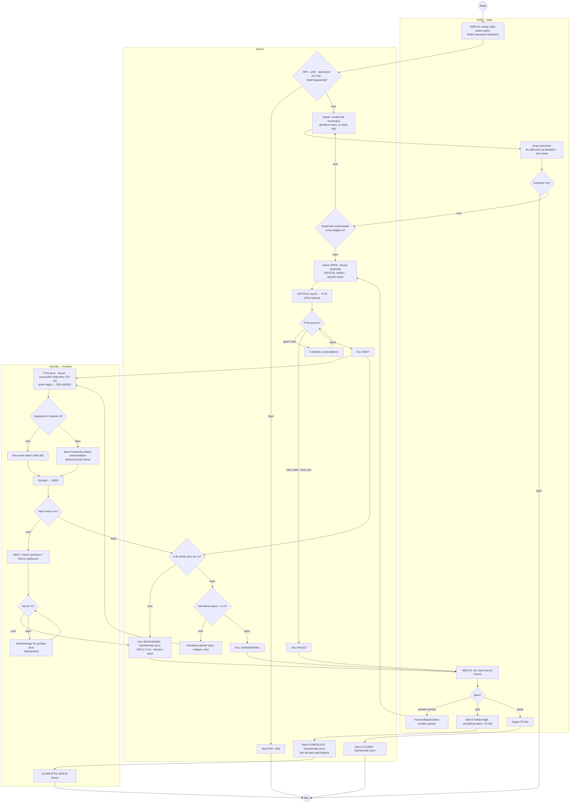

# Activity Diagram — Acil alarmın oluşturulması, gönderilmesi, yanıtlanması ve iptali

> Kaynak: K-09, K-13, K-17, K-24, K-31, BR-04, US-20 – US-25, TD-03, TD-05 – TD-10. Ayrıntılı tasarım: `../design/emergency-alert-design.md`. Otomatik eskalasyon (R2) gösterilmez.

**Açıklama:** Alarmı yalnızca aktif operasyonun KOR'u, MFA'lı oturumla ve onay adımından geçerek gönderir (K-09, K-17, K-19, BR-04). Onay ile gönderim arasında hedef kitle değiştiyse yeni önizleme istenir (TD-05). Gönderim `CRITICAL` kuyruktan cihaz başına FCM mesajıyla yapılır; geçici hatalar 3 kez denenir, kalıcı hatada alıcı "Gönderilemedi" olur. Android'de uygulama ön plandaysa tam ekran alarm açılır; değilse yüksek önemli bildirim çıkar ve dokununca tam ekran açılır. Kilit ekranında kendiliğinden tam ekran açılması MVP'de **yoktur** (RT-03). Yanıt vermeyene 2 dk aralıkla en fazla 5 hatırlatma gider, sonra alıcı "Yanıtsız" olur (K-13). İptal bildirimi yanıtlamış olanlar dahil tüm alıcılara gider. Yeniden gönderim yalnızca `UNANSWERED` ve `FAILED` alıcılar içindir. Sessiz mod, DND ve zorla durdurulmuş uygulama durumlarında alarmın ulaşması veya ses çıkarması garanti edilmez.
