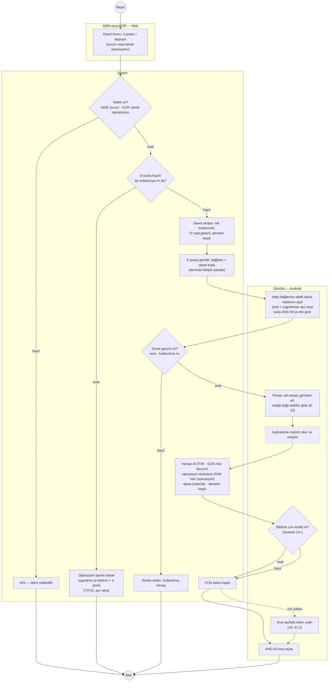

# Activity Diagram — Gönüllünün davetle sisteme katılması

> Kaynak: K-06, K-10, SC-01, US-01, US-02, US-03, TD-02, TD-17. Kesik çerçeveli adım Genişletilmiş MVP'dir.

**Açıklama:** Açık kayıt yoktur. Davet yalnızca ADM (kurum geneli) veya KOR (kendi operasyonu) tarafından oluşturulur. Davet tek kullanımlıktır, 72 saat geçerlidir ve e-postada hem bağlantı hem elle girilebilir kod bulunur (TD-02). Aydınlatma metni adımı Genişletilmiş halkadadır; Çekirdekte atlanır (CON-15). Bildirim izni reddedilse de hesap etkinleşir, ama alarm alınamayacağı için ana ekranda kalıcı uyarı gösterilir. Kayıtlı bir kullanıcıya yapılan operasyon daveti ayrı akıştır: `activity-join-operation.md`.
