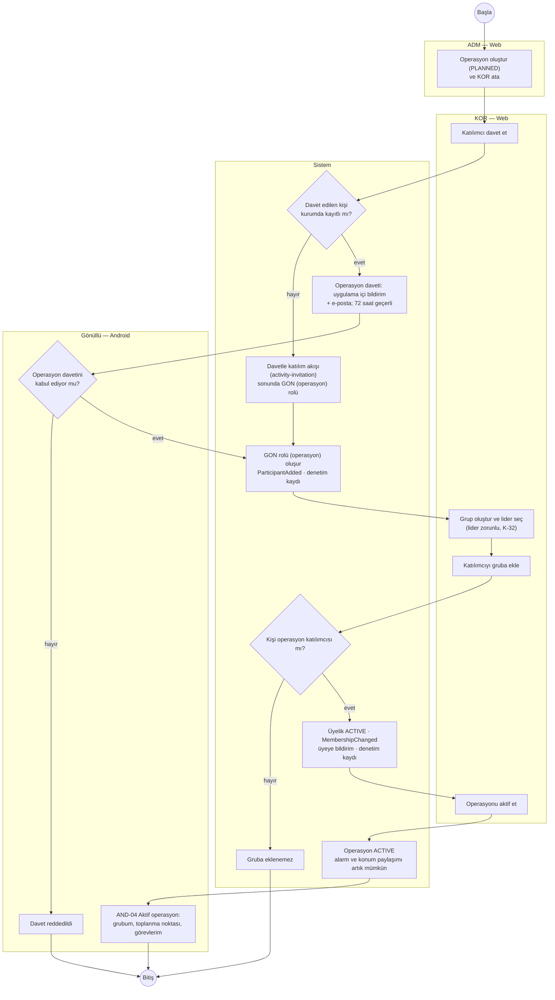

# Activity Diagram — Gönüllünün operasyona katılması

> Kaynak: K-06, K-07, K-11, K-32, SC-02, US-08, US-09, **TD-01 (kabul edildi)**. Operasyona katılım, `ROLE_ASSIGNMENT(role=GON, scope=OPERATION)` kaydıdır.

**Açıklama:** Operasyonu yalnızca ADM oluşturur ve KOR atar. KOR, kendi operasyonuna yeni kişileri davetle katar; kurumda zaten kayıtlı kişiler operasyon davetini uygulamada kabul eder (TD-01). Gruba yalnızca operasyon katılımcıları eklenebilir; grup lider seçilmeden oluşturulamaz (K-32). Sıralama zorunlu değildir: gruplar operasyon `PLANNED` iken de kurulabilir, ancak alarm ve konum paylaşımı yalnızca `ACTIVE` operasyonda mümkündür (K-17, K-14). Operasyon kapanınca operasyon kapsamlı roller pasifleşir ve gruplar arşivlenir (K-11). Gönüllünün kendi isteğiyle ayrılması R2'dedir (K-28) ve gösterilmez.
