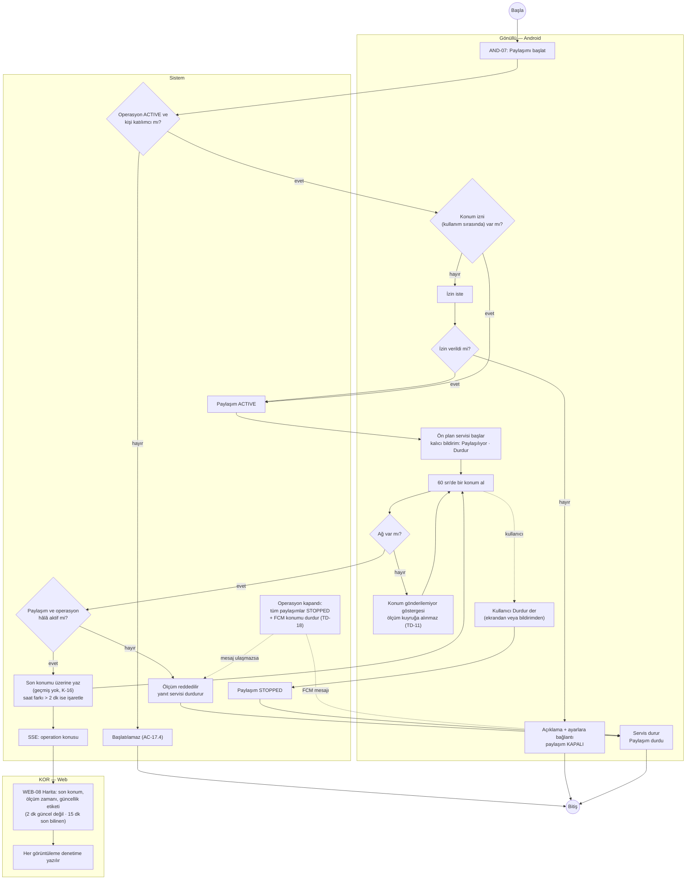

# Activity Diagram — Konum paylaşımının başlatılması ve durdurulması

> Kaynak: K-14, K-15, K-16, BR-09, US-17 – US-19, AC-08.3, ADR-011, VS-18, TD-11, TD-18. Arka planda kesintisiz çalışma **garanti edilmez** (`../design/technical-risks-validation.md` G-07).

**Açıklama:** Paylaşımı yalnızca gönüllü (veya kendi konumu için grup lideri) başlatır ve istediği an durdurabilir (K-14). Paylaşım yalnızca aktif operasyonda ve operasyon katılımcısı için mümkündür. Konum, kalıcı bildirimli bir ön plan servisiyle 60 sn'de bir alınır; ayrı "her zaman" izni istenmez (ADR-011). Bu varsayım Hafta 2'de doğrulanır (TV-01). Ağ yokken ölçümler biriktirilmez; yalnızca son konum önemlidir. Operasyon kapanınca sunucu paylaşımları durdurur ve cihaza mesaj gönderir; mesaj ulaşmazsa sonraki ölçüm reddedilir ve servis durur (≤ 1 dk hedefi, AC-08.3). Konumu yalnızca aktif operasyonun KOR'u görür (K-15); grup lideri ve diğer gönüllüler göremez.
