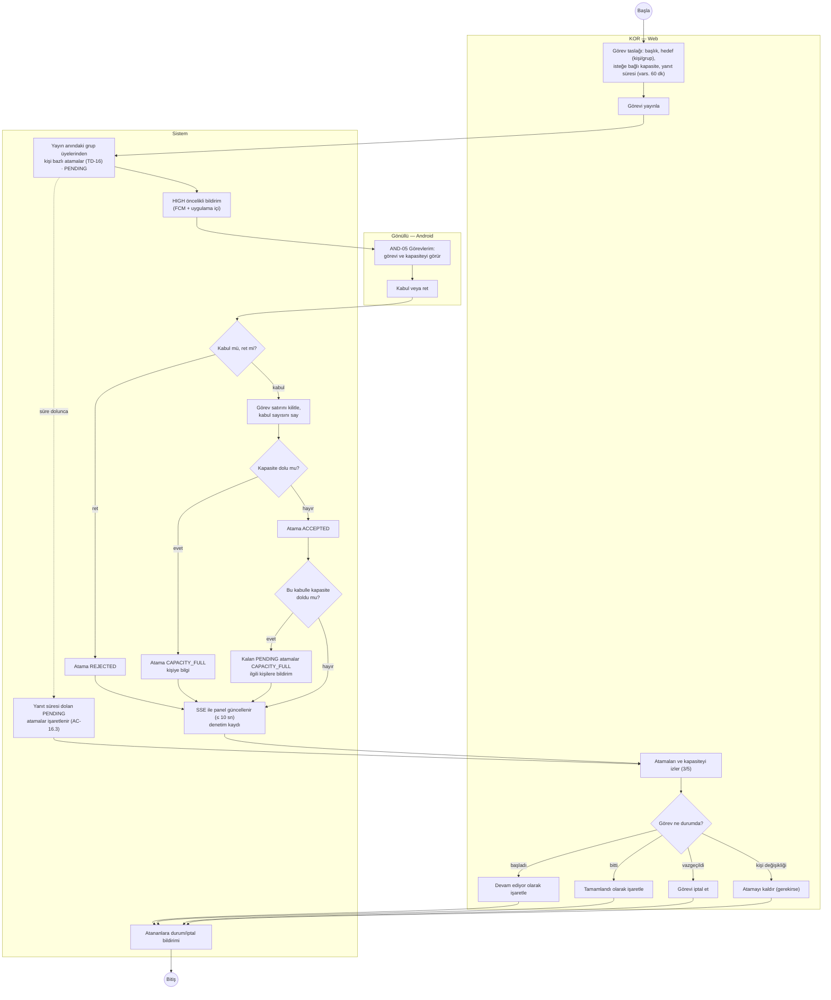

# Activity Diagram — Görev atanması ve görev durumunun güncellenmesi

> Kaynak: K-12, VS-17, SC-04, US-13 – US-16, AC-14.4 – AC-14.6, TD-16. Görev durumları: `DRAFT → PUBLISHED → IN_PROGRESS → DONE / CANCELLED`. Atama durumları: `PENDING → ACCEPTED / REJECTED / CAPACITY_FULL / REMOVED`.

**Açıklama:** Görevi yalnızca operasyonun KOR'u oluşturur ve durumunu ilerletir (K-12, VS-17); grup lideri ve gönüllü görev durumunu değiştiremez. Kabul, kapasite kontrolüyle aynı işlemde ve satır kilidiyle yapılır; eşzamanlı kabuller kapasiteyi aşamaz (AC-14.6). Kapasite dolunca bekleyen atamalar kapanır. Gönüllü kabul ettiği görevi bırakamaz; gerekirse KOR atamayı kaldırır (AC-14.4). Yanıt süresinin dolması atamanın durumunu değiştirmez, yalnızca panelde işaretler. Liste filtreleri (AC-16.2) Genişletilmiş halkadadır ve akışta gösterilmez.
