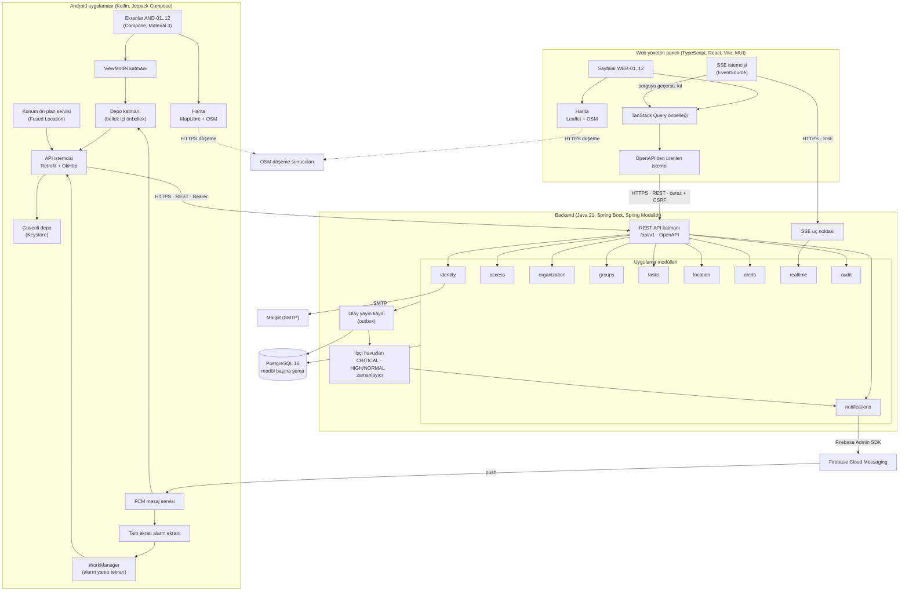

# Component Diagram

> Kaynak: ADR-001 – ADR-012, `../design/system-architecture.md` §2–3. Yalnızca MVP bileşenleri gösterilir. R2+ modüller (messaging, files, calls) **gösterilmez.**

**Açıklama:** Android ve web istemcileri backend'e yalnızca OpenAPI sözleşmesindeki REST uçlarıyla bağlanır (ADR-010). Web anlık güncellemeleri SSE ile alır (ADR-009). Android kalıcı bağlantı tutmaz; anlık bilgiyi FCM ile alır ve uygulama açılışında REST ile tazeler (ADR-005). Backend tek bir dağıtılabilir birimdir; modüller Spring Modulith uygulama modülleridir ve birbirleriyle açık arayüzler ve outbox ile kalıcılaştırılan olaylar üzerinden konuşur (ADR-001, ADR-004). Alarm gönderimi `CRITICAL` işçi havuzunda diğer trafikten ayrı işlenir. Harita döşemeleri istemciler tarafından doğrudan OSM'den alınır; konum verisi harita servisine gönderilmez. Android'de kalıcı yerel veritabanı yoktur; yalnızca alarm yanıtı WorkManager işi olarak saklanır (K-24).
