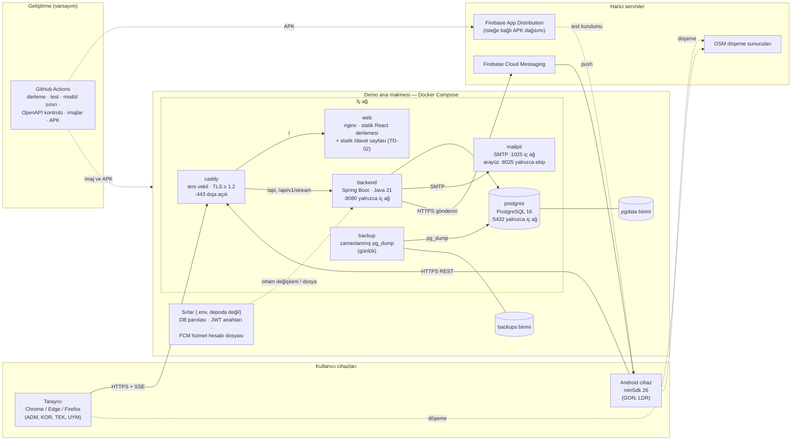

# Deployment Diagram

> Kaynak: ADR-008, VS-04, VS-11, VS-12, TD-15, US-29 (TLS ≥ 1.2, sır yönetimi), NFR-01, NFR-11. Demo ortamı: **Docker Compose ile tek makine veya tek sanal sunucu** (VS-11; makinenin kendisi gerçek bilgi gerektirir). Depo ve CI için GitHub varsayılmıştır (ADR-008).

**Açıklama:** Tüm sunucu bileşenleri tek bir Docker Compose projesinde çalışır. Dışa yalnızca Caddy (443) açılır; backend, PostgreSQL ve Mailpit SMTP portu iç ağdadır. Mailpit arayüzü yalnızca ekip erişimine açıktır. Caddy TLS'i sonlandırır, statik web uygulamasını ve API/SSE trafiğini yönlendirir; SSE için vekil zaman aşımı TV-11'de doğrulanır. Veritabanı kalıcı birimde tutulur ve günlük `pg_dump` yedeği ayrı bir birime alınır (RPO 24 sa, RTO 4 sa, VS-04, TD-15). Sırlar depoda tutulmaz (NFR-01). Android uygulaması Google Play'de yayınlanmaz; imzalı APK veya Firebase App Distribution ile dağıtılır (VS-12). Harici servisler FCM ve OSM'dir; harici servise kişisel veri yalnızca FCM üzerinden kısa bildirim metni olarak gider ve veriler sentetiktir (K-04).
