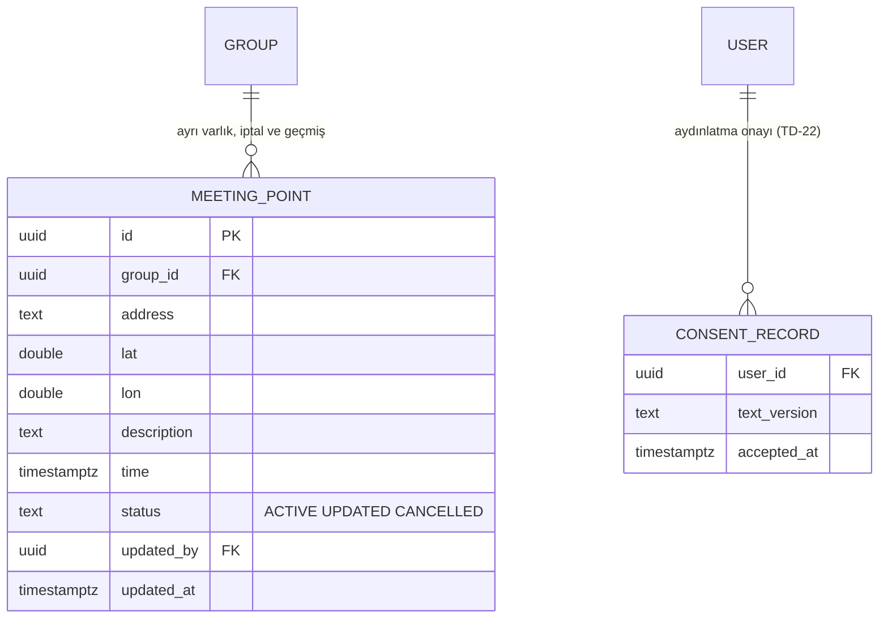
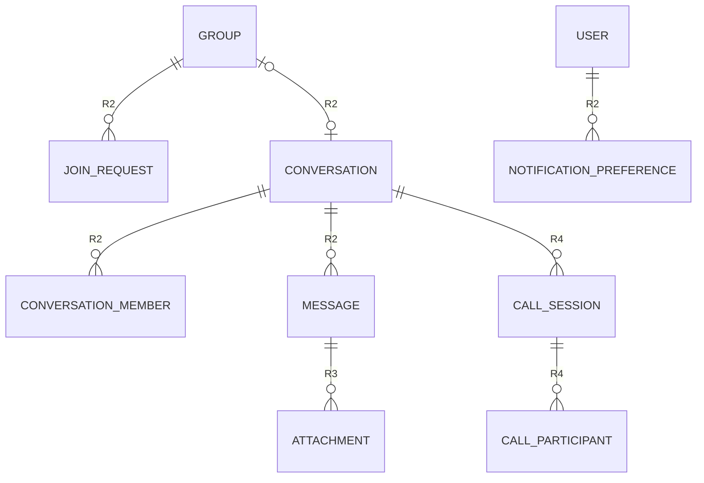

# Entity Relationship Diagram

> Kaynak: `../domain-model.md` §2, §3, §5, §5A, §5B (birebir eşleşir). Mantıksal modeldir; fiziksel şema ve geçişler bu aşamada **yazılmaz.** PostgreSQL'e eşleme kuralları: `../design/api-and-data-design-basis.md` §4.
> - TD etiketleri, varlığın veya ilişkinin hangi **onaylı tasarım kararından** geldiğini gösterir (`../design/system-architecture.md` §9).
> - Genişletilmiş MVP ve R2+ varlıkları ayrı diyagramlarda gösterilir; Çekirdek diyagramına karıştırılmaz.

## 1. Çekirdek MVP

```mermaid
erDiagram
  ORGANIZATION ||--o{ OPERATION : "içerir"
  ORGANIZATION ||--o{ GROUP : "içerir"
  OPERATION |o--o{ GROUP : "bağlıdır (MVP: zorunlu)"
  USER ||--o{ ROLE_ASSIGNMENT : "sahiptir"
  OPERATION |o--o{ ROLE_ASSIGNMENT : "kapsam: katılım ve KOR (TD-01)"
  USER ||--o{ INVITATION : "oluşturur"
  USER |o--o{ INVITATION : "davet edilen / kabul eden"
  USER ||--o{ DEVICE : "kaydeder"
  USER ||--o{ REFRESH_TOKEN : "TD-04"
  DEVICE |o--o{ REFRESH_TOKEN : "Android oturumu"
  GROUP ||--o{ GROUP_MEMBERSHIP : "tam bir LEADER"
  USER ||--o{ GROUP_MEMBERSHIP : ""
  OPERATION ||--o{ TASK : ""
  TASK ||--o{ TASK_ASSIGNMENT : "kişi bazlı"
  USER ||--o{ TASK_ASSIGNMENT : ""
  USER ||--o{ LOCATION_SHARING : "operasyon başına tek"
  OPERATION ||--o{ LOCATION_SHARING : ""
  USER ||--o{ LAST_LOCATION : "operasyon başına tek"
  OPERATION ||--o{ LAST_LOCATION : ""
  OPERATION ||--o{ ALERT : ""
  ALERT ||--|{ NOTIFICATION : "gönderim, iptal, kapanış"
  ALERT ||--o{ ALERT_RECIPIENT : "TD-03"
  USER ||--o{ ALERT_RECIPIENT : "TD-03"
  ALERT |o--o| ALERT : "düzeltir (TD-09)"
  NOTIFICATION ||--o{ DELIVERY : "kanal, cihaz, deneme"
  USER ||--o{ DELIVERY : ""
  DEVICE |o--o{ DELIVERY : "PUSH"
  USER |o--o{ AUDIT_ENTRY : "aktör (sistemde boş)"

  ORGANIZATION {
    uuid id PK
    text name "kurgusal senaryo kurumu (VS-01)"
  }
  USER {
    uuid id PK
    text email UK
    text password_hash
    text full_name
    text display_name
    text phone "isteğe bağlı (K-10)"
    text status "ACTIVE DISABLED CLOSED"
    text totp_secret "şifreli, ADM/KOR (K-19)"
    timestamptz totp_enrolled_at
    bool must_change_password "AC-03.5"
    int failed_login_count
    timestamptz locked_until
    timestamptz created_at
  }
  ROLE_ASSIGNMENT {
    uuid id PK
    uuid user_id FK
    text role "ADM KOR GON TEK UYM"
    text scope_type "ORGANIZATION OPERATION"
    uuid scope_id "kurum veya operasyon"
    uuid granted_by FK
    timestamptz granted_at
    timestamptz revoked_at
  }
  INVITATION {
    uuid id PK
    text kind "NEW_USER OPERATION"
    text email
    uuid user_id FK "davet edilen / kabul eden"
    text scope_type
    uuid scope_id
    text token_hash UK
    text code_hash UK "elle girilen kod (TD-02)"
    timestamptz expires_at "72 saat"
    text status "PENDING ACCEPTED DECLINED EXPIRED REVOKED"
    timestamptz used_at
    uuid created_by FK
  }
  DEVICE {
    uuid id PK
    uuid user_id FK
    text fcm_token UK
    text platform "ANDROID"
    text app_version
    bool active
    timestamptz registered_at
    timestamptz last_seen_at
  }
  REFRESH_TOKEN {
    uuid id PK
    uuid user_id FK
    uuid device_id FK "web için boş"
    text client "WEB ANDROID"
    text token_hash UK
    bool mfa_verified "yalnızca web ADM/KOR"
    timestamptz issued_at
    timestamptz expires_at "web 12 sa, Android 30 gün"
    timestamptz last_used_at
    uuid replaced_by FK "döndürme zinciri"
    timestamptz revoked_at
  }
  OPERATION {
    uuid id PK
    uuid organization_id FK
    text name
    text description
    text state "PLANNED ACTIVE COMPLETED CANCELLED"
    timestamptz planned_end_at
    timestamptz activated_at
    timestamptz closed_at
    uuid created_by FK
  }
  GROUP {
    uuid id PK
    uuid organization_id FK
    uuid operation_id FK
    text name
    text description
    text type "MVP: OPERATIONAL"
    text join_policy "MVP: MANAGED"
    text mp_address "toplanma noktası"
    double mp_lat
    double mp_lon
    text mp_description
    timestamptz mp_time
    uuid mp_updated_by FK
    timestamptz mp_updated_at
    uuid created_by FK
    timestamptz archived_at
  }
  GROUP_MEMBERSHIP {
    uuid group_id FK
    uuid user_id FK
    text role "LEADER MEMBER"
    text status "ACTIVE REMOVED"
    uuid added_by FK
    timestamptz joined_at
    timestamptz ended_at
    text end_reason
  }
  TASK {
    uuid id PK
    uuid operation_id FK
    text title
    text description
    text priority
    text meeting_point "isteğe bağlı"
    tstzrange time_window
    int capacity "isteğe bağlı (K-12)"
    timestamptz response_deadline "vars. 60 dk"
    text state "DRAFT PUBLISHED IN_PROGRESS DONE CANCELLED"
    uuid created_by FK
  }
  TASK_ASSIGNMENT {
    uuid task_id FK
    uuid user_id FK
    text status "PENDING ACCEPTED REJECTED CAPACITY_FULL REMOVED"
    timestamptz responded_at
    uuid removed_by FK
  }
  LOCATION_SHARING {
    uuid user_id FK
    uuid operation_id FK
    text state "OFF ACTIVE UNAVAILABLE STOPPED"
    timestamptz started_at
    timestamptz stopped_at
  }
  LAST_LOCATION {
    uuid user_id FK
    uuid operation_id FK
    double lat
    double lon
    double accuracy
    timestamptz measured_at "cihaz"
    timestamptz received_at "sunucu"
    bool clock_skew_flag "> 2 dk"
  }
  ALERT {
    uuid id PK
    uuid operation_id FK
    text message
    text requested_action
    text priority
    text response_options "sabit 3 seçenek (K-13)"
    text state "DRAFT SENT OPEN CANCELLED CLOSED"
    int version "taslak sürümü (TD-05)"
    text reminder_policy "2 dk x 5"
    uuid corrects_alert_id FK "benzersiz (TD-09)"
    text idempotency_key
    uuid created_by FK
    timestamptz sent_at
    uuid cancelled_by FK
    timestamptz cancelled_at
    uuid closed_by FK "otomatikte boş"
    timestamptz closed_at
    text close_reason "MANUAL OPERATION_CLOSED"
  }
  ALERT_RECIPIENT {
    uuid id PK
    uuid alert_id FK
    uuid user_id FK
    text state "QUEUED SENT DELIVERED SEEN RESPONDED UNANSWERED FAILED"
    text response_option
    timestamptz responded_at_device
    timestamptz responded_at_server
    text response_idempotency_key
    timestamptz delivered_at
    timestamptz seen_at
    int reminder_count
    timestamptz next_reminder_at
    text failure_reason
  }
  NOTIFICATION {
    uuid id PK
    text category "ALERT TASK ANNOUNCEMENT MEETING_POINT OPERATION_INVITE SYSTEM"
    text kind "ALERT_SENT ALERT_CANCELLED ALERT_CLOSED LOCATION_STOP vb."
    text priority "CRITICAL HIGH NORMAL LOW"
    text title "kısa"
    text body "kısa; duyuru metni"
    text source_type
    uuid source_id
    jsonb audience_expr
    uuid created_by FK "sistemde boş"
    timestamptz created_at
    text idempotency_key
  }
  DELIVERY {
    uuid id PK
    uuid notification_id FK
    uuid user_id FK
    uuid device_id FK "PUSH için"
    text channel "PUSH IN_APP"
    int round "0 ilk tur, n elle yeniden gönderim"
    int attempt "tur içinde 0 ilk, 1-5 hatırlatma"
    text status "QUEUED SENT FAILED"
    text fcm_message_id
    text error_code
    timestamptz queued_at
    timestamptz sent_at
    timestamptz read_at "IN_APP gelen kutusu"
  }
  AUDIT_ENTRY {
    uuid id PK
    uuid actor_id FK "sistem işlemlerinde boş"
    text action
    text resource_type
    uuid resource_id
    timestamptz at
    jsonb details "içerik ve sır yok"
  }
```

**Açıklama:** `domain-model.md`'deki MVP varlıklarının tamamı gösterilir. Önemli noktalar:
- **Toplanma noktası:** Çekirdekte grubun alanlarıdır (`mp_*`).
- **Kapsam ve katılım:** `ROLE_ASSIGNMENT.scope_id` çok biçimlidir: `scope_type`'a göre kurumu veya operasyonu gösterir. Operasyona katılım `(GON, OPERATION)` kaydıdır (TD-01). Grup lideri rol ataması değil, üyelik rolüdür.
- **Konum:** `LAST_LOCATION` kullanıcı ve operasyon başına tek satırdır; geçmiş yoktur (K-16).
- **Alarm ve bildirim:** Alarm 1:N bildirim üretir (gönderim, iptal, kapanış). Hatırlatmalar ayrı bildirim değil, gönderim bildiriminin `attempt` numaralı teslim denemeleridir. Alarm iş durumu (görüldü, yanıt) `ALERT_RECIPIENT`'ta, iletim kaydı `DELIVERY`'dedir.
- **Oturum:** `REFRESH_TOKEN.mfa_verified` yalnızca web'deki ADM/KOR oturumunda `true` olur. Android oturumu kurumsal izin taşımaz (DR-12).
- **Aktörsüz kayıtlar:** Sistem işlemlerinde (zamanlayıcı, otomatik kapanış) denetim kaydının aktörü boştur.
- Bütünlük kuralları (tek lider, kapasite, benzersizlikler): `domain-model.md` §5B.
- Outbox ve teslim kuyruğu teknik tablolardır ve alan modeline dahil değildir.

## 2. Genişletilmiş MVP

**Açıklama:** Yalnızca zaman kalırsa (kapı KP3) eklenecek varlıklardır. `MEETING_POINT`, Çekirdekteki grup alanlarının yerini alır. `CONSENT_RECORD` aydınlatma metni onayının kaydıdır (US-02, AC-02.2, TD-22).

## 3. Sonraki sürümlerin bağlanma noktaları (R2+, oluşturulmaz)

**Açıklama:** `domain-model.md` §2 ve §4'teki gelecek varlıklarıdır. MVP'de **tablo olarak oluşturulmaz** (README §5.2). Hepsi mevcut `GROUP` ve `USER` varlıklarına bağlanır; MVP modelinde değişiklik gerektirmez.
