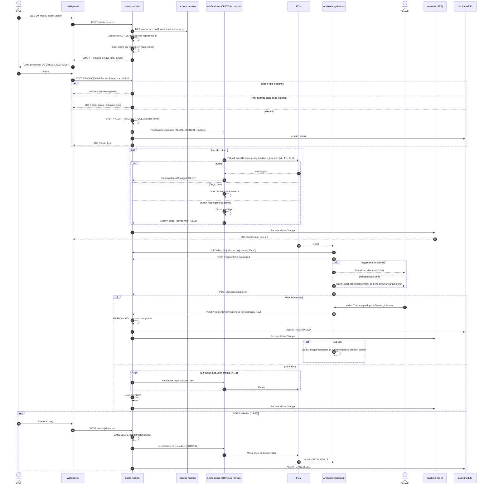

# Sequence Diagram — Acil alarm ve bildirim süreci

> Kaynak: K-09, K-13, K-17, K-19, K-24, BR-04, BR-06, US-20 – US-25, ADR-004, ADR-009, TD-03, TD-05 – TD-10. Ayrıntılar ve hata durumları: `../design/emergency-alert-design.md`. Uç nokta adları taslaktır.

**Açıklama:** Alarm iki adımda gönderilir: taslak ve önizleme, ardından onaylı gönderim (TD-05). `Idempotency-Key` yinelenen isteklerin ikinci alarm oluşturmasını önler (AC-20.5). Alarm kaydı, alıcı satırları ve bildirim isteği tek işlemde ve outbox ile yazılır; gönderim `CRITICAL` öncelikli ayrı işçi havuzunda yapılır (ADR-004). Panel her alıcının Gönderildi / Teslim edildi / Görüldü / Yanıt durumunu ayrı gösterir (BR-06). "Teslim edildi" ve "Görüldü" sinyalleri uygulamanın çalışıp ağa erişebilmesine bağlıdır; gelmezse "bilinmiyor" görünür. Hatırlatmalar sunucudan gönderilir; cihazda yerel alarm zamanlayıcısı kullanılmaz. Otomatik eskalasyon R2'dedir ve gösterilmez.
