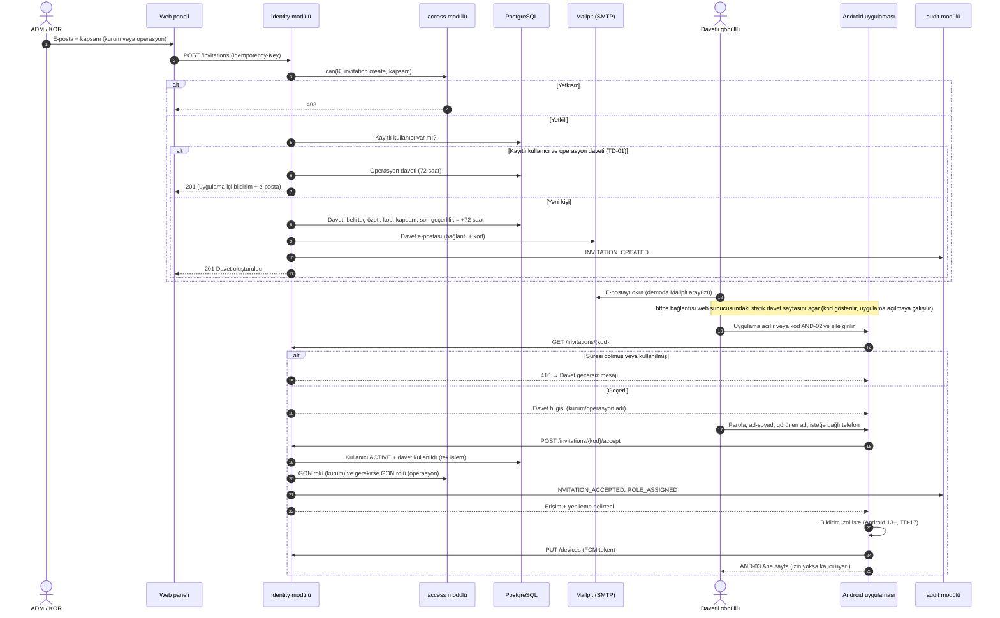

# Sequence Diagram — Gönüllü davet süreci

> Kaynak: K-06, K-10, US-01, US-02, TD-01, TD-02, TD-17. Uç nokta adları taslaktır.

**Açıklama:** Davet tek kullanımlıktır; sunucu yalnızca belirtecin özetini saklar ve davet 72 saat geçerlidir. E-posta hem bağlantı hem kod içerir. Bağlantı bir https adresidir ve web sunucusundaki statik davet sayfasını açar. Sayfa kodu gösterir ve uygulamayı açmayı dener; e-posta istemcileri özel URI şemalı bağlantıları engellediği için bu yol seçildi. Uygulama açılamazsa kod elle girilir (TD-02). Demoda e-postalar Mailpit'te yakalanır; sentetik kullanıcılara gerçek e-posta gitmez (K-04). Davetin kabulü, hesabın etkinleşmesi ve rol atanması tek işlemde yapılır ve denetime yazılır. Kayıtlı kullanıcıya gönderilen operasyon daveti uygulamada kabul edilir (TD-01, `activity-join-operation.md`). Aydınlatma metni onayı Genişletilmiş halkadadır ve gösterilmez.
