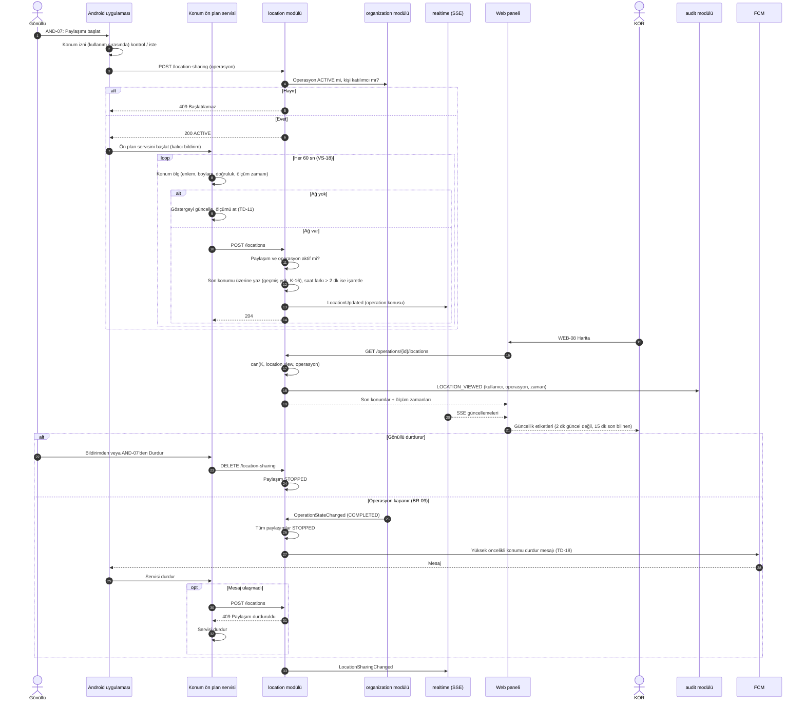

# Sequence Diagram — Konum paylaşımı

> Kaynak: K-14, K-15, K-16, BR-08, BR-09, US-17 – US-19, AC-08.3, ADR-011, VS-18, TD-11, TD-18. Arka planda kesintisiz çalışma garanti edilmez (TV-01). Uç nokta adları taslaktır.

**Açıklama:** Paylaşımı kullanıcı başlatır ve durdurur (K-14). Paylaşım yalnızca aktif operasyonda ve operasyon katılımcısı için mümkündür. Konum, kalıcı bildirimli ön plan servisiyle 60 sn'de bir gönderilir; sunucu yalnızca son konumu tutar (K-16). Konumu yalnızca aktif operasyonun KOR'u görür ve her görüntüleme denetime yazılır (K-15, BR-08). Operasyon kapanınca paylaşımlar sunucu tarafında hemen durur. Cihaz durdurma mesajını alamazsa bir sonraki ölçüm reddedilir ve servis kendini durdurur; hedef ≤ 1 dk (AC-08.3).
