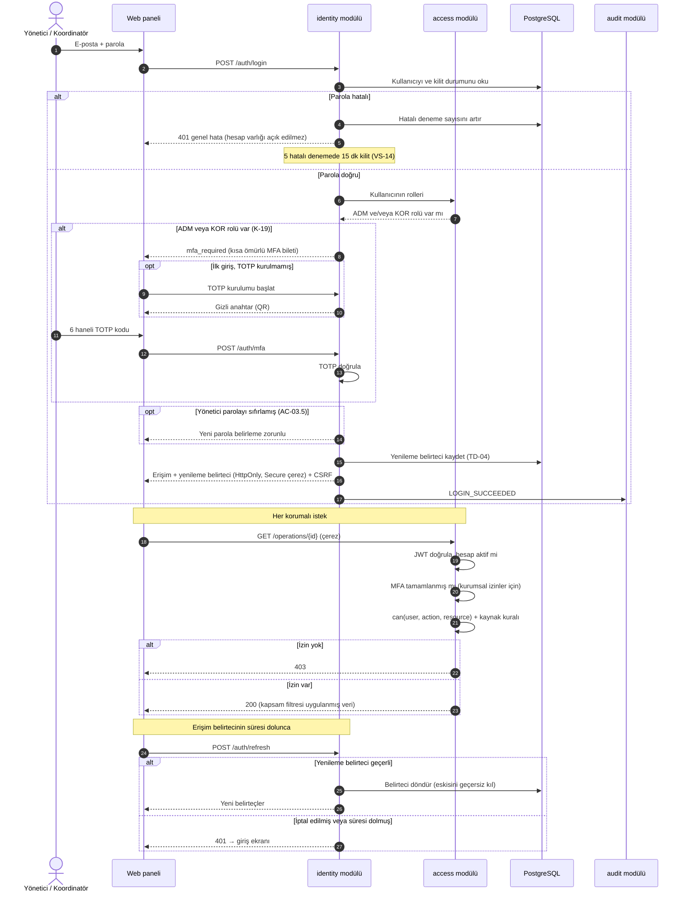
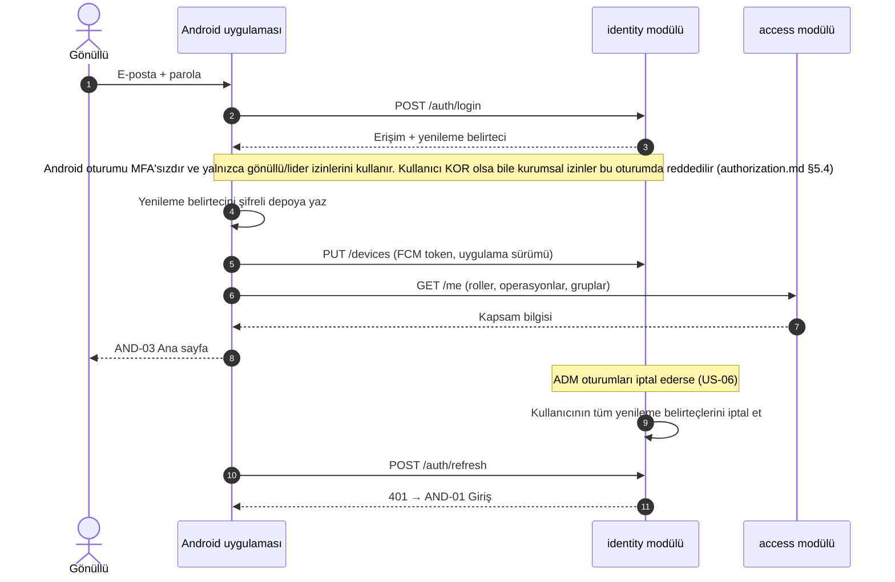

# Sequence Diagram — Kullanıcı girişi ve yetkilendirme

> Kaynak: ADR-012, K-19, FR-22, US-03, US-06, US-07, NFR-02, ADR-002, TD-04 (belirteç süreleri: erişim 15 dk; yenileme web 12 sa, Android 30 gün), ADR-013. Uç nokta adları taslaktır (`../design/system-architecture.md` §7); uygulanmamıştır.

## Web paneli (ADM, KOR, TEK, UYM)

## Android (GON, LDR)

**Açıklama:** Kimlik doğrulama `identity`, yetki denetimi `access` modülündedir. ADM ve KOR rolü olan kullanıcılar web panelinde TOTP doğrulamadan kurumsal izinleri kullanamaz (K-19). Erişim belirteci kısa ömürlü, yenileme belirteci iptal edilebilir ve her kullanımda döndürülür. Oturum iptali en geç bir erişim belirteci ömrü içinde etkili olur; SSE bağlantıları hemen kapatılır. Her istekte yetki sunucuda denetlenir; liste sorgularında kapsam filtresi veritabanı sorgusuna eklenir (NFR-02). Kullanıcının kendi parolasını sıfırlaması Genişletilmiş halkadadır ve gösterilmez.
