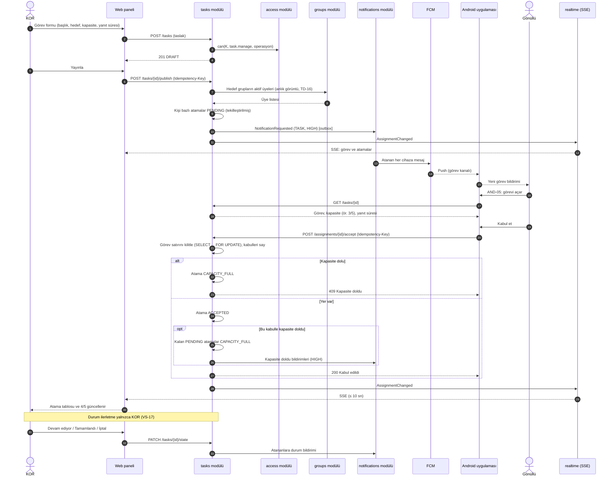

# Sequence Diagram — Görev atama süreci

> Kaynak: K-12, VS-17, US-13 – US-16, AC-14.5, AC-14.6, TD-16, ADR-004, ADR-009. Uç nokta adları taslaktır.

**Açıklama:** Gruba atanan görev, yayın anındaki aktif üyeler için kişi bazlı atamalara dönüşür (TD-16, AC-13.2). Kabul, görev satırı kilitlenerek kapasite kontrolüyle aynı işlemde yapılır; aynı anda gelen kabuller kapasiteyi aşamaz (AC-14.6). Kapasite dolunca bekleyen atamalar kapanır ve ilgili kişilere bildirilir (AC-14.5). Bildirim isteği outbox ile yazılır; görev bildirimi `HIGH` önceliklidir ve alarm kuyruğunu etkilemez (ADR-004). Panel SSE ile güncellenir. Gönüllü kabul ettiği görevi bırakamaz; KOR atamayı kaldırabilir (AC-14.4).
