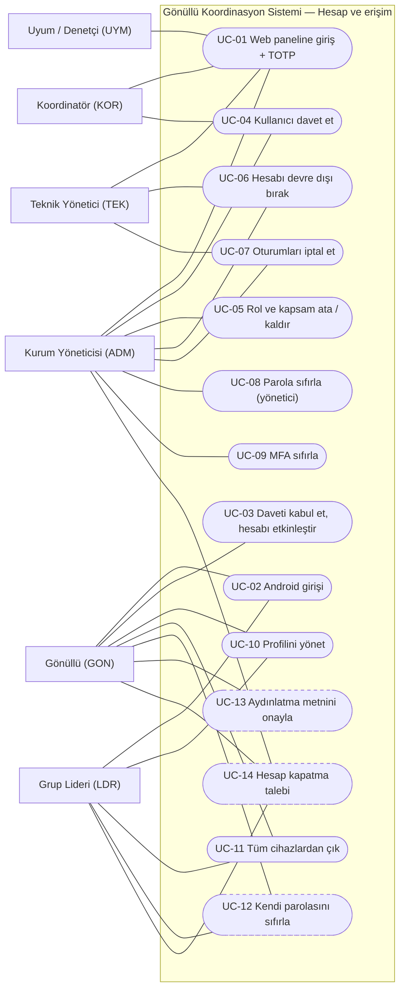
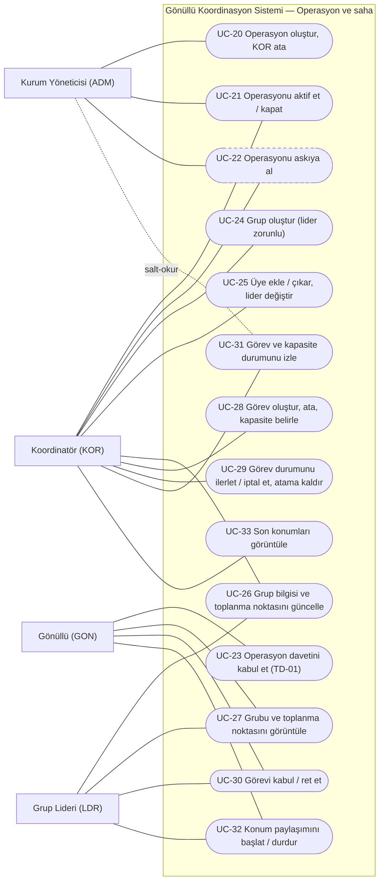
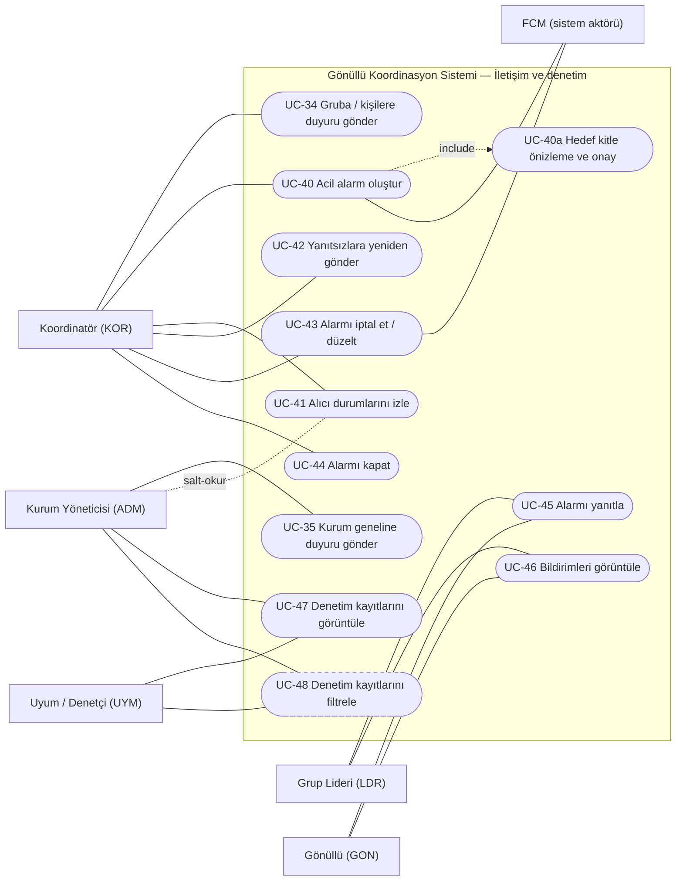

# Use Case Diagram

> **Gösterim:** Mermaid'de UML use case sözdizimi yoktur. Aktörler dikdörtgen, kullanım senaryoları yuvarlatılmış düğüm, sistem sınırı çerçeve olarak çizildi. **Kesik çerçeveli** senaryolar Genişletilmiş MVP'dir (zaman kalırsa, KP3). R2 ve sonrası **bilinçli olarak gösterilmez.** Yetkiler `docs/analysis/user-roles.md` §4 ile birebir eşleşir. Okunabilirlik için diyagram üç görünüme bölündü.

Aktörler: **ADM** Kurum Yöneticisi · **KOR** Operasyon Koordinatörü · **LDR** Grup Lideri · **GON** Gönüllü · **TEK** Teknik Sistem Yöneticisi · **UYM** Uyum/Denetçi · **FCM** (ikincil sistem aktörü)

## Görünüm 1 — Hesap ve erişim

**Açıklama:** Hesap yalnızca davetle oluşur (K-06). Davet kurum genelinde ADM, kendi operasyonu için KOR tarafından gönderilir. Web girişinde ADM ve KOR için TOTP zorunludur (K-19). TEK yalnızca teknik gerekçeyle hesap devre dışı bırakma ve oturum iptali yapar ve iş verisi görmez (TD-14). UC-10 ve UC-11 web rollerince de kullanılır (WEB-12); görünüm sade kalsın diye yalnızca mobil rollere bağlandı. UC-14'ü gönüllü ve lider talep eder, ADM işler.

## Görünüm 2 — Operasyon, grup, görev ve konum

**Açıklama:** Operasyonu yalnızca ADM oluşturur; aktif etme ve kapatmayı ADM ile operasyonun KOR'u yapar (FR-19). Grup, görev ve üye işlemleri yalnızca KOR'dadır. ADM bunları ancak kendini o operasyona KOR olarak atayarak yapar (K-07), bu yüzden ADM'den bu senaryolara bağlantı çizilmedi. Grup lideri yalnızca grup bilgisini ve toplanma noktasını günceller (K-08); üye ekleyemez, görev yönetemez, konum göremez (K-15). Konumu yalnızca aktif operasyonun KOR'u görür ve her görüntüleme denetime yazılır (BR-08).

## Görünüm 3 — Duyuru, acil alarm ve denetim

**Açıklama:** Acil alarmı yalnızca aktif operasyonun KOR'u gönderir (K-09, K-17); onay adımı her alarmda zorunludur (UC-40a, BR-04). Grup lideri alarm ve duyuru gönderemez (K-09). Alarmı, alıcı olarak seçilen herkes yanıtlar; gönderen kendi alarmının alıcısı olmaz. Alarm yalnızca MFA'lı web oturumundan gönderilir; Android uygulamasında alarm gönderme yoktur (ADR-013, DR-12). Otomatik eskalasyon (R2) ve gönüllünün başlattığı SOS (R3) bu diyagramda **yoktur.** Denetim kayıtlarını yalnızca ADM ve UYM görür (K-26).
