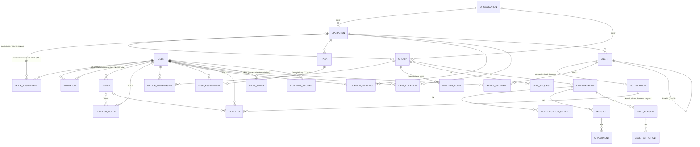
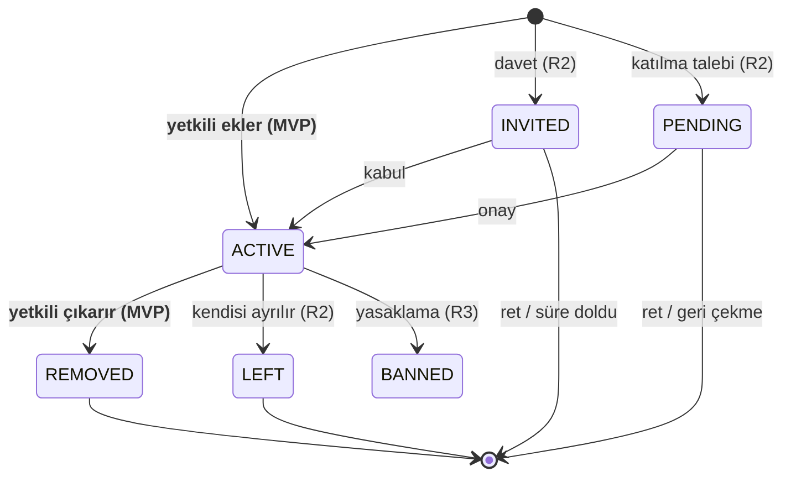

# Alan Modeli: Kullanıcı, Grup ve İletişim İlişkileri

> **Durum: Kabul edildi** (K-07, K-11, K-12, K-14, K-16, K-32; ADR-001 – ADR-003; tasarım kararları TD-01, TD-03, TD-04, TD-09, TD-22). Alanlar mantıksal düzeydedir; fiziksel şema geliştirme aşamasında (Hafta 3, Flyway) çıkarılacak. "MVP" sütunu olmayan veya **R2+** ile işaretli varlıklar ilk sürümde **oluşturulmaz.**

## 1. Temel kavramlar

| Kavram | Tanım | Neden ayrı |
|---|---|---|
| **Kullanıcı** | Sistemde hesabı olan kişi | – |
| **Kurum rolü ataması** | Kullanıcının kurum veya operasyon kapsamındaki rolü (ADM, KOR, TEK...) | Yönetsel yetkiler buradan gelir (`authorization.md`) |
| **Grup** | Üyeleri olan bir kişi topluluğu | Hedefleme, koordinasyon ve iletişim için ortak birim |
| **Grup üyeliği** | Kullanıcının bir gruptaki rolü ve durumu | Katılma talebi, grup içi roller ve ayrılma gibi gelecekteki akışlar burada yaşar |
| **Konuşma** *(R2)* | Mesajların aktığı kanal | Grup ile karıştırılmaz; ileride bire bir sohbet de bir konuşma olur |
| **Bildirim** | Bir veya daha çok alıcıya iletilen haber, kaydıyla birlikte | Alarm, duyuru, görev ve sohbet aynı hattı kullanır |
| **Görüşme oturumu** *(R4)* | Bir konuşmaya bağlı sesli veya görüntülü oturum | Medya dış SFU'da işlenir; biz yalnızca oturumu ve yetkiyi yönetiriz |

## 2. Varlık ilişkileri

Alanlarıyla birlikte ayrıntılı diyagram: `diagrams/erd.md`. Bütünlük kuralları ve kardinalite gerekçeleri: §5B.

**Kardinalite düzeltmesi (14.11.2026):** Önceki sürümde `ALERT ||--|| NOTIFICATION` (1:1) yazıyordu. Onaylı akışta bir alarm en az bir bildirim (gönderim) üretir; iptal (US-25) ve kapanış (TD-06) ayrı bildirimlerdir. Bu yüzden ilişki **1:N** oldu. Hatırlatmalar yeni bildirim değil, aynı gönderim bildiriminin yeni teslim denemeleridir (`DELIVERY.attempt`).

## 3. Kullanıcı-grup ilişkisi

### 3.1 Grup türleri

| `type` | Oluşturan | Kapsam | Katılım | Sürüm |
|---|---|---|---|---|
| `OPERATIONAL` | Koordinatör (ADM, KOR olarak atanarak) | Bir operasyona bağlı; operasyonla arşivlenir (K-11) | Yönetilen (KOR ekler, K-08) | **MVP** |
| `STANDING` | Kurum yöneticisi | Kurum geneli kalıcı ekip (ör. "İlk yardım ekibi") | Yönetilen veya talepli | R2 (K-11) |
| `COMMUNITY` | **Kullanıcılar** | Kurum içi, operasyondan bağımsız | Davet, talep veya açık | **R3** |

**Neden tür ayrımı:** "Kullanıcıların grup oluşturabilmesi" ile "koordinatörün operasyon grubu kurması" aynı yetki sonuçlarını doğurmamalı. Operasyon grubuna acil alarm ve konum kapsamı bağlanabilir. Bir topluluk grubunun üyeliği ise **hiçbir zaman** konum görme veya alarm gönderme yetkisi vermez (`authorization.md` §4). Topluluk grubu acil alarm hedefi de olamaz (K-31).

### 3.2 Grup varlığı

| Alan | MVP | Not |
|---|---|---|
| `id`, `organization_id`, `name`, `description` | ✅ | |
| `type` | ✅ (yalnızca `OPERATIONAL`) | HZ-2 |
| `operation_id` (nullable) | ✅ | `COMMUNITY` gruplarında boş |
| `join_policy` | ✅ (yalnızca `MANAGED`) | Gelecek: `INVITE`, `REQUEST`, `OPEN` |
| `visibility` | – | R3: `HIDDEN` (yalnızca üyeler görür), `LISTED` (kurum içinde listelenir). **Kamuya açık grup yok** (§2.2) |
| `settings` (grup politikaları) | – | R2+: kimler mesaj yazabilir, kimler görüşme başlatabilir, dosya izni... (`authorization.md` §3) |
| `created_by`, `created_at`, `archived_at` | ✅ | Operasyon kapanınca grup arşivlenir (K-11) |

### 3.3 Grup üyeliği

| Alan | MVP | Not |
|---|---|---|
| `group_id`, `user_id` | ✅ | Aynı ikili için tek bir *aktif* üyelik olur |
| `role` | ✅ `LEADER`, `MEMBER` | R2: `ADMIN`, `MODERATOR`; R3: `OWNER` (topluluk grubunun sahibi) |
| `status` | ✅ `ACTIVE`, `REMOVED` | R2: `INVITED`, `PENDING`, `LEFT`, `BANNED` |
| `added_by`, `joined_at`, `ended_at`, `end_reason` | ✅ | Geçmişin korunması: sohbet erişim politikası (AMB-04) ve denetim için |
| `notification_level` | – | R2: `ALL`, `MENTIONS`, `MUTED` (**acil alarmları etkilemez**) |

**Üyelik durum makinesi** (MVP'de yalnızca kalın geçişler var):

**Kurallar**
- **D-01:** Üyelik bittiğinde (REMOVED, LEFT, BANNED) grubun görev, toplanma noktası, konuşma ve görüşmelerine erişim **bir sonraki istekte** sona erer. Gerçek zamanlı abonelikler sonlandırılır (`communication.md` §2).
- **D-02:** Üyelik değişiklikleri `MembershipChanged {group_id, user_id, old_status, new_status, old_role, new_role}` olayını üretir. Bu olay MVP'de bildirim ve denetim tarafından, R2'den itibaren messaging ve calls tarafından tüketilir.
- **D-03 (K-32):** Her aktif grupta tam bir `LEADER` (topluluk grubunda bir `OWNER`) bulunur. Grup lider seçilmeden oluşturulamaz; son lider, yerine yeni lider atanmadan çıkarılamaz. Topluluk grubunun sahibi ayrılmadan önce sahipliği devretmelidir.
- **D-04:** Üst sınırlar yapılandırılabilir. Başlangıç değerleri: 500 kayıtlı kullanıcı, 5 operasyon (K-02); grup başına en fazla 50 üye, alarm başına en fazla 500 alıcı (VS-02).

### 3.4 Katılma talebi *(R2)*

| Alan | Not |
|---|---|
| `group_id`, `user_id`, `message` (isteğe bağlı, kısa) | Serbest metin sınırlı tutulur (RC-05) |
| `status`: `PENDING`, `APPROVED`, `REJECTED`, `WITHDRAWN`, `EXPIRED` | |
| `decided_by`, `decided_at` | Denetim kaydına yazılır |

Davet bağlantısı (R2): kısa ömürlü, kullanım sayısı sınırlı, iptal edilebilir belirteç. Bağlantıyla katılım yine `join_policy` kuralına tabidir.

## 4. İletişim varlıkları (R2+, MVP'de oluşturulmaz)

### 4.1 Konuşma *(R2)*

| Alan | Not |
|---|---|
| `id`, `type`: `GROUP` (R2), `DIRECT` (R3, K-22) | |
| `group_id` (nullable) | `GROUP` türünde zorunlu; grup başına en fazla bir konuşma |
| `retention_policy_id` | Saklama süresi R2 analizinde belirlenir (K-22) |
| `last_seq` | Mesaj sıra sayacı |

**Üyelik kaynağı:** `GROUP` konuşmasının üyeleri ayrıca saklanmaz, grup üyeliğinden türetilir. `CONVERSATION_MEMBER` tablosu yalnızca okuma imleci (`last_read_seq`), bildirim seviyesi ve (DIRECT için) katılımcı listesi tutar. Böylece "grup üyeliği" ve "sohbet üyeliği" ayrı ayrı güncellenip birbirinden kopmaz.

### 4.2 Mesaj *(R2)*

| Alan | Not |
|---|---|
| `id` (zamana göre sıralanabilir), `conversation_id`, `seq` | `seq` konuşma içinde artan sayı: sıralama, eksik mesaj tespiti, imleçli senkronizasyon |
| `sender_id`, `client_message_id` | İstemci tekrarlarında çift mesaj oluşmaz (idempotency) |
| `kind`: `TEXT`, `SYSTEM` (R2), `ATTACHMENT` (R3), `CALL_EVENT` (R4) | Sistem mesajı örneği: "Ayşe gruba katıldı" |
| `body`, `reply_to_id` (R3) | |
| `created_at`, `edited_at` (R3), `deleted_at` | Silmede içerik temizlenir, kayıt yer tutucu olarak kalır |

**Okundu bilgisi:** Mesaj başına alıcı satırı tutulmaz. Kullanıcı başına `last_read_seq` saklanır. Bu yaklaşım büyük gruplarda ölçeklenir.

### 4.3 Ek *(R3)*

| Alan | Not |
|---|---|
| `id`, `owner_id`, `context_type` (`MESSAGE`, R4'ten itibaren `TASK`, `OPERATION`), `context_id` | Erişim yetkisi bağlamdan devralınır |
| `storage_key`, `mime_type`, `size`, `checksum` | Dosya nesne depolamadadır, veritabanında yalnızca meta veri bulunur |
| `scan_status`: `PENDING`, `CLEAN`, `REJECTED` | `CLEAN` olmadan indirilemez |
| `metadata_stripped` | Fotoğraflardan EXIF/GPS kaldırıldı mı (RC-06) |
| `retention_until` | |

### 4.4 Görüşme oturumu *(R4/R5)*

| Alan | Not |
|---|---|
| `id`, `conversation_id`, `media`: `AUDIO` (R4), `VIDEO` (R5) | Görüşme her zaman bir konuşmaya bağlıdır, yetki oradan devralınır |
| `started_by`, `started_at`, `ended_at`, `sfu_room_id` | |
| `CALL_PARTICIPANT`: `user_id`, `joined_at`, `left_at` | **Kayıt (recording) yok** (karar gerektirir, RC-07) |

## 5. Bildirim varlıkları (MVP)

| Varlık | Alanlar | Not |
|---|---|---|
| **Notification** | `id`, `category` (`ALERT`, `TASK`, `ANNOUNCEMENT`, `MEETING_POINT`, `OPERATION_INVITE`, `SYSTEM`; R2'den itibaren `CHAT`, `JOIN_REQUEST`; R4'ten itibaren `CALL`), `kind` (ör. `ALERT_SENT`, `ALERT_CANCELLED`, `ALERT_CLOSED`, `LOCATION_STOP`), `priority` (`CRITICAL`, `HIGH`, `NORMAL`, `LOW`), `title`, `body` (kısa metin; duyuru içeriği burada), `source_type`, `source_id`, `audience_expr`, `created_by` (sistem bildirimlerinde boş), `created_at`, `idempotency_key` | Tüm modüller bu yapıyı kullanır. `title` ve `body`, kilit ekranında görünebileceği için kısa tutulur. **Önceki sürümde içerik alanı yoktu; duyuru metni için eklendi** |
| **Delivery** | `id`, `notification_id`, `user_id`, `device_id` (PUSH için), `channel` (`PUSH`, `IN_APP`; `SMS` ayrı kararla R3+, K-20), `round` (0 = ilk tur, n = n'inci elle yeniden gönderim), `attempt` (tur içinde 0 = ilk gönderim, 1–5 = hatırlatma), `status` (`QUEUED`, `SENT`, `FAILED`), `fcm_message_id`, `error_code`, `queued_at`, `sent_at`, `read_at` (yalnızca IN_APP: gelen kutusunda okundu) | Kanal, cihaz ve deneme başına teslim kaydı. Alarm alıcısının iş durumu (görüldü, yanıt) `AlertRecipient`'tadır; Delivery yalnızca iletim kaydıdır. Anlık görüntü: hedef kitle gönderim anında sabitlenir |
| **Alert** | `id`, `operation_id`, `message`, `requested_action`, `priority`, `response_options` (sabit 3 seçenek, K-13), `state` (`DRAFT`, `SENT`, `OPEN`, `CANCELLED`, `CLOSED`), `version` (taslak sürümü, TD-05), `reminder_policy` (2 dk × 5), `corrects_alert_id` (TD-09), `created_by`, `sent_at`, `cancelled_by`, `cancelled_at`, `closed_by` (otomatik kapanışta boş), `closed_at`, `close_reason` (`MANUAL`, `OPERATION_CLOSED`), `idempotency_key` | **Notification ile 1:N** (§2). Yalnızca `ACTIVE` operasyonda `SENT` olabilir (K-17) |
| **AlertRecipient** *(TD-03)* | `id`, `alert_id`, `user_id`, `state` (`QUEUED`, `SENT`, `DELIVERED`, `SEEN`, `RESPONDED`, `UNANSWERED`, `FAILED`), `response_option`, `responded_at_device`, `responded_at_server`, `response_idempotency_key`, `delivered_at`, `seen_at`, `reminder_count`, `next_reminder_at`, `failure_reason` | Alarm başına kullanıcı başına **tek satır**. Gönderen alıcı olmaz. Yanıt değişikliği aynı satırı günceller; önceki yanıtlar denetim kaydındadır (TD-07). Alarm `CANCELLED`/`CLOSED` olunca satır donar (TD-06) |
| **NotificationPreference** *(R2)* | `user_id`, `scope` (global / grup / konuşma), `category`, `level` | **`CRITICAL` kategorisi tercihlerle kapatılamaz** |

**Hedef kitle ifadesi (`audience_expr`)**

| Hedef | Örnek | Sürüm |
|---|---|---|
| Kullanıcı listesi | `{users:[u1,u2]}` | MVP |
| Grup | `{groups:[g1]}` | MVP |
| Operasyon | `{operation: op1}` | MVP |
| Kurum geneli | `{organization: true}` | MVP (yalnızca R-ADM) |
| Rol ve kapsam | `{role: LEADER, operation: op1}` | R2 |
| Yetkinlik etiketi | `{tags:[ilk-yardim]}` | R3 |
| Bölge (geofence) | `{area: ...}` | R3+ (konum verisi kullanır; ayrı KVKK değerlendirmesi gerekir) |

Hedef kitle gönderim anında **gönderenin yetki kapsamıyla kesiştirilerek** çözülür ve alıcı listesi sabitlenir. Sonradan gruba katılan biri eski alarmı almaz.

## 5A. Operasyon, görev ve konum varlıkları (MVP)

| Varlık | Alanlar | Kurallar |
|---|---|---|
| **Operation** | `id`, `organization_id`, `name`, `description`, `activated_at`, `closed_at`, `state` (`PLANNED`, `ACTIVE`, `SUSPENDED`*, `COMPLETED`, `CANCELLED`), `planned_end_at`, `created_by` | Yalnızca `ACTIVE` iken konum kabul edilir ve alarm oluşturulabilir (BR-09, K-17). Kapanışta konum paylaşımları 1 dk içinde durur, kapsamlı roller pasifleşir, gruplar arşivlenir. Planlanan bitişten 2 saat sonra kapatılmamışsa KOR'a hatırlatma gider. *Genişletilmiş MVP |
| **Task** | `id`, `operation_id`, `title`, `description`, `priority`, `meeting_point` (isteğe bağlı), `time_window`, `capacity` (isteğe bağlı), `response_deadline` (varsayılan 60 dk), `state` (`DRAFT`, `PUBLISHED`, `IN_PROGRESS`, `DONE`, `CANCELLED`), `created_by` | Durumu yalnızca KOR ilerletir (VS-17). `capacity` mevcut kabul sayısının altına düşürülemez (K-12) |
| **TaskAssignment** | `task_id`, `user_id`, `status` (`PENDING`, `ACCEPTED`, `REJECTED`, `CAPACITY_FULL`, `REMOVED`), `responded_at`, `removed_by` | Gruba atanan görevde üye başına bir kayıt. Kabul, kapasite kontrolüyle aynı işlemde ve satır kilidiyle yapılır; eşzamanlı kabuller kapasiteyi aşamaz. Kapasite dolunca `PENDING` kayıtlar `CAPACITY_FULL` olur. Kabulden sonra gönüllü bırakamaz; KOR `REMOVED` yapar (K-12) |
| **MeetingPoint** | Çekirdek: grubun alanları (`address`, `lat`, `lon`, `description`, `time`, `updated_by`, `updated_at`). Genişletilmiş: ayrı varlık, iptal ve geçmiş | LEADER veya KOR günceller; her güncelleme `HIGH` öncelikli bildirim üretir (K-08, K-09) |
| **LastLocation** | `user_id`, `operation_id`, `lat`, `lon`, `accuracy`, `measured_at` (cihaz), `received_at` (sunucu), `clock_skew_flag` | Kullanıcı ve operasyon başına **tek satır**; yeni ölçüm üzerine yazılır. Geçmiş tutulmaz (K-16). Güncellik `measured_at`'e göre hesaplanır: 2 dk / 15 dk. Cihaz ve sunucu saati farkı 2 dk'yı aşarsa `clock_skew_flag` işaretlenir |
| **LocationSharing** | `user_id`, `operation_id`, `state` (`OFF`, `ACTIVE`, `UNAVAILABLE`, `STOPPED`), `started_at`, `stopped_at` | Yalnızca kullanıcı başlatır (K-14). Operasyon `ACTIVE` değilse başlatılamaz |
| **RoleAssignment** | `id`, `user_id`, `role` (`ADM`, `KOR`, `GON`, `TEK`, `UYM`), `scope_type` (`ORGANIZATION`, `OPERATION`), `scope_id`, `granted_by`, `granted_at`, `revoked_at` | K-07. **Operasyona katılım = `(GON, OPERATION, op)`** (TD-01). ADM'nin kendini KOR olarak ataması da bu kayıttır ve denetime yazılır. Grup lideri bir rol ataması değil, `GroupMembership.role = LEADER`'dır. Operasyon kapanınca operasyon kapsamlı atamalar `revoked_at` ile pasifleşir |
| **Invitation** | `id`, `kind` (`NEW_USER`, `OPERATION`), `email`, `user_id` (kayıtlı kullanıcıya operasyon davetinde dolu; yeni kullanıcıda kabulde dolar), `scope_type`, `scope_id`, `token_hash`, `code_hash` (elle girilen kod, TD-02), `expires_at` (72 saat), `status` (`PENDING`, `ACCEPTED`, `DECLINED`, `EXPIRED`, `REVOKED`), `used_at`, `created_by` | K-06, TD-01, TD-02. Tek kullanımlık; belirteç ve kod yalnızca özet olarak saklanır |
| **User** | `id`, `email`, `password_hash`, `full_name`, `display_name`, `phone` (isteğe bağlı), `status` (`ACTIVE`, `DISABLED`, `CLOSED`*), `totp_secret` (şifreli; ADM/KOR), `totp_enrolled_at`, `must_change_password`, `failed_login_count`, `locked_until`, `created_at` | K-10, K-19, AC-03.2, AC-03.5. *`CLOSED`: hesap kapatma (Genişletilmiş, US-30) |
| **Device** | `id`, `user_id`, `fcm_token`, `platform` (`ANDROID`), `app_version`, `active`, `registered_at`, `last_seen_at` | FCM token benzersizdir. Kalıcı FCM hatasında `active = false` |
| **RefreshToken** *(TD-04)* | `id`, `user_id`, `device_id` (web'de boş), `client` (`WEB`, `ANDROID`), `token_hash`, `mfa_verified` (yalnızca web ADM/KOR oturumunda `true`), `issued_at`, `expires_at` (web 12 sa, Android 30 gün), `last_used_at`, `replaced_by`, `revoked_at` | Her kullanımda döndürülür; eski belirteç tekrar kullanılırsa aynı zincirdeki tüm belirteçler iptal edilir (çalınma tespiti). FR-22 oturum iptali tüm satırları iptal eder |
| **ConsentRecord** *(Genişletilmiş, TD-22)* | `user_id`, `text_version`, `accepted_at` | US-02 AC-02.2. Prototipte metin kurgusaldır (VS-10) |
| **AuditEntry** | `actor_id`, `action`, `resource_type`, `resource_id`, `at`, `details` (içerik veya sır yok) | Ekleme-yalnız; yalnızca ADM ve UYM okur (K-26) |

## 5B. Bütünlük kuralları ve kardinaliteler

Fiziksel şemada kısıt veya indeks olarak uygulanacak kurallar. SQL bu aşamada yazılmaz.

| Kural | Kapsam | Dayanak |
|---|---|---|
| Aynı (grup, kullanıcı) için en fazla bir `ACTIVE` üyelik | GroupMembership | §3.3 |
| Her `ACTIVE` grupta **tam bir** `ACTIVE` `LEADER` (oluşturmada zorunlu; son lider yer değiştirmeden çıkarılamaz) | GroupMembership | K-32, D-03 |
| Gruba yalnızca grubun operasyonuna katılmış kullanıcı eklenebilir | GroupMembership ↔ RoleAssignment | TD-01 |
| Aynı (kullanıcı, rol, kapsam türü, kapsam) için en fazla bir aktif atama | RoleAssignment | K-07 |
| Aynı (görev, kullanıcı) için tek atama | TaskAssignment | K-12 |
| `ACCEPTED` atama sayısı ≤ `capacity` (doluysa); kabul, görev satırı kilitlenerek yapılır | Task ↔ TaskAssignment | K-12, AC-14.6 |
| `capacity` mevcut kabul sayısının altına düşürülemez | Task | AC-13.7 |
| Kullanıcı ve operasyon başına tek `LocationSharing` ve tek `LastLocation` | location | K-16 |
| `LocationSharing.state = ACTIVE` yalnızca operasyon `ACTIVE` iken | location ↔ organization | K-14, BR-09 |
| Aynı (alarm, kullanıcı) için tek `AlertRecipient`; gönderen alıcı olamaz | AlertRecipient | TD-03 |
| `Alert.state = SENT/OPEN` yalnızca operasyon `ACTIVE` iken oluşabilir | Alert | K-17 |
| Bir alarm en fazla bir alarmı düzeltir; bir alarm en fazla bir kez düzeltilir | Alert.corrects_alert_id (benzersiz) | TD-09 |
| `Alert.idempotency_key` ve `Notification.idempotency_key` gönderen başına benzersiz | alerts, notifications | NFR-06 |
| `AlertRecipient.response_idempotency_key` tekrarları tek yanıt sayılır | AlertRecipient | AC-20.5, K-24 |
| Aynı (bildirim, kullanıcı, kanal, cihaz, tur, deneme) için tek Delivery; tur = alıcının elle yeniden gönderim sayısı (LD-43) | Delivery | ADR-004 |
| `Device.fcm_token` benzersiz | Device | – |
| `Invitation.token_hash` ve `code_hash` benzersiz; `PENDING` dışındaki davet kullanılamaz | Invitation | K-06 |
| `AuditEntry` yalnızca eklenir; güncelleme ve silme yok | audit | NFR-05, K-26 |
| Tüm zaman damgaları UTC | Tümü | VS-21 |

## 6. Karar referansları

- Q-07 → K-11: operasyon grupları operasyona bağlı ve onunla arşivlenir; çoklu üyelik serbest; toplanma noktası gruba bağlı.
- Q-27 – Q-33 → K-27 – K-33 (`docs/analysis/decision-log.md`).
