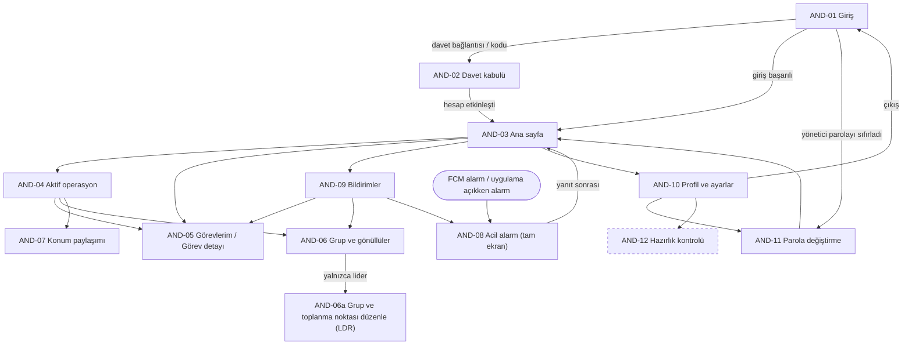

# Android Uygulaması: Ekranlar ve Kullanıcı Akışları

> **Kullanıcılar:** GON (Gönüllü) ve LDR (Grup Lideri). KOR veya ADM bir operasyona gönüllü olarak da katıldıysa Android'i yalnızca gönüllü yetkileriyle kullanır; Android oturumu MFA'sızdır ve kurumsal izin taşımaz (K-19, authorization.md §5.4).
> **Halka:** Ç = Çekirdek · G = Genişletilmiş (KP3). R2+ ekranlar (sohbet, katılma talebi, SOS, bildirim tercihleri) **yoktur.**
> **Android'de kurumsal işlem yoktur (ADR-013, DR-12):** alarm oluşturma/iptal/kapatma, görev yönetimi, konum görüntüleme, davet ve kullanıcı yönetimi yalnızca MFA'lı web panelindedir.
> Metinler yalnızca Türkçedir (K-21). Erişilebilirlik: TalkBack etiketleri, ≥ 48 dp dokunma alanı (NFR-09).

## 1. Gezinme haritası

**Açıklama:** Alt gezinme çubuğunda beş sekme bulunur: Ana sayfa, Görevlerim, Grup, Bildirimler, Profil. Konum paylaşımına Ana sayfa ve Aktif operasyon ekranından erişilir. Acil alarm (AND-08) hangi ekrandan olursa olsun öne gelir: uygulama açıkken kendiliğinden, uygulama arka plandayken bildirime dokunulunca (K-13). Kesik çerçeveli ekran Genişletilmiş halkadadır.

## 2. Ekranlar

| ID | Ekran | Amaç | Roller | Halka | İçerik ve eylemler | Geçişler | İlgili |
|---|---|---|---|---|---|---|---|
| **AND-01** | Giriş | Hesaba giriş | GON, LDR | Ç | E-posta, parola; hatalı girişte genel mesaj; 5 hatada 15 dk kilit bilgisi; "Davet kodum var" bağlantısı; "Parolamı unuttum" (G) | AND-02, AND-03, AND-11 | US-03, AC-03.1 – AC-03.5 |
| **AND-02** | Davet kabulü | Davetle hesabı etkinleştirme | Davetli kişi | Ç | Bağlantıyla dolan veya elle girilen davet kodu; kurum/operasyon adı; parola, ad-soyad, görünen ad, isteğe bağlı telefon; (G) aydınlatma metni ve onay; süresi dolmuş veya kullanılmış davet mesajı; bildirim izni isteği | AND-03 | US-01, US-02, K-06, K-10, TD-02, TD-17 |
| **AND-03** | Ana sayfa | Günün durumu tek bakışta | GON, LDR | Ç | **Açık alarm bandı** (yanıt bekleyen alarm varsa en üstte); bildirim izni kapalı uyarısı (AC-31.2); çevrimdışı göstergesi ve son senkronizasyon zamanı (AC-32.1); aktif operasyon kartları ve birden çoksa operasyon seçici (TD-19); bekleyen operasyon davetleri (kabul/ret, TD-01); yanıt bekleyen görev sayısı; konum paylaşım durumu | AND-04, AND-05, AND-07, AND-08, AND-09 | US-31, US-32, TD-01, TD-19 |
| **AND-04** | Aktif operasyon | Operasyon bağlamı | GON, LDR | Ç | Operasyon adı ve durumu; gruplarım ve liderleri; toplanma noktası (adres, harita noktası, zaman, son güncelleyen kişi, AC-12.3); bu operasyondaki görevlerim; konum paylaşım durumu ve kısayolu | AND-05, AND-06, AND-07 | US-12, SC-02 |
| **AND-05** | Görevlerim / Görev detayı | Görevleri görme ve yanıtlama | GON, LDR | Ç | Liste: bekleyen / kabul edilen / geçmiş; detay: başlık, açıklama, öncelik, yer, zaman aralığı, **kapasite (3/5)**, yanıt süresi; Kabul / Ret (yalnızca `PENDING` iken); "Kapasite doldu" ve "Atama kaldırıldı" durumları; kabulden sonra bırakma yok | AND-04 | US-14, AC-13.6, AC-14.4 – AC-14.6, K-12 |
| **AND-06** | Grup ve gönüllüler | Grubumu tanımak | GON, LDR | Ç | Grup adı, açıklama, lider; toplanma noktası; üye listesi: gönüllü yalnızca **görünen adları**, lider ad-soyadı da görür (user-roles §5). İletişim bilgisi ve konum **gösterilmez** | AND-06a (yalnızca LDR) | US-10, K-08, K-15, NFR-15 |
| **AND-06a** | Grup ve toplanma noktası düzenle | Lider güncellemesi | LDR | Ç | Grup açıklaması; toplanma noktası adresi, harita noktası (MapLibre + OSM), zaman, açıklama. Kaydedince üyelere `HIGH` bildirim gider. **Üye ekleme/çıkarma yok** (K-08) | AND-06 | US-12, AC-09.6 |
| **AND-07** | Konum paylaşımı | Paylaşımı kontrol etme | GON, LDR | Ç | Durum: Kapalı / Aktif / Alınamıyor / Durduruldu; son başarılı gönderim zamanı; Başlat / Durdur; "Konumunuzu yalnızca bu operasyonun koordinatörü görür, geçmiş tutulmaz" bilgisi; izin yoksa açıklama ve ayarlara bağlantı; aktif operasyon yoksa başlatma kapalı | AND-03, AND-04 | US-17, AC-17.1 – AC-17.5, K-14, K-15, K-16 |
| **AND-08** | Acil alarm (tam ekran) | Alarmı fark etme ve yanıtlama | Alıcı olan herkes | Ç | Belirgin renk ve başlık; alarm metni (≥ 20 sp), talep edilen eylem, operasyon adı, gönderim zamanı; üç yanıt düğmesi (≥ 48 dp): Aldım / Yardım gerekiyor / Göreve gidiyorum; yanıttan sonra seçilen yanıt ve "değiştir" seçeneği (TD-07); ağ yoksa "Yanıt iletilemedi, tekrar deneniyor"; iptal edilmişse "ALARM İPTAL EDİLDİ", kapanmışsa "Alarm kapatıldı" | AND-03 | US-21, US-22, US-25, AC-21.2, AC-21.3, AC-22.4 |
| **AND-09** | Bildirimler | Uygulama içi gelen kutusu | GON, LDR | Ç | Duyurular, görev bildirimleri, toplanma noktası güncellemeleri, alarm geçmişi (açık alarmlar en üstte); dokununca ilgili ekran. Bildirim tercihleri **yok** (R2) | AND-05, AND-06, AND-08 | TD-13, FR-06 |
| **AND-10** | Profil ve ayarlar | Hesap yönetimi | GON, LDR | Ç / G | (Ç) Profil görüntüle/düzenle (düzenlenebilir alanlar); bildirim izni durumu ve ayarlara bağlantı; parola değiştir; tüm cihazlardan çık; çıkış. (G) Hazırlık kontrolü; hesap kapatma talebi | AND-11, AND-12, AND-01 | US-04, US-06 (AC-06.4), US-30 (G) |
| **AND-11** | Parola değiştirme | Parola yenileme | GON, LDR | Ç | Mevcut ve yeni parola; yönetici sıfırlamasından sonra ilk girişte zorunlu | AND-03 | AC-03.5 |
| **AND-12** | Hazırlık kontrolü | Alarm almaya hazır mıyım? | GON, LDR | G | Bildirim izni, alarm kanalı durumu, konum izni, pil optimizasyonu; her biri için ayarlara bağlantı; DND istisnası yönlendirmesi (garanti yok, G-02) | AND-10 | US-31 (AC-31.1) |

## 3. Kritik akışlar

### 3.1 Alarm (AND-08), uygulamanın durumuna göre

| Uygulama durumu | Ne olur | Garanti |
|---|---|---|
| Ön planda | AND-08 kendiliğinden açılır | Evet (uygulama içi) |
| Arka planda / ekran açık | `alarm` kanalında yüksek önemli bildirim (heads-up), eylem düğmeleri (TD-21); dokununca AND-08 | Kanal ayarına bağlı |
| Ekran kilitli | Kilit ekranında bildirim; dokununca kilit açma sonrası AND-08. **Kendiliğinden tam ekran yok** (RT-03, US-42 R3) | Kanal ve kilit ekranı ayarına bağlı |
| Süreç sonlanmış | FCM uygulamayı başlatır, bildirim gösterilir | Genelde evet; Doze ve üretici davranışı doğrulanacak (TV-03) |
| Zorla durdurulmuş | Mesaj gelmez; kullanıcı uygulamayı açınca açık alarmlar listelenir | **Hayır** (G-05) |
| Sessiz mod / DND | Bildirim görünür, ses çalmayabilir | **Hayır** (G-01, G-02) |

### 3.2 Hata ve boş durumlar

| Durum | Ekran davranışı |
|---|---|
| Aktif operasyon yok | AND-03'te "Şu anda aktif bir operasyonunuz yok"; konum başlatma kapalı |
| Çevrimdışı | Tüm ekranlarda üst bantta "Çevrimdışı · son senkronizasyon hh:mm"; yazma işlemleri "gönderilemedi" olarak işaretlenir ve elle tekrarlanır; yalnızca alarm yanıtı otomatik tekrar edilir (K-24) |
| Oturum iptal edildi | Bir sonraki istekte AND-01'e yönlendirme ve açıklama mesajı |
| Operasyon kapandı | Konum servisi durur; AND-07'de "Operasyon kapandı, paylaşım durdu"; açık alarmlar "kapatıldı" olarak görünür |
