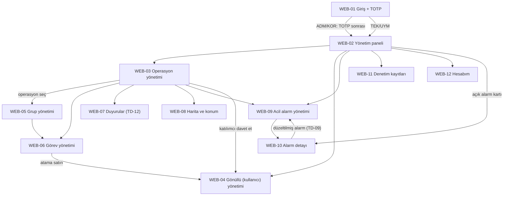
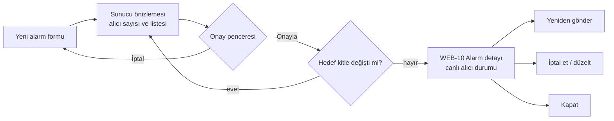

# Web Yönetim Paneli: Ekranlar ve Kullanıcı Akışları

> **Kullanıcılar:** ADM, KOR, TEK, UYM (VS-06). Gönüllüler ve grup liderleri web panelini kullanmaz.
> **Halka:** Ç = Çekirdek · G = Genişletilmiş (KP3). R2+ ekranlar (politika yapılandırma, rapor/dışa aktarma, gerekçeli acil konum erişimi, sohbet) **yoktur.**
> Menü role göre oluşturulur; yetki her istekte sunucuda yeniden denetlenir (NFR-02). ADM, operasyonel ekranlarda (görev, alarm, harita) yalnızca kendini o operasyona KOR olarak atadıysa işlem yapabilir (K-07); aksi hâlde ilgili ekranlar salt-okur veya gizlidir.

## 1. Gezinme haritası

**Açıklama:** Operasyonel ekranlar (grup, görev, duyuru, harita, alarm) seçili bir operasyon bağlamında açılır. Üst çubukta aktif operasyon seçicisi bulunur. Açık alarm varsa yönetim panelinde ve üst çubukta kalıcı bir uyarı kartı görünür ve WEB-10'a götürür. SSE bağlantısı koparsa üst çubukta "Canlı güncelleme kesildi, yeniden bağlanılıyor" gösterilir (ADR-009).

### 1.1 Role göre menü

| Ekran | ADM | KOR | TEK | UYM |
|---|---|---|---|---|
| WEB-02 Yönetim paneli | ✓ | ✓ | ✓ (hesap durumları) | ✓ (denetim kısayolu) |
| WEB-03 Operasyon yönetimi | ✓ | ✓ (kendi operasyonları) | – | – |
| WEB-04 Gönüllü yönetimi | ✓ | ✓ (kendi operasyonunun katılımcıları) | ✓ (yalnızca hesap durumu, TD-14) | – |
| WEB-05 Grup yönetimi | salt-okur | ✓ | – | – |
| WEB-06 Görev yönetimi | salt-okur | ✓ | – | – |
| WEB-07 Duyurular | ✓ (kurum geneli) | ✓ (grup/kişi) | – | – |
| WEB-08 Harita ve konum | – (KOR olarak atanırsa) | ✓ (yalnızca aktif operasyon) | – | – |
| WEB-09/10 Acil alarm | salt-okur | ✓ | – | – |
| WEB-11 Denetim kayıtları | ✓ | – | – | ✓ (salt-okur) |
| WEB-12 Hesabım | ✓ | ✓ | ✓ | ✓ |

Bu tablo `docs/analysis/user-roles.md` §4 ile birebir eşleşir.

## 2. Ekranlar

| ID | Ekran | Amaç | Roller | Halka | İçerik ve eylemler | Geçişler | İlgili |
|---|---|---|---|---|---|---|---|
| **WEB-01** | Yönetici girişi | Panele güvenli giriş | ADM, KOR, TEK, UYM | Ç | E-posta, parola → ADM/KOR için TOTP adımı; ilk girişte TOTP kurulumu (QR); yönetici sıfırlamasından sonra yeni parola zorunlu; kilit bilgisi | WEB-02 | US-03, US-07, K-19, ADR-012 |
| **WEB-02** | Yönetim paneli | Role göre özet | Tüm web rolleri | Ç | **KOR:** kendi operasyonları, açık alarmlar ve yanıt özeti, yanıt bekleyen görev atamaları, paylaşım yapan kişi sayısı. **ADM:** operasyon listesi ve durumları, kullanıcı ve davet sayıları, açık alarmlar (salt-okur), kapatılmamış operasyon uyarısı. **TEK:** hesap durum listesi kısayolu. **UYM:** denetim kayıtları kısayolu | WEB-03, 04, 09, 10, 11 | – |
| **WEB-03** | Operasyon yönetimi | Operasyon yaşam döngüsü | ADM, KOR | Ç / G | Liste ve detay; (ADM) operasyon oluştur, KOR ata; (ADM, KOR) aktif et, kapat (kapatırken: konum paylaşımları durur, açık alarmlar kapanır, gruplar arşivlenir uyarısı); (G) askıya al; katılımcı listesi ve operasyon daveti gönder (TD-01); planlanan bitişi geçen operasyon uyarısı | WEB-04 – WEB-09 | US-08, AC-08.1 – AC-08.4, SC-02 |
| **WEB-04** | Gönüllü (kullanıcı) yönetimi | Kullanıcı, davet ve rol | ADM, KOR, TEK | Ç / G | **ADM:** kurum geneli kullanıcı listesi, davet oluştur, rol ve kapsam ata/kaldır, devre dışı bırak, oturumları iptal et, parola sıfırla, MFA sıfırla. **KOR:** kendi operasyonuna davet, katılımcı listesi (ad, iletişim, gruplar, görevler); rol atayamaz. **TEK:** yalnızca görünen ad ve hesap durumu; devre dışı bırak, oturum iptal et (TD-14). (G) Hesap kapatma talepleri (ADM işler) | WEB-03, WEB-05 | US-01, US-05, US-06, US-30 (G), K-06, K-07 |
| **WEB-05** | Grup yönetimi | Operasyon grupları | KOR (ADM salt-okur) | Ç | Grup oluştur (**lider seçimi zorunlu**); üye ekle (yalnızca operasyon katılımcıları) ve çıkar; lider değiştir (son lider yeni lider atanmadan çıkarılamaz); grup bilgisi ve toplanma noktası (harita üzerinde işaretleme) | WEB-06 | US-09, AC-09.1 – AC-09.6, US-12, K-08, K-32 |
| **WEB-06** | Görev yönetimi | Görev atama ve izleme | KOR (ADM salt-okur) | Ç / G | Görev oluştur: başlık, açıklama, öncelik, yer/toplanma noktası, zaman aralığı, hedef (kişi/grup), **kapasite**, yanıt süresi; yayınla; atama tablosu (Bekliyor / Kabul / Ret / Kapasite doldu, yanıt süresi geçenler işaretli); kapasite göstergesi (3/5); Devam ediyor / Tamamlandı / İptal; atama kaldır; görevi düzenle (atananlara bildirim). (G) Durum filtreleri | WEB-04 | US-13 – US-16, K-12, AC-13.6, AC-16.1 – AC-16.3 |
| **WEB-07** | Duyurular | Duyuru gönderme | KOR, ADM | Ç | Hedef seçimi (KOR: kendi operasyonundaki grup/kişiler; ADM: kurum geneli); **alıcı önizlemesi** (sayı ve liste); 50'den fazla alıcıda ek onay; gönderilmiş duyurular listesi ve teslim özeti | WEB-03 | US-11, AC-11.1 – AC-11.4, K-09, TD-12 |
| **WEB-08** | Harita ve konum görünümü | Saha durumunu görme | KOR (aktif operasyon) | Ç | Leaflet + OSM harita ve liste; kişi başına son konum, ölçüm zamanı, doğruluk, **güncellik etiketi** (güncel / 2 dk+ güncel değil / 15 dk+ son bilinen), saat farkı işareti; paylaşım yapmayanlar ayrı listede; SSE ile güncelleme. Ekranın her açılışı ve her konum sorgusu denetime yazılır. Konum geçmişi **yok** | WEB-03 | US-18, US-19, K-15, K-16, BR-08 |
| **WEB-09** | Acil alarm yönetimi | Alarm oluşturma ve listeleme | KOR (ADM salt-okur) | Ç | Alarm listesi (Açık / İptal / Kapalı); "Yeni alarm" formu (mesaj, talep edilen eylem, öncelik, hedef); yalnızca aktif operasyonda etkin; **onay penceresi** ("BU BİR ACİL ALARMDIR", alıcı sayısı ve listesi, varsayılan odak İptal'de); hedef kitle değiştiyse yeniden önizleme | WEB-10 | US-20, AC-20.1 – AC-20.7, TD-05 |
| **WEB-10** | Alarm detayı | Alıcı bazlı izleme ve müdahale | KOR (ADM salt-okur) | Ç | Özet sayılar (Yanıtladı / Bekliyor / Yanıtsız / Gönderilemedi, "Yardım gerekiyor" öne çıkarılmış); alıcı tablosu: son yanıt, Gönderildi / Teslim edildi / Görüldü / Yanıt zamanları, hatırlatma sayısı, hata türü, bilinmeyen sinyaller "bilinmiyor"; **yanıtsız/başarısızlara yeniden gönder**; **iptal et** (onaylı) ve düzeltilmiş alarm gönder (TD-09); **kapat** (TD-06); SSE ile ≤ 5 sn güncelleme | WEB-09 | US-23, US-24, US-25, AC-23.1, AC-23.4, AC-24.1 – AC-24.3 |
| **WEB-11** | Denetim kayıtları | Kritik işlemleri izleme | ADM, UYM (salt-okur) | Ç / G | Zaman sıralı liste: aktör, işlem, kaynak, zaman; içerik ve sır gösterilmez; değiştirme/silme yok. (G) Tarih, kullanıcı ve işlem türü filtreleri | – | US-27, AC-27.1 – AC-27.4, K-26 |
| **WEB-12** | Hesabım | Kendi hesabı | Tüm web rolleri | Ç | Profil; parola değiştir; TOTP yeniden kur (ADM/KOR); tüm cihazlardan çık; çıkış | WEB-01 | US-04, AC-06.4 |

## 3. Kritik akışlar

### 3.1 Alarm gönderimi (WEB-09 → WEB-10)

**Açıklama:** Onaysız gönderim yoktur (BR-04). Onay isteği tekrar ederse aynı alarm döner (`Idempotency-Key`). Gönderimden sonra kullanıcı doğrudan alıcı durum ekranına geçer.

### 3.2 Hata ve boş durumlar

| Durum | Ekran davranışı |
|---|---|
| Operasyon aktif değil | WEB-08 ve "Yeni alarm" kapalı; açıklama: "Alarm ve konum yalnızca aktif operasyonda" (K-17, BR-09) |
| Yetkisiz işlem | Düğme gösterilmez; doğrudan istek 403 döner ve "Bu işlem için yetkiniz yok" mesajı çıkar |
| SSE koptu | Uyarı bandı; otomatik yeniden bağlanma; başarısız olursa 5 sn yoklama (ADR-009) |
| MFA tamamlanmadı | Kurumsal ekranlar açılmaz; WEB-01 TOTP adımına yönlendirme |
| Push servisi bozuk (`CRITICAL` kuyruk > 30 sn) | Panelde TEK ekranı yok: uyarı panel dışında, sağlık ucu ve günlük kaydıyla verilir (TD-14, GAP-11). KOR'un WEB-10 ekranında "Gönderim gecikiyor" bandı, `AlertView.deliveryDelayed` alanına göre gösterilir (LD-02) |
