# GKS — Proje Genel Bakış (değerlendirme raporu)

> **Durum tarihi:** 16.11.2026 23.56 (Europe/Istanbul). Son commit: `33f84d6`.
>
> **Kaynaklar:**
> - Kaynak kod (`backend/`, `web/`, `android/`).
> - Flyway migration'ları V1–V19.
> - Geliştirme veritabanının canlı kataloğu (`information_schema`, `pg_catalog`; Flyway V19).
> - Build dosyaları, `git log`.
> - `docs/`, `PROJECT_PROGRESS.md`, `AI_HANDOFF.md`, `MANUEL_TEST.md`, `.claude-runs/RAPOR_2–6.md`.
>
> **İşaretler:** Doğrulanamayan bilgi **(doğrulanamadı)** diye işaretlidir. Bu belgede parola, anahtar, belirteç,
> `.env` değeri ve demo parolası **yoktur**.

---

## 1. Proje özeti

**GKS (Gönüllü Koordinasyon Sistemi)** afet ve acil durum operasyonları için bir koordinasyon sistemidir. Gönüllüler
operasyonlara davetle katılır, gruplara ayrılır ve görevlendirilir. Sistem şunları sağlar:

- duyuru ve kurum içi mesajlaşma,
- acil alarm (operasyon alarmı ve Genel Acil Alarm) ile yanıt takibi,
- gönüllülerin açıkça başlattığı konum paylaşımı ve harita,
- halka açık bilgilendirme sitesi ve kamu duyuruları.

Gereksinim kaynakları: `docs/analysis/` (MVP kapsamı, kullanıcı rolleri, hikâyeler). Gereksinim belgesi
(`Gonullu_Koordinasyon_Sistemi_Gereksinim_Analizi.docx`) depoda yok **(doğrulanamadı)**.

**İstemciler:**
- **Web paneli** (`/panel`): ADM, KOR, TEK, UYM.
- **Halka açık site** (`/`): giriş gerektirmez.
- **Android uygulaması**: gönüllü ve grup lideri; ADM/KOR için MFA'lı yönetim oturumu (ADR-014).

### 1.1 Roller (`access/Role.java`)

| Rol | Kapsam | Görev | MFA |
|---|---|---|---|
| ADM | Kurum | Kurum yöneticisi; KOR ataması olmadan her operasyonda KOR yetkileri (ADR-015) | Zorunlu |
| KOR | Operasyon | Koordinatör (kendi operasyonu) | Zorunlu |
| GON | Operasyon | Gönüllü / operasyon katılımcısı | Yok |
| TEK | Kurum | Teknik destek (yalnızca web) | Yok |
| UYM | Kurum | Uyum / denetim (yalnızca web) | Yok |
| Grup lideri / üyesi | Grup | Rol değil; `groups.group_memberships.role` = `LEADER` / `MEMBER` | — |

**Oturum kapısı** (`Grants.corporate`):
- **Web oturumu:** ADM/KOR kurumsal izinleri yalnızca MFA'lı oturumda gelir; TEK/UYM izinleri MFA'sız web oturumunda gelir.
- **Android oturumu:** yalnızca ADM/KOR'un MFA'lı yönetim oturumu kurumsal izin taşır. TEK/UYM Android'de kurumsal
  izin almaz.
- **Gönüllü (GON) izinleri** her istemcide geçerlidir.

### 1.2 Etkin izinler (`access/EffectivePermissions.java`)

| İzin | ADM (kurum) | ADM (her operasyon, ADR-015) | KOR (kendi op.) | GON | TEK | UYM | Lider | Üye |
|---|---|---|---|---|---|---|---|---|
| operation.create | ✓ | | | | | | | |
| operation.manage | ✓ | ✓ | ✓ | | | | | |
| invitation.create | ✓ | ✓ | ✓ | | | | | |
| invitation.respond | herkes | | | | | | | |
| role.assign | ✓ | | | | | | | |
| user.status.view | ✓ | | | | ✓ | | | |
| account.disable | ✓ | | | | ✓ | | | |
| session.revoke | ✓ | | | | ✓ | | | |
| audit.view | ✓ | | | | | ✓ | | |
| mfa.reset, password.reset | ✓ | | | | | | | |
| announcement.send.organization | ✓ | | | | | | | |
| public_announcement.manage | ✓ | | | | | | | |
| alert.view | ✓ | ✓ | ✓ | | | | | |
| alert.send / cancel / close / resend | | ✓ | ✓ | | | | | |
| task.manage | | ✓ | ✓ | | | | | |
| location.view | | ✓ | ✓ | | | | | |
| announcement.send.group | | ✓ | ✓ | | | | | |
| group.create.operational | | ✓ | ✓ | | | | | |
| group.view | ✓ | ✓ | ✓ | | | | ✓ | ✓ |
| group.update | | ✓ | ✓ | | | | ✓ | |
| membership.add / remove / role.update | | ✓ | ✓ | | | | | |
| meeting_point.update | | ✓ | ✓ | | | | ✓ | |
| task.respond, location.share, alert.respond | | | | ✓ | | | | |

Bu liste yalnızca menü ve düğmeler içindir. Yetki her istekte sunucuda yeniden denetlenir.

Sonradan eklenen modüllerin kuralları bu listede değil, ilgili `access` arayüzlerinde:
- **Mesaj kanalları** (`ChannelAccess`): okuyucu/yazar üyelikten hesaplanır.
- **Harita** (`ChannelAccess`): ADM tümü, KOR kendi operasyonları.
- **Genel Acil Alarm** (`AlertService`): kurum geneli yalnızca ADM; KOR yalnızca kendi kapsamı.

---

## 2. Klasör yapısı (git'te izlenen 616 dosya)

```text
.
├── backend/                     Spring Boot uygulaması (modüler monolit)
│   ├── build.gradle.kts         bağımlılıklar, bootRun (.env yükleme, local profili)
│   └── src/
│       ├── main/java/org/gks/backend/
│       │   ├── (kök)            ortak altyapı: ApiException, Idempotency, PageCursor, AuditTrail, RealtimeBus, SecurityConfiguration
│       │   ├── identity/        kullanıcı, giriş, MFA, oturum/belirteç, davet, cihaz (FCM) kaydı, kullanıcı yönetimi
│       │   ├── access/          roller, rol atamaları, tüm yetki kararları (*Access arayüzleri)
│       │   ├── organization/    kurum ve operasyon (durum makinesi, bölge)
│       │   ├── groups/          operasyon grupları, üyelik, lider, toplanma noktası
│       │   ├── tasks/           görev, atama, kabul/ret, durum geçmişi
│       │   ├── notifications/   gelen kutusu, duyuru, teslim kuyruğu, FCM, kamu duyuruları
│       │   ├── alerts/          acil alarm (operasyon + genel), harita uçları
│       │   ├── location/        konum paylaşımı ve son konum
│       │   ├── messaging/       mesaj kanalları ve mesajlar
│       │   ├── realtime/        SSE akışı
│       │   ├── audit/           denetim kaydı yazımı ve okuma
│       │   └── devseed/         geliştirme aracı: demo verisi (yalnızca demo-seed profili)
│       ├── main/resources/      application.yaml, application-demo-seed.yaml, db/migration (V1–V19)
│       └── test/                Testcontainers entegrasyon testleri (47 test sınıfı)
├── web/                         React + Vite yönetim paneli ve halka açık site
│   ├── public/brand/            logo
│   └── src/
│       ├── app/                 kabuk (AppShell), yönlendirme, tema, oturum, canlı akış, sorgu anahtarları
│       ├── api/                 HTTP istemcisi, hata (problem) eşleme
│       ├── services/            sözleşme arayüzleri, http ve mock uygulamaları, kayıt
│       ├── features/            ekranlar (alerts, groups, map, messaging, operations, public, tasks, users …)
│       ├── components/          ortak bileşenler (map/GksMap, panel, format)
│       ├── content/             halka açık site ve rehber içeriği (JSON); Android'e de gömülür
│       ├── config/              servis ön ayarı, marka, harita yapılandırması
│       └── test/                test yardımcıları (renderApp)
├── android/                     Kotlin/Compose uygulaması
│   ├── gradle/libs.versions.toml  sürüm kataloğu
│   └── app/src/
│       ├── main/java/org/gks/android/
│       │   ├── data/            Retrofit API, depolar, oturum (Keystore), mesaj kuyruğu, SSE, rehber
│       │   ├── alarm/           FCM servisi, alarm/duyuru/mesaj bildirimleri
│       │   ├── location/        konum ön plan servisi
│       │   ├── domain/          ekran modelleri ve yetki görünürlüğü
│       │   └── ui/              ekranlar (home, tasks, groups, management, alerts, messaging, map, guide …)
│       └── test/                JVM birim testleri (MockWebServer)
├── docs/
│   ├── analysis/                gereksinim, MVP kapsamı, roller, hikâyeler, riskler, karar günlüğü
│   ├── architecture/            mimari, yetki, iletişim, ADR'ler (decisions.md), tasarım, diyagramlar, UI akışları
│   └── operations/db-roles.md   veritabanı kullanıcıları kurulumu
├── scripts/
│   ├── db/initdb/               Postgres ilk açılışta uygulama kullanıcısını (gks_app) oluşturan betik
│   ├── dev/                     demo-seed.ps1 ve README
│   └── demo-davet-kabul.mjs     Mailpit'teki davetleri kabul eden demo betiği
├── compose.yaml                 PostgreSQL 16.16 + Mailpit
├── .env.example                 ortam değişkeni şablonu (değerler depoda yok)
├── PROJECT_PROGRESS.md, AI_HANDOFF.md, MANUEL_TEST.md
└── .claude-runs/                (git dışı) raporlar, iş çıktıları, yedek
```

---

## 3. Teknolojiler ve sürümler

### 3.1 Backend (`backend/build.gradle.kts`)

| Bileşen | Sürüm |
|---|---|
| Java (toolchain) | 21 |
| Spring Boot (eklenti) | 4.1.2 |
| io.spring.dependency-management | 1.1.7 |
| Spring Modulith (BOM) | 2.1.1 |
| Gradle wrapper | 9.8.2 |
| Starter'lar (Boot BOM sürümü) | actuator, data-jpa, flyway, mail, security, validation, webmvc |
| spring-security-oauth2-jose (JWT) | Boot BOM |
| BouncyCastle `bcprov-jdk18on` | 1.81 |
| `flyway-database-postgresql`, PostgreSQL JDBC | Boot BOM |
| **Firebase Admin SDK** `firebase-admin` | 9.4.3 (firestore/storage hariç tutulmuş) |
| `google-http-client-jackson2` | 1.45.3 (firebase-admin'in eksik bildirdiği bağımlılık) |
| `spring-boot-docker-compose` (developmentOnly) | Boot BOM |
| Test | spring-boot test starter'ları, spring-modulith-starter-test, Testcontainers (junit-jupiter, postgresql) |

Spring Boot BOM'un çözdüğü alt sürümler (ör. Hibernate, Jackson 3) burada ayrıca listelenmedi **(doğrulanamadı)**.

### 3.2 Web (`web/package.json`, sabit sürümler)

| Paket | Sürüm | | Geliştirme paketi | Sürüm |
|---|---|---|---|---|
| react, react-dom | 18.3.1 | | typescript | 5.6.2 |
| react-router-dom | 6.26.2 | | vite | 5.4.8 |
| @mui/material, @mui/icons-material | 5.16.7 | | @vitejs/plugin-react | 4.3.2 |
| @emotion/react / styled | 11.13.3 / 11.13.0 | | vitest | 2.1.2 |
| @tanstack/react-query | 5.59.0 | | jsdom | 25.0.1 |
| **maplibre-gl** (16.11 eklendi) | 6.18.0 | | @testing-library/react / dom / user-event / jest-dom | 16.0.1 / 10.4.0 / 14.5.2 / 6.5.0 |
| | | | eslint, @eslint/js | 9.12.0 |
| | | | typescript-eslint | 8.8.1 |
| | | | eslint-plugin-react-hooks | 5.0.0 |

### 3.3 Android (`android/gradle/libs.versions.toml`, `app/build.gradle.kts`)

| Bileşen | Sürüm |
|---|---|
| Android Gradle Plugin | 8.2.2 |
| Gradle wrapper | 8.5 |
| Kotlin | 1.9.22 |
| Compose compiler | 1.5.10 |
| Compose BOM | 2024.02.00 (Material3) |
| SDK | compileSdk 34, targetSdk 34, minSdk 26, JVM hedefi 17 |
| AndroidX | core-ktx 1.12.0, activity-compose 1.8.2, lifecycle 2.7.0, navigation-compose 2.7.7 |
| Kotlin kütüphaneleri | coroutines 1.7.3, kotlinx-serialization-json 1.6.3 |
| Ağ | Retrofit 2.9.0, retrofit2-kotlinx-serialization-converter 1.0.0, OkHttp 4.12.0 |
| **Firebase** | BOM 33.7.0 (firebase-messaging), google-services eklentisi 4.4.2 |
| **MapLibre Android SDK** (16.11 eklendi) | 11.13.5 — 13.x Kotlin 2.2 gerektirdiğinden seçilmedi (ADR-025) |
| Test | JUnit 4.13.2, OkHttp MockWebServer 4.12.0, coroutines-test |
| Uygulama | versionName 0.1.0, versionCode 1 |

### 3.4 Altyapı

| Bileşen | Sürüm |
|---|---|
| PostgreSQL (compose) | `postgres:16.16` |
| Mailpit (compose) | `axllent/mailpit:v1.33.1` |

Geliştirme makinesinde 16.11.2026'da ölçülen araçlar:

| Araç | Sürüm |
|---|---|
| Node.js / npm | 21.6.1 / 10.2.4 |
| Docker / Compose | 29.4.0 / 5.1.1 |
| JDK (backend) | Temurin 21.0.4 |
| JDK (Android) | Temurin 17.0.12 |
| Git | 2.45.1 |

---

## 4. Backend modülleri

Spring Modulith ile her alt paket bir uygulama modülüdür; sınırlar `ModularityTests` ile doğrulanır.
Modüller başka modülün tablosuna dokunmaz, yalnızca dışa açık arayüz ve olaylarla konuşur (ADR-001). İstisna `devseed`
geliştirme aracıdır (bkz. §15).

| Modül | Sorumluluk | Şema | Dışa açık arayüzler / olaylar | Başka modüllerden kullandıkları |
|---|---|---|---|---|
| (kök) `org.gks.backend` | Hata biçimi (`ApiException`, `ApiProblems`), `Idempotency`, `PageCursor`, `AuditTrail`, `RealtimeBus`, güvenlik zinciri, `TraceIdFilter`, zamanlayıcı yapılandırması | `platform` (`flyway_schema_history`, `idempotency_keys`) | `AuditTrail.record` → `AuditEvent`; `RealtimeBus` → `TopicEvent`, `SessionsEnded`, `AccessChanged` | — |
| identity | Kullanıcı hesabı (Argon2id), giriş, TOTP MFA, JWT + yenileme belirteci, davet, cihaz kaydı, kullanıcı yönetimi, ilk ADM kurulumu | `identity` | `UserAccounts`, `UserDirectory`, `AccessTokenAuthenticationFilter`, `AuthenticatedSession`, `MeContextSources`, `ClientType`, `NewUserAccount` | access, organization, groups (bağlam için) |
| access | Rol atamaları ve **tüm yetki kararları** (`Grants`, `EffectivePermissions`, `*Access`) | `access` | `Subject`, `Role`, `ActingBasis`, `OperationAccess`, `GroupAccess`, `TaskAccess`, `AlertAccess`, `LocationAccess`, `AnnouncementAccess`, `AuditAccess`, `UserAdminAccess`, `RealtimeAccess`, `ChannelAccess`, `Participation`, `RoleAssignments`; olay `ParticipationRevoked` | organization |
| organization | Kurum ve operasyon; durum geçişleri, gecikme işareti, operasyon bölgesi (V18) | `organization` | `Operations`, `OperationState`, `ParticipantDetails`; olay **`OperationClosed`** | access, identity |
| groups | Grup, üyelik, lider, toplanma noktası | `groups` | `GroupMembers` | access, organization, notifications; `ParticipationRevoked` dinler |
| tasks | Görev, anlık görüntüyle atama, kapasite güvenceli kabul, durum geçmişi | `tasks` | — | access, organization, groups, notifications; `ParticipationRevoked` dinler |
| notifications | Gelen kutusu (`Notifier`, MANDATORY işlem), duyurular, teslim kuyruğu (`DeliveryWorker`), FCM (`FcmPushGateway`, `FcmPayloadRules`), kamu duyuruları + IP oran sınırı | `notifications` | `Notifier`, `PushGateway`, `NotificationDirectories` | access, identity, organization, groups |
| alerts | Operasyon alarmı ve Genel Acil Alarm, alıcı durumu, hatırlatma, Operasyon Haritası uçları | `alerts` | — (`OperationClosed` dinler: açık alarmları kapatır) | access, organization, groups, identity, notifications, messaging (`SystemMessages`) |
| location | Açık başlatmalı konum paylaşımı, son konum, görüntüleme denetimi, saklama | `location` | — (`OperationClosed` dinler) | access, organization, groups |
| messaging | Operasyon, koordinasyon ve grup kanalları; mesaj, okuma, sessize alma, moderasyon, saklama | `messaging` | `SystemMessages` (sistem mesajı yazma) (`OperationClosed` dinler) | access, organization, groups, notifications |
| realtime | SSE bağlantıları, konu yetkisi, tekrar oynatma / `resync` | — | — (`TopicEvent`, `SessionsEnded`, `AccessChanged` dinler) | access |
| audit | `AuditEvent`'i aynı işlemde yazar; denetim okuma ucu | `audit` | — (`AuditEvent` dinler) | access, identity |
| devseed | Demo verisi aracı (yalnızca `demo-seed` profili) | — (diğer şemalara yalnızca ekleme) | — | identity (`UserAccounts`), `AuditTrail` |

**Zamanlanmış işler:** hepsi `gks.scheduling.enabled=false` ile kapatılabilir; demo aracı bunu kullanır.

| İş | Görev | Aralık |
|---|---|---|
| `DeliveryWorker` | Teslim kuyruğu | CRITICAL 1 sn, STANDARD 5 sn |
| `AlertLifecycle` | Alarm hatırlatmaları | 30 sn |
| `LocationLifecycle` | Konum saklama temizliği | 1 sa |
| `MessagingLifecycle` | Mesaj saklama temizliği | 1 sa |
| `IdempotencyCleanup` | Süresi dolan Idempotency kayıtları | 1 sa |
| `StreamHub.ping` | SSE canlı tutma | 15 sn |

---

## 5. Veritabanı

PostgreSQL 16; şemanın tek sahibi Flyway'dir (Hibernate `ddl-auto: validate`). Her modülün kendi şeması vardır (V1).
Aşağıdaki tablolar **geliştirme veritabanının canlı kataloğundan** (Flyway V19) üretildi:
27 tablo, 329 sütun, 221 kısıt, 60 ek indeks.

### 5.1 Tablolar

### Şema `access`


#### `access.role_assignments`

| Sütun | Tip | Boş olamaz | Varsayılan | FK |
|---|---|---|---|---|
| `id` | uuid | evet |  |  |
| `user_id` | uuid | evet |  | → identity.users.id ON DELETE RESTRICT |
| `role` | text | evet |  |  |
| `scope_type` | text | evet |  |  |
| `scope_id` | uuid | evet |  |  |
| `granted_by` | uuid |  |  | → identity.users.id ON DELETE RESTRICT |
| `granted_at` | timestamptz | evet | `now()` |  |
| `revoked_at` | timestamptz |  |  |  |
| `revoked_by` | uuid |  |  | → identity.users.id ON DELETE RESTRICT |
| `revoke_reason` | text |  |  |  |

- **PK:** (id)
- **CHECK:**
  - `ck_role_assignments_revoke_reason`: `(((revoke_reason IS NULL) OR (revoke_reason = ANY (ARRAY['MANUAL'::text, 'OPERATION_CLOSED'::text, 'ACCOUNT_CLOSED'::text, 'INVITATION_DECLINED'::text]))))`
  - `ck_role_assignments_revoked`: `(((revoked_at IS NOT NULL) OR ((revoked_by IS NULL) AND (revoke_reason IS NULL))))`
  - `ck_role_assignments_role`: `((role = ANY (ARRAY['ADM'::text, 'KOR'::text, 'GON'::text, 'TEK'::text, 'UYM'::text])))`
  - `ck_role_assignments_role_scope`: `((((role = ANY (ARRAY['ADM'::text, 'TEK'::text, 'UYM'::text])) AND (scope_type = 'ORGANIZATION'::text)) OR ((role = ANY (ARRAY['KOR'::text, 'GON'::text])) AND (scope_type = 'OPERATION'::text))))`
  - `ck_role_assignments_scope_type`: `((scope_type = ANY (ARRAY['ORGANIZATION'::text, 'OPERATION'::text])))`
- **İndeksler:**
  - `ix_role_assignments_scope_active`: `btree (scope_type, scope_id, role) WHERE (revoked_at IS NULL)`
  - `ix_role_assignments_user_active`: `btree (user_id) WHERE (revoked_at IS NULL)`
  - `ux_role_assignments_active`: `UNIQUE btree (user_id, role, scope_type, scope_id) WHERE (revoked_at IS NULL)`

### Şema `alerts`


#### `alerts.alert_recipients`

| Sütun | Tip | Boş olamaz | Varsayılan | FK |
|---|---|---|---|---|
| `id` | uuid | evet |  |  |
| `alert_id` | uuid | evet |  | → alerts.alerts.id ON DELETE RESTRICT |
| `user_id` | uuid | evet |  | → identity.users.id ON DELETE RESTRICT |
| `via_group_id` | uuid |  |  | → groups.groups.id ON DELETE RESTRICT |
| `state` | text | evet | `'QUEUED'::text` |  |
| `response_option` | text |  |  |  |
| `responded_at_device` | timestamptz |  |  |  |
| `responded_at_server` | timestamptz |  |  |  |
| `first_responded_at` | timestamptz |  |  |  |
| `response_idempotency_key` | text |  |  |  |
| `queued_at` | timestamptz | evet | `now()` |  |
| `sent_at` | timestamptz |  |  |  |
| `delivered_at` | timestamptz |  |  |  |
| `seen_at` | timestamptz |  |  |  |
| `reminder_count` | int | evet | `0` |  |
| `next_reminder_at` | timestamptz |  |  |  |
| `resend_count` | int | evet | `0` |  |
| `failure_reason` | text |  |  |  |
| `updated_at` | timestamptz | evet | `now()` |  |

- **PK:** (id)
- **UNIQUE** `uq_alert_recipients_alert_user`: (alert_id, user_id)
- **CHECK:**
  - `ck_alert_recipients_failed`: `(((state = 'FAILED'::text) = (failure_reason IS NOT NULL)))`
  - `ck_alert_recipients_failure_reason`: `((failure_reason = ANY (ARRAY['NO_DEVICE'::text, 'TOKEN_INVALID'::text, 'FCM_UNAVAILABLE'::text, 'FCM_REJECTED'::text])))`
  - `ck_alert_recipients_reminder`: `(((reminder_count >= 0) AND (reminder_count <= 10)))`
  - `ck_alert_recipients_response`: `(((state = 'RESPONDED'::text) = (response_option IS NOT NULL)))`
  - `ck_alert_recipients_response_option`: `((response_option = ANY (ARRAY['RECEIVED'::text, 'NEED_HELP'::text, 'ON_MY_WAY'::text])))`
  - `ck_alert_recipients_response_times`: `(((response_option IS NULL) OR ((responded_at_server IS NOT NULL) AND (first_responded_at IS NOT NULL))))`
  - `ck_alert_recipients_state`: `((state = ANY (ARRAY['QUEUED'::text, 'SENT'::text, 'DELIVERED'::text, 'SEEN'::text, 'RESPONDED'::text, 'UNANSWERED'::text, 'FAILED'::text])))`
- **İndeksler:**
  - `ix_alert_recipients_reminder_due`: `btree (next_reminder_at) WHERE ((state = ANY (ARRAY['SENT'::text, 'DELIVERED'::text, 'SEEN'::text])) AND (next_reminder_at IS NOT NULL))`
  - `ix_alert_recipients_user`: `btree (user_id, alert_id)`

#### `alerts.alerts`

| Sütun | Tip | Boş olamaz | Varsayılan | FK |
|---|---|---|---|---|
| `id` | uuid | evet |  |  |
| `operation_id` | uuid |  |  | → organization.operations.id ON DELETE RESTRICT |
| `message` | text | evet |  |  |
| `requested_action` | text |  |  |  |
| `priority` | text | evet | `'CRITICAL'::text` |  |
| `state` | text | evet | `'DRAFT'::text` |  |
| `version` | int | evet | `1` |  |
| `target_expr` | jsonb | evet |  |  |
| `audience_fingerprint` | text |  |  |  |
| `preview_recipient_count` | int |  |  |  |
| `previewed_at` | timestamptz |  |  |  |
| `recipient_count` | int |  |  |  |
| `reminder_interval_seconds` | int | evet | `120` |  |
| `reminder_max` | int | evet | `5` |  |
| `corrects_alert_id` | uuid |  |  | → alerts.alerts.id ON DELETE RESTRICT |
| `idempotency_key` | text |  |  |  |
| `sent_notification_id` | uuid |  |  | → notifications.notifications.id ON DELETE RESTRICT |
| `created_by` | uuid | evet |  | → identity.users.id ON DELETE RESTRICT |
| `created_at` | timestamptz | evet | `now()` |  |
| `updated_at` | timestamptz | evet | `now()` |  |
| `sent_by` | uuid |  |  | → identity.users.id ON DELETE RESTRICT |
| `sent_at` | timestamptz |  |  |  |
| `cancelled_by` | uuid |  |  | → identity.users.id ON DELETE RESTRICT |
| `cancelled_at` | timestamptz |  |  |  |
| `closed_by` | uuid |  |  | → identity.users.id ON DELETE RESTRICT |
| `closed_at` | timestamptz |  |  |  |
| `close_reason` | text |  |  |  |
| `scope` | text | evet | `'OPERATION'::text` |  |
| `event_lat` | double |  |  |  |
| `event_lon` | double |  |  |  |

- **PK:** (id)
- **CHECK:**
  - `ck_alerts_cancelled`: `(((state = 'CANCELLED'::text) = (cancelled_at IS NOT NULL)))`
  - `ck_alerts_close_reason`: `((close_reason = ANY (ARRAY['MANUAL'::text, 'OPERATION_CLOSED'::text])))`
  - `ck_alerts_closed`: `(((state = 'CLOSED'::text) = ((closed_at IS NOT NULL) AND (close_reason IS NOT NULL))))`
  - `ck_alerts_event_location`: `((((event_lat IS NULL) = (event_lon IS NULL)) AND ((event_lat IS NULL) OR ((event_lat >= ('-90'::integer)::double precision) AND (event_lat <= (90)::double precision))) AND ((event_lon IS NULL) OR ((event_lon >= ('-180'::integer)::double precision) AND (event_lon <= (180)::double precision)))))`
  - `ck_alerts_manual_close_actor`: `(((close_reason IS DISTINCT FROM 'MANUAL'::text) OR (closed_by IS NOT NULL)))`
  - `ck_alerts_message`: `(((char_length(message) >= 1) AND (char_length(message) <= 500)))`
  - `ck_alerts_not_self_correct`: `(((corrects_alert_id IS NULL) OR (corrects_alert_id <> id)))`
  - `ck_alerts_priority`: `((priority = ANY (ARRAY['HIGH'::text, 'CRITICAL'::text])))`
  - `ck_alerts_recipient_count`: `(((recipient_count IS NULL) OR ((recipient_count >= 0) AND (recipient_count <= 500))))`
  - `ck_alerts_reminder`: `(((reminder_interval_seconds > 0) AND ((reminder_max >= 0) AND (reminder_max <= 10))))`
  - `ck_alerts_requested_action`: `(((requested_action IS NULL) OR (char_length(requested_action) <= 200)))`
  - `ck_alerts_scope`: `(((scope = ANY (ARRAY['OPERATION'::text, 'GENERAL'::text])) AND ((scope = 'OPERATION'::text) = (operation_id IS NOT NULL))))`
  - `ck_alerts_sent_fields`: `((((state = 'DRAFT'::text) = (sent_at IS NULL)) AND ((state = 'DRAFT'::text) OR ((sent_by IS NOT NULL) AND (recipient_count IS NOT NULL)))))`
  - `ck_alerts_state`: `((state = ANY (ARRAY['DRAFT'::text, 'SENT'::text, 'OPEN'::text, 'CANCELLED'::text, 'CLOSED'::text])))`
- **İndeksler:**
  - `ix_alerts_general`: `btree (created_by, id DESC) WHERE (scope = 'GENERAL'::text)`
  - `ix_alerts_operation`: `btree (operation_id, id DESC)`
  - `ix_alerts_operation_open`: `btree (operation_id) WHERE (state = 'OPEN'::text)`
  - `ux_alerts_corrects`: `UNIQUE btree (corrects_alert_id) WHERE (corrects_alert_id IS NOT NULL)`

### Şema `audit`


#### `audit.audit_entries`

| Sütun | Tip | Boş olamaz | Varsayılan | FK |
|---|---|---|---|---|
| `id` | uuid | evet |  |  |
| `actor_id` | uuid |  |  | → identity.users.id ON DELETE RESTRICT |
| `actor_basis` | text | evet |  |  |
| `action` | text | evet |  |  |
| `resource_type` | text | evet |  |  |
| `resource_id` | uuid |  |  |  |
| `operation_id` | uuid |  |  |  |
| `client` | text | evet |  |  |
| `trace_id` | text |  |  |  |
| `at` | timestamptz | evet |  |  |
| `details` | jsonb |  |  |  |
| `ip` | inet |  |  |  |

- **PK:** (id)
- **CHECK:**
  - `ck_audit_entries_action`: `((action ~ '^[A-Z][A-Z_]{2,63}$'::text))`
  - `ck_audit_entries_actor_basis`: `((actor_basis = ANY (ARRAY['KOR'::text, 'ADM'::text, 'TEK'::text, 'UYM'::text, 'LEADER'::text, 'SELF'::text, 'SYSTEM'::text])))`
  - `ck_audit_entries_actor_required`: `(((actor_id IS NOT NULL) OR (action = 'LOGIN_FAILED'::text)))`
  - `ck_audit_entries_client`: `((client = ANY (ARRAY['WEB'::text, 'ANDROID'::text, 'SYSTEM'::text])))`
  - `ck_audit_entries_details`: `(((details IS NULL) OR (jsonb_typeof(details) = 'object'::text)))`
  - `ck_audit_entries_resource_type`: `((resource_type = ANY (ARRAY['ALERT'::text, 'ALERT_RECIPIENT'::text, 'TASK'::text, 'TASK_ASSIGNMENT'::text, 'GROUP'::text, 'GROUP_MEMBERSHIP'::text, 'OPERATION'::text, 'ROLE_ASSIGNMENT'::text, 'USER'::text, 'SESSION'::text, 'INVITATION'::text, 'LOCATION'::text, 'NOTIFICATION'::text, 'MEETING_POINT'::text, 'PUBLIC_ANNOUNCEMENT'::text, 'MESSAGE'::text, 'CHANNEL'::text])))`
- **İndeksler:**
  - `ix_audit_entries_action`: `btree (action, id DESC)`
  - `ix_audit_entries_actor`: `btree (actor_id, id DESC)`
  - `ix_audit_entries_basis`: `btree (actor_basis, id DESC)`
  - `ix_audit_entries_operation`: `btree (operation_id, id DESC) WHERE (operation_id IS NOT NULL)`
  - `ix_audit_entries_resource`: `btree (resource_type, resource_id, id DESC)`
- **Tetikleyici:** `tg_audit_entries_no_update_delete (BEFORE DELETE) → EXECUTE FUNCTION audit.audit_entries_append_only()`
- **Tetikleyici:** `tg_audit_entries_no_update_delete (BEFORE UPDATE) → EXECUTE FUNCTION audit.audit_entries_append_only()`

### Şema `groups`


#### `groups.group_memberships`

| Sütun | Tip | Boş olamaz | Varsayılan | FK |
|---|---|---|---|---|
| `id` | uuid | evet |  |  |
| `group_id` | uuid | evet |  | → groups.groups.id ON DELETE RESTRICT |
| `user_id` | uuid | evet |  | → identity.users.id ON DELETE RESTRICT |
| `role` | text | evet | `'MEMBER'::text` |  |
| `status` | text | evet | `'ACTIVE'::text` |  |
| `added_by` | uuid | evet |  | → identity.users.id ON DELETE RESTRICT |
| `joined_at` | timestamptz | evet | `now()` |  |
| `ended_at` | timestamptz |  |  |  |
| `ended_by` | uuid |  |  | → identity.users.id ON DELETE RESTRICT |
| `end_reason` | text |  |  |  |
| `updated_at` | timestamptz | evet | `now()` |  |

- **PK:** (id)
- **CHECK:**
  - `ck_group_memberships_end_reason`: `(((end_reason IS NULL) OR (end_reason = ANY (ARRAY['REMOVED_BY_COORDINATOR'::text, 'PARTICIPATION_REVOKED'::text, 'ACCOUNT_CLOSED'::text]))))`
  - `ck_group_memberships_ended`: `(((status = 'ACTIVE'::text) = (ended_at IS NULL)))`
  - `ck_group_memberships_role`: `((role = ANY (ARRAY['LEADER'::text, 'MEMBER'::text])))`
  - `ck_group_memberships_status`: `((status = ANY (ARRAY['ACTIVE'::text, 'REMOVED'::text])))`
- **İndeksler:**
  - `ix_group_memberships_user_active`: `btree (user_id) WHERE (status = 'ACTIVE'::text)`
  - `ux_group_memberships_active_leader`: `UNIQUE btree (group_id) WHERE ((role = 'LEADER'::text) AND (status = 'ACTIVE'::text))`
  - `ux_group_memberships_active_member`: `UNIQUE btree (group_id, user_id) WHERE (status = 'ACTIVE'::text)`

#### `groups.groups`

| Sütun | Tip | Boş olamaz | Varsayılan | FK |
|---|---|---|---|---|
| `id` | uuid | evet |  |  |
| `organization_id` | uuid | evet |  | → organization.organizations.id ON DELETE RESTRICT |
| `operation_id` | uuid |  |  | → organization.operations.id ON DELETE RESTRICT |
| `name` | text | evet |  |  |
| `description` | text |  |  |  |
| `type` | text | evet | `'OPERATIONAL'::text` |  |
| `join_policy` | text | evet | `'MANAGED'::text` |  |
| `mp_address` | text |  |  |  |
| `mp_lat` | double |  |  |  |
| `mp_lon` | double |  |  |  |
| `mp_description` | text |  |  |  |
| `mp_time` | timestamptz |  |  |  |
| `mp_updated_by` | uuid |  |  | → identity.users.id ON DELETE RESTRICT |
| `mp_updated_at` | timestamptz |  |  |  |
| `created_by` | uuid | evet |  | → identity.users.id ON DELETE RESTRICT |
| `created_at` | timestamptz | evet | `now()` |  |
| `updated_at` | timestamptz | evet | `now()` |  |
| `archived_at` | timestamptz |  |  |  |

- **PK:** (id)
- **CHECK:**
  - `ck_groups_join_policy`: `((join_policy = 'MANAGED'::text))`
  - `ck_groups_lengths`: `((((char_length(name) >= 2) AND (char_length(name) <= 80)) AND ((description IS NULL) OR (char_length(description) <= 1000)) AND ((mp_address IS NULL) OR (char_length(mp_address) <= 300)) AND ((mp_description IS NULL) OR (char_length(mp_description) <= 500))))`
  - `ck_groups_mp_audit`: `(((mp_updated_at IS NULL) = (mp_updated_by IS NULL)))`
  - `ck_groups_mp_coords`: `((((mp_lat IS NULL) = (mp_lon IS NULL)) AND ((mp_lat IS NULL) OR ((mp_lat >= ('-90'::integer)::double precision) AND (mp_lat <= (90)::double precision))) AND ((mp_lon IS NULL) OR ((mp_lon >= ('-180'::integer)::double precision) AND (mp_lon <= (180)::double precision)))))`
  - `ck_groups_operational_has_operation`: `(((type <> 'OPERATIONAL'::text) OR (operation_id IS NOT NULL)))`
  - `ck_groups_type`: `((type = 'OPERATIONAL'::text))`
- **İndeksler:**
  - `ix_groups_operation`: `btree (operation_id) WHERE (archived_at IS NULL)`
  - `ux_groups_operation_name`: `UNIQUE btree (operation_id, lower(name)) WHERE (archived_at IS NULL)`

### Şema `identity`


#### `identity.devices`

| Sütun | Tip | Boş olamaz | Varsayılan | FK |
|---|---|---|---|---|
| `id` | uuid | evet |  |  |
| `user_id` | uuid | evet |  | → identity.users.id ON DELETE RESTRICT |
| `installation_id` | text | evet |  |  |
| `fcm_token` | text | evet |  |  |
| `platform` | text | evet | `'ANDROID'::text` |  |
| `app_version` | text |  |  |  |
| `active` | bool | evet | `true` |  |
| `deactivated_at` | timestamptz |  |  |  |
| `deactivation_reason` | text |  |  |  |
| `registered_at` | timestamptz | evet | `now()` |  |
| `last_seen_at` | timestamptz |  |  |  |

- **PK:** (id)
- **UNIQUE** `uq_devices_user_installation`: (user_id, installation_id)
- **CHECK:**
  - `ck_devices_active_reason`: `((active = (deactivated_at IS NULL)))`
  - `ck_devices_deactivation_reason`: `(((deactivation_reason IS NULL) OR (deactivation_reason = ANY (ARRAY['FCM_UNREGISTERED'::text, 'FCM_INVALID_TOKEN'::text, 'LOGOUT'::text, 'USER_SWITCH'::text, 'TOKEN_REPLACED'::text, 'ACCOUNT_DISABLED'::text]))))`
  - `ck_devices_platform`: `((platform = 'ANDROID'::text))`
- **İndeksler:**
  - `ix_devices_user_active`: `btree (user_id) WHERE active`
  - `ux_devices_fcm_token_active`: `UNIQUE btree (fcm_token) WHERE active`
  - `ux_devices_installation_active`: `UNIQUE btree (installation_id) WHERE active`

#### `identity.invitations`

| Sütun | Tip | Boş olamaz | Varsayılan | FK |
|---|---|---|---|---|
| `id` | uuid | evet |  |  |
| `kind` | text | evet |  |  |
| `email` | text | evet |  |  |
| `user_id` | uuid |  |  | → identity.users.id ON DELETE RESTRICT |
| `scope_type` | text | evet |  |  |
| `scope_id` | uuid | evet |  |  |
| `token_hash` | text | evet |  |  |
| `code_hash` | text | evet |  |  |
| `expires_at` | timestamptz | evet |  |  |
| `status` | text | evet | `'PENDING'::text` |  |
| `used_at` | timestamptz |  |  |  |
| `created_by` | uuid | evet |  | → identity.users.id ON DELETE RESTRICT |
| `created_at` | timestamptz | evet | `now()` |  |

- **PK:** (id)
- **UNIQUE** `uq_invitations_code_hash`: (code_hash)
- **UNIQUE** `uq_invitations_token_hash`: (token_hash)
- **CHECK:**
  - `ck_invitations_email`: `(((email = lower(email)) AND ((length(email) >= 3) AND (length(email) <= 254))))`
  - `ck_invitations_kind`: `((kind = ANY (ARRAY['NEW_USER'::text, 'OPERATION'::text])))`
  - `ck_invitations_operation_kind`: `(((kind <> 'OPERATION'::text) OR ((scope_type = 'OPERATION'::text) AND (user_id IS NOT NULL))))`
  - `ck_invitations_scope_type`: `((scope_type = ANY (ARRAY['ORGANIZATION'::text, 'OPERATION'::text])))`
  - `ck_invitations_status`: `((status = ANY (ARRAY['PENDING'::text, 'ACCEPTED'::text, 'DECLINED'::text, 'EXPIRED'::text, 'REVOKED'::text])))`
  - `ck_invitations_used`: `(((status <> ALL (ARRAY['ACCEPTED'::text, 'DECLINED'::text])) OR (used_at IS NOT NULL)))`
- **İndeksler:**
  - `ix_invitations_expiry`: `btree (expires_at) WHERE (status = 'PENDING'::text)`
  - `ix_invitations_scope`: `btree (scope_type, scope_id, id DESC)`
  - `ix_invitations_user_pending`: `btree (user_id) WHERE (status = 'PENDING'::text)`
  - `ux_invitations_pending_email_scope`: `UNIQUE btree (email, scope_type, scope_id) WHERE (status = 'PENDING'::text)`

#### `identity.mfa_tickets`

| Sütun | Tip | Boş olamaz | Varsayılan | FK |
|---|---|---|---|---|
| `id` | uuid | evet |  |  |
| `user_id` | uuid | evet |  | → identity.users.id ON DELETE RESTRICT |
| `token_hash` | text | evet |  |  |
| `created_at` | timestamptz | evet | `now()` |  |
| `expires_at` | timestamptz | evet |  |  |
| `attempts` | int | evet | `0` |  |
| `used_at` | timestamptz |  |  |  |
| `client` | text | evet | `'WEB'::text` |  |
| `installation_id` | text |  |  |  |

- **PK:** (id)
- **UNIQUE** `uq_mfa_tickets_hash`: (token_hash)
- **CHECK:**
  - `ck_mfa_tickets_attempts`: `(((attempts >= 0) AND (attempts <= 5)))`
  - `ck_mfa_tickets_client`: `((client = ANY (ARRAY['WEB'::text, 'ANDROID'::text])))`
  - `ck_mfa_tickets_installation`: `(((client = 'ANDROID'::text) = (installation_id IS NOT NULL)))`
- **İndeksler:**
  - `ix_mfa_tickets_expires`: `btree (expires_at)`

#### `identity.refresh_tokens`

| Sütun | Tip | Boş olamaz | Varsayılan | FK |
|---|---|---|---|---|
| `id` | uuid | evet |  |  |
| `user_id` | uuid | evet |  | → identity.users.id ON DELETE RESTRICT |
| `device_id` | uuid |  |  | → identity.devices.id ON DELETE RESTRICT |
| `family_id` | uuid | evet |  |  |
| `client` | text | evet |  |  |
| `token_hash` | text | evet |  |  |
| `mfa_verified` | bool | evet | `false` |  |
| `issued_at` | timestamptz | evet | `now()` |  |
| `expires_at` | timestamptz | evet |  |  |
| `last_used_at` | timestamptz |  |  |  |
| `replaced_by` | uuid |  |  | → identity.refresh_tokens.id ON DELETE SET NULL |
| `revoked_at` | timestamptz |  |  |  |
| `revoke_reason` | text |  |  |  |

- **PK:** (id)
- **UNIQUE** `uq_refresh_tokens_hash`: (token_hash)
- **CHECK:**
  - `ck_refresh_tokens_client`: `((client = ANY (ARRAY['WEB'::text, 'ANDROID'::text])))`
  - `ck_refresh_tokens_mfa_absolute`: `(((NOT mfa_verified) OR (expires_at <= (issued_at + '12:00:00'::interval))))`
  - `ck_refresh_tokens_revoke_reason`: `(((revoke_reason IS NULL) OR (revoke_reason = ANY (ARRAY['LOGOUT'::text, 'LOGOUT_ALL'::text, 'ADMIN_REVOKE'::text, 'REUSE_DETECTED'::text, 'ACCOUNT_DISABLED'::text, 'PASSWORD_CHANGED'::text, 'MFA_RESET'::text, 'ROTATION_RETRY'::text]))))`
  - `ck_refresh_tokens_web_no_device`: `(((client = 'ANDROID'::text) OR (device_id IS NULL)))`
- **İndeksler:**
  - `ix_refresh_tokens_expires`: `btree (expires_at)`
  - `ix_refresh_tokens_family`: `btree (family_id)`
  - `ix_refresh_tokens_revoked_live`: `btree (revoked_at) WHERE (revoked_at IS NOT NULL)`
  - `ix_refresh_tokens_user_active`: `btree (user_id) WHERE (revoked_at IS NULL)`

#### `identity.users`

| Sütun | Tip | Boş olamaz | Varsayılan | FK |
|---|---|---|---|---|
| `id` | uuid | evet |  |  |
| `email` | text | evet |  |  |
| `password_hash` | text | evet |  |  |
| `full_name` | text | evet |  |  |
| `display_name` | text | evet |  |  |
| `phone` | text |  |  |  |
| `status` | text | evet | `'ACTIVE'::text` |  |
| `totp_secret` | text |  |  |  |
| `totp_enrolled_at` | timestamptz |  |  |  |
| `must_change_password` | bool | evet | `false` |  |
| `failed_login_count` | int | evet | `0` |  |
| `locked_until` | timestamptz |  |  |  |
| `password_changed_at` | timestamptz |  |  |  |
| `disabled_at` | timestamptz |  |  |  |
| `closed_at` | timestamptz |  |  |  |
| `closure_requested_at` | timestamptz |  |  |  |
| `created_at` | timestamptz | evet | `now()` |  |
| `updated_at` | timestamptz | evet | `now()` |  |
| `totp_last_used_step` | bigint |  |  |  |

- **PK:** (id)
- **UNIQUE** `uq_users_email`: (email)
- **CHECK:**
  - `ck_users_closed_at`: `(((status = 'CLOSED'::text) = (closed_at IS NOT NULL)))`
  - `ck_users_email_lower`: `((email = lower(email)))`
  - `ck_users_failed_login`: `((failed_login_count >= 0))`
  - `ck_users_lengths`: `((((char_length(email) >= 3) AND (char_length(email) <= 254)) AND ((char_length(full_name) >= 2) AND (char_length(full_name) <= 100)) AND ((char_length(display_name) >= 2) AND (char_length(display_name) <= 40)) AND (char_length(password_hash) > 0) AND ((phone IS NULL) OR (phone ~ '^\+[1-9][0-9]{7,14}$'::text))))`
  - `ck_users_status`: `((status = ANY (ARRAY['ACTIVE'::text, 'DISABLED'::text, 'CLOSED'::text])))`

### Şema `location`


#### `location.last_locations`

| Sütun | Tip | Boş olamaz | Varsayılan | FK |
|---|---|---|---|---|
| `user_id` | uuid | evet |  | → identity.users.id ON DELETE RESTRICT |
| `operation_id` | uuid | evet |  | → organization.operations.id ON DELETE RESTRICT |
| `lat` | double | evet |  |  |
| `lon` | double | evet |  |  |
| `accuracy` | double |  |  |  |
| `measured_at` | timestamptz | evet |  |  |
| `received_at` | timestamptz | evet | `now()` |  |
| `clock_skew_flag` | bool | evet | `false` |  |
| `retain_until` | timestamptz |  |  |  |

- **PK:** (user_id, operation_id)
- **CHECK:**
  - `ck_last_locations_accuracy`: `(((accuracy IS NULL) OR (accuracy >= (0)::double precision)))`
  - `ck_last_locations_coords`: `((((lat >= ('-90'::integer)::double precision) AND (lat <= (90)::double precision)) AND ((lon >= ('-180'::integer)::double precision) AND (lon <= (180)::double precision))))`
- **İndeksler:**
  - `ix_last_locations_operation`: `btree (operation_id)`
  - `ix_last_locations_retain`: `btree (retain_until) WHERE (retain_until IS NOT NULL)`

#### `location.location_sharings`

| Sütun | Tip | Boş olamaz | Varsayılan | FK |
|---|---|---|---|---|
| `user_id` | uuid | evet |  | → identity.users.id ON DELETE RESTRICT |
| `operation_id` | uuid | evet |  | → organization.operations.id ON DELETE RESTRICT |
| `state` | text | evet | `'OFF'::text` |  |
| `started_at` | timestamptz |  |  |  |
| `stopped_at` | timestamptz |  |  |  |
| `availability_reason` | text |  |  |  |
| `stop_reason` | text |  |  |  |
| `last_sent_at` | timestamptz |  |  |  |
| `updated_at` | timestamptz | evet | `now()` |  |

- **PK:** (user_id, operation_id)
- **CHECK:**
  - `ck_location_sharings_availability`: `(((state = 'UNAVAILABLE'::text) = (availability_reason IS NOT NULL)))`
  - `ck_location_sharings_availability_reason`: `((availability_reason = ANY (ARRAY['PERMISSION_DENIED'::text, 'GPS_OFF'::text, 'NO_FIX'::text])))`
  - `ck_location_sharings_started`: `(((state <> 'ACTIVE'::text) OR (started_at IS NOT NULL)))`
  - `ck_location_sharings_state`: `((state = ANY (ARRAY['OFF'::text, 'ACTIVE'::text, 'UNAVAILABLE'::text, 'STOPPED'::text])))`
  - `ck_location_sharings_stop_reason`: `((stop_reason = ANY (ARRAY['USER'::text, 'OPERATION_CLOSED'::text, 'OPERATION_SUSPENDED'::text, 'PARTICIPATION_REVOKED'::text, 'SESSION_ENDED'::text, 'ACCOUNT_DISABLED'::text])))`
- **İndeksler:**
  - `ix_location_sharings_operation_active`: `btree (operation_id) WHERE (state = 'ACTIVE'::text)`

### Şema `messaging`


#### `messaging.channels`

| Sütun | Tip | Boş olamaz | Varsayılan | FK |
|---|---|---|---|---|
| `id` | uuid | evet |  |  |
| `operation_id` | uuid | evet |  |  |
| `group_id` | uuid |  |  |  |
| `kind` | text | evet |  |  |
| `admins_only` | bool | evet | `false` |  |
| `created_at` | timestamptz | evet | `now()` |  |
| `closed_at` | timestamptz |  |  |  |

- **PK:** (id)
- **CHECK:**
  - `ck_channels_admins_only`: `(((kind = 'OPERATION'::text) OR (NOT admins_only)))`
  - `ck_channels_group`: `(((kind = 'GROUP'::text) = (group_id IS NOT NULL)))`
  - `ck_channels_kind`: `((kind = ANY (ARRAY['OPERATION'::text, 'COORDINATION'::text, 'GROUP'::text])))`
- **İndeksler:**
  - `ix_channels_closed`: `btree (closed_at) WHERE (closed_at IS NOT NULL)`
  - `ux_channels_group`: `UNIQUE btree (group_id) WHERE (group_id IS NOT NULL)`
  - `ux_channels_operation_kind`: `UNIQUE btree (operation_id, kind) WHERE (group_id IS NULL)`

#### `messaging.messages`

| Sütun | Tip | Boş olamaz | Varsayılan | FK |
|---|---|---|---|---|
| `id` | uuid | evet |  |  |
| `channel_id` | uuid | evet |  | → messaging.channels.id ON DELETE CASCADE |
| `sender_id` | uuid |  |  | → identity.users.id ON DELETE RESTRICT |
| `kind` | text | evet | `'USER'::text` |  |
| `body` | text | evet |  |  |
| `created_at` | timestamptz | evet |  |  |
| `deleted_at` | timestamptz |  |  |  |
| `hidden_at` | timestamptz |  |  |  |
| `hidden_by` | uuid |  |  | → identity.users.id ON DELETE RESTRICT |
| `client_key` | text |  |  |  |

- **PK:** (id)
- **CHECK:**
  - `ck_messages_body`: `(((char_length(body) >= 1) AND (char_length(body) <= 2000)))`
  - `ck_messages_client_key`: `(((client_key IS NULL) OR ((char_length(client_key) >= 8) AND (char_length(client_key) <= 200))))`
  - `ck_messages_hidden`: `(((hidden_at IS NULL) = (hidden_by IS NULL)))`
  - `ck_messages_kind`: `((kind = ANY (ARRAY['USER'::text, 'SYSTEM'::text])))`
  - `ck_messages_sender`: `(((kind = 'USER'::text) = (sender_id IS NOT NULL)))`
- **İndeksler:**
  - `ix_messages_channel`: `btree (channel_id, id DESC)`
  - `ux_messages_client_key`: `UNIQUE btree (sender_id, client_key) WHERE (client_key IS NOT NULL)`

#### `messaging.mutes`

| Sütun | Tip | Boş olamaz | Varsayılan | FK |
|---|---|---|---|---|
| `channel_id` | uuid | evet |  | → messaging.channels.id ON DELETE CASCADE |
| `user_id` | uuid | evet |  |  |
| `muted_at` | timestamptz | evet |  |  |

- **PK:** (channel_id, user_id)

#### `messaging.reads`

| Sütun | Tip | Boş olamaz | Varsayılan | FK |
|---|---|---|---|---|
| `channel_id` | uuid | evet |  | → messaging.channels.id ON DELETE CASCADE |
| `user_id` | uuid | evet |  |  |
| `last_read_id` | uuid | evet |  |  |
| `read_at` | timestamptz | evet |  |  |

- **PK:** (channel_id, user_id)

### Şema `notifications`


#### `notifications.deliveries`

| Sütun | Tip | Boş olamaz | Varsayılan | FK |
|---|---|---|---|---|
| `id` | uuid | evet |  |  |
| `notification_id` | uuid | evet |  | → notifications.notifications.id ON DELETE RESTRICT |
| `user_id` | uuid | evet |  | → identity.users.id ON DELETE RESTRICT |
| `device_id` | uuid |  |  | → identity.devices.id ON DELETE RESTRICT |
| `channel` | text | evet |  |  |
| `attempt` | int | evet | `0` |  |
| `round` | int | evet | `0` |  |
| `queue_class` | text | evet |  |  |
| `status` | text | evet | `'QUEUED'::text` |  |
| `send_tries` | int | evet | `0` |  |
| `available_at` | timestamptz | evet | `now()` |  |
| `fcm_message_id` | text |  |  |  |
| `error_code` | text |  |  |  |
| `queued_at` | timestamptz | evet | `now()` |  |
| `sent_at` | timestamptz |  |  |  |
| `failed_at` | timestamptz |  |  |  |
| `read_at` | timestamptz |  |  |  |

- **PK:** (id)
- **CHECK:**
  - `ck_deliveries_attempt`: `((((attempt >= 0) AND (attempt <= 10)) AND (round >= 0) AND ((send_tries >= 0) AND (send_tries <= 10))))`
  - `ck_deliveries_channel`: `((channel = ANY (ARRAY['PUSH'::text, 'IN_APP'::text])))`
  - `ck_deliveries_channel_device`: `(((channel = 'PUSH'::text) = (device_id IS NOT NULL)))`
  - `ck_deliveries_in_app_shape`: `(((channel = 'PUSH'::text) OR ((attempt = 0) AND (round = 0))))`
  - `ck_deliveries_queue_class`: `((queue_class = ANY (ARRAY['CRITICAL'::text, 'STANDARD'::text])))`
  - `ck_deliveries_read_in_app`: `(((read_at IS NULL) OR (channel = 'IN_APP'::text)))`
  - `ck_deliveries_sent`: `(((status <> 'SENT'::text) OR (sent_at IS NOT NULL)))`
  - `ck_deliveries_status`: `((status = ANY (ARRAY['QUEUED'::text, 'SENT'::text, 'FAILED'::text])))`
- **İndeksler:**
  - `ix_deliveries_inbox`: `btree (user_id, id DESC) WHERE (channel = 'IN_APP'::text)`
  - `ix_deliveries_notification`: `btree (notification_id)`
  - `ix_deliveries_queue`: `btree (queue_class, available_at) WHERE (status = 'QUEUED'::text)`
  - `ix_deliveries_unread`: `btree (user_id) WHERE ((channel = 'IN_APP'::text) AND (read_at IS NULL))`
  - `ux_deliveries_in_app_unique`: `UNIQUE btree (notification_id, user_id) WHERE (channel = 'IN_APP'::text)`
  - `ux_deliveries_push_unique`: `UNIQUE btree (notification_id, user_id, device_id, round, attempt) WHERE (channel = 'PUSH'::text)`

#### `notifications.notifications`

| Sütun | Tip | Boş olamaz | Varsayılan | FK |
|---|---|---|---|---|
| `id` | uuid | evet |  |  |
| `category` | text | evet |  |  |
| `kind` | text | evet |  |  |
| `priority` | text | evet |  |  |
| `title` | text | evet |  |  |
| `body` | text |  |  |  |
| `source_type` | text |  |  |  |
| `source_id` | uuid |  |  |  |
| `operation_id` | uuid |  |  | → organization.operations.id ON DELETE RESTRICT |
| `audience_expr` | jsonb | evet |  |  |
| `recipient_count` | int |  |  |  |
| `created_by` | uuid |  |  | → identity.users.id ON DELETE RESTRICT |
| `created_at` | timestamptz | evet | `now()` |  |
| `idempotency_key` | text | evet |  |  |

- **PK:** (id)
- **CHECK:**
  - `ck_notifications_alert_critical`: `(((kind <> ALL (ARRAY['ALERT_SENT'::text, 'ALERT_CANCELLED'::text])) OR (priority = 'CRITICAL'::text)))`
  - `ck_notifications_audience`: `((jsonb_typeof(audience_expr) = 'object'::text))`
  - `ck_notifications_body`: `(((body IS NULL) OR (char_length(body) <= 2000)))`
  - `ck_notifications_category`: `((category = ANY (ARRAY['ALERT'::text, 'TASK'::text, 'ANNOUNCEMENT'::text, 'MEETING_POINT'::text, 'OPERATION_INVITE'::text, 'SYSTEM'::text, 'MESSAGE'::text])))`
  - `ck_notifications_kind`: `((kind = ANY (ARRAY['ALERT_SENT'::text, 'ALERT_CANCELLED'::text, 'ALERT_CLOSED'::text, 'TASK_ASSIGNED'::text, 'TASK_UPDATED'::text, 'TASK_CANCELLED'::text, 'TASK_CAPACITY_FULL'::text, 'TASK_ASSIGNMENT_REMOVED'::text, 'MEETING_POINT_UPDATED'::text, 'MEETING_POINT_CANCELLED'::text, 'GROUP_MEMBER_ADDED'::text, 'ANNOUNCEMENT'::text, 'OPERATION_INVITE'::text, 'OPERATION_CLOSE_REMINDER'::text, 'LOCATION_STOP'::text, 'SESSION_REVOKED'::text, 'MESSAGE_POSTED'::text])))`
  - `ck_notifications_priority`: `((priority = ANY (ARRAY['CRITICAL'::text, 'HIGH'::text, 'NORMAL'::text, 'LOW'::text])))`
  - `ck_notifications_recipient_count`: `(((recipient_count IS NULL) OR (recipient_count >= 0)))`
  - `ck_notifications_source_pair`: `(((source_type IS NULL) = (source_id IS NULL)))`
  - `ck_notifications_source_type`: `((source_type = ANY (ARRAY['ALERT'::text, 'TASK'::text, 'TASK_ASSIGNMENT'::text, 'GROUP'::text, 'OPERATION'::text, 'INVITATION'::text, 'CHANNEL'::text])))`
  - `ck_notifications_title`: `(((char_length(title) >= 1) AND (char_length(title) <= 200)))`
- **İndeksler:**
  - `ix_notifications_announcements`: `btree (operation_id, id DESC) WHERE (category = 'ANNOUNCEMENT'::text)`
  - `ix_notifications_source`: `btree (source_type, source_id)`
  - `uq_notifications_idempotency_key`: `UNIQUE btree (idempotency_key)`
  - `ux_notifications_alert_lifecycle`: `UNIQUE btree (source_id, kind) WHERE (kind = ANY (ARRAY['ALERT_SENT'::text, 'ALERT_CANCELLED'::text, 'ALERT_CLOSED'::text]))`

#### `notifications.public_announcements`

| Sütun | Tip | Boş olamaz | Varsayılan | FK |
|---|---|---|---|---|
| `id` | uuid | evet |  |  |
| `title` | text | evet |  |  |
| `body` | text | evet |  |  |
| `state` | text | evet | `'DRAFT'::text` |  |
| `version` | int | evet | `1` |  |
| `created_by` | uuid | evet |  | → identity.users.id ON DELETE RESTRICT |
| `created_at` | timestamptz | evet | `now()` |  |
| `updated_by` | uuid | evet |  | → identity.users.id ON DELETE RESTRICT |
| `updated_at` | timestamptz | evet | `now()` |  |
| `published_at` | timestamptz |  |  |  |

- **PK:** (id)
- **CHECK:**
  - `ck_public_announcements_body`: `(((char_length(body) >= 1) AND (char_length(body) <= 5000)))`
  - `ck_public_announcements_published`: `(((state = 'PUBLISHED'::text) = (published_at IS NOT NULL)))`
  - `ck_public_announcements_state`: `((state = ANY (ARRAY['DRAFT'::text, 'PUBLISHED'::text])))`
  - `ck_public_announcements_title`: `(((char_length(title) >= 3) AND (char_length(title) <= 160)))`
  - `ck_public_announcements_version`: `((version >= 1))`
- **İndeksler:**
  - `ix_public_announcements_published`: `btree (published_at DESC, id DESC) WHERE (state = 'PUBLISHED'::text)`
  - `ix_public_announcements_updated`: `btree (updated_at DESC, id DESC)`

### Şema `organization`


#### `organization.operations`

| Sütun | Tip | Boş olamaz | Varsayılan | FK |
|---|---|---|---|---|
| `id` | uuid | evet |  |  |
| `organization_id` | uuid | evet |  | → organization.organizations.id ON DELETE RESTRICT |
| `name` | text | evet |  |  |
| `description` | text |  |  |  |
| `state` | text | evet | `'PLANNED'::text` |  |
| `planned_end_at` | timestamptz |  |  |  |
| `activated_at` | timestamptz |  |  |  |
| `closed_at` | timestamptz |  |  |  |
| `closed_by` | uuid |  |  | → identity.users.id ON DELETE RESTRICT |
| `close_reminder_sent_at` | timestamptz |  |  |  |
| `created_by` | uuid | evet |  | → identity.users.id ON DELETE RESTRICT |
| `created_at` | timestamptz | evet | `now()` |  |
| `updated_at` | timestamptz | evet | `now()` |  |
| `center_lat` | double |  |  |  |
| `center_lon` | double |  |  |  |
| `radius_m` | int |  |  |  |

- **PK:** (id)
- **CHECK:**
  - `ck_operations_activated`: `(((state <> ALL (ARRAY['ACTIVE'::text, 'SUSPENDED'::text, 'COMPLETED'::text])) OR (activated_at IS NOT NULL)))`
  - `ck_operations_area`: `((((center_lat IS NULL) = (center_lon IS NULL)) AND ((center_lat IS NULL) OR ((center_lat >= ('-90'::integer)::double precision) AND (center_lat <= (90)::double precision))) AND ((center_lon IS NULL) OR ((center_lon >= ('-180'::integer)::double precision) AND (center_lon <= (180)::double precision))) AND ((radius_m IS NULL) OR ((center_lat IS NOT NULL) AND ((radius_m >= 50) AND (radius_m <= 200000))))))`
  - `ck_operations_closed`: `(((state = ANY (ARRAY['COMPLETED'::text, 'CANCELLED'::text])) = (closed_at IS NOT NULL)))`
  - `ck_operations_description`: `((char_length(description) <= 2000))`
  - `ck_operations_name`: `(((char_length(name) >= 3) AND (char_length(name) <= 120)))`
  - `ck_operations_state`: `((state = ANY (ARRAY['PLANNED'::text, 'ACTIVE'::text, 'SUSPENDED'::text, 'COMPLETED'::text, 'CANCELLED'::text])))`
- **İndeksler:**
  - `ix_operations_close_reminder`: `btree (planned_end_at) WHERE ((state = 'ACTIVE'::text) AND (close_reminder_sent_at IS NULL))`
  - `ix_operations_org_state`: `btree (organization_id, state)`

#### `organization.organizations`

| Sütun | Tip | Boş olamaz | Varsayılan | FK |
|---|---|---|---|---|
| `id` | uuid | evet |  |  |
| `name` | text | evet |  |  |
| `created_at` | timestamptz | evet | `now()` |  |

- **PK:** (id)
- **CHECK:**
  - `ck_organizations_name`: `(((char_length(name) >= 1) AND (char_length(name) <= 120)))`

### Şema `platform`


#### `platform.flyway_schema_history`

| Sütun | Tip | Boş olamaz | Varsayılan | FK |
|---|---|---|---|---|
| `installed_rank` | int | evet |  |  |
| `version` | varchar |  |  |  |
| `description` | varchar | evet |  |  |
| `type` | varchar | evet |  |  |
| `script` | varchar | evet |  |  |
| `checksum` | int |  |  |  |
| `installed_by` | varchar | evet |  |  |
| `installed_on` | timestamp without time zone | evet | `now()` |  |
| `execution_time` | int | evet |  |  |
| `success` | bool | evet |  |  |

- **PK:** (installed_rank)
- **İndeksler:**
  - `flyway_schema_history_s_idx`: `btree (success)`

#### `platform.idempotency_keys`

| Sütun | Tip | Boş olamaz | Varsayılan | FK |
|---|---|---|---|---|
| `principal_key` | text | evet |  |  |
| `idem_key` | text | evet |  |  |
| `method` | text | evet |  |  |
| `route_template` | text | evet |  |  |
| `request_hash` | text | evet |  |  |
| `hash_key_version` | smallint | evet |  |  |
| `response_status` | int |  |  |  |
| `response_body` | text |  |  |  |
| `body_redacted` | bool | evet | `false` |  |
| `resource_type` | text |  |  |  |
| `resource_id` | uuid |  |  |  |
| `created_at` | timestamptz | evet | `now()` |  |
| `expires_at` | timestamptz | evet |  |  |

- **PK:** (principal_key, idem_key)
- **CHECK:**
  - `ck_idempotency_keys_hash_key_version`: `((hash_key_version > 0))`
  - `ck_idempotency_keys_key_len`: `(((char_length(idem_key) >= 8) AND (char_length(idem_key) <= 64)))`
  - `ck_idempotency_keys_redacted`: `(((NOT body_redacted) OR (response_body IS NULL)))`
  - `ck_idempotency_keys_status`: `(((response_status >= 200) AND (response_status <= 299)))`
- **Diğer kısıt** `ct_idempotency_keys_completed`: `TRIGGER DEFERRABLE INITIALLY DEFERRED`
- **İndeksler:**
  - `ix_idempotency_keys_expires`: `btree (expires_at)`
- **Tetikleyici:** `ct_idempotency_keys_completed (AFTER INSERT) → EXECUTE FUNCTION platform.idempotency_keys_completed_check()`
- **Tetikleyici:** `ct_idempotency_keys_completed (AFTER UPDATE) → EXECUTE FUNCTION platform.idempotency_keys_completed_check()`

### Şema `tasks`


#### `tasks.task_assignments`

| Sütun | Tip | Boş olamaz | Varsayılan | FK |
|---|---|---|---|---|
| `id` | uuid | evet |  |  |
| `task_id` | uuid | evet |  | → tasks.tasks.id ON DELETE RESTRICT |
| `user_id` | uuid | evet |  | → identity.users.id ON DELETE RESTRICT |
| `via_group_id` | uuid |  |  | → groups.groups.id ON DELETE RESTRICT |
| `source` | text | evet | `'SNAPSHOT'::text` |  |
| `status` | text | evet | `'PENDING'::text` |  |
| `assigned_at` | timestamptz | evet | `now()` |  |
| `assigned_by` | uuid | evet |  | → identity.users.id ON DELETE RESTRICT |
| `respond_by` | timestamptz | evet |  |  |
| `responded_at` | timestamptz |  |  |  |
| `removed_at` | timestamptz |  |  |  |
| `removed_by` | uuid |  |  | → identity.users.id ON DELETE RESTRICT |
| `updated_at` | timestamptz | evet | `now()` |  |

- **PK:** (id)
- **UNIQUE** `uq_task_assignments_task_user`: (task_id, user_id)
- **CHECK:**
  - `ck_task_assignments_removed`: `(((status = 'REMOVED'::text) = (removed_at IS NOT NULL)))`
  - `ck_task_assignments_responded`: `(((status <> ALL (ARRAY['ACCEPTED'::text, 'REJECTED'::text])) OR (responded_at IS NOT NULL)))`
  - `ck_task_assignments_source`: `((source = ANY (ARRAY['SNAPSHOT'::text, 'MANUAL'::text])))`
  - `ck_task_assignments_status`: `((status = ANY (ARRAY['PENDING'::text, 'ACCEPTED'::text, 'REJECTED'::text, 'CAPACITY_FULL'::text, 'REMOVED'::text])))`
- **İndeksler:**
  - `ix_task_assignments_pending`: `btree (task_id, respond_by) WHERE (status = 'PENDING'::text)`
  - `ix_task_assignments_user`: `btree (user_id, task_id)`

#### `tasks.task_state_changes`

| Sütun | Tip | Boş olamaz | Varsayılan | FK |
|---|---|---|---|---|
| `id` | uuid | evet |  |  |
| `task_id` | uuid | evet |  | → tasks.tasks.id ON DELETE RESTRICT |
| `from_state` | text |  |  |  |
| `to_state` | text | evet |  |  |
| `changed_by` | uuid | evet |  | → identity.users.id ON DELETE RESTRICT |
| `changed_at` | timestamptz | evet | `now()` |  |

- **PK:** (id)
- **CHECK:**
  - `ck_task_state_changes_states`: `((((from_state IS NULL) OR (from_state = ANY (ARRAY['DRAFT'::text, 'PUBLISHED'::text, 'IN_PROGRESS'::text, 'DONE'::text, 'CANCELLED'::text]))) AND (to_state = ANY (ARRAY['DRAFT'::text, 'PUBLISHED'::text, 'IN_PROGRESS'::text, 'DONE'::text, 'CANCELLED'::text]))))`
- **İndeksler:**
  - `ix_task_state_changes_task`: `btree (task_id, id)`

#### `tasks.tasks`

| Sütun | Tip | Boş olamaz | Varsayılan | FK |
|---|---|---|---|---|
| `id` | uuid | evet |  |  |
| `operation_id` | uuid | evet |  | → organization.operations.id ON DELETE RESTRICT |
| `title` | text | evet |  |  |
| `description` | text |  |  |  |
| `priority` | text | evet | `'NORMAL'::text` |  |
| `meeting_point` | text |  |  |  |
| `time_window` | tstzrange |  |  |  |
| `capacity` | int |  |  |  |
| `accepted_count` | int | evet | `0` |  |
| `response_window_minutes` | int | evet | `60` |  |
| `target_expr` | jsonb |  |  |  |
| `state` | text | evet | `'DRAFT'::text` |  |
| `version` | int | evet | `1` |  |
| `created_by` | uuid | evet |  | → identity.users.id ON DELETE RESTRICT |
| `created_at` | timestamptz | evet | `now()` |  |
| `updated_at` | timestamptz | evet | `now()` |  |
| `published_at` | timestamptz |  |  |  |
| `completed_at` | timestamptz |  |  |  |
| `cancelled_at` | timestamptz |  |  |  |
| `state_changed_by` | uuid |  |  | → identity.users.id ON DELETE RESTRICT |

- **PK:** (id)
- **CHECK:**
  - `ck_tasks_accepted_nonneg`: `((accepted_count >= 0))`
  - `ck_tasks_capacity_not_exceeded`: `(((capacity IS NULL) OR (accepted_count <= capacity)))`
  - `ck_tasks_capacity_positive`: `(((capacity IS NULL) OR (capacity > 0)))`
  - `ck_tasks_lengths`: `((((char_length(title) >= 3) AND (char_length(title) <= 120)) AND ((description IS NULL) OR ((char_length(description) >= 1) AND (char_length(description) <= 2000))) AND ((meeting_point IS NULL) OR ((char_length(meeting_point) >= 1) AND (char_length(meeting_point) <= 300)))))`
  - `ck_tasks_priority`: `((priority = ANY (ARRAY['LOW'::text, 'NORMAL'::text, 'HIGH'::text, 'URGENT'::text])))`
  - `ck_tasks_published`: `(((state = 'DRAFT'::text) OR (published_at IS NOT NULL) OR (state = 'CANCELLED'::text)))`
  - `ck_tasks_response_window`: `(((response_window_minutes >= 5) AND (response_window_minutes <= 1440)))`
  - `ck_tasks_state`: `((state = ANY (ARRAY['DRAFT'::text, 'PUBLISHED'::text, 'IN_PROGRESS'::text, 'DONE'::text, 'CANCELLED'::text])))`
  - `ck_tasks_target_expr`: `(((target_expr IS NULL) OR (jsonb_typeof(target_expr) = 'object'::text)))`
  - `ck_tasks_time_window`: `(((time_window IS NULL) OR ((NOT isempty(time_window)) AND (NOT lower_inf(time_window)))))`
- **İndeksler:**
  - `ix_tasks_operation`: `btree (operation_id, id DESC)`
  - `ix_tasks_operation_open`: `btree (operation_id) WHERE (state = ANY (ARRAY['PUBLISHED'::text, 'IN_PROGRESS'::text]))`


### 5.2 Migration geçmişi

| Dosya | İçerik |
|---|---|
| V1__create_module_schemas.sql | Modül şemaları: identity, access, organization, groups, tasks, location, alerts, notifications, audit |
| V2__organization.sql | Kurum (tek kayıt, sabit kimlik) ve operasyon; durum kısıtları |
| V3__identity.sql | Kullanıcı, cihaz (FCM), yenileme belirteci |
| V4__groups.sql | Grup (toplanma noktası sütunlarıyla) ve üyelik |
| V5__idempotency.sql | `platform.idempotency_keys` + tamamlanma denetimi tetikleyicisi |
| V6__tasks.sql | Görev, atama, durum geçmişi; kapasite aşılamaz kısıtı |
| V7__access.sql | Kapsamlı rol atamaları |
| V8__identity_mfa.sql | TOTP alanları ve MFA biletleri |
| V9__identity_invitations.sql | Davetler (kod ve belirteç yalnızca anahtarlı özet olarak) |
| V10__notifications.sql | Bildirim ve teslim (PUSH / IN_APP) tabloları |
| V11__mobile_management_sessions.sql | Android yönetim oturumu (MFA bileti kurulum kimliği, 12 sa mutlak sınır) |
| V12__audit.sql | Denetim kaydı + yalnızca ekleme tetikleyicisi |
| V13__alerts.sql | Alarm ve alıcı anlık görüntüsü |
| V14__location.sql | Konum paylaşımı, son konum, konum görüntüleme penceresi |
| V15__app_role_and_identity_audit.sql | `gks_app` yetkileri, aktör zorunluluğu, IP sütunu; görüntüleme penceresi tablosu kaldırıldı |
| V16__public_announcements.sql | Kamu duyuruları |
| V17__messaging.sql | `messaging` şeması (kanal, mesaj, okuma, sessize alma); bildirim/denetim kısıtları genişletildi |
| V18__operation_area.sql | Operasyon merkezi + yarıçap |
| V19__general_alerts.sql | Alarm kapsamı (OPERATION/GENERAL), olay yeri, genel alarm indeksi |

### 5.3 Veritabanı kullanıcıları ve yetkiler

| Kullanıcı | Nasıl oluşur | Yetki |
|---|---|---|
| Tablo sahibi (`POSTGRES_USER`) | Postgres konteyneri; adı `.env`'de | Tüm tabloların sahibi, süper kullanıcı. Yalnızca Flyway migration'ları için (`spring.flyway.user`) |
| `gks_app` (`GKS_DB_APP_USER`, varsayılan) | `scripts/db/initdb/10-gks-app-user.sh` | Giriş yapabilir, süper kullanıcı değil. Uygulamanın bağlandığı kullanıcı (ADR-020) |

`gks_app` yetkileri (V15, V17 ve şema varsayılan yetkileri; kataloğun `role_table_grants` görünümünden doğrulandı):
- **Tüm uygulama tabloları:** `SELECT, INSERT, UPDATE, DELETE`.
- **`audit.audit_entries`:** yalnızca `SELECT, INSERT`. Ayrıca yalnızca ekleme tetikleyicisi UPDATE/DELETE'i engeller.
- **`platform.flyway_schema_history`:** `gks_app`'e yetki verilmemiş.

### 5.4 Saklama kuralları ve süreler (kodda)

| Veri | Kural | Kaynak |
|---|---|---|
| Son konum | Operasyon kapanınca `retain_until` dolar; 30 gün (`gks.location.retention-after-close`, P30D) sonra saatlik iş siler. Geçmiş iz tutulmaz | `LocationService`, `LocationStore` |
| Mesajlar | Operasyon kapanınca kanal kapanır; 90 gün (`gks.messaging.retention-after-close`, P90D) sonra kanal silinir. Mesaj, okuma ve sessize alma kayıtları `ON DELETE CASCADE` ile gider | `MessagingLifecycle`, V17 |
| Idempotency kayıtları | 24 saat (`gks.idempotency.ttl`), saatlik temizlik | `IdempotencyCleanup` |
| Erişim belirteci (JWT) | 15 dk | `JwtProperties` |
| Yenileme belirteci | Web 12 sa mutlak, Android 30 gün kayan. Satırlar silinmez; temizlik işi yok | `RefreshTokens` |
| MFA bileti | 5 dk | `MfaTickets` |
| Davet | 72 sa | `InvitationService` |
| Bilinmeyen hesap deneme kaydı | 24 sa | `UnknownAccountThrottle` |
| SSE olay tamponu | 5 dk (tekrar oynatma); bağlantı ömrü 30 dk | `StreamHub` |
| FCM mesaj ömrü (TTL) | Alarm 1 sa, diğerleri 1 gün | `FcmPushGateway` |
| Kendi mesajını silme süresi | 5 dk | `gks.messaging.delete-window` |
| Denetim kaydı | Silinmez, değiştirilmez (yalnızca ekleme) | V12 tetikleyicisi |
| Bildirim, teslim, alarm, görev, kullanıcı | Otomatik silme yok | `delete from` taraması |

### 5.5 İlişki diyagramı (yabancı anahtarlardan, 43 ilişki)

Not: Mermaid'de şema ayracı `__` olarak yazıldı. Her satır `üst ||--o{ alt : "sütun(lar)"` biçimindedir.

```mermaid
erDiagram
    identity__users ||--o{ access__role_assignments : "granted_by, revoked_by, user_id"
    alerts__alerts ||--o{ alerts__alert_recipients : "alert_id"
    groups__groups ||--o{ alerts__alert_recipients : "via_group_id"
    identity__users ||--o{ alerts__alert_recipients : "user_id"
    alerts__alerts ||--o{ alerts__alerts : "corrects_alert_id"
    identity__users ||--o{ alerts__alerts : "cancelled_by, closed_by, created_by, sent_by"
    notifications__notifications ||--o{ alerts__alerts : "sent_notification_id"
    organization__operations ||--o{ alerts__alerts : "operation_id"
    identity__users ||--o{ audit__audit_entries : "actor_id"
    groups__groups ||--o{ groups__group_memberships : "group_id"
    identity__users ||--o{ groups__group_memberships : "added_by, ended_by, user_id"
    identity__users ||--o{ groups__groups : "created_by, mp_updated_by"
    organization__operations ||--o{ groups__groups : "operation_id"
    organization__organizations ||--o{ groups__groups : "organization_id"
    identity__users ||--o{ identity__devices : "user_id"
    identity__users ||--o{ identity__invitations : "created_by, user_id"
    identity__users ||--o{ identity__mfa_tickets : "user_id"
    identity__devices ||--o{ identity__refresh_tokens : "device_id"
    identity__refresh_tokens ||--o{ identity__refresh_tokens : "replaced_by"
    identity__users ||--o{ identity__refresh_tokens : "user_id"
    identity__users ||--o{ location__last_locations : "user_id"
    organization__operations ||--o{ location__last_locations : "operation_id"
    identity__users ||--o{ location__location_sharings : "user_id"
    organization__operations ||--o{ location__location_sharings : "operation_id"
    identity__users ||--o{ messaging__messages : "hidden_by, sender_id"
    messaging__channels ||--o{ messaging__messages : "channel_id"
    messaging__channels ||--o{ messaging__mutes : "channel_id"
    messaging__channels ||--o{ messaging__reads : "channel_id"
    identity__devices ||--o{ notifications__deliveries : "device_id"
    identity__users ||--o{ notifications__deliveries : "user_id"
    notifications__notifications ||--o{ notifications__deliveries : "notification_id"
    identity__users ||--o{ notifications__notifications : "created_by"
    organization__operations ||--o{ notifications__notifications : "operation_id"
    identity__users ||--o{ notifications__public_announcements : "created_by, updated_by"
    identity__users ||--o{ organization__operations : "closed_by, created_by"
    organization__organizations ||--o{ organization__operations : "organization_id"
    groups__groups ||--o{ tasks__task_assignments : "via_group_id"
    identity__users ||--o{ tasks__task_assignments : "assigned_by, removed_by, user_id"
    tasks__tasks ||--o{ tasks__task_assignments : "task_id"
    identity__users ||--o{ tasks__task_state_changes : "changed_by"
    tasks__tasks ||--o{ tasks__task_state_changes : "task_id"
    identity__users ||--o{ tasks__tasks : "created_by, state_changed_by"
    organization__operations ||--o{ tasks__tasks : "operation_id"
```




---

## 6. API

- Tüm uçlar `/api/v1` altında: **104 uç**, 21 denetleyici.
- Liste denetleyici kodundan çıkarıldı.
- "Kim" sütunu `EffectivePermissions` ve ilgili `*Access` kurallarından alındı; bu kurallar servis katmanında
  denetlenir. "İstemci kısıtı" sütunu uçta görülen `requireAndroid` ve `requireManagementSession` çağrılarıdır.
- **Yönetim oturumu** = web, ya da ADM/KOR için MFA'lı Android oturumu (ADR-014).
- Hatalar RFC 7807 problem biçimindedir (`ApiProblems`; kod + `traceId`).


#### access

| Yöntem | Yol | Ne yapar | Kim (izin) | İstemci kısıtı (uçta) | Idempotency-Key |
|---|---|---|---|---|---|
| POST | `/api/v1/role-assignments` | Rol atar (KOR/GON operasyona, ADM/TEK/UYM kuruma) | ADM (role.assign) | yönetim oturumu |  |
| DELETE | `/api/v1/role-assignments/{id}` | Rol atamasını kaldırır | ADM | yönetim oturumu |  |
| GET | `/api/v1/role-assignments` | Rol atamalarını süzgeçle listeler | ADM | yönetim oturumu |  |

#### alerts

| Yöntem | Yol | Ne yapar | Kim (izin) | İstemci kısıtı (uçta) | Idempotency-Key |
|---|---|---|---|---|---|
| POST | `/api/v1/operations/{operationId}/alerts` | Operasyon alarmı taslağı + alıcı önizlemesi (isteğe bağlı olay yeri) | KOR (kendi op.) / ADM (alert.send) | yönetim oturumu |  |
| POST | `/api/v1/general-alerts` | Genel Acil Alarm taslağı + tekilleştirilmiş önizleme | ADM (kurum geneli dahil) / KOR (kendi op. kapsamı) | yönetim oturumu |  |
| DELETE | `/api/v1/alerts/{alertId}` | Alarm taslağını siler | Alarmı yönetebilen | yönetim oturumu |  |
| GET | `/api/v1/alerts/{alertId}/preview` | Hedef kitleyi yeniden çözer, güncel özet | Alarmı yönetebilen | yönetim oturumu |  |
| POST | `/api/v1/alerts/{alertId}/send` | Onaylı gönderim (sürüm + özet eşleşmeli; genel alarmda confirmed=true) | Alarmı yönetebilen | yönetim oturumu | evet |
| GET | `/api/v1/operations/{operationId}/alerts` | Operasyonun alarmları | KOR/ADM (alert.view) | yönetim oturumu |  |
| GET | `/api/v1/alerts` | Açık alarmlar (KOR: kendi op. + kendi genel alarmları; ADM: tümü) | KOR/ADM | yönetim oturumu |  |
| GET | `/api/v1/alerts/{alertId}` | Yöneticiye sayılı görünüm, alıcıya kendi görünümü | Yönetici veya alıcı |  |  |
| GET | `/api/v1/alerts/{alertId}/recipients` | Alıcı tablosu (yardım isteyen önce) | Alarmı yönetebilen | yönetim oturumu |  |
| POST | `/api/v1/alerts/{alertId}/resend` | Yanıtsız/başarısızlara yeniden gönderim | Alarmı yönetebilen | yönetim oturumu | evet |
| POST | `/api/v1/alerts/{alertId}/cancel` | Alarmı iptal eder (alıcılara iptal bildirimi) | Alarmı yönetebilen | yönetim oturumu | evet |
| POST | `/api/v1/alerts/{alertId}/close` | Alarmı kapatır (genel: "Acil durum sona erdi") | Alarmı yönetebilen | yönetim oturumu |  |
| GET | `/api/v1/me/alerts` | Alıcısı olunan alarmlar | Alıcı (GON vb.) | yalnızca Android |  |
| POST | `/api/v1/alert-recipients/{recipientId}/delivered` | Uygulama alarmı aldı sinyali | Alıcının kendisi | yalnızca Android |  |
| POST | `/api/v1/alert-recipients/{recipientId}/seen` | Alarm görüldü sinyali | Alıcının kendisi | yalnızca Android |  |
| POST | `/api/v1/alert-recipients/{recipientId}/responses` | Yanıt: Aldım / Yardım gerekiyor / Yoldayım | Alıcının kendisi | yalnızca Android | evet |
| GET | `/api/v1/map/operations/{operationId}` | Operasyon sayfası haritası (bölge, toplanma noktaları, açık alarm sayıları) | O op. KOR'u / ADM (kurumsal oturum) |  |  |
| GET | `/api/v1/map/operations` | Operasyon Haritası (varsayılan ACTIVE; PLANNED/SUSPENDED isteğe bağlı) | ADM tümü / KOR kendi op. (kurumsal oturum) |  |  |

#### audit

| Yöntem | Yol | Ne yapar | Kim (izin) | İstemci kısıtı (uçta) | Idempotency-Key |
|---|---|---|---|---|---|
| GET | `/api/v1/audit-entries` | Denetim kayıtları (süzgeçli, sayfalı) | ADM, UYM (audit.view) | yönetim oturumu |  |

#### groups

| Yöntem | Yol | Ne yapar | Kim (izin) | İstemci kısıtı (uçta) | Idempotency-Key |
|---|---|---|---|---|---|
| POST | `/api/v1/operations/{operationId}/groups` | Grup oluşturur (lider + üyeler) | KOR/ADM (group.create.operational) | yönetim oturumu |  |
| GET | `/api/v1/groups` | Grupları listeler (gönüllü: kendi grupları) | Kimliği doğrulanmış; kapsam rolden |  |  |
| GET | `/api/v1/groups/{groupId}` | Grup ayrıntısı | Üye, lider, KOR/ADM |  |  |
| POST | `/api/v1/groups/{groupId}/members` | Üye ekler | KOR/ADM (membership.add) | yönetim oturumu |  |
| DELETE | `/api/v1/groups/{groupId}/members/{userId}` | Üye çıkarır | KOR/ADM (membership.remove) | yönetim oturumu |  |
| PUT | `/api/v1/groups/{groupId}/leader` | Lider değiştirir | KOR/ADM (membership.role.update) | yönetim oturumu |  |
| PATCH | `/api/v1/groups/{groupId}` | Ad/açıklama günceller (lider yalnızca açıklama) | KOR/ADM, lider (group.update) |  |  |
| PUT | `/api/v1/groups/{groupId}/meeting-point` | Toplanma noktası (adres/koordinat/zaman) | KOR/ADM, lider (meeting_point.update) |  |  |

#### identity

| Yöntem | Yol | Ne yapar | Kim (izin) | İstemci kısıtı (uçta) | Idempotency-Key |
|---|---|---|---|---|---|
| GET | `/api/v1/auth/csrf` | CSRF belirteci ve çerezi | Herkes (kimliksiz) |  |  |
| POST | `/api/v1/auth/login` | Giriş (web çerez / Android belirteç; ADM/KOR'da MFA bileti) | Herkes (kimliksiz) |  |  |
| POST | `/api/v1/auth/mfa/enroll` | TOTP kurulumu (gizli anahtar bir kez döner) | MFA biletiyle |  |  |
| POST | `/api/v1/auth/mfa` | TOTP doğrulama → MFA'lı oturum | MFA biletiyle |  |  |
| POST | `/api/v1/auth/refresh` | Belirteç yenileme (dönüşüm, tekrar kullanım tespiti) | Yenileme belirteciyle |  |  |
| POST | `/api/v1/auth/logout` | Bu oturumu kapatır (Android: cihaz pasif) | Kimliği doğrulanmış |  |  |
| POST | `/api/v1/auth/logout-all` | Tüm oturumları ve cihazları kapatır | Kimliği doğrulanmış |  |  |
| PUT | `/api/v1/devices/{installationId}` | FCM cihaz kaydı / belirteç yenileme | Android oturumu (serviste denetlenir) |  |  |
| POST | `/api/v1/invitations` | Davet oluşturur (e-posta Mailpit/SMTP) | ADM / KOR kendi op. (invitation.create) | yönetim oturumu | evet |
| GET | `/api/v1/invitations` | Davetleri listeler | ADM / KOR | yönetim oturumu |  |
| POST | `/api/v1/invitations/{id}/revoke` | Daveti iptal eder | ADM / KOR | yönetim oturumu |  |
| POST | `/api/v1/invitations/lookup` | Davet kodunu doğrular | Herkes (kimliksiz, kodla) |  |  |
| POST | `/api/v1/invitations/accept` | Yeni hesapla daveti kabul (hesap + oturum) | Herkes (kimliksiz, kodla) |  | evet |
| POST | `/api/v1/invitations/{id}/accept` | Kayıtlı kullanıcı operasyon davetini kabul | Davet edilen (Android) |  | evet |
| POST | `/api/v1/invitations/{id}/decline` | Daveti reddeder | Davet edilen (Android) |  | evet |
| GET | `/api/v1/me` | Profil | Kimliği doğrulanmış |  |  |
| PATCH | `/api/v1/me` | Ad, görünen ad, telefon günceller | Kimliği doğrulanmış |  |  |
| POST | `/api/v1/me/password` | Parola değiştirir; tüm oturumlar iptal, çağırana yeni belirteç çifti | Kimliği doğrulanmış |  |  |
| GET | `/api/v1/me/context` | Roller, operasyonlar, gruplar, etkin izinler (menü için) | Kimliği doğrulanmış |  |  |
| GET | `/api/v1/ping` | Canlılık | Herkes (kimliksiz) |  |  |
| GET | `/api/v1/users` | Kullanıcı dizini (ADM tam, TEK ad+durum, KOR kendi op.) | ADM, TEK, KOR | yönetim oturumu |  |
| GET | `/api/v1/users/{id}` | Kullanıcı ayrıntısı | ADM, TEK, KOR (kapsamlı) | yönetim oturumu |  |
| POST | `/api/v1/users/{id}/disable` | Hesabı devre dışı (oturumlar ve cihazlar kapanır) | ADM, TEK (ADM hesabı hariç) | yönetim oturumu |  |
| POST | `/api/v1/users/{id}/enable` | Hesabı etkinleştirir | ADM, TEK | yönetim oturumu |  |
| POST | `/api/v1/users/{id}/revoke-sessions` | Tüm oturumları iptal | ADM, TEK | yönetim oturumu |  |
| POST | `/api/v1/users/{id}/reset-password` | Geçici parola e-postalar, değişim zorunlu | ADM | yönetim oturumu |  |
| POST | `/api/v1/users/{id}/reset-mfa` | TOTP sıfırlar, oturumları kapatır | ADM | yönetim oturumu |  |

#### location

| Yöntem | Yol | Ne yapar | Kim (izin) | İstemci kısıtı (uçta) | Idempotency-Key |
|---|---|---|---|---|---|
| POST | `/api/v1/operations/{operationId}/location-sharing` | Konum paylaşımını açıkça başlatır | Katılımcı (location.share) | yalnızca Android |  |
| DELETE | `/api/v1/operations/{operationId}/location-sharing` | Paylaşımı durdurur | Katılımcı | yalnızca Android |  |
| POST | `/api/v1/operations/{operationId}/locations` | Tek konum ölçümü gönderir | Paylaşımı açık katılımcı | yalnızca Android |  |
| GET | `/api/v1/me/location-sharing` | Kendi paylaşım durumları | Katılımcı | yalnızca Android |  |
| GET | `/api/v1/operations/{operationId}/locations` | Son konumlar (her görüntüleme denetime) | KOR/ADM (location.view) | yönetim oturumu |  |

#### messaging

| Yöntem | Yol | Ne yapar | Kim (izin) | İstemci kısıtı (uçta) | Idempotency-Key |
|---|---|---|---|---|---|
| GET | `/api/v1/channels` | Erişilebilen kanallar ve okunmamış sayıları | Kimliği doğrulanmış; üyelikten |  |  |
| GET | `/api/v1/channels/{channelId}/messages` | Mesaj geçmişi (imleçli) | Kanalın okuyucusu |  |  |
| POST | `/api/v1/channels/{channelId}/messages` | Mesaj gönderir (1–2000 karakter) | Kanalın yazarı |  | evet |
| DELETE | `/api/v1/channels/{channelId}/messages/{messageId}` | Kendi mesajını siler (5 dk) | Gönderen |  |  |
| POST | `/api/v1/channels/{channelId}/messages/{messageId}/hide` | Mesajı gizler (moderasyon, denetimli) | Kanalda KOR/ADM |  |  |
| POST | `/api/v1/channels/{channelId}/read` | Okuma işareti | Kanalın okuyucusu |  |  |
| PUT | `/api/v1/channels/{channelId}/mute` | Kanal bildirimini sessize alır/açar | Kanalın okuyucusu |  |  |
| PATCH | `/api/v1/channels/{channelId}` | "Yalnızca yöneticiler yazabilir" ayarı | Operasyon kanalında KOR/ADM |  |  |

#### notifications

| Yöntem | Yol | Ne yapar | Kim (izin) | İstemci kısıtı (uçta) | Idempotency-Key |
|---|---|---|---|---|---|
| POST | `/api/v1/announcements/preview` | Duyuru alıcı önizlemesi | KOR/ADM; kurum geneli ADM | yönetim oturumu |  |
| POST | `/api/v1/announcements` | Operasyon/grup/kişi/kurum duyurusu gönderir | KOR/ADM; kurum geneli ADM | yönetim oturumu | evet |
| GET | `/api/v1/announcements` | Gönderilmiş duyurular | KOR/ADM | yönetim oturumu |  |
| GET | `/api/v1/announcements/{id}` | Duyuru ayrıntısı | KOR/ADM | yönetim oturumu |  |
| GET | `/api/v1/me/notifications` | Gelen kutusu (sayfalı) | Kimliği doğrulanmış |  |  |
| GET | `/api/v1/me/notifications/{id}` | Bildirim ayrıntısı | Alıcı |  |  |
| POST | `/api/v1/me/notifications/{id}/read` | Okundu işaretler | Alıcı |  |  |
| GET | `/api/v1/me/notifications/unread-count` | Okunmamış sayısı | Kimliği doğrulanmış |  |  |
| GET | `/api/v1/public/announcements` | Yayındaki kamu duyuruları (IP başına 60/dk) | Herkes (kimliksiz) |  |  |
| GET | `/api/v1/public-announcements` | Kamu duyurusu yönetim listesi (taslak + yayında) | ADM (public_announcement.manage) | yönetim oturumu |  |
| GET | `/api/v1/public-announcements/{id}` | Kamu duyurusu ayrıntısı | ADM | yönetim oturumu |  |
| POST | `/api/v1/public-announcements` | Kamu duyurusu taslağı | ADM | yönetim oturumu |  |
| PATCH | `/api/v1/public-announcements/{id}` | Günceller (sürümlü) | ADM | yönetim oturumu |  |
| POST | `/api/v1/public-announcements/{id}/publish` | Yayımlar | ADM | yönetim oturumu |  |
| POST | `/api/v1/public-announcements/{id}/unpublish` | Yayından kaldırır | ADM | yönetim oturumu |  |

#### organization

| Yöntem | Yol | Ne yapar | Kim (izin) | İstemci kısıtı (uçta) | Idempotency-Key |
|---|---|---|---|---|---|
| POST | `/api/v1/operations` | Operasyon oluşturur (PLANNED, koordinatörler, isteğe bağlı bölge) | ADM (operation.create) | yönetim oturumu | evet |
| GET | `/api/v1/operations` | Kapsamdaki operasyonlar | Kimliği doğrulanmış; kapsam rolden |  |  |
| GET | `/api/v1/operations/{id}` | Operasyon ayrıntısı (yönetici/katılımcı izdüşümü) | Kapsamdaki |  |  |
| GET | `/api/v1/operations/{id}/participants` | Katılımcı listesi | KOR/ADM | yönetim oturumu |  |
| PATCH | `/api/v1/operations/{id}` | Kısmi güncelleme (ad, açıklama, bitiş, bölge) | KOR/ADM (operation.manage) | yönetim oturumu |  |
| POST | `/api/v1/operations/{id}/state` | Durum geçişi (aktif et, kapat, iptal) | KOR/ADM | yönetim oturumu |  |

#### realtime

| Yöntem | Yol | Ne yapar | Kim (izin) | İstemci kısıtı (uçta) | Idempotency-Key |
|---|---|---|---|---|---|
| GET | `/api/v1/stream` | SSE akışı; konular bağlantıda yetkilendirilir | Kimliği doğrulanmış |  |  |

#### tasks

| Yöntem | Yol | Ne yapar | Kim (izin) | İstemci kısıtı (uçta) | Idempotency-Key |
|---|---|---|---|---|---|
| POST | `/api/v1/operations/{operationId}/tasks` | Görev taslağı | KOR/ADM (task.manage) | yönetim oturumu | evet |
| PATCH | `/api/v1/tasks/{taskId}` | Görev günceller (sürümlü) | KOR/ADM | yönetim oturumu |  |
| POST | `/api/v1/tasks/{taskId}/publish` | Yayımlar, atamaları anlık görüntüyle oluşturur | KOR/ADM | yönetim oturumu | evet |
| POST | `/api/v1/tasks/{taskId}/state` | Durum geçişi | KOR/ADM | yönetim oturumu | evet |
| POST | `/api/v1/tasks/{taskId}/assignments` | Elle atama ekler | KOR/ADM | yönetim oturumu | evet |
| DELETE | `/api/v1/tasks/{taskId}/assignments/{assignmentId}` | Atamayı kaldırır | KOR/ADM | yönetim oturumu |  |
| GET | `/api/v1/operations/{operationId}/tasks` | Görevler (gönüllü: yalnızca kendine atananlar) | Kapsamdaki |  |  |
| GET | `/api/v1/tasks/{taskId}` | Görev ayrıntısı | KOR/ADM veya atanan |  |  |
| GET | `/api/v1/tasks/{taskId}/assignments` | Atamalar | KOR/ADM | yönetim oturumu |  |
| GET | `/api/v1/me/assignments` | Kendi atamaları | Katılımcı |  |  |
| POST | `/api/v1/assignments/{assignmentId}/accept` | Atamayı kabul (kapasite güvenceli) | Atanan (task.respond) |  | evet |
| POST | `/api/v1/assignments/{assignmentId}/reject` | Atamayı reddeder | Atanan |  | evet |


### 6.1 Halka açık (kimliksiz) uçlar (`SecurityConfiguration`)

| Uç | Not |
|---|---|
| `GET /api/v1/ping` | Canlılık |
| `GET /api/v1/public/**` | Kamu duyuruları; IP başına dakikada 60 |
| `GET /api/v1/auth/csrf` | CSRF belirteci |
| `POST /api/v1/auth/login` | Giriş |
| `POST /api/v1/auth/mfa/enroll`, `POST /api/v1/auth/mfa` | MFA bileti gerekir |
| `POST /api/v1/auth/refresh` | Yenileme belirteci gerekir |
| `POST /api/v1/invitations/lookup`, `POST /api/v1/invitations/accept` | Davet kodu gerekir |
| `GET /actuator/health/**` | Sağlık; push durumu `components.push` (UP / DISABLED / DEGRADED) |

`/actuator/info` ve `/actuator/modulith` kimlik ister. Bunların dışındaki tüm uçlar da kimlik ister.

### 6.2 SSE olay türleri (`GET /api/v1/stream`)

- **Konular:** `user:{id}` (her zaman), `organization`, `operation:{id}`, `location:{id}`. Her konu bağlantıda
  yetkilendirilir; en fazla 10 konu.
- **Olaylar:** yalnızca kimlik ve durum taşır; istemci içeriği REST'ten çeker.

| Olay | Üretici |
|---|---|
| `inbox.changed` | notifications |
| `announcement.sent` | notifications |
| `operation.state.changed` | organization |
| `alert.opened`, `alert.recipient.changed`, `alert.cancelled`, `alert.closed` | alerts |
| `location.updated`, `location.sharing.changed` | location |
| `message.created`, `message.updated`, `channel.updated` | messaging |
| `session.revoked` | realtime (oturum iptali) |
| `subscription.revoked` | realtime (yetki düştü) |
| `resync` | realtime (`Last-Event-ID` tamponda yoksa) |
| `ping` (yorum satırı) | realtime, 15 sn |

---

## 7. Güvenlik

### 7.1 Kimlik doğrulama akışı

**1. Giriş** (`POST /auth/login`)
- E-posta + parola; parola Argon2id özetiyle saklanır.
- 5 başarısız deneme → 15 dk kilit. Bilinmeyen e-posta da aynı biçimde sayılır; dışarıdan ayırt edilemez.
- ADM/KOR için oturum açılmaz, 5 dk geçerli bir **MFA bileti** döner.
- Web'e yalnızca ADM, KOR, TEK veya UYM rolü olan girer.

**2. MFA** (TOTP, RFC 6238)
- `mfa/enroll` gizli anahtarı yalnızca bir kez döndürür. Anahtar AES-GCM ile şifreli saklanır (`GKS_TOTP_ENCRYPTION_KEY`).
- Kullanılmış zaman adımı tekrar kabul edilmez. Yanlış kodlar sayılır, 5. denemede hesap kilitlenir.
- Android'de ADM/KOR yönetim oturumu da TOTP ister ve en fazla 12 sa sürer (V11, ADR-014).

**3. Belirteçler**

| | Web | Android |
|---|---|---|
| Erişim belirteci (JWT, 15 dk) | `__Host-access` çerezi | Gövdede |
| Yenileme belirteci | `__Secure-refresh` çerezi; 12 sa mutlak | Gövdede; 30 gün kayan |
| Çerez özellikleri | `HttpOnly; Secure; SameSite=Strict` | — |
| İstemcide saklama | Tarayıcı çerezi | Keystore AES-GCM ile şifreli (PROJECT_PROGRESS) |

Her istekte oturum veritabanından denetlenir; iptal edilen oturumun erişim belirteci bir sonraki istekte reddedilir.

**4. Yenileme ve çalınma tespiti**
- Her yenilemede belirteç döner (rotasyon).
- Eski belirteç 10 sn tolerans dışında tekrar kullanılırsa bütün oturum zinciri iptal edilir (`REUSE_DETECTED`) ve
  denetime `REFRESH_TOKEN_REUSED` yazılır.
- **Bilinen eksik (Görev 24a):** bu yolda cihaz (FCM) kaydı kapatılmıyor.

**5. Çıkış**
- `logout`: o oturum ve Android'de oturumun cihazı kapanır.
- `logout-all`: tüm oturumlar ve tüm cihazlar kapanır.
- Yönetici işlemleri (devre dışı bırakma, oturum iptali, parola/MFA sıfırlama) tüm oturumları ve cihazları kapatır.

### 7.2 Diğer önlemler

**CSRF:** çerezle gelen isteklerde çift gönderimli `XSRF-TOKEN` çerezi + başlık zorunlu (Secure, SameSite=Strict).
Bearer (Android) isteklerinde gerekmez. CORS başlığı verilmez.

**Yetki denetiminin yeri:**
1. `SecurityConfiguration`: kimlik var mı.
2. Denetleyici: istemci türü (`requireAndroid`, `requireManagementSession`).
3. Servis: `access` modülündeki `*Access` arayüzleri (`Grants.coordinates`, `Grants.corporate`). Rol atamaları her
   istekte veritabanından okunur.

Yetki testleri gerçek rol atamalarıyla yazılmıştır (access taklit edilmez).

**SQL enjeksiyonu:**
- Erişim `JdbcClient` adlandırılmış/konumsal parametreleri ve JPA ile yapılıyor.
- Dinamik SQL (`StringBuilder.append`) yalnızca sabit metin parçalarını birleştiriyor; değerler daima parametre.
- `sql(... + değişken)` taramasında kullanıcı girdisi birleştiren satır bulunmadı. Satır satır tam denetim yapılmadı
  **(doğrulanamadı: %100)**.

**Diğer:**
- Hata yanıtında yığın izi yok.
- Bilinmeyen JSON alanı reddedilir (`fail-on-unknown-properties`).
- Her yanıtta `traceId` var.
- Güvenlik başlıkları açık; sunucu oturumu yok (`SecurityConfigurationTests`).

### 7.3 Oran sınırları

| Kapsam | Sınır | Uygulama |
|---|---|---|
| Giriş / MFA | 5 başarısız → 15 dk hesap kilidi | `Users`, `LoginService` |
| Kamu duyuruları (`/public/**`) | IP başına 60/dk → `429` + `Retry-After` | `PublicRateLimiter` (bellek içi) |
| Mesaj gönderme | Kişi başı 30/dk | `MessageRateLimiter` (bellek içi) |
| Genel Acil Alarm gönderimi | Kişi başı 10 dakikada 3 | `GeneralAlertRateLimiter` (bellek içi) |
| SSE | Bağlantı başına en fazla 10 konu | `MAX_LIVE_TOPICS` / sunucu |

Bellek içi sınırlar tek örnek içindir; çoklu sunucuda paylaşılmaz.

### 7.4 Idempotency-Key

- Başlık UUID olmalı. İstek gövdesinin HMAC özeti saklanır; aynı anahtar ve aynı istek kaydedilen yanıtı döndürür,
  farklı istek uyuşmazlık hatası verir. Kayıt 24 sa tutulur (V5).
- **Zorunlu olan uçlar:**
  - Operasyon oluşturma.
  - Görev: oluşturma, yayımlama, durum, elle atama.
  - Atama kabul/ret.
  - Duyuru gönderme.
  - Davet: oluşturma, kabul, ret.
  - Alarm: gönderme, yeniden gönderme, iptal, alıcı yanıtı.
  - Mesaj gönderme.
- Tam liste §6 tablolarındaki "Idempotency-Key" sütunundadır.
- Android, ağ hatasında aynı anahtarla tekrar dener (`IdempotencyKeys`, mesaj kuyruğu).

### 7.5 Denetime yazılan olay türleri (kodda geçen tam liste)

| Alan | Olaylar |
|---|---|
| Kimlik / oturum | `LOGIN_SUCCEEDED`, `LOGIN_FAILED` (yanlış MFA kodu dahil), `MFA_ENROLLED`, `LOGOUT`, `LOGOUT_ALL`, `REFRESH_TOKEN_REUSED` |
| Kullanıcı yönetimi | `ACCOUNT_DISABLED`, `ACCOUNT_ENABLED`, `SESSIONS_REVOKED`, `PASSWORD_RESET_BY_ADMIN`, `MFA_RESET` |
| Davet | `INVITATION_CREATED`, `INVITATION_REVOKED` |
| Rol | `ROLE_ASSIGNED`, `ROLE_REVOKED` |
| Operasyon | `OPERATION_CREATED`, `OPERATION_UPDATED`, `OPERATION_STATE_CHANGED` |
| Grup | `GROUP_CREATED`, `GROUP_UPDATED`, `GROUP_MEMBER_ADDED`, `GROUP_MEMBER_REMOVED`, `GROUP_LEADER_CHANGED`, `MEETING_POINT_UPDATED` |
| Görev | `TASK_CREATED`, `TASK_UPDATED`, `TASK_PUBLISHED`, `TASK_STATE_CHANGED`, `ASSIGNMENT_ADDED`, `ASSIGNMENT_REMOVED` |
| Duyuru | `ANNOUNCEMENT_SENT`, `PUBLIC_ANNOUNCEMENT_CREATED`, `_UPDATED`, `_PUBLISHED`, `_UNPUBLISHED` |
| Alarm | `ALERT_DRAFTED`, `ALERT_DRAFT_DELETED`, `ALERT_SENT`, `ALERT_CORRECTED`, `ALERT_CANCELLED`, `ALERT_CLOSED`, `ALERT_RESENT`, `ALERT_RESPONDED` |
| Konum | `LOCATION_SHARING_STARTED`, `LOCATION_SHARING_STOPPED`, `LOCATION_VIEWED` (her görüntüleme) |
| Mesajlaşma | `MESSAGE_HIDDEN`, `CHANNEL_SETTINGS_CHANGED` |
| Geliştirme | `DEMO_DATA_SEEDED` |

**Kayıt kuralları:**
- İçerik (başlık, metin, adres, koordinat, e-posta) yazılmaz; uzunluk, sayı, kimlik ve hedef yazılır.
- Yazım iş işlemiyle aynı işlemdedir; yazılamazsa iş geri alınır (ADR-016).
- Her kayıtta yetki dayanağı (`actor_basis`: KOR/ADM/TEK/UYM/LEADER/SELF/SYSTEM) ve istemci (WEB/ANDROID/SYSTEM) vardır.
- **Denetlenmeyen işlem:** kullanıcının kendi parola değişikliği (`AccountService`'te kayıt yok).

### 7.6 Gizli bilgilerin yönetimi

- Sırlar yalnızca ortam değişkenlerinden okunur; `bootRun` kök `.env` dosyasını yükler.
- `.env`, `android/app/google-services.json` ve Firebase hizmet hesabı dosyası depo dışında (`.gitignore`).
- Firebase hizmet hesabı dosyası depo dışında tutulur; yalnızca dosya yolu `.env`'dedir.
- JWT imza anahtarı, TOTP şifreleme anahtarı, davet ve Idempotency özet anahtarları: 32 bayt Base64. Anahtar metinleri
  hiçbir günlük veya hata mesajına yazılmaz (`*PropertiesTests`).
- Demo parolası yalnızca `GKS_DEMO_PASSWORD` ortam değişkeninden okunur.

---

## 8. Web ve Android yapısı

### 8.1 Web ekranları (`web/src/app/App.tsx`, menü görünürlüğü `AppShell.tsx`)

**Halka açık site** (giriş gerektirmez):

| Rota | Ekran |
|---|---|
| `/` | Ana sayfa (hero, afet kartları) |
| `/afet/:tur` | Afet türü rehberi |
| `/rehber` | Hazırlık rehberi |
| `/ne-yapmali` | Afet anında ne yapmalı |
| `/duyurular` | Kamu duyuruları |
| `/gonulluluk` | Gönüllülük (kayıt formu yok; davetle katılım) |
| `/iletisim` | İletişim (yalnızca 112) |
| `/giris` | Giriş (+ MFA) |

**Panel** (`/panel`; yalnızca ADM, KOR, TEK, UYM):

| Rota | Ekran | Kim görür |
|---|---|---|
| `/panel` | Özet (kartlar, operasyon harita kartı, sistem/push durumu) | Hepsi (içerik role göre) |
| `/panel/operasyonlar`, `/:opId` | Operasyon listesi / ayrıntı (bölge haritası, katılımcılar, kanal bağlantıları) | ADM, KOR |
| `/panel/operasyonlar/:opId/gruplar[/:groupId]` | Gruplar, üyeler, toplanma noktası (haritadan) | Operasyonun KOR'u, ADM |
| `/panel/operasyonlar/:opId/gorevler[/:taskId]` | Görevler ve atamalar | Operasyonun KOR'u, ADM |
| `/panel/operasyonlar/:opId/alarmlar` | Operasyon alarmları | alert.view |
| `/panel/operasyonlar/:opId/konum` | Son konumlar (harita + tablo) | location.view |
| `/panel/alarmlar`, `/panel/alarmlar/:alertId` | Açık alarmlar, alarm takibi | alert izni olanlar |
| `/panel/harita` | Operasyon Haritası | ADM, KOR |
| `/panel/mesajlar[/:channelId]` | Mesajlar (kanallar + sohbet) | ADM, KOR |
| `/panel/bildirimler` | Gelen kutusu | Hepsi |
| `/panel/duyurular` | Operasyon/kurum duyuruları | Duyuru izni olanlar |
| `/panel/kamu-duyurulari` | Kamu duyurusu yönetimi | ADM |
| `/panel/davetler` | Davetler | invitation.create |
| `/panel/roller` | Rol atama | ADM |
| `/panel/kullanicilar` | Kullanıcı yönetimi | user.status.view (ADM, TEK) |
| `/panel/denetim` | Denetim kayıtları | ADM, UYM |
| `/panel/hesabim` | Profil, parola, MFA | Hepsi |
| Üst çubuk "Genel Acil Alarm" | Genel alarm penceresi | ADM, KOR |

Eski panel adresleri (`/operasyonlar/*` vb.) `/panel/...`e yönlenir. Web'de servis çalışanı ve çevrimdışı mod yok;
WebGL yoksa harita yerine metin gösterilir.

### 8.2 Android ekranları (`ui/MainShell.kt`)

**Girişten önce:** giriş, MFA, davet koduyla kayıt, internetsiz Afet Rehberi.

**Alt sekmeler:**
- Gönüllü: Ana Sayfa, Rehberler, Mesajlar, Duyurular, Hesap.
- Yönetim oturumu: Ana Sayfa, Mesajlar, Duyurular, Yönetim, Hesap.

| Ekran / rota | Ne yapar | Kim |
|---|---|---|
| Ana Sayfa | Afet kartları, hızlı erişim, operasyon ve davet kartları; açık alarm bandı | Hepsi |
| Görevlerim, görev ayrıntısı (`task/{id}`) | Kabul / ret | Gönüllü |
| Grubum, grup ayrıntısı (`group/{id}`) | Üyeler, toplanma noktası (harita, yol tarifi) | Üye / lider |
| Operasyon ayrıntısı (`operation/{id}`) | Konum paylaşımı kartı, kanal bağlantısı | Katılımcı |
| Mesajlar, sohbet (`messages/{id}`) | Kanal listesi, sohbet, çevrimdışı kuyruk | Kanal üyeleri |
| Duyurular | Kamu duyuruları | Hepsi |
| Bildirimler (`notification/{id}`) | Gelen kutusu | Hepsi |
| Alarm ekranı (`alert/{id}`) | Yanıt, sesi susturma, olay yeri | Alıcı |
| Hesap: profil, parola | | Hepsi |
| Yönetim: operasyon listesi / ayrıntı / form | Bölge seçimi, durum, koordinatörler | ADM, KOR (MFA) |
| Yönetim: gönüllüler, gruplar, görevler, duyurular, kurum duyurusu | | ADM, KOR (MFA) |
| Yönetim: Operasyon Haritası, Genel Acil Alarm, açık alarmlar, alarm takibi | | ADM, KOR (MFA) |

### 8.3 Tasarım sistemi (ADR-023)

- **Tema dosyaları:** web `web/src/app/theme.ts` (MUI) ve `config/brand.ts`; Android `ui/theme/Theme.kt` (Material3)
  ve `res/values/brand.xml`.
- **Palet** (iki istemcide aynı):

| Renk | Kod |
|---|---|
| Lacivert | `#0B2D57` (koyu `#071E3D`, açık `#1C4A80`) |
| Turuncu | `#C2410C` (süs `#F97316`, yumuşak `#FFF1E6`) |
| Zemin | `#F3F5F8` |
| Tehlike | `#B42318` |
| Başarı | `#1E6B3A` |

- Metin/zemin çiftleri WCAG AA (testli); sistem fontları kullanılır.
- Android dinamik renk kullanmaz.
- Harita işaretleri: aktif lacivert, planlı gri, askıda turuncu, açık alarm kırmızı.

### 8.4 Çevrimdışı çalışan kısımlar (Android)

- **Afet Rehberi:** web içeriği derlemede `assets/guide/` içine gömülür; girişten önce de açılır.
- **Mesajlar:** kalıcı kuyruk; ağ gelince aynı Idempotency-Key ile gönderilir. Başarısız mesaj görünür ve tekrar
  denenebilir.
- **Alarm bildirimi:** durum cihazda saklanır; açılışta sunucuyla uzlaştırılır. Bildirimden yanıt ağ ister.
- **Harita:** karolar yüklenmezse koordinat ve adres metin olarak görünür. "Yol tarifi" (`geo:`) telefonun harita
  uygulamasını açar.
- **Oturum belirteçleri:** cihazda şifreli saklanır.

---

## 9. Dış servisler

### 9.1 FCM (Firebase Cloud Messaging)

- **Sunucu:** `FcmPushGateway`, `firebase-admin` 9.4.3; taşıyıcı `NetHttpTransport`.
  - Yalnızca **data** mesajı gönderilir. Gönderimden önce `FcmPayloadRules` yükü FCM v1 kurallarına göre denetler.
  - Gönderim işlem dışında `DeliveryWorker` ile yapılır. Teslim satırında `KOD (HTTP durum)` tutulur.
  - Geçersiz belirteçte cihaz kapatılır.

| Mesaj türü | Öncelik | TTL | Yük |
|---|---|---|---|
| Alarm (açıldı / iptal / kapandı) | HIGH (CRITICAL) | 1 sa | Tür, bildirim kimliği, başlık ve metin (≤1000) |
| Duyuru, görev, diğer bildirimler | NORMAL | 1 gün | Tür, kimlikler, başlık ve metin |
| Mesaj (`MESSAGE`) | NORMAL | 1 gün | **Yalnızca** kanal ve mesaj kimliği (içerik yok) |

Alarm ve mesajda collapse key kullanılır. Alarm başlık/metninin Google üzerinden geçmesi bilinçli bir seçimdir
(ADR-022). Görev 24c (operasyon duyurusunda yalnızca kimlik gönderme) yapılmadı.

**Android bildirim kanalları:**

| Kanal | Kullanım |
|---|---|
| `alerts-critical-v2` | Alarm sesi, titreşim, DND'yi geçme isteği, kilit ekranında gizli içerik |
| `announcements` | Duyurular |
| `messages` | Mesajlar |
| `location-sharing` | Konum ön plan servisi |

Alarm yanıtlanana kadar sürekli çalar (`FLAG_INSISTENT`; varsayılan 10 dk, ardından 3 dk aralıkla hatırlatma).
Bildirimden yanıt verilebilir. SSE ve FCM'den gelen aynı olay tek bildirim gösterir (tekilleştirme).

- **Yapılandırma:**
  - Sunucu: `GKS_PUSH_PROVIDER` (`none` veya `fcm`) ve `GKS_FIREBASE_CREDENTIALS_FILE` (dosya yolu).
  - Android: `google-services.json` (depo dışı).
  - Sağlık durumu: `/actuator/health` → `components.push`.

### 9.2 Harita

- **Kütüphaneler:** web `maplibre-gl` 6.18.0, Android MapLibre Android SDK 11.13.5.
- **Karo adresi:** web `VITE_MAP_TILE_URL`, Android `-Pgks.mapTileUrl`.
  - Varsayılan `https://tile.openstreetmap.org/{z}/{x}/{y}.png` **yalnızca geliştirme/test** içindir; üretimde kurumun
    kendi karo sunucusu gerekir (ADR-025).
- "© OpenStreetMap katkıcıları" atfı her haritada gösterilir.
- Adres arama (geocoding) yok.

### 9.3 E-posta

- Spring Mail; geliştirmede **Mailpit** (SMTP `127.0.0.1:1025`, arayüz `:8025`).
- Davet e-postaları ve yöneticinin parola sıfırlaması (geçici parola) commit sonrası gönderilir.
- Ayarlar: `GKS_MAIL_HOST`, `GKS_MAIL_PORT`, `GKS_MAIL_FROM`, `GKS_INVITATION_LINK_BASE`.
- Gerçek SMTP hiç denenmedi **(doğrulanamadı)**.
- Web'de `/davet` rotası yok; davet Android'de kodla kabul edilir.

### 9.4 Android konum servisi

- Ön plan servisi (`foregroundServiceType="location"`), `LocationManager`, 60 sn aralık. "Kullanım sırasında" izni
  yeterli; arka plan konum izni istenmez.
- Paylaşım yalnızca aktif operasyonda, kullanıcı açıkça başlatınca çalışır.
- Durur: kullanıcı durdurunca, operasyon kapanınca/askıya alınınca, katılım kaldırılınca (`409` yanıtıyla).
- Gerçek GPS ile uçtan uca deneme kaydı yok **(doğrulanamadı)**.

---

## 10. Sunucu ve kurulum

### 10.1 Gerekli araçlar

| Araç | Not |
|---|---|
| JDK 21 | Backend |
| JDK 17 | Android derlemesi |
| Docker + Compose | PostgreSQL, Mailpit |
| Node.js + npm | Geliştirme makinesinde 21.6.1 / 10.2.4 |
| Android SDK 34 | Android Studio Hedgehog (belgede; doğrulanamadı) |
| Gradle wrapper'ları | Depoda |

### 10.2 Portlar

| Port | Servis |
|---|---|
| 8080 | Backend |
| 5173 | Vite geliştirme sunucusu; `/api` ve `/actuator/health` vekili |
| 5432 | PostgreSQL (yalnızca `127.0.0.1`) |
| 1025, 8025 | Mailpit SMTP / web arayüzü (yalnızca `127.0.0.1`) |

### 10.3 compose.yaml servisleri

- **`postgres`:**
  - Ortam değişkenleri: `POSTGRES_DB`, `POSTGRES_USER`, `POSTGRES_PASSWORD`, `GKS_DB_APP_USER`, `GKS_DB_APP_PASSWORD`.
  - UTC saat dilimi, `pgdata` birimi, `scripts/db/initdb` ilk açılış betiği, sağlık denetimi.
  - Spring Boot Docker Compose bağlantısından hariç.
- **`mailpit`.**

### 10.4 Spring profilleri

| Profil | Ne yapar |
|---|---|
| `local` | `bootRun`'ın varsayılanı. Bağlantı `gks_app` ile; Flyway tablo sahibiyle |
| `demo-seed` | Demo verisi aracı: zamanlayıcı ve FCM kapalı, rastgele port, ekleyip kapanır |
| (profilsiz) | Testler; Testcontainers ile |

### 10.5 `.env.example` değişkenleri (yalnızca adlar)

| Değişken | Amaç |
|---|---|
| `POSTGRES_DB`, `POSTGRES_USER`, `POSTGRES_PASSWORD` | Veritabanı adı ve tablo sahibi (Flyway) |
| `GKS_DB_APP_USER`, `GKS_DB_APP_PASSWORD` | Uygulamanın kısıtlı veritabanı kullanıcısı (ADR-020) |
| `GKS_PUSH_PROVIDER`, `GKS_FIREBASE_CREDENTIALS_FILE` | Push sağlayıcısı ve Firebase hizmet hesabı dosya yolu |
| `GKS_JWT_SIGNING_KEY` | JWT imza anahtarı |
| `GKS_TOTP_ENCRYPTION_KEY` | TOTP gizli anahtarlarının şifreleme anahtarı |
| `GKS_INVITATION_HASH_KEY` | Davet kodu özet anahtarı |
| `GKS_IDEMPOTENCY_HASH_KEY` | Idempotency istek özeti anahtarı |
| `GKS_BOOTSTRAP_ADMIN_EMAIL`, `GKS_BOOTSTRAP_ADMIN_PASSWORD` | Kurumda ADM yokken tek seferlik ilk yönetici |

**`application.yaml`'da olup şablonda olmayan değişkenler:**

| Değişken | Amaç |
|---|---|
| `GKS_DB_HOST`, `GKS_DB_PORT` | Veritabanı adresi (varsayılan localhost:5432) |
| `GKS_MAIL_HOST`, `GKS_MAIL_PORT`, `GKS_MAIL_FROM` | E-posta |
| `GKS_INVITATION_LINK_BASE` | Davet bağlantısı kökü |
| `GKS_IDEMPOTENCY_HASH_KEY_VERSION`, `GKS_IDEMPOTENCY_VERIFY_ONLY_KEY(_VERSION)` | Anahtar döndürme |
| `GKS_BOOTSTRAP_ADMIN_FULL_NAME`, `GKS_BOOTSTRAP_ADMIN_DISPLAY_NAME` | İlk yöneticinin adı |
| `GKS_DEMO_PASSWORD`, `GKS_DEMO_CONFIRM_LOCAL` | Demo aracı |
| `VITE_SERVICE_PRESET`, `VITE_MAP_TILE_URL`, `VITE_MAP_ATTRIBUTION` | Web |

**Android Gradle özellikleri:**

| Özellik | Amaç |
|---|---|
| `gks.apiBaseUrl` | Backend adresi |
| `gks.mapTileUrl` | Harita karo adresi |
| `gks.alertInsistentMinutes`, `gks.alertReminderMinutes` | Alarm sesi süresi ve hatırlatma aralığı |

### 10.6 Üretim için gerekenler (kodda/belgede yok ya da eksik)

**Altyapı:**
- Kurumun kendi harita karo sunucusu.
- Gerçek SMTP.
- HTTPS ters vekil. Çerezler `Secure` olduğundan zorunlu.
- Konteyner imajı / Dockerfile ve CI hattı: **depoda yok**.

**Gizli bilgi ve veritabanı:**
- Sırların güvenli yönetimi.
- Firebase üretim projesi.
- Veritabanı yedekleme politikası. Geliştirme yedeği elle alındı (RAPOR_6).

**Ölçeklenme:** çoklu örnekte bellek içi SSE ve oran sınırları paylaşılmaz (ADR-017). Bunun için `LISTEN/NOTIFY` veya
outbox gerekir.

**Bakım:** yenileme belirteci satırlarının temizliği yok.

---

## 11. Test durumu

### 11.1 Otomatik testler (son tam çalıştırmalar 16.11.2026)

| Bileşen | Sonuç | Araçlar |
|---|---|---|
| Backend (paket paket, `--max-workers=1`) | **534/534** | JUnit 5, Spring Boot Test, MockMvc, Testcontainers (PostgreSQL 16), Spring Modulith `verify` |
| Web | **198/198**; `tsc` ve `eslint` temiz | Vitest 2.1.2, Testing Library, jsdom; servisler mock ön ayarla |
| Android | **105/105**; `assembleDebug` başarılı | JUnit 4, OkHttp MockWebServer (`FakeBackend`), JVM birim testleri |

Test dosyası sayıları: backend 47 test sınıfı, web 24 test dosyası, Android 23 test dosyası. Android'de cihaz veya
emülatör (enstrümantasyon) testi yok.

**Backend paket dağılımı:**

| Paket | Test | | Paket | Test |
|---|---|---|---|---|
| access | 37 | | messaging | 6 |
| alerts | 14 | | notifications | 51 |
| audit | 6 | | organization | 54 |
| devseed | 3 | | realtime | 5 |
| groups | 62 | | tasks | 115 |
| identity | 131 | | kök (Modularity, Security, Idempotency, Application) | 46 |
| location | 4 | | | |

### 11.2 Elle test listesi (`MANUEL_TEST.md`)

§0 Başlatma · §1 Test hesapları · §2 Roller ve menüler · §3 Rol atama · §4 Kullanıcı yönetimi · §5 Duyuru ·
§6 Acil alarm · §7 Konum · §8 Tarih-saat seçici · §9 Canlı akış ve bildirimler · §10 Denetim kayıtları ·
§11 FCM ve alarm bildirimi · §12 Tasarım · §13 Halka açık site · §14 Kamu duyuruları · §15 Android tasarım ·
§16 Mesajlaşma · §17 Harita · §18 Genel Acil Alarm · §19 Demo verisi.

Proje sahibinin onayladığı denemeler (belgelere göre):
- Web girişi, alarm, duyurular.
- Telefonda SSE ve yerel bildirim.
- FCM gerçek cihazda.
- Yeni tasarım tarayıcıda/telefonda ve Cloudflare tüneliyle iki telefonda (proje sahibinin 16.11 mesajı).

§16–§19 henüz elle denenmedi.

### 11.3 Bulunan ve düzeltilen önemli hatalar

| Hata | Kök neden | Düzeltme (commit) |
|---|---|---|
| Aktif olmayan operasyonda alarm düğmesi görünmüyordu | Düğme yalnızca ACTIVE'de çiziliyordu, açıklama yoktu | Pasif düğme + neden + aktifleştirme bağlantısı (`6668c73`) |
| FCM açılışta `NoClassDefFoundError` | firebase-admin 9.4.3 `JacksonFactory`'yi kullanıyor ama `google-http-client-jackson2`'yi bildirmiyor | Bağımlılık eklendi; FCM başlatılamazsa backend çökmez, sağlıkta DEGRADED (`0a0f5dd`) |
| FCM hata gövdesi okunamıyordu (`ZipException`) | firebase-admin'in Apache HTTP/2 taşıyıcısı, Boot'un yükselttiği httpclient5 5.6.5 ile gzip gövdeyi çözemiyor | `NetHttpTransport`; hata kodları görünür (`6e94d15`) |
| FCM `INVALID_ARGUMENT (400)` | firebase-admin önceliği yerel ayara bağlı `toLowerCase()` ile yazıyor; Türkçe yerel ayarda `"hıgh"` | Harf dönüşümünde `Locale.ROOT`; `FcmPayloadRules` ön denetimi (`685700e`) |
| jsdom testlerinde zaman aşımı | Yavaş ortam (RAPOR_5 §5) | `testTimeout` 15 sn |
| MapLibre Android 13.x derlenemiyor | Kotlin 2.2 metadata'sı, Kotlin 1.9.22 derleyicisi | 11.13.5 seçildi (`608761c`) |
| Demo aracı web'siz açılamıyordu | `web-application-type: none` iken `HttpSecurity` yok | Rastgele port (`a478745`) |
| Demo denetim kaydı reddedildi | V15 `ck_audit_entries_actor_required` (aktör zorunlu) | Aktör olarak ADM (`a478745`) |
| Bazı dosyalarda `\r\r\n` satır sonu | Ajanın içe aktarma yardımcı betiği | Normalleştirildi (`3d5d424`) |

---

## 12. Mimari kararlar (`docs/architecture/decisions.md`)

| ADR | Başlık | Özet | Durum |
|---|---|---|---|
| 001 | Modüler monolit | Tek uygulama, sınırları net modüller | Uygulandı (Spring Modulith) |
| 002 | Merkezi, izin tabanlı yetki | Tüm denetimler izinle; kritik izinler kurum rolünden | Uygulandı (`access`) |
| 003 | Grup ve konuşma ayrı | Grup üyelik birimi, konuşma kanal | Mesajlaşma ADR-024 ile bu ayrımla geldi |
| 004 | Tek bildirim hattı, öncelik sınıfları, outbox | Tüm bildirimler notifications'tan; CRITICAL ayrı kuyruk | Kuyruk ve öncelik var; ayrı outbox tablosu yok |
| 005 | Konu tabanlı yayın, doğruluk kaynağı REST | Olaylar konuya; kaçanlar REST'ten | Uygulandı |
| 006 | WebRTC SFU *(R4)* | Ses/görüntü hazır SFU ile | Ertelendi, kod yok |
| 007 | Ekler için nesne depolama *(R3)* | S3 + imzalı URL | Ertelendi, kod yok |
| 008 | Teknoloji yığını | Spring Boot, PostgreSQL, React, Kotlin/Compose … | Uygulandı |
| 009 | MVP gerçek zamanlı taşıma: SSE | Web için SSE, `Last-Event-ID` | Uygulandı |
| 010 | OpenAPI sözleşmesi tek kaynak | Uçlar OpenAPI ile; istemci tipleri üretilir | **Uygulanmadı:** depoda OpenAPI dosyası yok; sözleşme `backend-api-design.md` |
| 011 | Android konum: ön plan servisi | Kullanıcı başlatır, 60 sn | Uygulandı |
| 012 | Kimlik doğrulama | Kısa JWT + iptal edilebilir yenileme; web'de HttpOnly çerez | Uygulandı |
| 013 | Android'den kurumsal işlem yok | — | ADR-014 ile yerine geçildi |
| 014 | Android yönetim oturumu | ADM/KOR Android'de TOTP + 12 sa oturumla yönetim | Uygulandı |
| 015 | ADM tüm operasyonlarda yönetim | `Grants.coordinates` = KOR(op) veya ADM | Uygulandı |
| 016 | Denetim kaydı | Aynı işlemde, yalnızca ekleme, yetki dayanağı | Uygulandı |
| 017 | SSE: tek örnek, işlem sonrası yayın | Bağlantı başına yetki | Uygulandı (tek örnek sınırı) |
| 018 | Acil alarm | ADM tam yetki; ilk sürüm FCM'siz | Uygulandı; FCM ADR-022 ile eklendi |
| 019 | Konum | Açık başlatma, kapanış sonrası 30 gün saklama | Uygulandı; "yalnızca KOR görür" ADR-020 ile değişti |
| 020 | Konumu ADM de görür, ayrı DB kullanıcısı, kimlik olayları denetimde | — | Uygulandı (V15) |
| 021 | Android SSE ve FCM'siz yerel bildirim | Ara çözüm | Uygulandı |
| 022 | FCM push ve acil alarm bildirimi | Data mesajı, insistent alarm, bildirimden yanıt | Uygulandı |
| 023 | Halka açık site, kamu duyuruları, tasarım sistemi | — | Uygulandı (V16) |
| 024 | Mesajlaşma | 3 kanal türü, her istekte erişim, içeriksiz push, 90 gün | Uygulandı (V17) |
| 025 | Harita: MapLibre + OSM | Operasyon bölgesi, Operasyon Haritası, OSM yalnızca geliştirme | Uygulandı (V18) |
| 026 | Genel Acil Alarm ve olay yeri | Birleştirilebilir hedef, `confirmed`, oran sınırı | Uygulandı (V19) |

Ayrıca `docs/analysis/decision-log.md` ve `docs/architecture/design/team/TASKS.md` içinde LD-xx karar kayıtları var.

---

## 13. Geliştirme süreci ve zaman çizelgesi

**Önemli not:** git geçmişi **15.11.2026 22.47'deki ilk commit'le** (`4ac4236`, 396 dosya, 55.835 satır) başlıyor.
Bu tarihten önceki geliştirme adımları (analiz, tasarım, ilk modüller) git'te yok **(doğrulanamadı)**. Toplam 33 commit;
`main`, `origin/main`'in 6 commit önünde (son 6 commit push edilmedi).

### 15.11.2026

| Saat | Commit | Aşama |
|---|---|---|
| 22.47 | `4ac4236` | İlk commit: backend (identity, access, organization, groups, tasks, notifications), web paneli, Android yönetim, AI devir belgesi |

### 16.11.2026 gece

| Saat | Commit | Aşama |
|---|---|---|
| 01.50 | `8d907fe` | ADM tüm operasyonlarda yönetim (ADR-015) |
| 01.57 | `094ff9d` | Android duyuru yönetimi |
| 02.10 | `69f7db9` | Android tarih-saat seçici |
| 02.21 | `735614a` | Web rol atama |
| 02.42 | `3766e3e` | Kullanıcı yönetimi |
| 02.51 | `3481534` | PageCursor |
| 02.54 | `5a933dc` | Belgeler |

### 16.11.2026 sabah (RAPOR_2)

| Saat | Commit | Aşama |
|---|---|---|
| 07.51 | `5fd8771` | Denetim kaydı (ADR-016) |
| 08.18 | `2b800a1` | SSE (ADR-017) |
| 08.57 | `9a79e24` | Acil alarm (ADR-018) |
| 09.18 | `0f51d86` | Konum (ADR-019) |
| 09.21 | `c1ff676` | Belgeler |

### 16.11.2026 öğle (RAPOR_3)

| Saat | Commit | Aşama |
|---|---|---|
| 13.00 | `5eed554` | ADM konum görüntüleme, ayrı DB kullanıcısı, kimlik olayları denetimi (ADR-020) |
| 13.05 | `6668c73` | Alarm düğmesi düzeltmesi |
| 13.09 | `8469734` | Android SSE (ADR-021) |
| 13.10 | `0c64d4c` | MANUEL_TEST.md |

### 16.11.2026 öğleden sonra (RAPOR_4)

| Saat | Commit | Aşama |
|---|---|---|
| 14.13 | `424bb3c` | FCM push (ADR-022) |
| 14.51–16.18 | `0a0f5dd`, `6e94d15`, `685700e` | FCM düzeltmeleri |

### 16.11.2026 akşam (RAPOR_5)

| Saat | Commit | Aşama |
|---|---|---|
| 16.56–18.06 | `23a044a` … `107e2bf` | Tasarım sistemi, halka açık site, kamu duyuruları (V16), panel yeniden tasarımı, Android tasarım (ADR-023) |

### 16.11.2026 gece (RAPOR_6)

| Saat | Commit | Aşama |
|---|---|---|
| 20.21 | `300586f` | Logo |
| 21.12 | `2655a1f` | Mesajlaşma (ADR-024) |
| 21.49 | `608761c` | Harita (ADR-025) |
| 23.01 | `3d5d424` | Genel Acil Alarm (ADR-026) |
| 23.14 | `a478745` | Demo verisi aracı |
| 23.32 | `33f84d6` | Belgeler |

### Raporlar (`.claude-runs/`, git dışı)

| Rapor | Kapsam |
|---|---|
| RAPOR_1 | Dosya yok **(doğrulanamadı)** |
| RAPOR_2 | 16.11 sabah, görevler 9–13: denetim, SSE, alarm, konum, belgeler |
| RAPOR_3 | 16.11 öğleden sonra, iş listesi 1–5: ADR-020/021, alarm düğmesi, elle test listesi |
| RAPOR_4 | FCM ve acil alarm bildirimi (ADR-022) ve düzeltmeleri |
| RAPOR_5 | Tasarım aşaması (ADR-023) |
| RAPOR_6 | Görev 20 mesajlaşma, 21 harita, 22 Genel Acil Alarm, 25 demo verisi; yedek, demo hesapları (parola yalnızca orada) |

---

## 14. Durum

### 14.1 Tamamlanan özellikler (backend + istemciler, testli)

**Kimlik ve hesap:**
- Giriş, TOTP MFA, oturum, yenileme ve çalınma tespiti.
- Davetle katılım.
- Profil ve parola; kullanıcı yönetimi (web).

**Operasyon:**
- Rol atama.
- Operasyon yaşam döngüsü (bölge ile).
- Gönüllü yönetimi.
- Grup, lider, toplanma noktası.
- Görev ve atama, kapasite güvencesi.

**İletişim:**
- Gelen kutusu, operasyon/grup/kişi/kurum duyuruları, kamu duyuruları.
- Mesajlaşma (3 kanal türü, Android çevrimdışı kuyruk).
- SSE (web + Android).
- FCM (alarm, duyuru, mesaj).

**Acil durum ve harita:**
- Acil alarm: taslak → onay → gönderim, yanıt, hatırlatma, iptal/düzeltme/kapatma.
- Genel Acil Alarm.
- Konum paylaşımı ve son konum.
- Harita (Operasyon Haritası, operasyon/konum/toplanma haritaları, Android yol tarifi).

**Diğer:**
- Denetim kaydı (okuma ekranıyla).
- Halka açık site ve tasarım sistemi.
- Demo verisi aracı.

### 14.2 Yarım kalanlar

- **Görev 23:** iki maddesi `3d5d424`'te yapıldı (olay yeri; alarm/operasyon → kanal bağlantısı). Proje sahibi kararıyla
  ayrıca gözden geçirilmedi.
- **Alarm:**
  - AL-02 taslak düzenleme yok (sil-yeniden oluştur).
  - `alert:{id}` konusu ve 1 sn birleştirme yok.
  - `deliveryDelayed` her zaman `false`.
  - Hatırlatmalar push'u yeniden tetiklemiyor.
- **Android:**
  - Genel alarmda grup ve kişi seçimi yok (web'de var).
  - Operasyon alarmı oluşturma yok (web'de).
  - Kullanıcı yönetimi ekranı yok.
  - Grup toplanma noktası saati metin alanı.
- **Konum:** `SESSION_ENDED` ve `ACCOUNT_DISABLED` durdurma nedenleri üretilmiyor.

### 14.3 Yapılmayanlar

**Görev 24** (proje sahibi kararıyla ertelendi):
- a) REUSE_DETECTED ve oturum bitişinde cihaz (FCM) kaydını kapatma.
- b) Türkçe I taraması (Java, Kotlin, TS).
- c) Bildirim içerik kuralları ve kamu duyurusunda "Telefonlara bildir".
- d) Gerçek teslim durumundan "iletim gecikti" ve FCM ile hatırlatma.
- e) Android alarm takip ekranı: Görev 22 kapsamında yapıldı.

**Diğer:**
- ADR-006 ses/görüntü, ADR-007 ekler, ADR-010 OpenAPI.
- Kendi kendine parola sıfırlama e-postası, onay metni, hesap kapatma.
- Operasyonun "Askıda" durumu kullanıcı akışı (durum tanımlı, akış yok).
- CI ve dağıtım dosyaları.

### 14.4 Bilinen sorunlar ve teknik borç

**Ölçeklenme ve bakım:**
- Tek örnek varsayımı: SSE ve oran sınırları bellek içi.
- Yenileme belirteci satırları temizlenmiyor.
- Kullanıcının kendi parola değişikliği denetime yazılmıyor.

**Bağımlılıklar:**
- Kotlin 1.9.22 yeni kütüphaneleri engelliyor (MapLibre 13.x).
- OSM karo sunucusu üretimde kullanılamaz.

**Kod ve belgeler:**
- Üç farklı sayfalama imleci biçimi korunuyor (`CursorFormat`).
- `backend-api-design.md` ve `authorization.md`'de eski "yalnızca web" metinleri kaldırılmadı; üstlerine ADR-014 notu
  eklendi.
- `AI_HANDOFF.md`'nin bazı eski bölümleri (ör. §10 test sayıları, §1'deki ADM satırı) güncel değil. Güncel kaynak bu
  belge ve `PROJECT_PROGRESS.md`.

**Ortam:**
- Geliştirme makinesinde tam backend testi tek seferde çalıştırılınca JVM bellek hatası görülmüş; testler paket paket
  çalıştırılıyor.
- Dev veritabanında demo verisi var. Demo öncesi yedek `.claude-runs/yedek/` altında.

### 14.5 Kararınızı bekleyen konular (RAPOR_6 §8)

1. Üretim harita karo sunucusu.
2. Kotlin 2.x yükseltmesi.
3. Android genel alarmda grup/kişi seçimi.
4. Genel alarm oran sınırı (10 dakikada 3).
5. Mesaj saklama süresi (90 gün).
6. Demo verisinin dev veritabanında kalması.

Ek konular:
- Görev 23'ün gözden geçirilmesi ve Görev 24'ün sırası.
- Push ve CI/dağıtım hedefi.

---

## 15. Yeniden kullanılabilirlik

| Parça | Konum | Başka projede kullanım | Taşımak için gerekenler |
|---|---|---|---|
| Idempotency altyapısı | `Idempotency*`, V5, `platform.idempotency_keys` | Her POST için tekrar güvenliği, HMAC'li istek özeti, 24 sa | Tablo + tetikleyici, HMAC anahtarı, `ApiException` kodları; Spring + JdbcClient |
| Denetim kaydı | `AuditTrail`, `audit/`, V12 + V15 | Aynı işlemde yazım, yalnızca ekleme tetikleyicisi, ayrı DB yetkisi | `AuditEvent` dinleyicisi, tablo/tetikleyici, aktör dayanağı listesinin uyarlanması |
| Kimlik ve oturum | `identity/` (JWT, yenileme rotasyonu, çalınma tespiti, TOTP, Argon2id, davet) | Web çerez + mobil belirteç çift kanalı | Rol/izin bağlamı (`access`), e-posta, `.env` anahtarları; modül içindeki `MeContextSources` gibi GKS'ye özgü bağımlar ayrılmalı |
| SSE akışı | `RealtimeBus`, `realtime/` | Konu yetkili, işlem sonrası, tekrar oynatmalı olay akışı | `RealtimeAccess` uygulaması; tek örnek sınırı |
| Bildirim hattı + FCM | `notifications/` (`Notifier`, `DeliveryWorker`, `FcmPushGateway`, `FcmPayloadRules`) | Öncelik kuyruğu, kira (lease), geri çekilme, FCM v1 yük denetimi, Türkçe yerel ayar tuzağına karşı önlem | Cihaz kaydı (`identity.devices`), firebase-admin + `google-http-client-jackson2`, `NetHttpTransport` |
| Mesajlaşma | `messaging/`, V17 | Üyelikten hesaplanan erişimli kanal sohbeti, içeriksiz push | `ChannelAccess` ve `GroupMembers` karşılıkları |
| Hata biçimi ve sayfalama | `ApiException`, `ApiProblems`, `PageCursor` | RFC 7807 + imleçli sayfalama | Bağımsız; doğrudan taşınabilir |
| Web servis kaydı (mock/http) | `web/src/services`, `config/services.ts` | Backend hazır olmadan mock ile ekran geliştirme, testte mock | Sözleşme arayüzleri |
| Web harita bileşeni | `components/map/GksMap.tsx`, `geo.ts` | MapLibre sarmalayıcısı, WebGL yoksa metin yedeği | `maplibre-gl`, karo yapılandırması |
| Android ağ katmanı | `data/ApiCall.kt` (`ApiCaller`, `ApiResult`, `IdempotencyKeys`), `data/session/` | Sonuç türü, belirteç yenileme, Keystore'da oturum | Retrofit + kotlinx.serialization |
| Android çevrimdışı mesaj kuyruğu | `data/messaging/MessageOutbox.kt` | Kalıcı kuyruk + aynı anahtarla tekrar | Sunucuda idempotent uç |
| Android acil alarm bildirimi | `alarm/Alarms.kt` | Insistent ses, DND isteği, kilit ekranı, tekilleştirme, uzlaştırma | FCM, bildirim kanalları, Android 14 tam ekran izni |
| Android harita | `ui/map/` (`GksMap`, `MapModel`) | MapLibre Compose sarmalayıcısı, `geo:` yol tarifi (`Locale.ROOT`) | MapLibre 11.x (Kotlin 1.9) veya 13.x (Kotlin 2.2) |
| Tasarım sistemi | `theme.ts`, `Theme.kt` | Lacivert/turuncu palet, WCAG AA testli | Marka yapılandırması |
| Demo verisi aracı deseni | `devseed/` | Profil + yerel adres korumalı, idempotent, kendiliğinden kapanan tohumlama | Proje verisine göre yeniden yazılır |

**Genel taşıma notu:**
- Backend modülleri `org.gks.backend` paketine ve `access.Subject` / `ActingBasis` türlerine bağlıdır.
- Taşırken bu ortak türlerin karşılıkları sağlanmalı veya küçük bir "platform" kütüphanesine ayrılmalı.
- Bunun yanında ilgili Flyway migration'ları ve `ModularityTests` güncellenmelidir.
